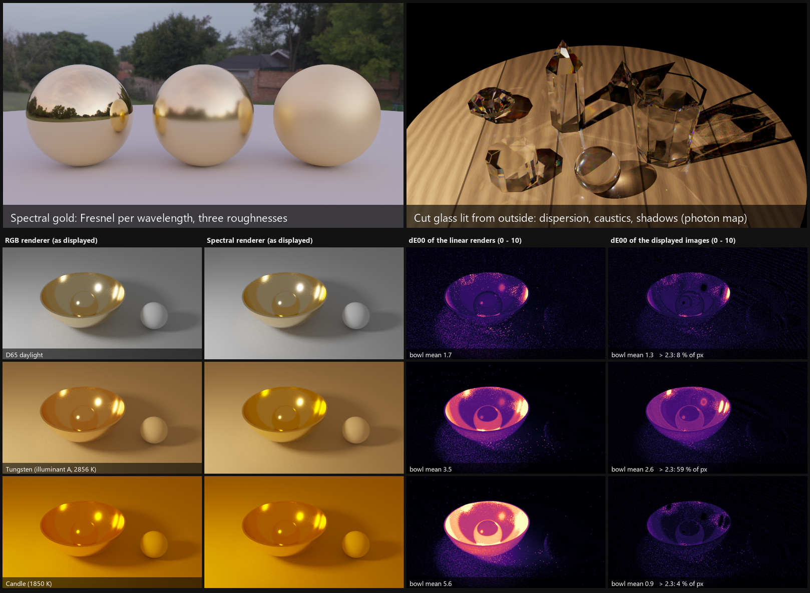
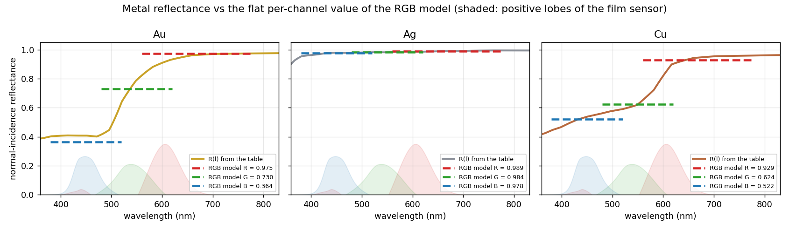
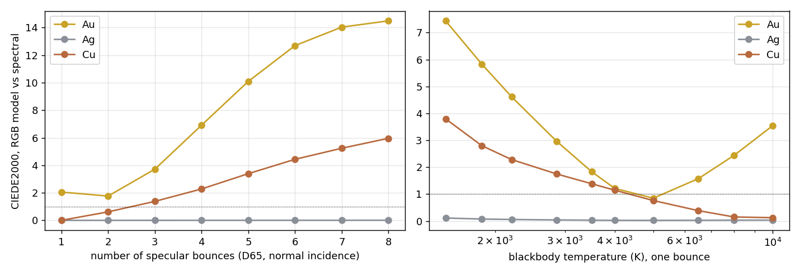
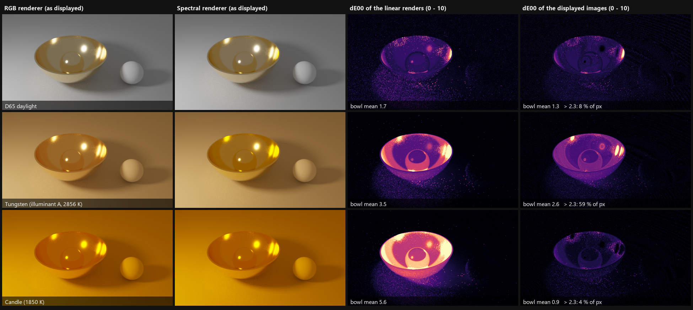
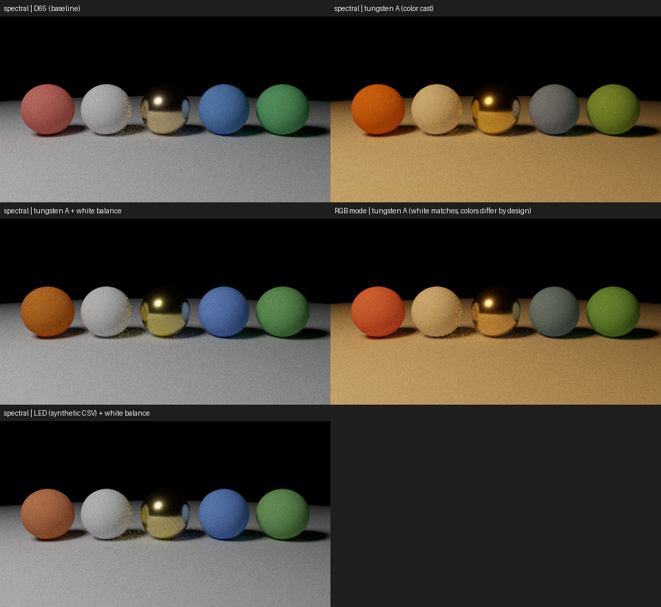
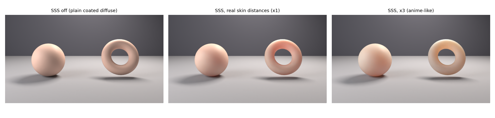
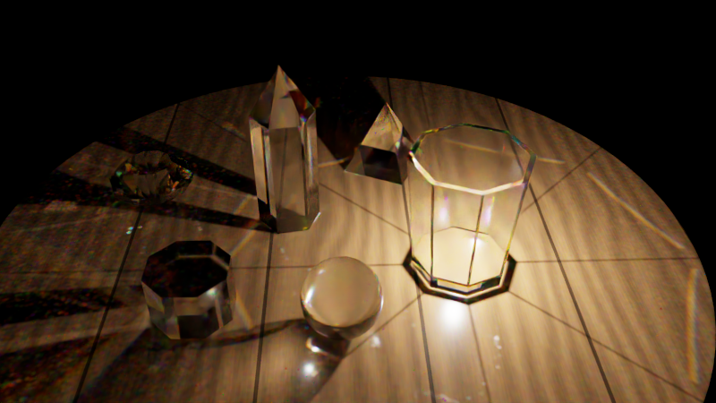
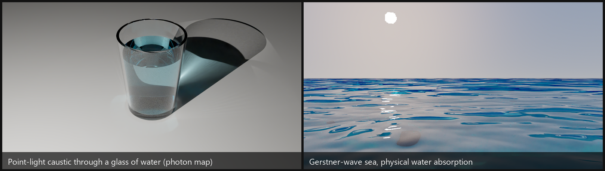
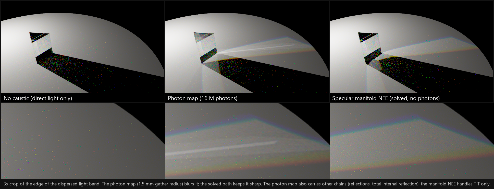

# GoLD_rayt



<sub>Top (spectral mode): gold spheres and cut glass with caustics. Bottom: the same gold bowl under three lights, RGB build vs
spectral build, and the color difference between them ([details](#how-much-does-rgb-rendering-get-wrong-for-metals)).</sub>

A 3D path tracer in C++20, built around **spectral rendering of metals** (gold first).

**Background.** Built for the author's graduation research: gold was measured with a spectroradiometer (SR-5100) and the
color difference between RGB and spectral rendering was quantified with Mitsuba. This renderer repeats that study in its
own code and aims at a **perceptually based renderer**. Besides metals it has dispersion and caustics, water, and MMD
characters with skin subsurface scattering.

> Windows / Visual Studio 2022 / x64 / CPU only. Readability and tests are preferred over raw speed.

## How much does RGB rendering get wrong for metals?

Both modes are the same engine with the same optical constants (Johnson & Christy), chosen at compile time
(`RenderMode.hpp`), so the difference is only the RGB approximation. The reference is a 1 nm integral of
`Fresnel(λ, θ)^n x light x film sensor` ([`tools/metal_accuracy.py`](tools/metal_accuracy.py)); the engine matches it
within ΔE00 0.12 (`--scene metalprobe`). The metric is CIEDE2000 (ΔE00: about 1 is visible side by side, 2-3 obvious).
These are comparisons between two renderings, not with a photograph.

| ΔE00, RGB vs spectral | Gold (Au) | Copper (Cu) | Silver (Ag) |
|---|---|---|---|
| D65 light, one reflection, all angles | 0.2 - **2.1** | 0.0 - 0.3 | 0.00 |
| other lights (tungsten A, candle, LED), one reflection | **2 - 6** | 1.8 - 2.8 | <= 0.07 |
| D65, metal reflecting metal 3 / 4 / 6 times | **3.7 / 6.9 / 12.7** | 1.4 / 2.3 / 4.4 | <= 0.01 |





- **Silver**: RGB is enough; its reflectance is flat.
- **Gold is the worst case.** Its red under D65 is 1.036 in the spectral render, but an `(eta, k)` Fresnel model cannot
  exceed 1, so RGB is about 6 % low in red. The error grows with a non-D65 light and with repeated reflections.
- The incidence angle is not the main cause (tested and rejected).
- **Rough metals** add error through the multiple-scattering color: gold under tungsten goes from 3.0 (smooth) to 6.3
  (roughness 1.0). A prototype that builds that color from the spectrum (not merged) helps for D65 but not for other lights.
- **Rule of thumb**: RGB for previews and D65 scenes; spectral when the light is not D65 or the metal is the subject.
  In a Release build spectral is about as fast.

**As a picture.** A gold bowl with a gold ball in it, a white ball and a gray floor, under one sphere light
(`--scene goldbowl --light d65|tungsten|candle`), rendered by both builds (256 spp, two renders averaged, no denoiser). The
renders are saved as linear float (`--out x.pfm`), so the difference is measured on the linear images and on the
displayed images (Reinhard, sRGB, clipped to the display range).



| Light | ΔE00, linear renders (mean) | ΔE00, displayed images (mean) | Displayed pixels with ΔE00 > 2.3 |
|---|---|---|---|
| D65 daylight | 1.7 | 1.3 | 8 % |
| Tungsten (illuminant A) | 3.5 | **2.6** | **59 %** |
| Candle (1850 K) | **5.6** | 0.9 | 4 % |

- **Tungsten**: the difference is visible on screen. The spectral gold is yellower and more saturated.
- **D65**: small, in the bright highlights.
- **Candle**: the largest measured difference and the smallest displayed one. A 1850 K blackbody is outside the sRGB
  gamut; the spectral render gives the gold a clearly negative blue, the RGB render almost none, and the display clips
  both to 0. The engine agrees with the 1 nm integral here, so this is the error of the RGB model. Whether real gold
  under a candle looks different from this screen was not tested (no gamut mapping or wide-gamut output).

Numbers: [`gold_compare_linear_results.txt`](docs/gold_compare_linear_results.txt). Scripts:
[`gold_compare_linear.py`](tools/gold_compare_linear.py), [`gold_compare_linear_fig.py`](tools/gold_compare_linear_fig.py).
(An earlier comparison on displayed PNGs only showed candle as the smallest difference, 0.8; that was the clipping.)

**Limits.** Kulla-Conty is an approximation (the true color of a rough metal was not compared); polarization and thin films
are not modeled; the Johnson & Christy tables are taken as truth; noise at equal render time was not compared.

Write-up with all tables (Japanese): [`docs/METAL_ACCURACY.md`](docs/METAL_ACCURACY.md). Raw outputs:
[`metal_accuracy_results.txt`](docs/metal_accuracy_results.txt), [`metal_probe_compare.txt`](docs/metal_probe_compare.txt),
[`metal_probe_rough_compare.txt`](docs/metal_probe_rough_compare.txt). Reproduce:

```bash
python tools/metal_accuracy.py --true-cmf --figs docs/img > docs/metal_accuracy_results.txt
```

## Aurisidus

> **Aurisidus** is a coined term derived from Latin
> *aurum* (**gold**) and *sidus* (**star**),
> representing the study of **gold-like metallic appearance** as a
> **structured, directional, and spectral phenomenon**,
> analogous to **stellar radiance**.

---

## Contents

0. [RGB vs spectral error for metals](#how-much-does-rgb-rendering-get-wrong-for-metals)
1. [Metals and spectral rendering](#1-metals-and-spectral-rendering) (the main topic)
2. [Quick start](#2-quick-start)
3. [The renderer in general](#3-the-renderer-in-general)
4. [Character rendering (hobby)](#4-character-rendering-hobby)
5. [How it works](#5-how-it-works)
6. [Verification](#6-verification)
7. [What could come next](#7-what-could-come-next)
8. [Gallery](#8-gallery)
9. [Third-party code and data](#9-third-party-code-and-data)

---

## 1. Metals and spectral rendering

The color of a metal comes from how its complex refractive index `n(λ) + i k(λ)` changes with wavelength. Gold is yellow
because its reflectance drops sharply below ~550 nm. An RGB renderer approximates that with three numbers; this one can
carry the wavelength itself.

### What it does

| Piece | How |
|---|---|
| **Wavelengths** | 4 per camera path (hero-wavelength sampling as in PBRT v4), stratified over 360-830 nm, importance-sampled by visual sensitivity. |
| **Optical constants** | Complex IOR tables `n(λ)`, `k(λ)` from CSV (RefractiveIndex.info blocks, 3-column or separate `n` / `k` files; nm, µm or eV). Johnson & Christy data for **Au, Ag, Cu** are in `assets/Metal_data/`. |
| **Measured reflectance** | A curve `R(λ)` (CSV, percent or fraction) is converted to `(n, k)` with Gulbrandsen's method including the edge tint. Normal-incidence color is exact; against the Johnson tables the Fresnel error is <= 0.013 at 45° and grows toward grazing angles. |
| **Fresnel** | Conductor Fresnel per wavelength on every bounce. |
| **Roughness** | GGX microfacets (isotropic or anisotropic), VNDF sampling. |
| **Multiple scattering** | Kulla-Conty compensation: a perfect conductor keeps an albedo of ~1.0 at every roughness (single scattering alone gives 0.92 / 0.56 / 0.31 at roughness 0.5 / 0.8 / 1.0). `--no-ms` switches it off. |
| **Film** | CIE 1931 color matching functions (analytic multi-lobe fit) to XYZ, then linear sRGB. |
| **Lights** | `RGB x D65`, a blackbody (any temperature), CIE illuminant A, or an SPD from CSV. Optional white balance (`--wb`). Environment maps and RGB albedos are upsampled to spectra (white is exact). |
| **Glass dispersion** | Cauchy `n(λ)` from the refractive index and Abbe number; a dispersive path continues with one wavelength. |

### Spectral vs RGB

A one-line compile-time switch in [`GoLD_rayt/include/Core/RenderMode.hpp`](GoLD_rayt/include/Core/RenderMode.hpp);
rebuild everything after changing it:

```cpp
#define RAYT_ENABLE_SPECTRAL 0   // 0 = RGB (default), 1 = spectral
```

In RGB mode the metal table is reduced to an RGB `(eta, k)` with the color matching functions, so both modes render the
same table. In a furnace test they agree within ~0.5 %. Release speed is about the same; Debug is ~3x slower in spectral
mode. The study of the difference is [above](#how-much-does-rgb-rendering-get-wrong-for-metals).

**The color of the light** (`--scene spd --light d65|tungsten|led`, `--wb` = white balance): five colored spheres and a gold
one under one sphere light. In spectral mode the whole scene takes the color of the light and the spheres change by
different amounts; white balance restores the neutral surfaces but not the colors. RGB mode (middle right) matches the
white but not the colors.



### Try it

Run from the project folder `GoLD_rayt/` (assets are loaded by relative path):

```bat
GoLD_rayt.exe --scene gold      --width 800 --spp 256 --out gold.png      :: three gold spheres, three roughnesses
GoLD_rayt.exe --scene goldrough --out goldrough.png                       :: rough gold, --no-ms to compare
GoLD_rayt.exe --scene spd --light tungsten --wb --out spd.png             :: metamerism under other light spectra
GoLD_rayt.exe --scene glass --abbe 6 --out dispersion.png                 :: dispersive glass (spectral mode)
GoLD_rayt.exe --scene metals                                              :: metal data tests, no image
```

### Not done (metals)

Sellmeier presets, Lorentz-Drude / multi-angle fitting, per-wavelength edge tint, thin-film interference, a better
RGB-to-spectrum upsampling (Jakob-Hanika), polarization, multiple-scattering compensation for rough dielectrics.

---

## 2. Quick start

Requirements: Windows 10/11 x64, **Visual Studio 2022** (v143), C++20, OpenMP, a CPU with **AVX2**. Libraries are bundled
(see [section 9](#9-third-party-code-and-data)).

1. Open `GoLD_rayt.sln`.
2. **Debug | x64** builds the **command-line renderer** (`src/main_cli.cpp`); **Release | x64** builds the **GUI viewer**
   (`src/main_ui.cpp`).
3. Copy the DLLs next to the executable (`bin/` is not tracked by Git): Embree (`embree4.dll`, `tbb12.dll`,
   `tbbmalloc.dll` from `librarys/embree-4.4.0.x64.windows/bin/`), OpenImageDenoise (`OpenImageDenoise.dll`, `_core.dll`,
   `_device_cpu.dll` from `librarys/oidn-2.5.1.x64.windows/bin/`), and for the GUI `glfw3.dll` (from
   `GoLD_rayt/external/glfw-3.4.bin.WIN64/lib-vc2022/`).
4. Run from the project folder `GoLD_rayt/`.

> **Speed tip.** A Release CLI is about 5x faster than Debug. To build it, set `ExcludedFromBuild` of `main_cli.cpp` to
> `false` and of `main_ui.cpp` to `true` for `Release|x64` in `GoLD_rayt.vcxproj` (revert it for the GUI).

**Command line** (`GoLD_rayt.exe [options]`)

| Option | Meaning |
|---|---|
| `--scene NAME` | `gold`, `glass`, `goldrough`, `spd`, `studio`, `mesh`, `pmx`, or a test: `furnace`, `metals`, `lights`, `aov`, `sss`, `bench` |
| `--width N`, `--spp N`, `--depth N` | image width, samples per pixel, maximum path depth |
| `--env file.hdr` | environment map (`assets/env/*.hdr`) |
| `--out file` | `.png`/`.bmp`/`.jpg` (tone mapped), `.hdr` or `.pfm` (linear float; use `.pfm` to keep negative values) |
| `--accel own\|embree` | own SAH BVH or Embree, for single-material triangle meshes only |
| `--light-sampler uniform\|power\|spatial\|all` | how the next-event-estimation light is chosen (default `spatial`) |
| `--aov`, `--denoise` | write albedo / normal images; also write a denoised image (Intel OIDN) |

Speed on the author's PC (8 threads, Release, RGB): the gold scene at 800x450, 256 spp, depth 16 takes about 2 minutes.

---

## 3. The renderer in general

- **Path tracing** with next-event estimation, multiple importance sampling, Russian roulette, thin-lens camera.
- **Lights**: point, sphere, rectangle, emissive triangle meshes, HDR environment map (importance sampled). Selection:
  uniform, power, spatial importance (PBRT-style bounds), or all lights.
- **Materials**: Lambertian (textures, alpha cut-outs, translucent layers), `CoatedDiffuse` (diffuse under a GGX coat,
  optional metal blend and subsurface), `RoughConductor`, `Dielectric` (smooth or rough, dispersive), `DiffuseLight`.
- **Geometry**: spheres, rectangles, triangle meshes (OBJ, PMX). Own SAH BVH or **Embree**.
- **Denoising**: albedo and normal AOVs plus **Intel Open Image Denoise**. At 64 spp the result matches the error of about
  230-420 raw samples; fine texture (stocking weave, hair strands) gets a little softer.
- **GUI** (Release build): a Dear ImGui viewer with progressive accumulation. Choose the scene (gold or glass spheres),
  environment map, roughness, exposure, samples per frame; save the image. It renders in the mode `RenderMode.hpp` selects.
  It does not load characters or use SSS or the denoiser.

---

## 4. Character rendering (hobby)

Loading MMD characters is a side project that exercises the renderer on a hard asset. **No model is included**: put your
own `.pmx` models, `.vpd` poses and textures in `MMD_model/` (ignored by Git) and respect each model's terms of use.

- **PMX 2.0 / 2.1 loader**: vertices, faces, textures, materials, bones, morphs.
- **Posing**: bone hierarchy, grant bones, linear blend skinning, `.vpd` poses (IK is not solved; the FK values in a VPD
  already contain the result).
- **Expressions**: vertex, UV, material, bone and group morphs (`--expr name`).
- **Materials**: MMD's toon / sphere-map recipe is replaced by physically based shading chosen from the material names
  (hair, eyes, ornaments, skin). `--pmx-matte` turns this off.
- **Studio lighting** (`--pmx-studio`), looks `--studio-look default|warm|cool|dramatic|soft`.
- **Subsurface scattering** (`--sss`, `--sss-scale S`): a BSSRDF with Burley's normalized diffusion profile (3.7 / 1.4 /
  0.7 mm for R / G / B, times `S`). It shows in close-ups and costs about 1.7-2.4x the time of a face portrait; at
  full-body size it is nearly invisible.

```bat
GoLD_rayt.exe --scene pmx --pmx-index 4 --pose-index 0 --expr shy --pmx-yaw -25 --pmx-studio ^
              --pmx-zoom 4.0 --pmx-focus 0.79 --width 420 --spp 128 --sss --denoise --out face.png
```

Details: [docs/SSS.md](docs/SSS.md) (Japanese). A sphere and a torus with the same skin material (`--scene skindemo`): no
SSS, real distances, tripled distances.



Not done: IK, physics (hair, skirt), VMD motion, toon / outline, thin parts such as ears, a random-walk reference for the
SSS approximation.

---

## 5. How it works

```
                      +-----------------------------+
 scene (CLI / code)   |  Scene: primitives + lights |  BVH / Embree, LightSampler
                      +--------------+--------------+
                                     |
 Camera --ray--> PathIntegrator.Li ---+---> hit -> Material (eval / sample / pdf)
   |             - NEE + MIS               \-> next-event estimation toward a light
   |             - Russian roulette
   |             - 4 wavelengths per path
   v
 Film (linear RGB, per pixel average) --> [OIDN denoise] --> tone map --> PNG / HDR
```

- **One path, four wavelengths.** `Li()` follows one camera path; every value is a `Spectrum`: 4 wavelengths in spectral
  mode, an RGB triple in RGB mode (a compile-time type). The film converts the final spectrum to RGB.
- **Materials** implement `eval`, `sample` and `pdf`; the integrator does not need to know which one it hits.
- **Next-event estimation** picks one light with the `LightSampler`, samples it, and combines it with BSDF sampling through
  the power heuristic.
- **Subsurface scattering** is a path event: the integrator finds an exit point with probe rays
  (`Render/SubsurfaceProbe.hpp`) and continues from there.
- **Precision**: `Real` is `double`; Embree finds hits in float and the hit record is rebuilt in double.

**Source layout** (`GoLD_rayt/include`; `src` has the entry points)

| Folder | Contents |
|---|---|
| `Core/` | types, `Spectrum`, `SampledWavelengths`, sampling, Fresnel, `RenderMode.hpp` |
| `Color/` | spectral curves, CIE functions, illuminants, emission spectra, complex IOR tables, `R(λ)`-to-`(n,k)` |
| `Materials/` | Lambertian, CoatedDiffuse, RoughConductor, Dielectric, DiffuseLight, Subsurface |
| `Microfacet/` | GGX and the directional-albedo table for the multiple-scattering compensation |
| `Geometry/`, `Scene/`, `Accelerators/` | shapes, aggregate, SAH BVH, Embree wrapper |
| `Lights/` | point / area / environment lights, light samplers |
| `Render/` | camera, film, integrator, denoiser, subsurface probe |
| `IO/` | CSV, metal-data, HDR / image / OBJ / PMX / VPD loaders |
| `Application/`, `src/UI/` | the Dear ImGui viewer |

---

## 6. Verification

The CLI has self-checks that print `OK` / `FAIL` per case and exit with code 2 on failure. They run in RGB and spectral mode
(`--spp` scales the samples; use Release).

| Command | What it checks |
|---|---|
| `--scene furnace` | white-furnace energy: glass and white diffuse return 1.0, rough conductors match an independent integration |
| `--scene metals` | table units, reflectance-to-`(n,k)`, edge tint against Johnson, multiple scattering, `CoatedDiffuse` reciprocity |
| `--scene lights` | each light type against a closed form or numerical integral; light-selection strategies agree |
| `--scene mesh` | triangle geometry, OBJ round trip, BVH and Embree vs brute force, emissive triangles |
| `--scene aov` | the albedo / normal features of a camera path |
| `--scene sss` | the profile, a white furnace over skin, the profile across a shadow edge |
| `--scene bench` | BVH benchmark: recursive reference vs SAH BVH vs Embree |
| GUI build: `--selftest` | scripted check of the GUI features |

Bugs found this way (and fixed): refraction that never left a glass sphere, an unnormalized camera ray that made rough gold
~22 % too dark, area lights that were always shadowed at grazing angles, wrong MIS weights for area lights.

---

## 7. What could come next

- **Sampling**: adaptive sampling, low-discrepancy sequences, Embree for the PMX scene (needs per-triangle materials and
  alpha cut-outs).
- **Metals**: Sellmeier / Lorentz-Drude, thin films, spectral upsampling of saturated colors.
- **Characters**: VMD motion, IK, hair / skirt physics, better hair and cloth BSDFs.
- **Infrastructure**: a scene description file, a light tree, `ctest` integration.

---

## 8. Gallery

More renders from the same engine (CPU, OIDN-denoised). The color of light is under [Spectral vs RGB](#spectral-vs-rgb), the
skin under [Character rendering](#4-character-rendering-hobby).

**A lamp inside a cut-glass tumbler** (`--scene crystal --crystal-inside`, caustic photon map, eight photon sets averaged).
All the light on the table is caustic: sharp-edged polygons with colored rims from dispersion.



**Water** (photon map): a point-light caustic through a glass of water (`--scene water --water-lamp`) and a Gerstner-wave
sea with physical water absorption (`--scene sea`).



**A caustic through a prism** (`--scene manifold`): without caustics, with the photon map, and with *specular manifold NEE*
(a prototype that solves the refraction path instead of estimating it with photons). The solved path keeps the edge of
the dispersed band sharp; both agree within a few percent on the smooth parts (`--scene manifoldtest`).



**A character** (`--scene pmx --pmx-studio --sss`, [section 4](#4-character-rendering-hobby)): hair, eyes, metal ornaments
and skin with subsurface scattering, under studio lights.


<sub>Model: サンドローネ (Sandrone; miHoYo, modified by 观海), used according to the model's terms of use (no redistribution, no
commercial use): the model is not part of this repository, only these renderings are shown. Pose: アラベスクポーズ
by mototo=toto. These are rendering tests of this project and have no connection with the model's authors.</sub>

---

## 9. Third-party code and data

| Component | Use | License |
|---|---|---|
| [Embree](https://github.com/RenderKit/embree) 4.4.0 | ray tracing kernels | Apache-2.0 |
| [Open Image Denoise](https://github.com/RenderKit/oidn) 2.5.1 | denoising | Apache-2.0 |
| [GLFW](https://www.glfw.org/) 3.4, glad | GUI window and OpenGL loader | zlib / permissive |
| [Dear ImGui](https://github.com/ocornut/imgui) | GUI | MIT |
| [GLM](https://github.com/g-truc/glm), [Eigen](https://eigen.tuxfamily.org/) 3.4 | math | MIT / MPL-2.0 |
| [stb](https://github.com/nothings/stb) | image reading and writing | public domain / MIT |
| Johnson & Christy optical constants (Au, Ag, Cu) | `assets/Metal_data/` | published data, via RefractiveIndex.info |

Environment maps in `assets/env/` keep the licenses of their sources. MMD models are not distributed.
This repository does not have a license file of its own yet.
