# GoLD_rayt

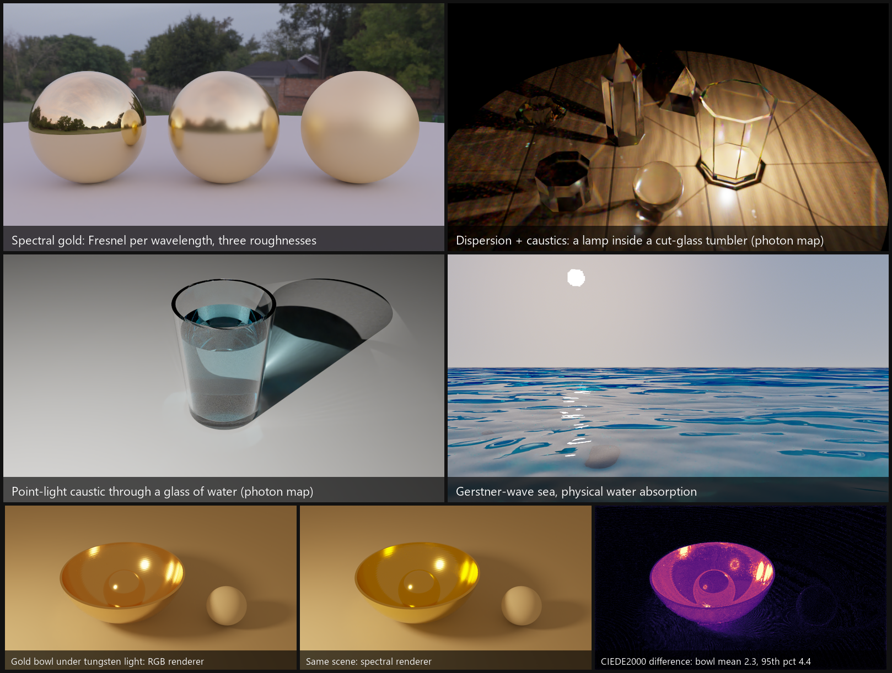

<sub>The same gold statue rendered by the RGB build and by the spectral build, under D65 daylight (top) and a tungsten lamp (bottom);
right: the CIEDE2000 color difference (mean 1.7 and 2.6, [numbers](docs/data/erato_gold_results.txt)). Under a warm light the RGB gold is
duller ([details](#how-much-does-rgb-rendering-get-wrong-for-metals)). Model: Erato by Geoffrey Marchal (© 2016,
[CC BY 4.0](https://creativecommons.org/licenses/by/4.0/)), a scan of the marble statue from Monte Calvo (Ny Carlsberg Glyptotek), from
[Morgan McGuire's Computer Graphics Archive](https://casual-effects.com/data/); scaled, normals recomputed, gold material; not part of
this repository ([credits](GoLD_rayt/assets/Meshes/erato/CREDITS.md)).</sub>

A spectral path tracer in C++20 for studying how materials look. It carries wavelengths instead of RGB through the scene, and its
results are checked against closed forms, measurements and Mitsuba 3.

It began with the author's graduation research, which measured gold with a spectroradiometer (SR-5100) and quantified how much RGB
rendering gets its color wrong. The renderer repeats that study in its own code and has grown into a simulator of material appearance:

- **Spectral light**: metals from measured optical constants, dispersion, thin-film interference, fluorescence from measured bispectral data.
- **Translucency**: scattering media (wax, marble, jade, fog, clouds with Mie scattering), subsurface scattering, skin with its relief,
  moisture and make-up, hair fibers.
- **Measured and captured materials**: spectral textures from a 2D spectroradiometer, measured BRDF tables, scans, 3D Gaussian Splatting.
- **Camera**: real lens prescriptions, physical exposure, a sensor with noise and a Bayer mosaic that writes a DNG raw file, polarization.
- **Verification**: a self-check for every feature, and a cross-check against Mitsuba 3.

> Windows / Visual Studio 2022 / x64 / CPU only. Readability and tests are preferred over raw speed.

> **Aurisidus** is a coined term derived from Latin
> *aurum* (**gold**) and *sidus* (**star**),
> representing the study of **gold-like metallic appearance** as a
> **structured, directional, and spectral phenomenon**,
> analogous to **stellar radiance**.

**Contents**:
[RGB vs spectral for metals](#how-much-does-rgb-rendering-get-wrong-for-metals) ·
[Gallery](#gallery) ·
[Captured objects](#captured-objects-and-3d-gaussian-splatting) ·
[The spectral engine](#the-spectral-engine) ·
[Quick start](#quick-start) ·
[Features](#features) ·
[Verification](#verification) ·
[Third-party code and data](#third-party-code-and-data) ·
[References](#references)

---

## How much does RGB rendering get wrong for metals?

Both builds are the same engine with the same optical constants (Johnson & Christy), so the difference is only the RGB approximation.
The reference is a 1 nm integral of `Fresnel(λ, θ)^n x light x film sensor`, which the engine matches within ΔE00 0.12
(CIEDE2000: about 1 is visible side by side, 2-3 obvious).

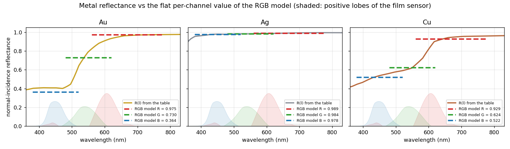

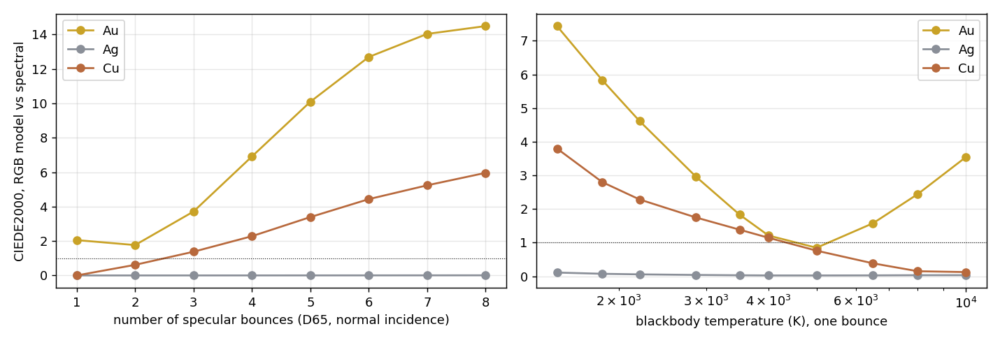

- **Silver**: RGB is enough; its reflectance is flat.
- **Gold is the worst case**: its reflectance rises steeply across the visible range, which three numbers cannot follow. The error grows
  with each reflection of metal in metal and the further the light is from daylight.
- **Rule of thumb**: RGB for previews and daylight scenes; spectral when the light is warm or colored, or the metal is the subject.

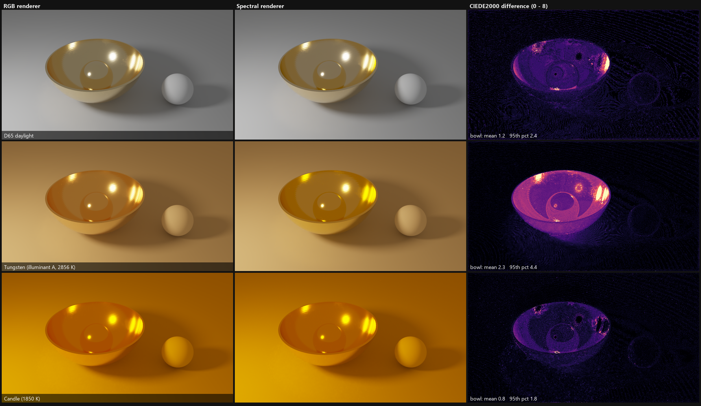

The same comparison as a picture (`--scene goldbowl`). Under tungsten the spectral gold is visibly yellower and more saturated. Under a
candle the difference is the largest of the three, but an sRGB screen hides it: both colors lie outside sRGB and are clipped alike; on a
Display P3 screen (`--gamut p3`) it shows. Write-up with all tables and the reasons: [docs/METAL_ACCURACY.md](docs/METAL_ACCURACY.md).

---

## Gallery

More renders from the same engine (CPU; OIDN-denoised unless noted). The statue in several of them is Erato by Geoffrey Marchal
(CC BY 4.0, see above); the scan is not part of this repository.

### What only a spectral renderer shows

**A soap bubble** (`scenes/soap_bubble_hdr.json`): thin-film interference per wavelength, with a film that thickens downward and swirls
([theory](docs/THIN_FILM.md)).

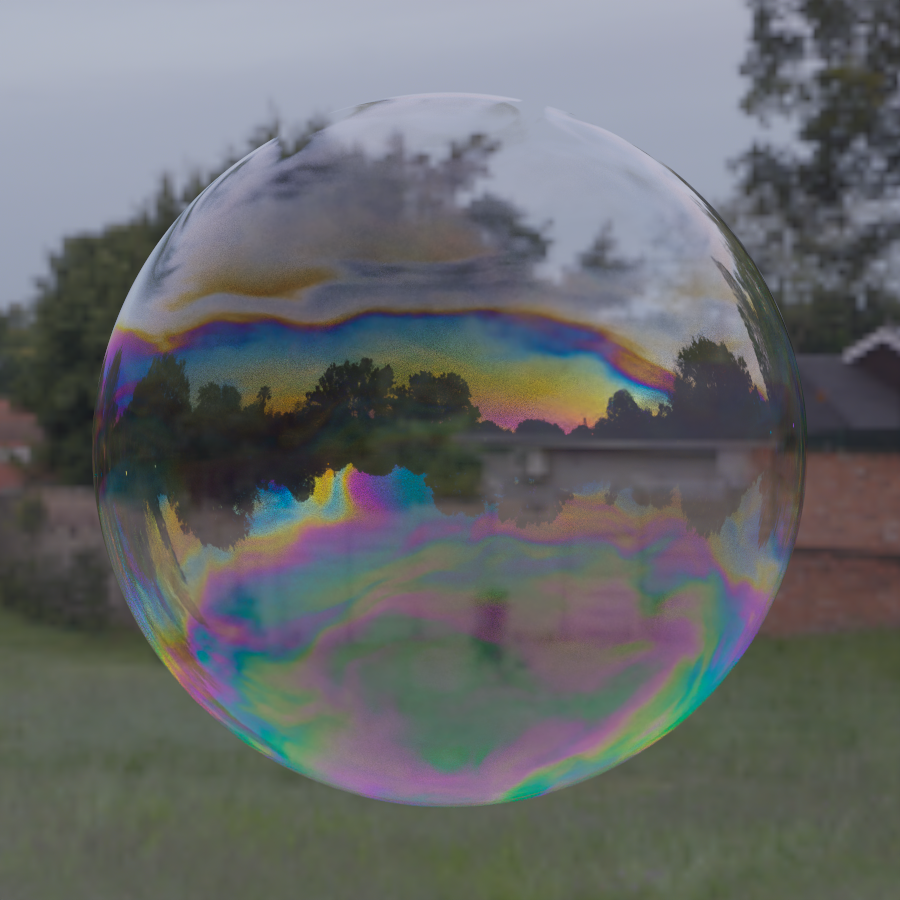

**A gold ring with a diamond** (`scenes/diamond_ring.json`): the dispersion of diamond splits the light inside the stone into colored fire.

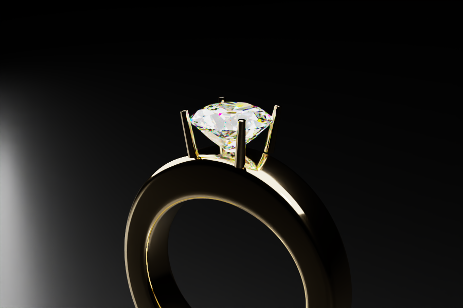

**A prism in fog** (`--lvc`): a beam through a dispersive prism fans out into a rainbow ([details](docs/LVC_BPT.md)).

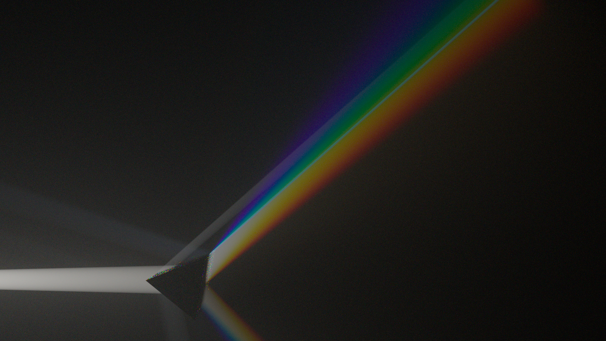

**Fluorescence**: measured samples under daylight, with the fluorescence switched off, and under a black light. Light absorbed at one
wavelength comes out at a longer one ([details](docs/FLUORESCENCE.md)).

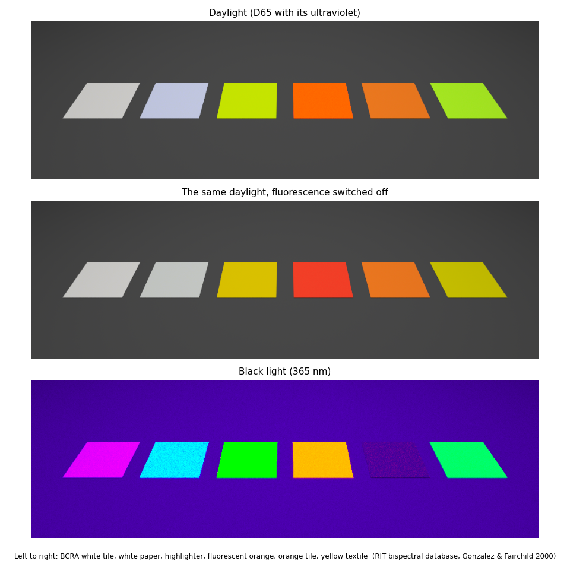

**The color of the light** (`--scene spd --light d65|tungsten|led`): colored spheres and gold under three lights. White balance (`--wb`)
restores the white but not the colors, and the RGB build gets the white right but not the colors.

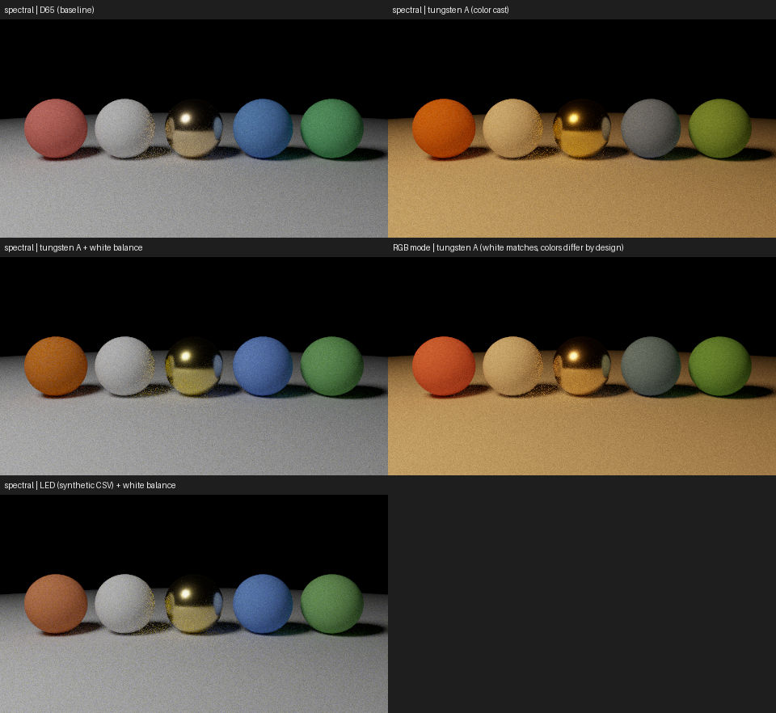

### Materials

**Three translucent materials, one statue** (`scenes/erato_translucent.json`): wax, marble and jade, lit from behind. Light scatters
inside the volume, so thin parts such as the drapery and the lyre glow.

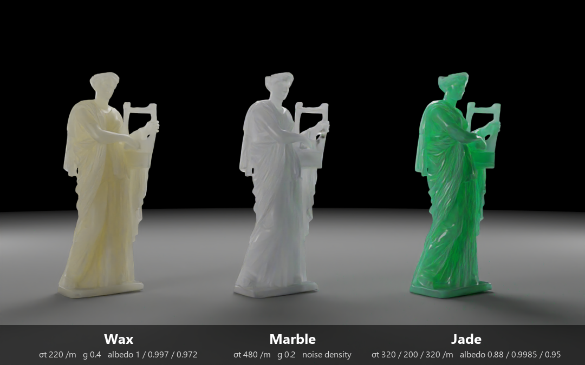

**Hair** (`scenes/hair_colors.json`, `scenes/hair_head.json`): each fiber scatters light by its own model, and the color comes from
melanin alone ([details](docs/HAIR.md)).

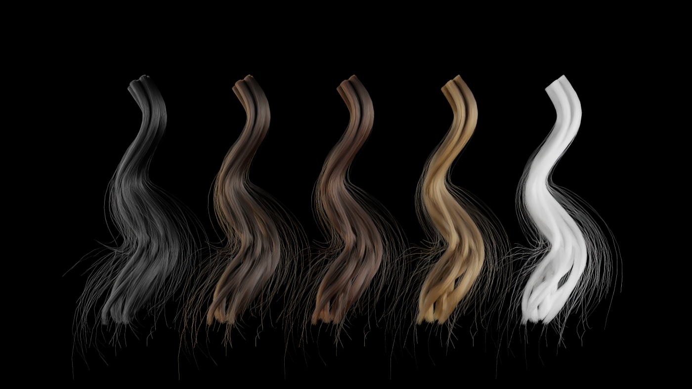

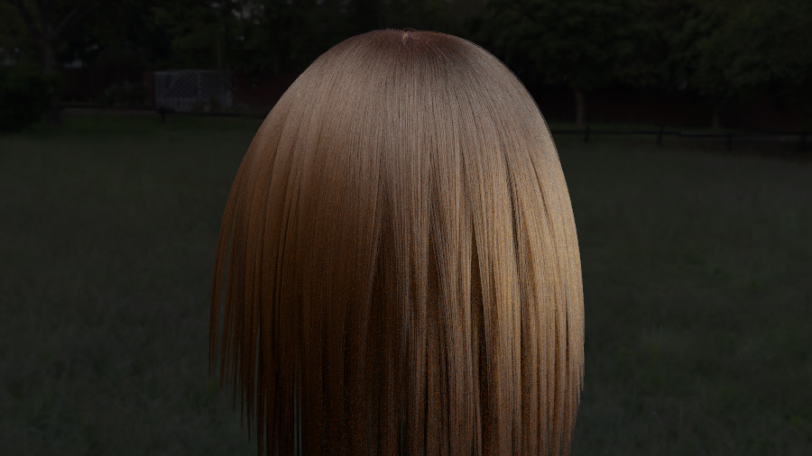

**Skin, dry and moist** (`scenes/skin_lamp_dry.json`, `scenes/skin_lamp_wet.json`): generated furrows and pores; water fills them and
sharpens the glint. Below: a lotion and an emulsion over an hour ([details](docs/SKIN_MOISTURE.md)).

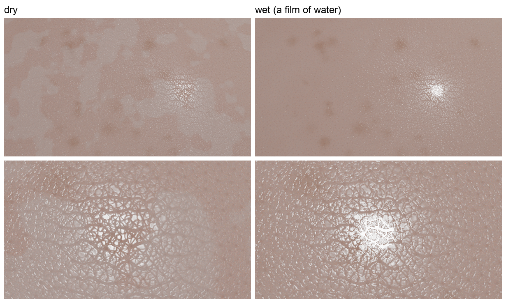

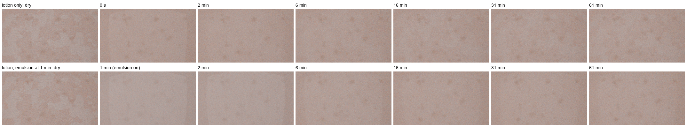

**Measured leather**: cowhide measured with a 2D spectroradiometer becomes a spectral texture with a relief; right, under a satin clear
coat ([details](docs/GLOSS.md)). Below, gilt leather: gold leaf (left) and silver leaf under a yellow varnish (right) look alike in daylight
and under a lamp.

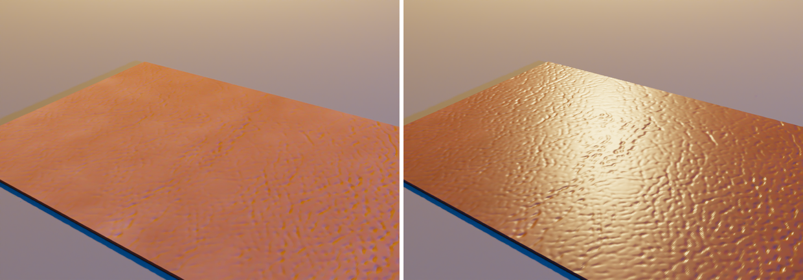

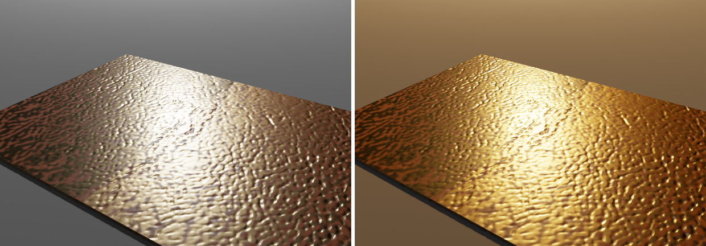

**Faded paper under an LED mix**: dye papers measured as they faded under simulated sunlight (a lab measurement, not in this repository);
a mat kept the border of each sheet at its first color.

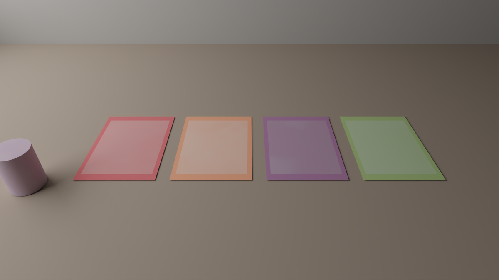

**A glass ball in haze** (`--lvc`): the ball focuses a beam into a cone of light ([details](docs/LVC_BPT.md)).

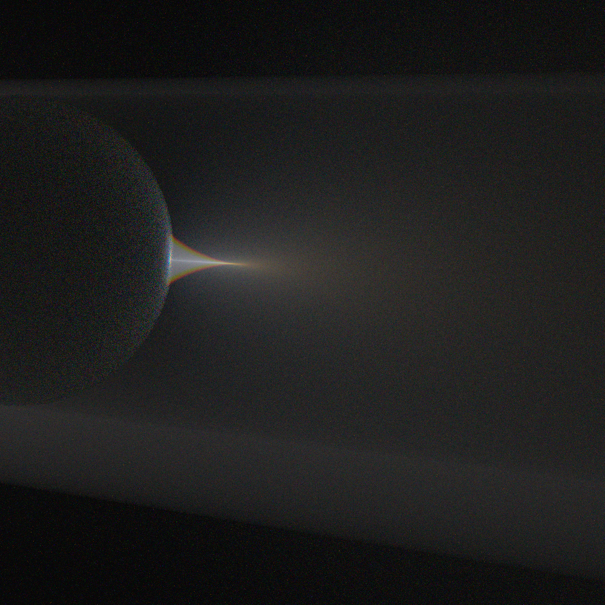

### Camera

**Depth of field** (`scenes/bokeh_layers.json`): a 100 mm lens at f/1.6 with seven blades; distant lights become heptagons.


**Four lenses** (`scenes/lens_chess_*.json`): one chess position through four real lens designs traced surface by surface: a fisheye,
a 50 mm double-Gauss at f/2 and at f/16 (diffraction stars), and an uncorrected single lens with color fringes.

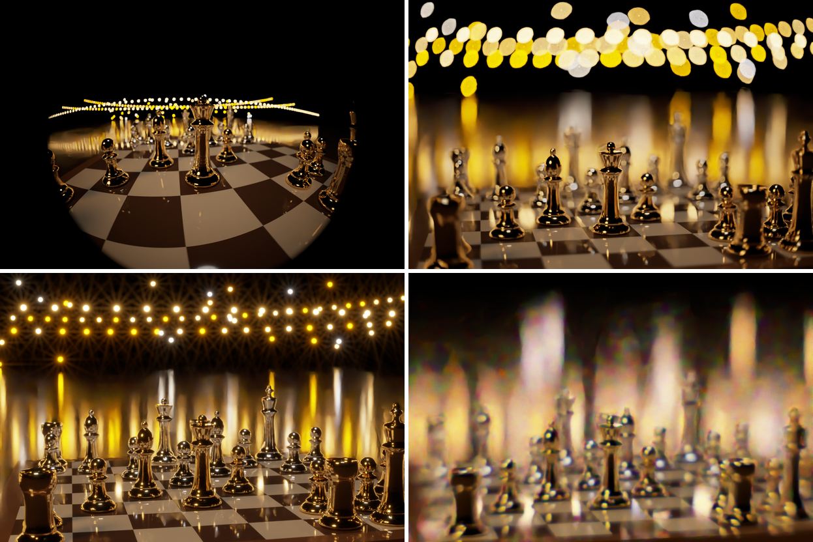

---

## Captured objects and 3D Gaussian Splatting

A scanned mesh can be shown as photographed or given any material of the renderer, and a 3D Gaussian Splatting point cloud is ray-traced
directly, so a glass ball placed in it reflects the captured room ([details](docs/CAPTURE.md)).

**Relighting a reconstruction.** A statue rendered as an opaque material and as thin wax was reconstructed with a relightable Gaussian
Splatting method and lit by new lights. The opaque statue comes back close to the truth; the wax does not: the reconstruction bakes the
scattering into a surface with 2.4 to 3.7 times the contrast, as Dihlmann et al. (NeurIPS 2024) report for subsurface scattering.

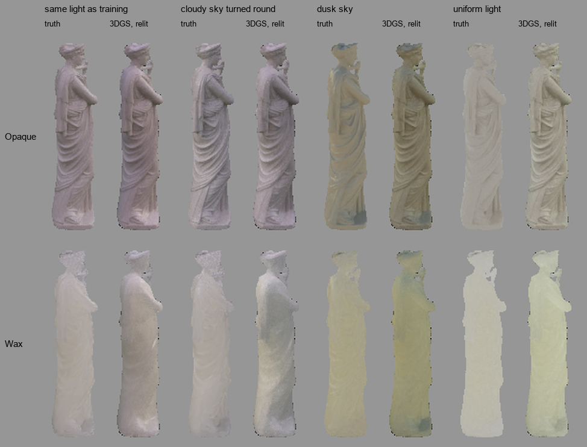

---

## The spectral engine

- **Wavelengths**: four per camera path (hero-wavelength sampling), 360-830 nm; a dispersive surface reduces the path to one.
- **Materials as spectra**: complex refractive indices `n(λ) + i k(λ)` from tables (Johnson & Christy for Au, Ag, Cu), a measured
  reflectance converted to `(n, k)`, reflectance spectra and spectral textures, bispectral matrices for fluorescence.
- **Lights as spectra**: D65 (also with its ultraviolet), blackbodies, measured spectra and mixes of them.
- **Film**: the CIE 1931 observer, or a given camera's sensitivities; output in sRGB, Display P3 or Rec.2020.
- **RGB build**: a one-line compile-time switch ([`RenderMode.hpp`](GoLD_rayt/include/Core/RenderMode.hpp)); spectral tables are reduced
  to RGB, so both builds render the same data.

---

## Quick start

Requirements: Windows 10/11 x64, **Visual Studio 2022** (v143), C++20, OpenMP, a CPU with **AVX2**.

1. `powershell -ExecutionPolicy Bypass -File tools\fetch_deps.ps1` downloads the third-party libraries (about 0.7 GB).
2. `powershell -ExecutionPolicy Bypass -File tools\build_cli.ps1` builds the command-line renderer into `out\cli` (`-Spectral` for the
   spectral build, `-Dev` for quick rebuilds). `GoLD_rayt.sln` also has a GUI viewer (Release | x64).
3. Run from the project folder `GoLD_rayt/` (assets are loaded by relative path):

```bat
GoLD_rayt.exe scenes\gold_bowl_tungsten.json --spp 64 --out bowl.png   :: a scene file; options after it win over the file
GoLD_rayt.exe --scene goldbowl --light candle --out candle.png          :: a built-in scene (--list-scenes)
GoLD_rayt.exe --scene metals                                            :: a self-check, no image
```

A scene file describes materials, shapes, meshes, lights and the camera as JSON ([docs/SCENE_FILE.md](docs/SCENE_FILE.md)).
Main options (`--help` lists all):

| Option | Meaning |
|---|---|
| `--width N`, `--spp N`, `--seed N` | image width, samples per pixel, a fixed seed (the same picture again) |
| `--out file` | `.png` / `.jpg` (tone mapped), `.pfm` / `.hdr` (linear) |
| `--denoise`, `--aov` | also a denoised image (Intel OIDN), albedo and normal images |
| `--gamut srgb\|p3\|rec2020`, `--bits 16` | output primaries (the PNG is tagged), 16-bit PNG |
| `--lens FILE`, `--focal-length`, `--fstop` | a real lens traced surface by surface, or a thin lens |
| `--iso S --nits K` | physical exposure from the f-number, the shutter and the ISO speed |
| `--sensor`, `--camera-response FILE`, `--wb`, `--awb` | a camera sensor (noise, Bayer mosaic, a DNG raw file), a camera's sensitivities, white balance |
| `--stokes`, `--polarizer A,B` | Stokes images, images behind a polarizing filter |
| `--lvc` | bidirectional path tracing with cached light paths (beams and caustics in fog) |

---

## Features

- **Path tracing** with next-event estimation, multiple importance sampling and Russian roulette; Embree or an own SAH BVH; Intel OIDN.
- **Materials**: diffuse, rough and anisotropic metals with multiple-scattering compensation, rough and dispersive glass, thin films,
  layered clear coats, measured BRDF tables (hpBRDF), fluorescent surfaces, a mix of two materials by a mask, hair fibers, skin
  (relief, pigment, oily and dry patches, water, lotion, foundation: [skin](docs/SKIN.md), [make-up](docs/COSMETICS.md)), fading dyes.
- **Translucency**: scattering media with colored coefficients and noise densities, tabulated phase functions (Mie), subsurface
  scattering by a profile or a random walk ([details](docs/SSS.md)).
- **Geometry**: spheres, rectangles, triangle meshes (OBJ, PLY, STL, PMX), surfaces of revolution, an ocean from a wave spectrum
  ([details](docs/WATER.md)), hair curves, 3D Gaussian Splatting point clouds.
- **Camera** ([details](docs/CAMERA.md)): thin lens with polygonal aperture, real lens prescriptions with the glasses of their patents,
  aberrations, vignetting, diffraction, motion blur, an orthographic view, physical exposure, a camera's spectral sensitivities, a sensor
  model (shot and read noise, ISO, ADC, Bayer mosaic and demosaicing) that writes a DNG raw file, white balance and auto white balance.
- **Polarization**: Stokes vectors through glass, water, metals and thin films, and a polarized clear sky ([details](docs/POLARIZATION.md)).
- **Light transport**: caustic photon map, manifold next-event estimation, bidirectional path tracing with vertex merging ([details](docs/LVC_BPT.md)).

How the code is organized: [docs/ARCHITECTURE.md](docs/ARCHITECTURE.md).

---

## Verification

Every feature has a self-check (`--scene furnace`, `metals`, `lights`, `volume`, `fluorescence`, `hair`, `polarization`, `film`, ...;
`--list-scenes` lists them all) that compares the renderer with closed forms, independent integrations or white furnaces, prints
`OK` / `FAIL` per case and runs in both builds.

Cross-checked against Mitsuba 3 on 23 scenes, RGB and spectral (diffuse, glass, rough metal, measured gold, scattering media):
they agree within the noise, and the one bug it found (rough glass ~0.5 % too bright) is fixed ([details](docs/MITSUBA_CHECK.md)).

Bugs found this way (and fixed): refraction that never left a glass sphere, an unnormalized camera ray that made rough gold
~22 % too dark, area lights that were always shadowed at grazing angles, wrong MIS weights for area lights, rough glass that
counted back-facing microfacets.

---

## Third-party code and data

These are **not included in the repository**: `tools/fetch_deps.ps1` downloads them, and each keeps its own license.

| Component | Use | License |
|---|---|---|
| [Embree](https://github.com/RenderKit/embree) 4.4.0 | ray tracing kernels | Apache-2.0 |
| [Open Image Denoise](https://github.com/RenderKit/oidn) 2.5.1 | denoising | Apache-2.0 |
| [GLFW](https://www.glfw.org/) 3.4 | GUI window | zlib |
| [Dear ImGui](https://github.com/ocornut/imgui) (docking branch) | GUI | MIT |
| [GLM](https://github.com/g-truc/glm) | math | MIT |
| [stb](https://github.com/nothings/stb) | image reading and writing | public domain / MIT |
| [nlohmann/json](https://github.com/nlohmann/json) 3.11.3 | scene files | MIT |
| [glad](https://github.com/Dav1dde/glad) 0.1.36 (generated loader, 3 files in `GoLD_rayt/external/glad/`) | OpenGL loader | generated code; `khrplatform.h` is Khronos (MIT) |
| Erato 3D scan by Geoffrey Marchal, via [casual-effects.com/data](https://casual-effects.com/data/) | the statue figures; the scan is not in the repository | CC BY 4.0 |
| Johnson & Christy optical constants (Au, Ag, Cu) | `assets/Metal_data/` | published data, via RefractiveIndex.info |
| RIT bispectral database (Gonzalez & Fairchild 2000) | the fluorescence figure; `tools/data/rit_bispectral.py` downloads it | no license stated; not redistributed |

Environment map: `assets/env/bryanston_park_sunrise_2k.hdr` (Poly Haven, CC0). MMD models are not distributed.

**License of this repository.** The code and the documentation are under the [MIT License](LICENSE) (Copyright (c) 2025-2026 So Kohinata). The images in `docs/img/` are renderings and are not covered by it.

---

## References

Selected works that the code implements or follows. The full list, with what each is used for, is in [docs/REFERENCES.md](docs/REFERENCES.md).

- M. Pharr, W. Jakob, G. Humphreys, *Physically Based Rendering: From Theory to Implementation*, 4th ed., MIT Press, 2023 (3rd ed., 2016). The overall design; the
  hero-wavelength walk through a medium (v4), light sampling, the dielectric BSDF, the probe-ray BSSRDF sampling (v3). [pbr-book.org](https://pbr-book.org)
- A. Wilkie, S. Nawaz, M. Droske, A. Weidlich, J. Hanika, "Hero Wavelength Spectral Sampling", *Computer Graphics Forum* 33(4), 2014. Four stratified wavelengths per path.
- E. Veach, L. J. Guibas, "Optimally Combining Sampling Techniques for Monte Carlo Rendering", SIGGRAPH 1995. Multiple importance sampling everywhere (next event estimation, strategies of the bidirectional estimator).
- I. Wald, S. Woop, C. Benthin, G. Johnson, M. Ernst, "Embree: A Kernel Framework for Efficient CPU Ray Tracing", *ACM TOG* 33(4), 2014. The Embree backend.
- P. B. Johnson, R. W. Christy, "Optical Constants of the Noble Metals", *Physical Review B* 6(12), 1972. The `n(λ)`, `k(λ)` of Au, Ag and Cu.
- O. Gulbrandsen, "Artist Friendly Metallic Fresnel", *JCGT* 3(4), 2014. A measured reflectance `R(λ)` to `(n, k)`, with the edge tint.
- E. Heitz, "Understanding the Masking-Shadowing Function in Microfacet-Based BRDFs", *JCGT* 3(2), 2014; "Sampling the GGX Distribution of Visible Normals", *JCGT* 7(4), 2018. GGX and VNDF sampling.
- S. Gonzalez, M. D. Fairchild, "Evaluation of bispectral spectrophotometry for accurate colorimetry of printing materials", Color Imaging Conference 2000. The bispectral database of the fluorescence figure.
- W. Jakob, S. Speierer, N. Roussel, M. Nimier-David, D. Vicini, T. Zeltner, B. Nicolet, M. Crespo, V. Leroy, Z. Zhang, *Mitsuba 3 renderer*, 2022, [mitsuba-renderer.org](https://www.mitsuba-renderer.org). The RGB-vs-spectral study of the graduation research was done with it, and the renderer is cross-checked against it.
- J. Gao, C. Gu, Y. Lin, H. Zhu, X. Cao, L. Zhang, Y. Yao, "Relightable 3D Gaussian: Real-time Point Cloud Relighting with BRDF Decomposition and Ray Tracing", arXiv:2311.16043, 2023. The relightable reconstruction that the lighting study trains and relights.
- J.-N. Dihlmann, A. Majumdar, A. Engelhardt, R. Braun, H. P. A. Lensch, "Subsurface Scattering for 3D Gaussian Splatting", NeurIPS 2024 (arXiv:2408.12282). Reports that a relightable reconstruction bakes the subsurface scattering of translucent objects into the surface color.
