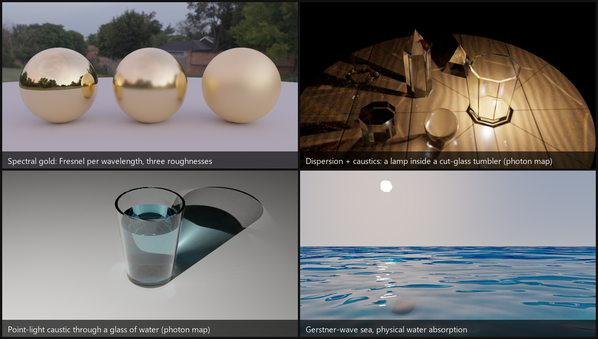

# GoLD_rayt



<sub>All four images were rendered by this project on the CPU in spectral mode (OIDN-denoised): gold spheres
(`--scene gold`), a lamp inside a cut-glass tumbler (`--scene crystal --crystal-inside`), a glass of water lit by a
point light (`--scene water --water-lamp`), and a Gerstner-wave sea (`--scene sea`). The caustics use a photon map.</sub>

A 3D path tracer built from scratch in C++20 as a **graduation thesis project on the appearance of metals**:
**spectral rendering of metals** (gold first) and a **quantitative comparison of that against RGB rendering**
(see the [thesis summary](#thesis-summary-how-much-does-rgb-rendering-get-wrong-for-metals) below). A side
project renders MMD characters (skin subsurface scattering, posing, expressions) as a hard test asset.

> Windows / Visual Studio 2022 / x64 / CPU only. The code favors readability and verification (every major
> piece has a numerical test) over raw speed.

## Thesis summary: how much does RGB rendering get wrong for metals?

The question: *how far is an RGB renderer from a spectral one for gold, copper and silver, and why?* Both
modes are the same engine with the same optical constants (Johnson & Christy tables), switched at compile time
(`RenderMode.hpp`), so the difference is only the RGB approximation.

**Method.** The reference is a 1 nm integration of `Fresnel(λ, θ)^n x light spectrum x film sensor`. The RGB
model is the engine's own RGB reduction of the tables. The metric is CIEDE2000 (ΔE00; about 1 is "visible side
by side", 2-3 "obviously different"). The Python model ([`tools/metal_accuracy.py`](tools/metal_accuracy.py))
was checked against the real engine with a probe scene (`--scene metalprobe`, both builds): the RGB build matches
the RGB model within ΔE00 0.07 and the spectral build matches the 1 nm integral within 0.12 (angles below 80°;
one 32-pixel bin of silver under D65 reaches 0.45, which is color noise).

**Result** (ΔE00, RGB vs spectral):

| Condition | Gold (Au) | Copper (Cu) | Silver (Ag) |
|---|---|---|---|
| D65 light, one reflection, all angles | 0.2 - **2.1** | 0.0 - 0.3 | 0.00 |
| other lights (tungsten A, candle, LED), one reflection | **2 - 6** | 1.8 - 2.8 | <= 0.07 |
| D65, metal reflecting metal 3 / 4 / 6 times | **3.7 / 6.9 / 12.7** | 1.4 / 2.3 / 4.4 | <= 0.01 |


- **Silver**: RGB is enough; its reflectance is flat over the visible range.
- **Gold is the worst case.** Its spectral red value under D65 is 1.036 (above 1, because the sRGB red sensor
  has a negative lobe in the blue-green where gold reflects little). A Fresnel `(eta, k)` model cannot exceed 1,
  so the reduction clamps it to 0.975: red is about 6 % low (ΔE00 2.1). The error grows when the light is not
  D65 (the RGB model fixes each channel's reflectance under D65) and when reflections accumulate (`F(λ)^n`
  sharpens the spectrum).
- **Incidence angle is not the main cause.** The hypothesis that RGB fails at grazing angles was tested and
  rejected for these three metals.
- **Rough metals** (multiple-scattering term): gold under tungsten light grows from 3.0 (smooth) to 6.3 at
  roughness 1.0, and copper under D65 from 0.1 to 1.1. A prototype that builds the multiple-scattering color from
  the spectrum (not merged) reduced the D65 cases (copper 1.09 to 0.11, gold 1.55 to 0.53), but errors from a
  non-D65 light cannot be fixed inside an RGB renderer.
- **Practical rule**: use the RGB build for previews and D65 scenes; use the spectral build when the light is
  not D65 or the metal itself is the subject. In a Release build the spectral mode is about as fast.

**Limits.** The Kulla-Conty multiple-scattering compensation is itself an approximation (the true color of a
rough metal was not compared); polarization, thin films and the error of the optical-constant tables are not
modeled (the Johnson & Christy tables are taken as the truth); all values are converged expectations, so noise
at equal render time is not compared.

Full write-up with all tables (Japanese): [`docs/METAL_ACCURACY.md`](docs/METAL_ACCURACY.md). Raw outputs:
[`metal_accuracy_results.txt`](docs/metal_accuracy_results.txt),
[`metal_probe_compare.txt`](docs/metal_probe_compare.txt),
[`metal_probe_rough_compare.txt`](docs/metal_probe_rough_compare.txt). Reproduce the analysis (seconds):

```bash
python tools/metal_accuracy.py --true-cmf --figs docs/img > docs/metal_accuracy_results.txt
```

## Aurisidus

> **Aurisidus** is a coined term derived from Latin
> *aurum* (**gold**) and *sidus* (**star**),
> representing the study of **gold-like metallic appearance** as a
> **structured, directional, and spectral phenomenon**,
> analogous to **stellar radiance**.

---

## Contents

0. [Thesis summary: RGB vs spectral error for metals](#thesis-summary-how-much-does-rgb-rendering-get-wrong-for-metals)
1. [Metals and spectral rendering](#1-metals-and-spectral-rendering) (the main topic)
2. [Quick start](#2-quick-start)
3. [The renderer in general](#3-the-renderer-in-general)
4. [Character rendering (hobby)](#4-character-rendering-hobby)
5. [How it works](#5-how-it-works)
6. [Verification](#6-verification)
7. [What could come next](#7-what-could-come-next)
8. [Third-party code and data](#8-third-party-code-and-data)

---

## 1. Metals and spectral rendering

The color of a metal comes from how its complex refractive index `n(λ) + i k(λ)` changes with
wavelength. Gold is yellow because its reflectance drops sharply below ~550 nm. An RGB renderer has to
approximate that with three numbers; this renderer can carry the wavelength itself.

### What it does

| Piece | How |
|---|---|
| **Wavelengths** | Each camera path carries **4 wavelengths** (hero-wavelength sampling as in PBRT v4), stratified over 360-830 nm and importance-sampled by visual sensitivity. |
| **Optical constants** | Complex IOR tables `n(λ)`, `k(λ)` read from CSV: RefractiveIndex.info blocks, 3-column tables or separate `n` / `k` files; units nm, µm or eV (auto-detected). Johnson & Christy data for **Au, Ag, Cu** are in `assets/Metal_data/`. |
| **Or measured reflectance** | A reflectance curve `R(λ)` (CSV, percent or fraction) is converted to `(n, k)` with Gulbrandsen's method including the edge tint. Normal-incidence color is exact; against the Johnson tables the Fresnel error is <= 0.013 at 45° and grows toward grazing angles. |
| **Fresnel** | Conductor Fresnel is evaluated **per wavelength** on every bounce. |
| **Roughness** | GGX microfacets (isotropic or anisotropic) with VNDF sampling. |
| **Multiple scattering** | Kulla-Conty compensation: a perfect conductor keeps an albedo of ~1.0 at every roughness (single scattering alone gives 0.92 / 0.56 / 0.31 at roughness 0.5 / 0.8 / 1.0). Can be switched off (`--no-ms`) to compare. |
| **Film** | Path spectra are converted with the CIE 1931 color matching functions (analytic multi-lobe fit) to XYZ, then linear sRGB. |
| **Lights** | Emission is `RGB x D65`, a **blackbody** (any temperature), CIE illuminant A, or an SPD from a CSV. An optional white balance divides the film by the light color. Environment maps and RGB albedos are upsampled to spectra (white is exact). |
| **Glass dispersion** | Cauchy `n(λ)` from the refractive index and Abbe number; a dispersive path continues with a single (hero) wavelength. |

### Spectral vs RGB

A one-line **compile-time** switch in [`GoLD_rayt/include/Core/RenderMode.hpp`](GoLD_rayt/include/Core/RenderMode.hpp):

```cpp
#define RAYT_ENABLE_SPECTRAL 0   // 0 = RGB (default), 1 = spectral
```

Rebuild everything after changing it (the `Spectrum` type itself changes). In RGB mode the metal table is
reduced to an RGB `(eta, k)` by integrating it with the color matching functions, so both modes render the
same table. Measured on the gold scene: spectral and RGB differ by about 2.5/255 (spectral slightly
warmer); in a furnace test they agree within ~0.5 %. A Release build is about as fast in spectral mode as in
RGB mode; Debug is about 3x slower. The systematic study of this difference (which metal, light, angle and
number of bounces) is in the [thesis summary](#thesis-summary-how-much-does-rgb-rendering-get-wrong-for-metals).

### Try it

Run from the project folder `GoLD_rayt/` (assets are loaded by relative path):

```bat
GoLD_rayt.exe --scene gold      --width 800 --spp 256 --out gold.png      :: three gold spheres, three roughnesses
GoLD_rayt.exe --scene goldrough --out goldrough.png                       :: rough gold, --no-ms to compare
GoLD_rayt.exe --scene spd --light tungsten --wb --out spd.png             :: metamerism under other light spectra
GoLD_rayt.exe --scene glass --abbe 6 --out dispersion.png                 :: dispersive glass (spectral mode)
GoLD_rayt.exe --scene metals                                              :: metal data tests, no image
```

### Not done (metals)

Sellmeier presets for real glasses, Lorentz-Drude / multi-angle fitting of optical constants, per-wavelength
edge tint, thin-film interference, a better RGB-to-spectrum upsampling (Jakob-Hanika) for saturated colors,
polarization. A rough dielectric does not compensate multiple scattering yet.

---

## 2. Quick start

**Requirements**

- Windows 10/11 x64, **Visual Studio 2022** (toolset v143), C++20, OpenMP, a CPU with **AVX2**.
- Libraries are bundled under `librarys/` and `GoLD_rayt/external/` (see [section 8](#8-third-party-code-and-data)).

**Build and run**

1. Open `GoLD_rayt.sln`.
2. **Debug | x64** builds the **command-line renderer** (`src/main_cli.cpp`); **Release | x64** builds the
   **GUI viewer** (`src/main_ui.cpp`).
3. Copy the runtime DLLs next to the executable (`x64/Debug` or `x64/Release`); `bin/` folders are not
   tracked by Git:
   - Embree: `embree4.dll`, `tbb12.dll`, `tbbmalloc.dll` from the Embree 4.4.0 Windows x64 release
     (`librarys/embree-4.4.0.x64.windows/bin/`),
   - OpenImageDenoise: `OpenImageDenoise.dll`, `OpenImageDenoise_core.dll`, `OpenImageDenoise_device_cpu.dll`
     from the OIDN 2.5.1 Windows x64 release (`librarys/oidn-2.5.1.x64.windows/bin/`),
   - `glfw3.dll` (GUI only) from `GoLD_rayt/external/glfw-3.4.bin.WIN64/lib-vc2022/`.
4. Run from the project folder `GoLD_rayt/`.

> **Speed tip.** A Release build of the CLI is about 5x faster than Debug. The project builds the CLI only in
> Debug; to get a fast CLI, set `ExcludedFromBuild` of `main_cli.cpp` to `false` and of `main_ui.cpp` to `true`
> for `Release|x64` in `GoLD_rayt.vcxproj` (and revert it for the GUI).

**Command line** (`GoLD_rayt.exe [options]`)

| Option | Meaning |
|---|---|
| `--scene NAME` | `gold`, `glass`, `goldrough`, `spd`, `studio`, `mesh`, `pmx`, or a test: `furnace`, `metals`, `lights`, `aov`, `sss`, `bench` |
| `--width N`, `--spp N`, `--depth N` | image width, samples per pixel, maximum path depth |
| `--env file.hdr` | environment map (`assets/env/*.hdr`) |
| `--out file` | `.png`/`.bmp`/`.jpg` (tone mapped) or `.hdr` (linear float) |
| `--accel own\|embree` | own SAH BVH or Embree for single-material triangle meshes (`mesh` and `bench` scenes only; other scenes print a note and ignore it) |
| `--light-sampler uniform\|power\|spatial\|all` | how the next-event-estimation light is chosen (default `spatial`) |
| `--aov`, `--denoise` | write albedo / normal images; also write a denoised image (Intel OIDN) |

Rough speed on the author's PC (8 threads, Release, RGB): the gold scene at 800x450, 256 spp, depth 16 takes
about 2 minutes.

---

## 3. The renderer in general

- **Path tracing** with next-event estimation and multiple importance sampling, Russian roulette, thin-lens
  camera (aperture parameter in the code).
- **Lights**: point, sphere, rectangle, emissive triangle meshes, HDR environment map (importance sampled).
  Light selection: uniform, power, or a spatial importance (PBRT-style bounds; the environment light gets a
  share proportional to its estimated irradiance), or "all lights". Rectangles are sampled by solid angle.
- **Materials**: Lambertian (textures, alpha cut-outs, translucent layers), `CoatedDiffuse` (diffuse under a
  glossy GGX coat, optional metal blend, optional subsurface), `RoughConductor`, `Dielectric` (smooth or rough,
  dispersive), `DiffuseLight`.
- **Geometry**: spheres, rectangles, triangle meshes (OBJ, PMX). Acceleration: own SAH BVH (flat array,
  iterative traversal) or **Embree**.
- **Denoising**: albedo and normal AOVs plus **Intel Open Image Denoise**. At 64 spp the denoised image matches
  roughly the error of 230-420 raw samples; fine texture (stocking weave, hair strands) gets a little softer.
- **GUI** (Release build): a Dear ImGui viewer with progressive accumulation. Scene (three gold spheres or glass
  spheres on a floor), environment map (every `.hdr` in `assets/env`), roughness of the center gold sphere, exposure
  (EV), samples per frame, sample limit, pause / reset, and "Save image" (PNG with the exposure, plus a linear HDR).
  It renders in whichever mode `RenderMode.hpp` selects (RGB or spectral) and shows it in the panel. It does not
  load characters, use SSS or denoise.

---

## 4. Character rendering (hobby)

Loading MMD characters is a side project that exercises the renderer on a hard asset.
**No model is included**: put your own `.pmx` models, `.vpd` poses and textures in `MMD_model/` (ignored by Git)
and respect each model's terms of use.

- **PMX 2.0 / 2.1 loader**: vertices, faces, textures (Japanese / Chinese file names), materials, bones, morphs.
- **Posing**: bone hierarchy, grant (append) bones, linear blend skinning, `.vpd` poses. IK is not solved; the
  FK values stored in a VPD already contain the IK result.
- **Expressions**: vertex, UV, material, bone and group morphs (`--expr name`); morph-switched layers such as a
  blush are drawn as translucent layers.
- **Materials**: MMD's toon / sphere-map recipe is replaced by physically based shading chosen from the material
  names (hair, eyes, ornaments, skin). `--pmx-matte` turns this off.
- **Studio lighting** (`--pmx-studio`) with key / fill / two rim lights, and looks `--studio-look
  default|warm|cool|dramatic|soft`.
- **Subsurface scattering (`--sss`, `--sss-scale S`)**: skin uses a BSSRDF with Burley's normalized diffusion
  profile (scatter distance 3.7 / 1.4 / 0.7 mm for R / G / B, times `S`). Light that passes the coat enters the
  skin and leaves at another point, found with probe rays; the texture stays sharp while the lighting is
  softened. It shows in close-ups (red bleeding into shadows, softer cheeks) and costs about 1.7-2.4x the render
  time of a face portrait. At full-body size it is nearly invisible (one pixel is about 3 mm).

```bat
GoLD_rayt.exe --scene pmx --pmx-index 4 --pose-index 0 --expr shy --pmx-yaw -25 --pmx-studio ^
              --pmx-zoom 4.0 --pmx-focus 0.79 --width 420 --spp 128 --sss --denoise --out face.png
```

The algorithm, parameters, verification and limits are written up in [docs/SSS.md](docs/SSS.md) (Japanese).

Not done: IK, physics (hair, skirt), VMD motion, toon / outline rendering, ears and other thin parts of the skin
(transmission was not checked), a random-walk reference for the SSS approximation.

---

## 5. How it works

```
                      +-----------------------------+
 scene (CLI / code)   |  Scene: primitives + lights |  BVH / Embree, LightSampler
                      +--------------+--------------+
                                     |
 Camera --ray--> PathIntegrator.Li ---+---> hit -> Material (eval / sample / pdf)
   |             - NEE + MIS               \-> next-event estimation toward a light
   |             - Russian roulette
   |             - 4 wavelengths per path
   v
 Film (linear RGB, per pixel average) --> [OIDN denoise] --> tone map --> PNG / HDR
```

- **One path, four wavelengths.** `Li()` follows one camera path while every value (throughput, radiance,
  Fresnel, albedo) is a `Spectrum`: 4 sampled wavelengths in spectral mode, an RGB triple in RGB mode (a
  compile-time type, see `RenderMode.hpp`). The film turns the final spectrum into RGB with the CIE functions.
- **Materials** implement `eval`, `sample` and `pdf` (a BSDF); the integrator never needs to know which one it
  hits. Special cases are hooks on the material: `prepareWavelengths` (dispersion), `opacity` (translucent
  layers), `aovAlbedo` (denoiser feature), `subsurface` (see below).
- **Next-event estimation** picks one light with the `LightSampler`, samples it, and combines it with BSDF
  sampling through the power heuristic. Both strategies use the same density "choose this light, then this
  direction", which keeps the weights consistent.
- **Subsurface scattering** is a path event: when a skin material samples "the light entered", the integrator
  finds an exit point with probe rays (`Render/SubsurfaceProbe.hpp`), multiplies by profile / pdf, and runs
  next-event estimation and BSDF sampling again at the exit point with a Fresnel-weighted cosine lobe.
- **Precision**: `Real` is `double` (`Core/Precision.hpp`); Embree finds hits in float and the hit record is
  rebuilt in double.

**Source layout** (`GoLD_rayt/include`, headers mostly; `src` has the entry points and a few implementations)

| Folder | Contents |
|---|---|
| `Core/` | types, `Spectrum`, `SampledWavelengths`, sampling, Fresnel, interaction records, `RenderMode.hpp` |
| `Color/` | spectral curves, CIE functions, illuminants, emission spectra, complex IOR tables, `R(λ)`-to-`(n,k)` |
| `Materials/` | Lambertian, CoatedDiffuse, RoughConductor, Dielectric, DiffuseLight, Subsurface |
| `Microfacet/` | GGX distribution and the directional-albedo table used by the multiple-scattering compensation |
| `Geometry/`, `Scene/`, `Accelerators/` | shapes, aggregate, SAH BVH, Embree wrapper |
| `Lights/` | point / area / environment lights, light bounds, light samplers |
| `Render/` | camera, film, integrator, denoiser wrapper, subsurface probe |
| `IO/` | CSV and metal-data loaders, HDR / image / OBJ / PMX / VPD loaders, morph and pose code |
| `Application/`, `src/UI/` | the Dear ImGui viewer |

---

## 6. Verification

The CLI contains self-checks that print `OK` / `FAIL` per case and exit with code 2 on failure (`--spp` scales
the number of samples; run in Release for speed). They run in both RGB and spectral mode.

| Command | What it checks |
|---|---|
| `--scene furnace` | white-furnace energy: glass and white diffuse return 1.0, rough conductors match an independent integration |
| `--scene metals` | table layouts and units, reflectance-to-`(n,k)`, edge-tint accuracy against Johnson, multiple scattering, `CoatedDiffuse` reciprocity and pdf |
| `--scene lights` | each light type against a closed form or numerical integral; light-selection strategies agree |
| `--scene mesh` | triangle geometry, OBJ round trip, BVH vs brute force, Embree vs brute force, emissive triangles |
| `--scene aov` | the albedo / normal features of a camera path |
| `--scene sss` | the radial profile, a white furnace over skin, and the profile across a shadow edge against a numerical integral |
| `--scene bench` | BVH benchmark: recursive reference vs the SAH BVH vs Embree (speed, and that the hits agree); use a Release build |
| GUI build: `GoLD_rayt.exe --selftest` | scripted check of the GUI features (scene and environment switches, roughness, exposure, samples per frame, pause, sample limit, saving); `--selftest-keep` keeps the saved image |

Bugs found this way (and fixed): refraction that never left a glass sphere, an unnormalized camera ray that made
rough gold ~22 % too dark, area lights that were always shadowed at grazing angles, and wrong MIS weights for
area lights.

---

## 7. What could come next

- **Sampling efficiency**: adaptive sampling (spend samples where the noise is), low-discrepancy sequences
  (Sobol / blue noise), and using Embree in the PMX scene (it is only wired up for single-material meshes; the
  PMX scene needs per-triangle materials and alpha cut-outs).
- **Metals**: Sellmeier / Lorentz-Drude models, thin films, spectral upsampling of saturated colors, fitting `(n, k)`
  to measured reflectance at several angles.
- **Characters**: VMD motion and temporal denoising for animation, IK, hair / skirt physics, better hair and
  cloth BSDFs, a random-walk reference to check the SSS approximation.
- **Infrastructure**: a scene description file, a light tree for many emitters, a lighter memory layout for meshes
  above a million triangles, `ctest` integration.

---

## 8. Third-party code and data

| Component | Use | License |
|---|---|---|
| [Embree](https://github.com/RenderKit/embree) 4.4.0 | ray tracing kernels | Apache-2.0 |
| [Open Image Denoise](https://github.com/RenderKit/oidn) 2.5.1 | denoising | Apache-2.0 |
| [GLFW](https://www.glfw.org/) 3.4, glad | GUI window and OpenGL loader | zlib / permissive |
| [Dear ImGui](https://github.com/ocornut/imgui) | GUI | MIT |
| [GLM](https://github.com/g-truc/glm), [Eigen](https://eigen.tuxfamily.org/) 3.4 | math | MIT / MPL-2.0 |
| [stb](https://github.com/nothings/stb) | image reading and writing | public domain / MIT |
| Johnson & Christy optical constants (Au, Ag, Cu) | `assets/Metal_data/` | published data, via RefractiveIndex.info |

Environment maps in `assets/env/` keep the licenses of their sources. MMD models are not distributed.
This repository does not have a license file of its own yet.
