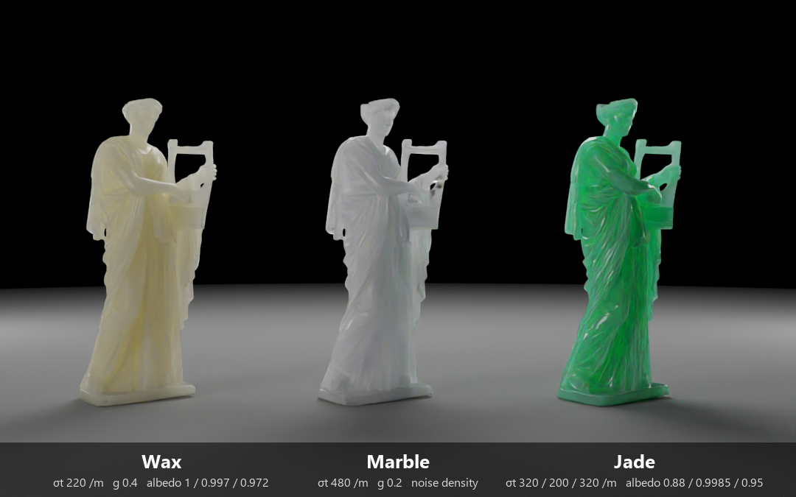
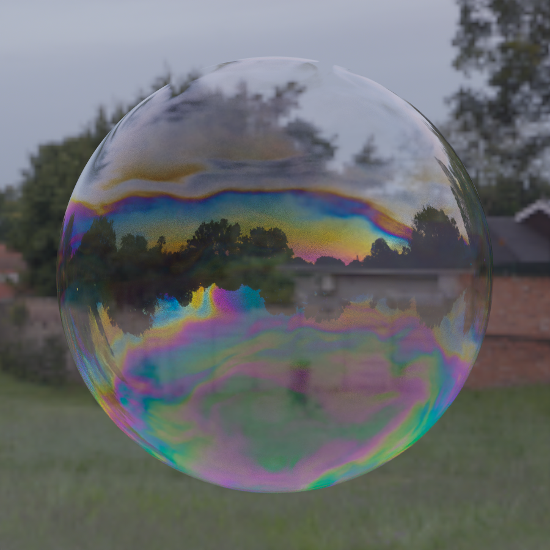
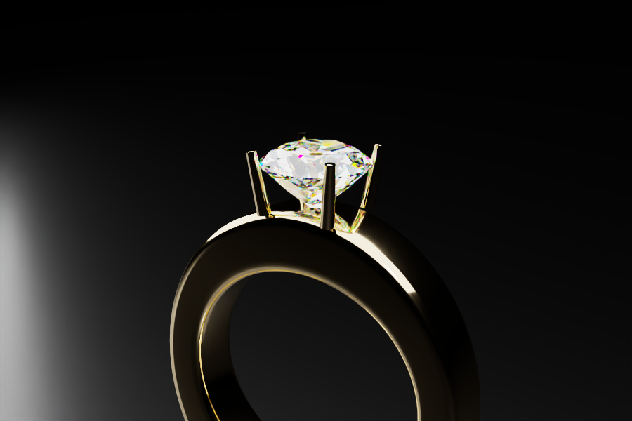
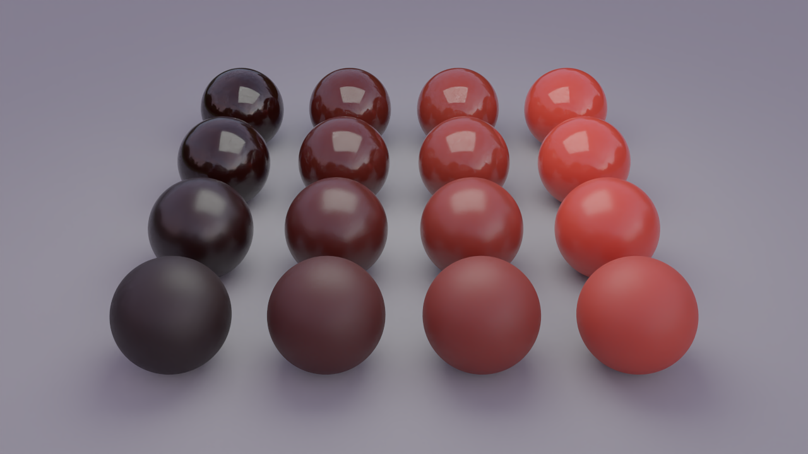
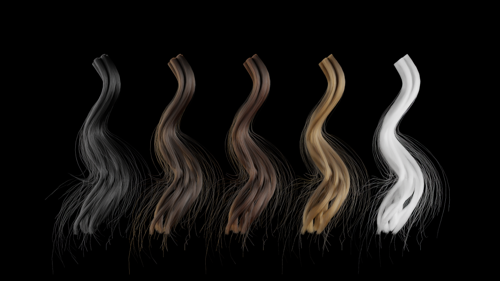
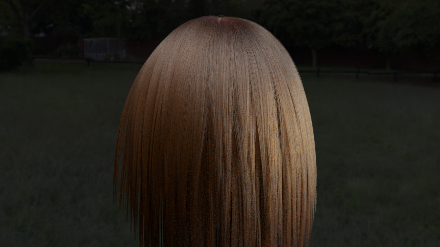
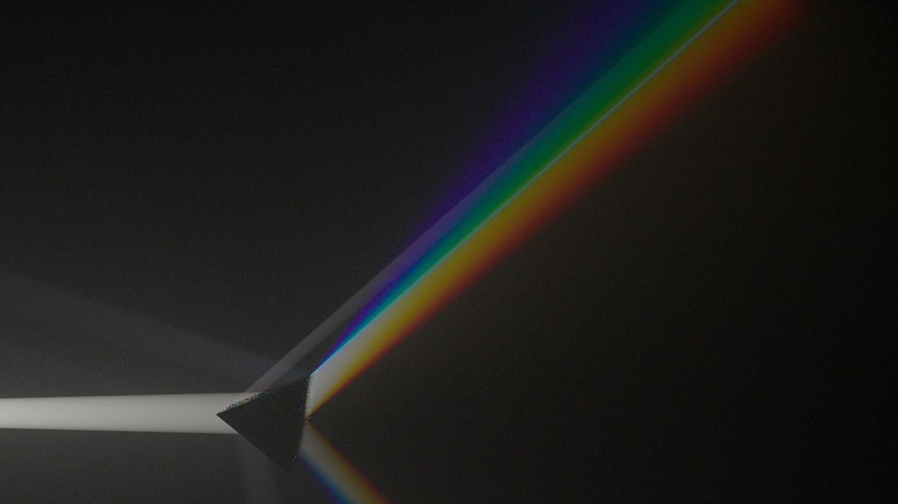
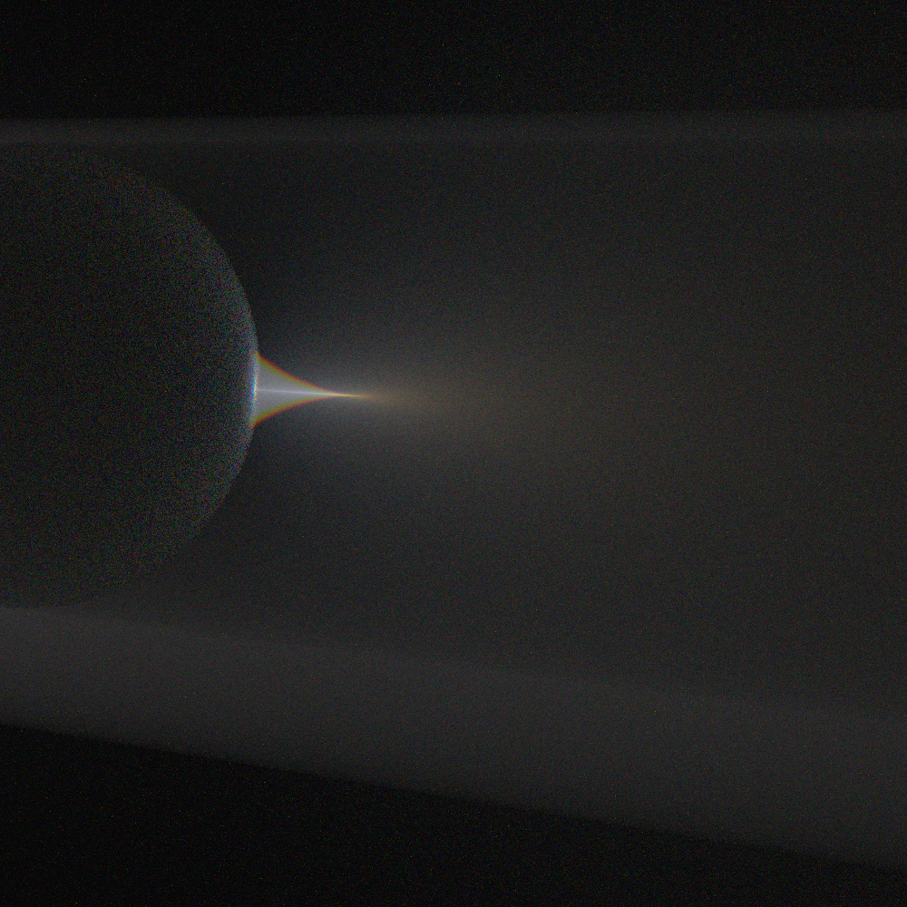

# GoLD_rayt


<sub>The same gold statue rendered by the RGB build and by the spectral build, under D65 daylight (top) and a tungsten lamp (bottom);
right: the CIEDE2000 color difference between the two images (mean 1.7 and 2.6 on the statue, [numbers](docs/data/erato_gold_results.txt)). Under daylight they agree; under a
warm light the RGB gold is duller ([details](#how-much-does-rgb-rendering-get-wrong-for-metals)).<br>
Model: Erato by Geoffrey Marchal (© 2016, [CC BY 4.0](https://creativecommons.org/licenses/by/4.0/)), a scan of the marble statue
from Monte Calvo (2nd century A.D., Ny Carlsberg Glyptotek, Copenhagen), from
[Morgan McGuire's Computer Graphics Archive](https://casual-effects.com/data/). Changes: scaled and placed, vertex normals recomputed
(`tools/data/mesh_clean.py`), gold material. The scan is not part of this repository
([credits](GoLD_rayt/assets/Meshes/erato/CREDITS.md)). Scene: `scenes/erato_gold.json`; 600 x 800, 256 spp, OIDN-denoised.</sub>

A 3D path tracer in C++20, built around **spectral rendering of metals** (gold first).

**Background.** Built for the author's graduation research: gold was measured with a spectroradiometer (SR-5100) and the
color difference between RGB and spectral rendering was quantified with Mitsuba. This renderer repeats that study in its
own code and aims at a **perceptually based renderer**. Besides metals it has dispersion and caustics, thin-film interference,
layered coats and anisotropic metal, scattering media (fog, clouds with Mie scattering), a wave-spectrum sea with sun glitter,
hair fibers, and MMD characters with skin subsurface scattering (plus a procedural micro-relief and uneven color).

> Windows / Visual Studio 2022 / x64 / CPU only. Readability and tests are preferred over raw speed.

## How much does RGB rendering get wrong for metals?

Both modes are the same engine with the same optical constants (Johnson & Christy), chosen at compile time
(`RenderMode.hpp`), so the difference is only the RGB approximation. The reference is a 1 nm integral of
`Fresnel(λ, θ)^n x light x film sensor` ([`tools/studies/metal_accuracy.py`](tools/studies/metal_accuracy.py)); the engine matches it
within ΔE00 0.12 (`--scene metalprobe`). The metric is CIEDE2000 (ΔE00: about 1 is visible side by side, 2-3 obvious).
These are comparisons between two renderings, not with a photograph.

| ΔE00, RGB vs spectral | Gold (Au) | Copper (Cu) | Silver (Ag) |
|---|---|---|---|
| D65 light, one reflection, all angles | 0.2 - **2.1** | 0.0 - 0.3 | 0.00 |
| other lights (tungsten A, candle, LED), one reflection | **2 - 6** | 1.8 - 2.8 | <= 0.07 |
| D65, metal reflecting metal 3 / 4 / 6 times | **3.7 / 6.9 / 12.7** | 1.4 / 2.3 / 4.4 | <= 0.01 |


- **Silver**: RGB is enough; its reflectance is flat.
- **Gold is the worst case.** Its red under D65 is 1.036 in the spectral render, but an `(eta, k)` Fresnel model cannot
  exceed 1, so RGB is about 6 % low in red. The error grows with a non-D65 light and with repeated reflections.
- The incidence angle is not the main cause (tested and rejected).
- **Rough metals** add error through the multiple-scattering color: gold under tungsten goes from 3.0 (smooth) to 6.3
  (roughness 1.0). A prototype that builds that color from the spectrum (not merged) helps for D65 but not for other lights.
- **Rule of thumb**: RGB for previews and D65 scenes; spectral when the light is not D65 or the metal is the subject.
  In a Release build spectral is about as fast.

**As a picture.** A gold bowl with a gold ball in it, a white ball and a gray floor, under one sphere light
(`--scene goldbowl --light d65|tungsten|candle`), rendered by both builds (256 spp, two renders averaged, no denoiser). The
renders are saved as linear float (`--out x.pfm`), so the difference is measured on the linear images and on the
displayed images (Reinhard, sRGB, clipped to the display range).


| Light | ΔE00, linear renders (mean) | ΔE00, displayed images (mean) | Displayed pixels with ΔE00 > 1 |
|---|---|---|---|
| D65 daylight | 1.7 | 1.3 | 65 % |
| Tungsten (illuminant A) | 3.5 | **2.6** | **80 %** |
| Candle (1850 K) | **5.6** | 0.9 | 36 % |

(ΔE00 of about 1 is roughly the smallest difference an observer can see.)

- **Tungsten**: the difference is visible on screen. The spectral gold is yellower and more saturated.
- **D65**: small, in the bright highlights, close to the visibility level.
- **Candle**: the largest measured difference, and the smallest one on an sRGB screen. A 1850 K blackbody is outside the
  sRGB gamut; the spectral render gives the gold a clearly negative blue, the RGB render almost none, and an sRGB display
  clips both to 0. **A wider gamut brings the difference back**: written as Display P3 (`--gamut p3`), the same two images
  differ by 5.2 instead of 0.9 ([numbers](docs/data/gold_compare_gamut_results.txt)). The engine agrees with the 1 nm
  integral here, so this is the error of the RGB model. Whether real gold under a candle looks different from this was not tested.

Numbers: [`gold_compare_linear_results.txt`](docs/data/gold_compare_linear_results.txt). Scripts:
[`gold_compare_linear.py`](tools/studies/gold_compare_linear.py), [`gold_compare_linear_fig.py`](tools/studies/gold_compare_linear_fig.py).
(An earlier comparison on displayed PNGs only showed candle as the smallest difference, 0.8; that was the clipping.)

**Limits.** Kulla-Conty is an approximation (the true color of a rough metal was not compared); polarization is not modeled (thin films
are, as a separate material, not on the metals themselves); the Johnson & Christy tables are taken as truth; noise at equal render time was not compared.

Write-up with all tables (Japanese): [`docs/METAL_ACCURACY.md`](docs/METAL_ACCURACY.md). Raw outputs:
[`metal_accuracy_results.txt`](docs/data/metal_accuracy_results.txt), [`metal_probe_compare.txt`](docs/data/metal_probe_compare.txt),
[`metal_probe_rough_compare.txt`](docs/data/metal_probe_rough_compare.txt). Reproduce:

```bash
python tools/studies/metal_accuracy.py --true-cmf --figs docs/img > docs/data/metal_accuracy_results.txt
```

## Aurisidus

> **Aurisidus** is a coined term derived from Latin
> *aurum* (**gold**) and *sidus* (**star**),
> representing the study of **gold-like metallic appearance** as a
> **structured, directional, and spectral phenomenon**,
> analogous to **stellar radiance**.

---

## Contents

0. [RGB vs spectral error for metals](#how-much-does-rgb-rendering-get-wrong-for-metals)
1. [Metals and spectral rendering](#1-metals-and-spectral-rendering) (the main topic)
2. [Quick start](#2-quick-start)
3. [The renderer in general](#3-the-renderer-in-general)
4. [How it works](#4-how-it-works)
5. [Verification](#5-verification)
6. [What could come next](#6-what-could-come-next)
7. [Gallery](#7-gallery)
8. [Third-party code and data](#8-third-party-code-and-data)
9. [References](#9-references)

---

## 1. Metals and spectral rendering

The color of a metal comes from how its complex refractive index `n(λ) + i k(λ)` changes with wavelength. Gold is yellow
because its reflectance drops sharply below ~550 nm. An RGB renderer approximates that with three numbers; this one can
carry the wavelength itself.

### What it does

| Piece | How |
|---|---|
| **Wavelengths** | 4 per camera path (hero-wavelength sampling as in PBRT v4), stratified over 360-830 nm, importance-sampled by visual sensitivity. |
| **Optical constants** | Complex IOR tables `n(λ)`, `k(λ)` from CSV (RefractiveIndex.info blocks, 3-column or separate `n` / `k` files; nm, µm or eV). Johnson & Christy data for **Au, Ag, Cu** are in `assets/Metal_data/`. |
| **Measured reflectance** | A curve `R(λ)` (CSV, percent or fraction) is converted to `(n, k)` with Gulbrandsen's method including the edge tint. Normal-incidence color is exact; against the Johnson tables the Fresnel error is <= 0.013 at 45° and grows toward grazing angles. |
| **Fresnel** | Conductor Fresnel per wavelength on every bounce. |
| **Roughness** | GGX microfacets (isotropic or anisotropic), VNDF sampling. |
| **Multiple scattering** | Kulla-Conty compensation: a perfect conductor keeps an albedo of ~1.0 at every roughness (single scattering alone gives 0.92 / 0.56 / 0.31 at roughness 0.5 / 0.8 / 1.0). `--no-ms` switches it off. |
| **Film** | CIE 1931 color matching functions (analytic multi-lobe fit) to XYZ, then linear sRGB. |
| **Lights** | `RGB x D65`, a blackbody (any temperature), CIE illuminant A, or an SPD from CSV. Optional white balance (`--wb`). Environment maps and RGB albedos are upsampled to spectra (white is exact). |
| **Glass dispersion** | Cauchy `n(λ)` from the refractive index and Abbe number, or Sellmeier coefficients (presets for diamond, sapphire, BK7 and fused silica); a dispersive path continues with one wavelength. |
| **Thin films** | Interference in a thin transparent layer (soap film, coated metal), per wavelength with Airy's formula, over air, a dielectric or a metal; the film thickness can vary over the surface ([theory](docs/THIN_FILM.md)). |

### Spectral vs RGB

A one-line compile-time switch in [`GoLD_rayt/include/Core/RenderMode.hpp`](GoLD_rayt/include/Core/RenderMode.hpp);
rebuild everything after changing it:

```cpp
#define RAYT_ENABLE_SPECTRAL 0   // 0 = RGB (default), 1 = spectral
```

In RGB mode the metal table is reduced to an RGB `(eta, k)` with the color matching functions, so both modes render the
same table. In a furnace test they agree within ~0.5 %. Release speed is about the same; Debug is ~3x slower in spectral
mode. The study of the difference is [above](#how-much-does-rgb-rendering-get-wrong-for-metals).

**The color of the light** (`--scene spd --light d65|tungsten|led`, `--wb` = white balance): five colored spheres and a gold
one under one sphere light. In spectral mode the whole scene takes the color of the light and the spheres change by
different amounts; white balance restores the neutral surfaces but not the colors. RGB mode (middle right) matches the
white but not the colors.


### Try it

Run from the project folder `GoLD_rayt/` (assets are loaded by relative path):

```bat
GoLD_rayt.exe --scene gold      --width 800 --spp 256 --out gold.png      :: three gold spheres, three roughnesses
GoLD_rayt.exe --scene goldrough --out goldrough.png                       :: rough gold, --no-ms to compare
GoLD_rayt.exe --scene spd --light tungsten --wb --out spd.png             :: metamerism under other light spectra
GoLD_rayt.exe --scene glass --abbe 6 --out dispersion.png                 :: dispersive glass (spectral mode)
GoLD_rayt.exe --scene metals                                              :: metal data tests, no image
```

### Not done (metals)

Lorentz-Drude / multi-angle fitting, per-wavelength edge tint, a better
RGB-to-spectrum upsampling (Jakob-Hanika), polarization, multiple-scattering compensation for rough dielectrics.

---

## 2. Quick start

Requirements: Windows 10/11 x64, **Visual Studio 2022** (v143), C++20, OpenMP, a CPU with **AVX2**. The third-party
libraries are not part of this repository; one script downloads them ([section 8](#8-third-party-code-and-data)).

1. `powershell -ExecutionPolicy Bypass -File tools\fetch_deps.ps1` downloads Embree, Open Image Denoise, GLM, nlohmann/json,
   stb, GLFW and Dear ImGui into the folders the project expects (about 0.7 GB; it skips what is already there).
2. `powershell -ExecutionPolicy Bypass -File tools\build_cli.ps1` builds the command-line renderer into `out\cli` and copies
   the DLLs it needs (`-Spectral` for the spectral build). Or open `GoLD_rayt.sln` in Visual Studio: **Debug | x64** builds the
   command-line renderer (`src/main_cli.cpp`), **Release | x64** the **GUI viewer** (`src/main_ui.cpp`); then copy the DLLs
   next to the executable: Embree (`embree4.dll`, `tbb12.dll`, `tbbmalloc.dll` from `librarys/embree-4.4.0.x64.windows/bin/`),
   OpenImageDenoise (`OpenImageDenoise.dll`, `_core.dll`, `_device_cpu.dll` from `librarys/oidn-2.5.1.x64.windows/bin/`), and
   for the GUI `glfw3.dll` (from `GoLD_rayt/external/glfw-3.4.bin.WIN64/lib-vc2022/`).
3. Run from the project folder `GoLD_rayt/`.

> **Speed tip.** A Release CLI is about 5x faster than Debug. `build_cli.ps1` is MSBuild with `/p:RaytCli=true`. `-Dev` skips the
> link-time code generation: changing one `.cpp` then rebuilds in about 3 seconds instead of 20 (the renderer is a few percent slower).

**Scene files.** A scene is a JSON file; the program takes it as its first argument, and the options after it win over the file:

```bat
GoLD_rayt.exe scenes\gold_bowl_tungsten.json --spp 64
```

A file either names a built-in scene with options (`scenes/presets/`) or describes the scene as data: materials (diffuse,
conductor with `"metal": "Au"`, dielectric, layered coat, thin film, hair, skin, emission), spheres, quads, OBJ meshes, surfaces of revolution, an ocean, hair strands, point lights, camera and
environment ([`docs/SCENE_FILE.md`](docs/SCENE_FILE.md), Japanese). `GoLD_rayt.exe --list-scenes` lists the built-in scenes.

**Command line** (`GoLD_rayt.exe [scene.json] [options]`)

| Option | Meaning |
|---|---|
| `--scene NAME` | a built-in scene (`--list-scenes`) or a test (`furnace`, `metals`, `lights`, `aov`, `sss`, `bench`, ...) |
| `--width N`, `--spp N`, `--depth N` | image width, samples per pixel, maximum path depth |
| `--env file.hdr` | environment map (`assets/env/*.hdr`) |
| `--out file` | `.png`/`.bmp`/`.jpg` (tone mapped), `.hdr` or `.pfm` (linear float; use `.pfm` to keep negative values) |
| `--gamut srgb\|p3\|rec2020` | primaries of the output (default `srgb`); a `.png` is tagged so that a viewer shows it in that gamut |
| `--bits 8\|16` | bits per channel of a `.png` (16 for wide-gamut work: no banding) |
| `--accel own\|embree` | own SAH BVH or Embree, for single-material triangle meshes only |
| `--light-sampler uniform\|power\|spatial\|all` | how the next-event-estimation light is chosen (default `spatial`) |
| `--aov`, `--denoise` | write albedo / normal images; also write a denoised image (Intel OIDN) |

Speed on the author's PC (8 threads, Release, RGB): the gold scene at 800x450, 256 spp, depth 16 takes about 2 minutes.

---

## 3. The renderer in general

- **Path tracing** with next-event estimation, multiple importance sampling, Russian roulette, thin-lens camera.
- **Lights**: point, sphere, rectangle, emissive triangle meshes, HDR environment map (importance sampled). Selection:
  uniform, power, spatial importance (PBRT-style bounds), or all lights.
- **Materials**: Lambertian (textures, alpha cut-outs, translucent layers), `CoatedDiffuse` (diffuse under a GGX coat, with an optional metal blend and subsurface scattering; used for skin, with a procedural
  micro-relief, uneven color and oily / dry patches: [details](docs/SKIN.md), Japanese), `LayeredCoat` (a clear coat over a diffuse or metal base, summed by a random walk
  between the layers), `RoughConductor` (also anisotropic: brushed or turned metal, with the tangent taken from the shape),
  `Dielectric` (smooth or rough, dispersive), `Hair` (one fiber: reflection, transmission and internal reflection, colored by melanin), `DiffuseLight`.
- **Geometry**: spheres, rectangles, triangle meshes (OBJ, PMX), an ocean surface built from a wave spectrum (wind speed, sun glitter; [details](docs/WATER.md), Japanese), and
  hair as chains of cylinders (generated locks and head hair).
  Own SAH BVH or **Embree**.
- **Media and sky**: scattering media with colored coefficients and noise densities (null collisions), tabulated phase functions
  (Mie scattering of cloud droplets; [details](docs/CLOUD.md), Japanese), a single-scattering sky with a sun (`tools/data/make_sky.py`).
- **Bidirectional path tracing** (`--lvc`, a prototype): light paths are cached and connected to the camera paths, with fog, diffuse surfaces,
  glass and dispersion; beams and caustics in fog are found far faster than by path tracing (10-60x lower noise variance in the same time).
  Details: [docs/LVC_BPT.md](docs/LVC_BPT.md) (Japanese).
- **Denoising**: albedo and normal AOVs plus **Intel Open Image Denoise**. At 64 spp the result matches the error of about
  230-420 raw samples; fine texture (stocking weave, single hair fibers) gets softer.
- **GUI** (Release build): a Dear ImGui viewer with progressive accumulation. Choose the scene (gold or glass spheres),
  environment map, roughness, exposure, samples per frame; save the image. It renders in the mode `RenderMode.hpp` selects.
  It does not load characters or use SSS or the denoiser.

---

## 4. How it works

```
                      +-----------------------------+
 scene (CLI / code)   |  Scene: primitives + lights |  BVH / Embree, LightSampler
                      +--------------+--------------+
                                     |
 Camera --ray--> PathIntegrator.Li ---+---> hit -> Material (eval / sample / pdf)
   |             - NEE + MIS               \-> next-event estimation toward a light
   |             - Russian roulette
   |             - 4 wavelengths per path
   v
 Film (linear RGB, per pixel average) --> [OIDN denoise] --> tone map --> PNG / HDR
```

- **One path, four wavelengths.** `Li()` follows one camera path; every value is a `Spectrum`: 4 wavelengths in spectral
  mode, an RGB triple in RGB mode (a compile-time type). The film converts the final spectrum to RGB.
- **Materials** implement `eval`, `sample` and `pdf`; the integrator does not need to know which one it hits.
- **Next-event estimation** picks one light with the `LightSampler`, samples it, and combines it with BSDF sampling through
  the power heuristic.
- **Subsurface scattering** is a path event: the integrator finds an exit point with probe rays
  (`Render/SubsurfaceProbe.hpp`) and continues from there ([details](docs/SSS.md), Japanese).
- **Precision**: `Real` is `double`; Embree finds hits in float and the hit record is rebuilt in double.

**Source layout** (`GoLD_rayt/include`; `src` has the entry points)

| Folder | Contents |
|---|---|
| `Core/` | types, `Spectrum`, `SampledWavelengths`, sampling, Fresnel, `RenderMode.hpp` |
| `Color/` | spectral curves, CIE functions, illuminants, emission spectra, complex IOR tables, `R(λ)`-to-`(n,k)` |
| `Materials/` | Lambertian, CoatedDiffuse (with the skin relief, wrinkle simulation and pigment), LayeredCoat, RoughConductor, Dielectric, ThinFilm, Hair, DiffuseLight, Subsurface, media |
| `Microfacet/` | GGX and the directional-albedo table for the multiple-scattering compensation |
| `Geometry/`, `Scene/`, `Accelerators/` | shapes (also hair curves and the ocean mesh), aggregate, SAH BVH, Embree wrapper |
| `Lights/` | point / area / environment lights, light samplers |
| `Render/` | camera, film, integrator, denoiser, subsurface probe |
| `IO/` | CSV, metal-data, HDR / image / OBJ / PMX / VPD loaders |
| `Application/`, `src/UI/` | the Dear ImGui viewer |
| `Cli/`, `src/Cli/` | the command-line renderer: options, scene files, one builder per scene, self-checks, tools, the common render steps |

---

## 5. Verification

The CLI has self-checks that print `OK` / `FAIL` per case and exit with code 2 on failure. They run in RGB and spectral mode
(`--spp` scales the samples; use Release).

| Command | What it checks |
|---|---|
| `--scene furnace` | white-furnace energy: glass and white diffuse return 1.0, rough conductors match an independent integration |
| `--scene metals` | table units, reflectance-to-`(n,k)`, edge tint against Johnson, multiple scattering, `CoatedDiffuse` reciprocity |
| `--scene lights` | each light type against a closed form or numerical integral; light-selection strategies agree |
| `--scene mesh` | triangle geometry, OBJ round trip, BVH and Embree vs brute force, emissive triangles |
| `--scene aov` | the albedo / normal features of a camera path |
| `--scene dispersion` | the Sellmeier presets against the published d-line index and Abbe number, a diamond ball in a white furnace |
| `--scene thinfilm` | Airy's formula against closed forms (no film, a quarter-wave coating, a free film), the sampling weights, a white furnace |
| `--scene sss` | the profile, a white furnace over skin, the profile across a shadow edge |
| `--scene lvc` | the bidirectional path tracer against path tracing (each strategy alone and together; fog, a diffuse floor), and against the caustic photon map (a glass ball, also dispersive) |
| `--scene volume` | scattering media: Beer-Lambert, white furnace, similarity relation, null collisions, the tabulated (Mie) phase function against its own density |
| `--scene layered` | the layered coat: a closed form for a smooth coat, `eval()` against `sample()`, energy, reciprocity |
| `--scene aniso` | anisotropic metal: the tangent of the shapes, the visible-normal density, rotation of the roughness axes |
| `--scene relief` | the skin micro-relief and pigment: the height field, the bent normals, the pores, a skin sphere in a white furnace with and without them |
| `--scene hair` | hair: the fiber scattering function (energy, `sample()` against `pdf()` and `eval()`, lobe directions), the cylinder intersector against brute force, white furnaces around a fiber and a lock |
| `--scene ocean` | the ocean: the wave set against its spectrum, Pierson-Moskowitz closed form, dispersion, directional spreading |
| `--scene bench` | BVH benchmark: recursive reference vs SAH BVH vs Embree |
| GUI build: `--selftest` | scripted check of the GUI features |

Bugs found this way (and fixed): refraction that never left a glass sphere, an unnormalized camera ray that made rough gold
~22 % too dark, area lights that were always shadowed at grazing angles, wrong MIS weights for area lights.

---

## 6. What could come next

- **Sampling**: adaptive sampling, low-discrepancy sequences, Embree for the PMX scene (needs per-triangle materials and
  alpha cut-outs).
- **Metals and films**: Lorentz-Drude, multilayer coatings and rough films, spectral upsampling of saturated colors.
- **Light transport**: caustics seen through glass (vertex merging), rough dielectrics and colored media in the bidirectional path tracer.
- **Hair and skin**: a comparison with measured data, curly and elliptical fibers, a second specular lobe and vellus hair for skin.
- **Infrastructure**: a light tree, `ctest` integration.

---

## 7. Gallery

More renders from the same engine (CPU; OIDN-denoised unless noted). The color of light is under [Spectral vs RGB](#spectral-vs-rgb).

**Three translucent materials, one statue** (`scenes/erato_translucent.json`): the same scan three times, lit from behind and above,
with a different scattering medium inside each: wax, marble (a noise density gives it soft variations) and jade. Light enters the
surface, scatters inside (a random walk with chromatic coefficients, hero-wavelength weights and null collisions for the density), and
leaves again; thin parts such as the drapery and the lyre glow. The coefficients are chosen by eye, not measured. 1080 x 675, 96 spp,
OIDN-denoised, 12 minutes on 8 threads.



<sub>Model: Erato by Geoffrey Marchal (© 2016, [CC BY 4.0](https://creativecommons.org/licenses/by/4.0/)), from
[Morgan McGuire's Computer Graphics Archive](https://casual-effects.com/data/). Changes: scaled and placed, vertex normals recomputed,
its two open boundaries closed (`tools/data/mesh_clean.py --cap`), wax / marble / jade media. The scan is not part of this repository.</sub>

**A soap bubble** (`scenes/soap_bubble_hdr.json`): thin-film interference. The film is thin and black at the top and thickens downwards,
with bands that wobble and swirl where the liquid circulates. Its colors are the interference of the light reflected at the front and
the back of the film, evaluated per wavelength ([theory](docs/THIN_FILM.md)). 900 x 900, 512 spp, OIDN-denoised.



**A gold ring with a diamond** (`scenes/diamond_ring.json`): a round brilliant-cut stone with the Sellmeier dispersion of diamond
(n_d 2.417, Abbe number 55), so the light that is split inside the stone leaves it as colored fire; gold with the Johnson & Christy
constants. 900 x 600, 768 spp, OIDN-denoised. The stone and the ring are generated by `tools/data/make_ring.py`.



**A clear coat over a base** (`scenes/layered_gloss.json`, `scenes/layered_lacquer.json`): lacquer on gold, car paint. The coat is a
rough dielectric over a diffuse or metal base, and the light that bounces between the two layers is summed by a random walk
([details](docs/GLOSS.md), Japanese; checked against a closed form and against two independent estimators, `--scene layered`).
Gloss has two independent axes: the sharpness of the reflections (coat roughness, rows) and their contrast (brightness of the
base, columns). 1280 x 720, 192 spp, OIDN-denoised.



**Hair** (`scenes/hair_colors.json`, `scenes/hair_head.json`): every fiber is a cylinder with a hair scattering function (white reflection off the
surface, light through the fiber, light reflected once inside; [details](docs/HAIR.md), Japanese), and the color comes from melanin alone.
Top: the same lock with black, brown, red, blond and white hair; 1400 x 788, 256 spp, OIDN-denoised, 23 minutes. Bottom: 40000 fibers falling over
a head (a plain sphere); 900 x 506, 512 spp, not denoised (the denoiser smooths single fibers away), 18 minutes. The fibers are drawn 1.6 times
thicker than real ones to keep the noise down. Checked in white furnaces and against sampling (`--scene hair`).





**Rainbows in fog** (`--scene fogspot --spot-prism --lvc`): a narrow beam crosses a dispersive prism in a haze, and the rainbow fan shows in the
fog. It is made with a bidirectional path tracer that caches light paths (`--lvc`, a prototype; one wavelength per pass for the dispersion),
which is checked against path tracing and the photon map (`--scene lvc`, [details](docs/LVC_BPT.md)). 1280 x 720, 600 M light paths, 9 minutes on 8 threads.



**A glass ball in haze** (`--gal-object ball --gal-floor 0`): the ball focuses the beam into a cone with colored edges.



---

## 8. Third-party code and data

These are **not included in the repository**: `tools/fetch_deps.ps1` downloads them, and each keeps its own license.

| Component | Use | License |
|---|---|---|
| [Embree](https://github.com/RenderKit/embree) 4.4.0 | ray tracing kernels | Apache-2.0 |
| [Open Image Denoise](https://github.com/RenderKit/oidn) 2.5.1 | denoising | Apache-2.0 |
| [GLFW](https://www.glfw.org/) 3.4 | GUI window | zlib |
| [Dear ImGui](https://github.com/ocornut/imgui) (docking branch) | GUI | MIT |
| [GLM](https://github.com/g-truc/glm) | math | MIT |
| [stb](https://github.com/nothings/stb) | image reading and writing | public domain / MIT |
| [nlohmann/json](https://github.com/nlohmann/json) 3.11.3 | scene files | MIT |
| [glad](https://github.com/Dav1dde/glad) 0.1.36 (generated loader, 3 files in `GoLD_rayt/external/glad/`) | OpenGL loader | generated code; `khrplatform.h` is Khronos (MIT) |
| Erato 3D scan by Geoffrey Marchal, via [casual-effects.com/data](https://casual-effects.com/data/) | the statue figures; the scan is not in the repository | CC BY 4.0 |
| Johnson & Christy optical constants (Au, Ag, Cu) | `assets/Metal_data/` | published data, via RefractiveIndex.info |

Environment map: `assets/env/bryanston_park_sunrise_2k.hdr` (Poly Haven, CC0). MMD models are not distributed.

**License of this repository.** The code and the documentation are under the [MIT License](LICENSE) (Copyright (c) 2025-2026 So Kohinata). The images in `docs/img/` are renderings and are not covered by it.

---

## 9. References

The works that the code implements or follows, and the ones that the studies in `docs/` reproduce or test. Each entry says what it is used for.
Entries marked *(studied)* were implemented as a reference or evaluated, and are not part of the renderer; *(next)* marks work that the documents name as the next step.

**Rendering framework and sampling**

- M. Pharr, W. Jakob, G. Humphreys, *Physically Based Rendering: From Theory to Implementation*, 4th ed., MIT Press, 2023 (3rd ed., 2016). The overall design; the
  hero-wavelength walk through a medium (v4), light sampling, the dielectric BSDF, the probe-ray BSSRDF sampling (v3). [pbr-book.org](https://pbr-book.org)
- A. Wilkie, S. Nawaz, M. Droske, A. Weidlich, J. Hanika, "Hero Wavelength Spectral Sampling", *Computer Graphics Forum* 33(4), 2014. Four stratified wavelengths per path.
- E. Veach, L. J. Guibas, "Optimally Combining Sampling Techniques for Monte Carlo Rendering", SIGGRAPH 1995. Multiple importance sampling everywhere (next event estimation, strategies of the bidirectional estimator).
- L. Conty Estevez, C. Kulla, "Importance Sampling of Many Lights with Adaptive Tree Splitting", *Proc. ACM CGIT* 1(2), 2018. The spatial light sampler (the per-light importance of PBRT v4).
- T. Duff, J. Burgess, P. Christensen, C. Hery, A. Kensler, M. Liani, R. Villemin, "Building an Orthonormal Basis, Revisited", *JCGT* 6(1), 2017. Local frames.
- J. Ureña, M. Fajardo, A. King, "An Area-Preserving Parametrization for Spherical Rectangles", *Computer Graphics Forum* 32(4) (EGSR), 2013. Solid-angle sampling of rectangular lights.
- I. Wald, S. Woop, C. Benthin, G. Johnson, M. Ernst, "Embree: A Kernel Framework for Efficient CPU Ray Tracing", *ACM TOG* 33(4), 2014. The Embree backend.

**Metals and microfacets**

- P. B. Johnson, R. W. Christy, "Optical Constants of the Noble Metals", *Physical Review B* 6(12), 1972. The `n(λ)`, `k(λ)` of Au, Ag and Cu.
- O. Gulbrandsen, "Artist Friendly Metallic Fresnel", *JCGT* 3(4), 2014. A measured reflectance `R(λ)` to `(n, k)`, with the edge tint.
- B. Walter, S. R. Marschner, H. Li, K. E. Torrance, "Microfacet Models for Refraction through Rough Surfaces", EGSR 2007. Rough dielectrics.
- E. Heitz, "Understanding the Masking-Shadowing Function in Microfacet-Based BRDFs", *JCGT* 3(2), 2014; "Sampling the GGX Distribution of Visible Normals", *JCGT* 7(4), 2018. GGX and VNDF sampling.
- C. Kulla, A. Conty, "Revisiting Physically Based Shading at Imageworks", SIGGRAPH 2017 course. The multiple-scattering compensation of rough metals.
- E. Heitz, J. Hanika, E. d'Eon, C. Dachsbacher, "Multiple-Scattering Microfacet BSDFs with the Smith Model", *ACM TOG* 35(4), 2016. *(next)* A reference for the true color of a rough metal.
- C. Schlick, "An Inexpensive BRDF Model for Physically-based Rendering", *Computer Graphics Forum* 13(3), 1994. The Fresnel of the coated diffuse material.

**Spectra and color**

- C. Wyman, P.-P. Sloan, P. Shirley, "Simple Analytic Approximations to the CIE XYZ Color Matching Functions", *JCGT* 2(2), 2013. The film's color matching functions.
- CIE 15:2004, *Colorimetry* (superseded by CIE 015:2018). The 1931 observer, illuminants D65 and A.
- C. Li, Z. Li, Z. Wang, Y. Xu, M. R. Luo, G. Cui, M. Melgosa, M. H. Brill, M. Pointer, "Comprehensive color solutions: CAM16, CAT16, and CAM16-UCS", *Color Research & Application* 42(6), 2017. The chromatic adaptation of the white balance (`--wb`).
- CIE 142-2001, *Improvement to Industrial Colour-Difference Evaluation* (CIEDE2000); G. Sharma, W. Wu, E. N. Dalal, "The CIEDE2000 Color-Difference Formula: Implementation Notes, Supplementary Test Data, and Mathematical Observations", *Color Research & Application* 30(1), 2005. The color differences of the RGB-vs-spectral studies.
- X. Zhang, B. A. Wandell, "A Spatial Extension of CIELAB for Digital Color Image Reproduction", *Journal of the Society for Information Display* 5(1), 61-63, 1997; "Color image fidelity metrics evaluated using image distortion maps", *Signal Processing* 70(3), 1998. S-CIELAB: the difference after the eye's spatial filtering.
- W. Jakob, J. Hanika, "A Low-Dimensional Function Space for Efficient Spectral Upsampling", *Computer Graphics Forum* 38(2), 2019. *(studied)* An alternative to the RGB-to-spectrum conversion; not adopted.
- C. Peters, S. Merzbach, J. Hanika, C. Dachsbacher, "Using Moments to Represent Bounded Signals for Spectral Rendering", *ACM TOG* 38(4), 2019. *(studied)* The metamer-mismatch study ([docs/SPECTRUM_FROM_RGB.md](docs/SPECTRUM_FROM_RGB.md)).

**Dispersion and thin films**

- I. H. Malitson, "Refraction and Dispersion of Synthetic Sapphire", *JOSA* 52, 1962; "Interspecimen Comparison of the Refractive Index of Fused Silica", *JOSA* 55, 1965; the Schott catalog (BK7); F. Peter, *Z. Phys.* 15, 358 (1923) for diamond. The Sellmeier presets.
- M. Born, E. Wolf, *Principles of Optics*, Cambridge University Press. Airy's formula for a thin film.
- B. Smits, G. Meyer, "Newton's Colors: Simulating Interference Phenomena in Realistic Image Synthesis", Eurographics Workshop on Photosimulation, Realism and Physics in Computer Graphics, 1990, pp. 185-194 (in *Photorealism in Computer Graphics*, Springer, 1992). An early use of interference in graphics.
- L. Belcour, P. Barla, "A Practical Extension to Microfacet Theory for the Modeling of Varying Iridescence", *ACM TOG* 36(4), 2017. *(next)* Thin films on rough surfaces.

**Participating media and subsurface scattering**

- J. Novák, I. Georgiev, J. Hanika, W. Jarosz, "Monte Carlo Methods for Volumetric Light Transport Simulation", *Computer Graphics Forum* 37(2) (EG STAR), 2018. Delta tracking, null collisions, the bookkeeping of the walk.
- L. G. Henyey, J. L. Greenstein, "Diffuse Radiation in the Galaxy", *Astrophysical Journal* 93, 1941. The phase function.
- I. Gkioulekas, B. Xiao, S. Zhao, E. H. Adelson, T. Zickler, K. Bala, "Understanding the Role of Phase Function in Translucent Appearance", *ACM TOG* 32(5), 2013. The two-lobe phase function.
- P. H. Christensen, B. Burley, "Approximate Reflectance Profiles for Efficient Subsurface Scattering", Pixar technical memo, 2015. The normalized diffusion profile of the skin BSSRDF.
- S. L. Jacques, "Optical properties of biological tissues: a review", *Physics in Medicine & Biology* 58(11), 2013; S. Prahl, hemoglobin spectra ([omlc.org](https://omlc.org/spectra/hemoglobin/)). The chromophore model of the layered skin.

**Caustics and light transport**

- H. W. Jensen, "Global Illumination using Photon Maps", Eurographics Workshop on Rendering, 1996. The caustic photon map.
- J. Hanika, M. Droske, L. Fascione, "Manifold Next Event Estimation", *Computer Graphics Forum* 34(4) (EGSR), 2015; T. Zeltner, I. Georgiev, W. Jakob, "Specular Manifold Sampling for Rendering High-Frequency Caustics and Glints", *ACM TOG* 39(4), 2020. The specular manifold NEE of the prism caustic.
- E. Veach, *Robust Monte Carlo Methods for Light Transport Simulation*, PhD thesis, Stanford University, 1997; E. P. Lafortune, Y. D. Willems, "Bi-directional Path Tracing", Compugraphics 1993. Light tracing and bidirectional path tracing, with specular vertices.
- I. Georgiev, J. Křivánek, T. Davidovič, P. Slusallek, "Light Transport Simulation with Vertex Connection and Merging", *ACM TOG* 31(6) (SIGGRAPH Asia), 2012;
  T. Davidovič, J. Křivánek, M. Hašan, P. Slusallek, "Progressive Light Transport Simulation on the GPU: Survey and Improvements", *ACM TOG* 33(3), 2014. The vertex cache and the weights of the bidirectional estimators.
- shocker_0x15, "Renderer introduction: Ray Tracing Camp 10" (slides, in Japanese), [Speaker Deck](https://speakerdeck.com/shocker_0x15/renderer-introduction-ray-tracing-camp-10). Volumetric and dispersive caustics by light vertex cache bidirectional path tracing: the target of the fog scenes.

**Software and background**

- W. Jakob, S. Speierer, N. Roussel, M. Nimier-David, D. Vicini, T. Zeltner, B. Nicolet, M. Crespo, V. Leroy, Z. Zhang, *Mitsuba 3 renderer*, 2022, [mitsuba-renderer.org](https://www.mitsuba-renderer.org). The RGB-vs-spectral study of the graduation research was done with it.
- J. Tessendorf, "Simulating Ocean Water", SIGGRAPH course notes, 2001 (the notes carry the copyright years 1999-2001). Background for the Gerstner-wave sea.
