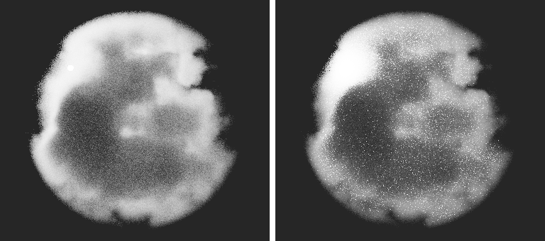

# 雲（Mie 散乱の位相関数）

雲の見た目の第一歩として、**水滴の Mie 散乱**を位相関数に入れた。結論: 雲の粒（半径 10 µm）は、Henyey-Greenstein（HG）が表せない鋭い前方ピークを持ち、逆光の雲の明暗が変わる。

## 1. 何を足したか

| 物 | 場所 |
|---|---|
| Mie 散乱の計算（Bohren & Huffman）、水滴の粒径分布の平均、位相関数の表の出力、自己チェック | `tools/studies/mie_phase.py` |
| 表の位相関数（密度と標本抽出が厳密に一致する） | `include/Materials/TabulatedPhase.hpp`、`PhaseFunction` が使う |
| シーンファイルの `medium.phaseTable`（CSV のパス。`g`/`g2`/`weight` の代わり） | `docs/SCENE_FILE.md` |
| `--media-nee`（媒質の衝突ごとに光源を標本抽出。境界が屈折率 1 のとき素通り）。シーンファイルで、太陽のような小さい光源を使うために要る | `src/Cli/RenderPipeline.cpp` |
| 作例 | `scenes/cloud_mie.json`（`--media-nee` はファイル内の `options`） |
| 表（生成物） | `assets/Cloud/mie_reff10.csv`（有効半径 10 µm、有効分散 0.1。可視光 6 波長の平均） |

## 2. Mie の位相関数（雲の水滴、有効半径 10 µm）

- 平均コサイン g = 0.865（文献の 0.85〜0.88 の範囲）。
- 前方（0°）は、同じ g の HG の約 80 倍。散乱された光の約 48% が 5° の円錐の中に入る（HG は 13%）。回折の山で、幅は 1° ほど。
- 約 140° に虹（rainbow）の山、180° に glory（後方の小さな山）。HG にも 2 ローブにもない。
- 水滴の粒の大きさの分布で山はなだらかになる。可視光の波長で平均したので、色の縞（霧虹、glory の色）は消えて、形だけが残る。

図は `python tools/studies/mie_phase.py --plot out/mie_reff10.png`。

雲の濃さは、液水量（LWC）から決まる。有効半径 10 µm の水滴では、消散係数 = 0.157 m²/g × LWC。LWC 0.3 g/m³ で 0.047 /m（積雲で 0.05〜0.1 /m）。

## 3. 確かめたこと

`python -I tools/studies/mie_phase.py --check`（8 項目、すべて PASS）:
- 粒が小さい極限（x = 0.01）で Rayleigh の 3/(16π)(1 + cos²θ) に一致（最大の差がピークの 4e-5）。
- 吸収のない球で Q_ext = Q_sca（差 2e-16）、x = 400 で Q_ext = 2.02（消光のパラドックス）。
- 位相関数の積分が 1。雲の水滴の平均コサインが 0.86。単一の水滴で、虹が 140.7° 付近、後方の山がある。

`--scene volume`（RGB・スペクトルの両方、PASS）の新しい項目:
- HG の表が、HG の式に 0.002% で一致。
- 表の `eval()` と `sample()` が同じ密度: 円錐（5°、60°、120°）に入る標本の割合が、`eval()` の積分と、標準誤差の 4 倍以内で一致（HG の表と Mie の表の両方）。
- Mie の表で、吸収のない厚い板が、空の明るさをそのまま返す（白炉）。HG の表の板が、HG の式の板と一致する。

## 4. 描画の比較（逆光、同じ雲・同じ太陽、位相関数だけが違う）

`scenes/cloud_mie.json`（640×360、128 spp、デノイズあり、RGB ビルド）。左は `phaseTable` を `"g": 0.865` に替えた物。時間は Mie 251 秒、HG 228 秒（スペクトル版のビルドと並行した値）。

- HG: 縁が全体に明るく、太陽の方向に特別な場所がない。
- Mie: 太陽に近い左上の縁に、明るい集中した領域ができ、本体は暗い。前方ピークが、太陽の近くの薄い部分で、光を強く通す。
- **ノイズ:** Mie の方が、デノイズ後も明るい斑点が多い。前方ピークは鋭く、太陽の方向に合った経路がまれに大きな値を出すため、と考えている（原因は未確認）。等時間のノイズは未測定。

## 5. 限界

- 位相関数は波長によらない（可視光の平均）。霧虹・glory の色の縞は出ない。波長ごとの位相関数には、媒質の重み付け（ヒーロー波長）の拡張が要る。
- 雲は、小さな球の中のノイズ密度（`cloud_noise` と同じ）。形はまだ雲らしくない。空は一様な暗い灰色で、青空も大気もない。
- 太陽は点に近い球の光源。大気の散乱（空の青、夕焼け）は未実装。
- 粒の大きさは 1 種類（有効半径 10 µm）。小さい粒（霧、薄い雲）は、`mie_phase.py --reff` で別の表を作れる。

## 6. 次の候補

1. 大気と空（Rayleigh + Mie の単散乱 → 環境マップ）で、青空と太陽を作る。
2. 雲の形（fBm + 球ではなく積雲の高さの分布）と、パウダー効果・銀縁の見え方。
3. 波長ごとの位相関数（霧虹、glory）。

## 参考文献

- Bohren & Huffman, *Absorption and Scattering of Light by Small Particles*, 1983（BHMIE）。
- Hansen & Travis, "Light scattering in planetary atmospheres", Space Science Reviews 16, 1974（粒径分布）。

（書誌は記憶から書いた。公開前に照合する。）
