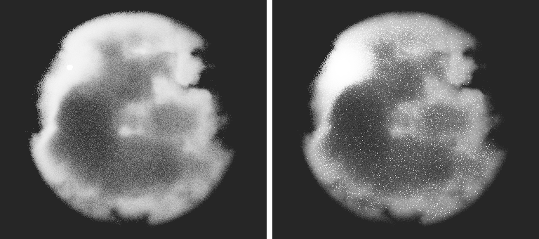

# Cloud (the Mie scattering phase function)

As a first step toward the appearance of clouds, the **Mie scattering of water drops** was put in as the phase function. Result: cloud droplets (radius 10 µm) have a sharp forward peak that Henyey-Greenstein (HG) cannot represent, and it changes the light and dark of a backlit cloud.

## 1. What was added

| Item | Where |
|---|---|
| Mie scattering calculation (Bohren & Huffman), averaging over the droplet size distribution, output of a phase function table, self-check | `tools/studies/mie_phase.py` |
| Tabulated phase function (density and sampling agree exactly), used by `PhaseFunction` | `include/Materials/TabulatedPhase.hpp` |
| `medium.phaseTable` of the scene file (path of a CSV; used instead of `g` / `g2` / `weight`) | `docs/SCENE_FILE.md` |
| `--media-nee` (samples a light source at every collision in the medium; the boundary is passed through when its refractive index is 1). Needed in scene files to use a small light such as the sun | `src/Cli/RenderPipeline.cpp` |
| Example | `scenes/cloud_mie.json` (`--media-nee` is in the `options` of the file) |
| Table (generated) | `assets/Cloud/mie_reff10.csv` (effective radius 10 µm, effective variance 0.1; average over 6 visible wavelengths) |

## 2. The Mie phase function (cloud droplets, effective radius 10 µm)

- Mean cosine g = 0.865 (within the literature's range of 0.85-0.88).
- Forward (0°) it is about 80 times the HG with the same g. About 48% of the scattered light falls inside a 5° cone (HG: 13%). It is a diffraction peak about 1° wide.
- A rainbow peak at about 140° and a glory (a small backward peak) at 180°. Neither HG nor the two-lobe function has them.
- The size distribution of the droplets smooths the peaks. Because the average is taken over visible wavelengths, the color fringes (fogbow (霧虹), the colors of the glory) vanish and only the shape remains.

The figure comes from `python tools/studies/mie_phase.py --plot out/mie_reff10.png`.

The density of a cloud is set by the liquid water content (LWC). For droplets of effective radius 10 µm, extinction coefficient = 0.157 m²/g × LWC. LWC 0.3 g/m³ gives 0.047 /m (cumulus: 0.05-0.1 /m).

## 3. What was checked

`python -I tools/studies/mie_phase.py --check` (8 items, all PASS):
- In the small-particle limit (x = 0.01) it agrees with Rayleigh's 3/(16π)(1 + cos²θ) (maximum difference 4e-5 of the peak).
- For a non-absorbing sphere Q_ext = Q_sca (difference 2e-16), and at x = 400 Q_ext = 2.02 (extinction paradox).
- The phase function integrates to 1. The mean cosine of cloud droplets is 0.86. For a single droplet there is a rainbow near 140.7° and a backward peak.

New items of `--scene volume` (both RGB and spectral, PASS):
- The HG table agrees with the HG formula to 0.002%.
- `eval()` and `sample()` of the table have the same density: the fraction of samples falling in cones (5°, 60°, 120°) agrees with the integral of `eval()` within 4 standard errors (both for the HG table and the Mie table).
- With the Mie table, a thick non-absorbing slab returns the brightness of the sky unchanged (white furnace). A slab with an HG table agrees with a slab with the HG formula.

## 4. Rendering comparison (backlit, same cloud and same sun, only the phase function differs)

`scenes/cloud_mie.json` (640×360, 128 spp, denoised, RGB build). The left image is the same scene with `phaseTable` replaced by `"g": 0.865`. Times: Mie 251 s, HG 228 s (values measured while the spectral build was running in parallel).

- HG: the rim is bright all around, and there is no special place in the direction of the sun.
- Mie: a bright, concentrated region appears on the upper-left rim near the sun, and the body is dark. The forward peak lets a lot of light through the thin parts near the sun.
- **Noise:** Mie has more bright speckles even after denoising. The forward peak is sharp, and the rare paths that match the sun's direction give large values; this is the current explanation.

## 5. Sky and sun

`tools/data/make_sky.py` produces an environment map of a clear sky (`.hdr`, latitude-longitude) and the color and position of the sun. The example is `scenes/cloud_sky.json` (the sky is `assets/env/sky_el12.hdr`, sun elevation 12°).

- The atmosphere has Rayleigh scattering by molecules (strong in blue, scale height 8 km) and Mie scattering by aerosols (a white glow around the sun, g = 0.76, scale height 1.2 km). The paths on which light is scattered only once are summed along the line of sight (the same idea as Nishita et al. 1993). The wavelengths are computed at 16 points over 400-700 nm and converted to sRGB with the same color matching function approximation as the renderer.
- The solar disc is not put in the map (two pixels would hold values above 40,000). It is placed in the scene as a small spherical light. Its color is that of sunlight after passing through the atmosphere (the lower the sun, the redder).
- Because only single scattering is computed, the sky is darker than a real one (a fraction at the zenith). `environment.scale` of the scene compensates for it.
- The sun is behind the cloud, so the cloud's rim glows silver (the Mie forward peak). Inside the cloud, bright-speckle noise tends to remain because the forward peak is sharp.

Usage: `python tools/data/make_sky.py --sun-el 12 --sun-dir -0.15 -0.97 --out GoLD_rayt/assets/env/sky_el12.hdr`. Write the printed sun color, radius and position into the scene file.

## References

- Bohren & Huffman, *Absorption and Scattering of Light by Small Particles*, Wiley, 1983 (BHMIE).
- Nishita, Sirai, Tadamura, Nakamae, "Display of the Earth taking into account atmospheric scattering", SIGGRAPH 1993, 175-182.
- Hansen & Travis, "Light scattering in planetary atmospheres", Space Science Reviews 16, 527-610, 1974 (size distribution).

(The bibliographic details were checked by web search on 2026-11-09.)
