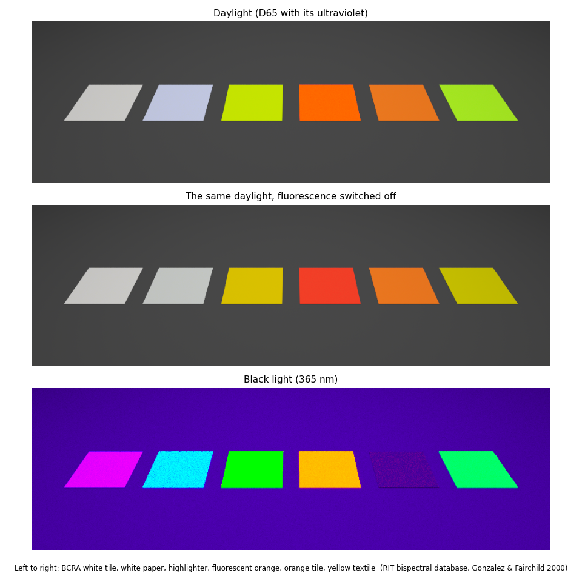

# Fluorescence

A fluorescent surface absorbs light at one wavelength and sends it out again at a longer one. White paper with an optical brightener turns ultraviolet into blue and looks "whiter than white" in daylight; highlighters and fluorescent pigments turn blue and green light into yellow, orange and red and can send out more light at some wavelengths than a white surface reflects. An RGB renderer cannot do this: light does not change color at a surface in RGB. The spectral build follows each path at a wavelength, so a path can change its wavelength at such a surface.



Left to right: a white ceramic tile, white printer paper, a highlighter on an index card, a fluorescent orange pigment, an orange ceramic tile, a yellow textile (spectral build, 1024 samples per pixel). In daylight the paper is bluer than the tile and the highlighter, the pigment and the textile glow; switched off, they are ordinary colors. Under the black light the fluorescent samples glow in the colors they emit, the orange tile stays dark, and the white tile only reflects the lamp's violet leak (405 nm light lies outside sRGB and shows as magenta here). `tools/studies/fluorescence_figure.py` makes the figure.

## 1. Using it

```jsonc
"materials": {
  "paper": { "type": "fluorescent", "file": "assets/Fluorescence/rit_bispectral/Labsphere/PHP8HPWH.BFC" },
  "lamp":  { "type": "emission", "spectrum": "d65uv", "radiance": 3 }
}
```

- `file` is a bispectral matrix in the format of the Labsphere BFC-450 (`.BFC`). `"fluorescence": false` keeps the reflectance and drops the fluorescence, for comparison.
- The matrices come from the RIT database (section 2), which is not part of this repository: `python tools/data/rit_bispectral.py fetch` downloads it (6.8 MB) to `GoLD_rayt/assets/Fluorescence/rit_bispectral/`, and `python tools/data/rit_bispectral.py list` lists the samples by the strength of their fluorescence.
- The light must have ultraviolet to excite an optical brightener: the preset `"d65uv"` is D65 with its part from 300 to 380 nm (the same as `"d65"` in the visible), blackbody lights (`"tungsten"`, `{ "blackbody": K }`) and spectra read from a file carry theirs. `assets/Illuminants/blacklight_365nm.csv` is a synthetic black light (a band at 365 nm and a 1 % violet leak at 405 nm).

## 2. The data

Gonzalez and Fairchild measured 144 materials, mostly prints, papers, inks and fluorescent pigments, with a Labsphere BFC-450 bispectral colorimeter (Color Imaging Conference 2000) and offered the matrices on the site of RIT's Munsell Color Science Laboratory; the `bcraday*` folders hold repeated measurements of ceramic reference tiles. No license is stated, so the files are downloaded, not redistributed. Hua, Tázlar, Fichet and Wilkie used the same database for fluorescent rendering (Computer Graphics Forum 2023) and found one file wrong (`IXCAXORA.BFC`, by far the "strongest" in the list).

Each matrix has rows for the emission wavelengths 380 to 780 nm and columns for the excitation wavelengths 300 to 780 nm, every 10 nm. The diagonal is the reflectance (light that leaves at the wavelength it came in at, fluorescence within the same 10 nm band included); an entry below the diagonal is the radiance factor at the row's wavelength for light in the column's 10 nm band. When a file is read:

- Entries whose excitation is 20 nm or more above the emission become 0: light does not fluoresce to shorter wavelengths, and these entries are noise. Their RMS is the matrix's noise (0.00066 in the white plastic "Ciba #8", which has an optical brightener; 0.0013 in the fluorescent orange).
- Fluorescence entries below 3 times that noise become 0, and so do negative ones. Setting only the negative entries to 0 would leave the positive half of the noise, which adds up over a row: the white plastic's red under D65 came out 1.8 % higher, and a ceramic tile that does not fluoresce glowed under the black light, which is almost all ultraviolet. In the white plastic this removes 440 entries summing to 0.35 (and 571 negative ones summing to −0.68); weak true fluorescence below the threshold goes with them.
- The column next to the diagonal on the long side (+10 nm) is kept. The instrument's 10 nm bands overlap there, and the column holds a real share of the light (in the yellow golf ball more than any single band below the diagonal).

## 3. Model

Under light of spectral irradiance E, the diffuse surface sends

```
L(λo) = (1/π) [ R(λo) E(λo) + Σ_c D(λo, c) Ē(c) ]
```

where R is the diagonal, D the matrix and Ē(c) the irradiance averaged over the band of column c (ASTM E2152 writes the same sum with E sampled at the column wavelengths). Rows between the measured emission wavelengths are interpolated linearly.

A path from the camera arrives at the surface with the wavelengths the camera records (four per path, hero wavelength sampling). For each wavelength λo, with F(λo) = Σ_c D(λo, c), the surface chooses reflection with probability R / (R + F) and fluorescence with F / (R + F). For fluorescence it draws the excitation wavelength λi from a mixture of two densities: a quarter of the time from the matrix row alone (a band with probability D(λo, c) / F, a uniform wavelength in it), otherwise from the row times the scene's light spectrum, the sum of its emission materials' spectra. The second finds the band of a narrow light: under the black light only 5 to 26 % of the excitation wavelengths drawn from the row alone fall in the lamp's band, and one sample's relative deviation at the vertex is 3 to 6 (white paper, highlighter, fluorescent orange, yellow textile); with the mixture it is 0.9 to 1.2. The vertex weight (R + F) p_row(λi) / p_mixture(λi) keeps the estimate unbiased whatever spectrum is given; it is at most 4 where the spectrum leaves a light out. The wavelength goes on at λi, and the vertex is a Lambertian surface of that albedo, which can exceed 1: the fluorescent orange pigment sends about 1.8 at 630 nm. Light sampling and the next direction both use the new wavelengths. A diffuse surface sends every wavelength in the same direction, so the four wavelengths keep sharing the path, each with its own excitation wavelength; a dispersive surface later still reduces the path to one. The film records the camera's wavelengths: the integrator keeps the wavelengths the path carries apart from those the camera sampled (`Render/Integrator.cpp`, `Li`).

A first version followed one wavelength from the first fluorescent surface on and drew the excitation from the row alone. Its pictures were too noisy: keeping the four wavelengths lowered the standard error on a fluorescent sphere in daylight by 3 to 10 times (most in red), and the light's spectrum lowered it by 1.7 times under a black light (inside a sphere that shines the black light; the camera's own wavelength sampling is the rest of the noise there).

The RGB build cannot shift wavelengths. There the surface is a Lambertian of its color under D65, ultraviolet included: the total radiance factor R(λo) + Σ_c D(λo, c) Ē_D65(c) / E_D65(λo), reduced to RGB like any measured reflectance. Under a D65 light the RGB and the spectral build agree; under any other light the RGB build is wrong in the way fluorescence makes it wrong (it keeps the daylight glow).

## 4. Light with ultraviolet

The camera samples wavelengths from 360 to 830 nm, and the film's white point is D65 from 380 to 780 nm. Light that only excites fluorescence lies outside that range: the emission tables of lights (blackbodies, spectra from files) now start at 300 nm, and `"d65uv"` adds CIE D65 from 300 to 375 nm (`Color/Illuminants.hpp`, `evaluateD65Full`). The camera never samples below 360 nm, so nothing that the renderer drew before changes (two renders made before the change came out the same to the bit). Lights given as RGB, environment maps and the preset `"d65"` stay without ultraviolet.

## 5. Checks

`--scene fluorescence` (both builds; about 3 minutes in the spectral build):

| Check | Result (spectral build) |
|---|---|
| The excitation sampler against the matrix (a synthetic matrix, λo = 455 nm, 400 000 samples) | the share in every band within 1.5 standard errors |
| `reemit()` as an estimator: the mean of albedo × g(new wavelength) against R g(λo) + ∫ b g, for g the light, with the row alone and with the light's spectrum; the share of shifted wavelengths against F / (R + F) | black light, row alone: 9.177e6 against 9.119e6 ± 0.033e6 (one sample's deviation 3.19); with the light: 9.116e6 ± 0.018e6 (1.78); D65: 108.44 against 108.44 ± 0.04; shifted 0.2809 against 0.2806 ± 0.0005 |
| A fluorescent sphere inside a sphere that shines `d65uv` inward: every point receives the same light, so the sphere must send R Le + ∫ b Le (b = D / band width), integrated against the film's sensor | synthetic matrix: (0.80265, 0.79433, 0.90783) against (0.80266, 0.79435, 0.90797), ± (0.00006, 0.00005, 0.00017) |
| The same with the fluorescence off: R Le | (0.80012, 0.80002, 0.80035) against (0.80003, 0.79997, 0.80020) |
| The synthetic sphere inside a sphere that shines the black light, with the row alone and with the light's spectrum | (1678, −3529, 67195) ± (10, 9, 76) and (1689, −3536, 67179) ± (6, 6, 44) against (1690, −3538, 67191) |
| The same with the white plastic "Ciba #8" and the fluorescent orange of the RIT database (when they are on this PC), in daylight and under the black light | daylight: (0.8430, 0.8444, 0.9045) against (0.8428, 0.8443, 0.9046); (2.4509, 0.1788, −0.0257) against (2.4509, 0.1787, −0.0257); black light: within 1.5 standard errors |

In the RGB build the same sphere gives the color under D65, and it agrees with the spectral build's result within 0.03 %: the spectral path tracing and the RGB build's sum over the matrix are separate calculations of the same quantity. The other self-checks (`furnace`, `lights`, `volume`, `dispersion`, `film`, `metals`, `thinfilm`, `layered`) pass in both builds after the change.

## 6. Limits

- Path tracing only. The caustic photon map, LVC-BPT and manifold next event estimation do not call the wavelength choice: there the surface reflects its diagonal and does not fluoresce. It cannot be part of a `mix`.
- The surface is Lambertian; the gloss of paper and the angle dependence of the measurement are not modeled. The BFC-450's measuring geometry was not checked.
- The surface does not emit in the ultraviolet or beyond 780 nm (no rows there).
- After the shift the four wavelengths no longer form the evenly spaced set of hero wavelength sampling; through a medium whose coefficients depend on the wavelength this case was not checked.
- The RGB build draws the daylight color under every light.

## 7. Sources

- S. Gonzalez, M. D. Fairchild, "Evaluation of bispectral spectrophotometry for accurate colorimetry of printing materials", Color Imaging Conference 2000, pp. 14–23 (as cited by Hua et al.); the database and a description: RIT Munsell Color Science Laboratory, "Fluorescent Database".
- Q. Hua, V. Tázlar, A. Fichet, A. Wilkie, "Efficient Storage and Importance Sampling for Fluorescent Reflectance", Computer Graphics Forum 42(1), 2023, pp. 47–59, DOI 10.1111/cgf.14716.
- ASTM E2152, "Standard Practice for Computing the Colors of Fluorescent Objects from Bispectral Photometric Data" (the definition of the matrix; the standard itself was not read).
