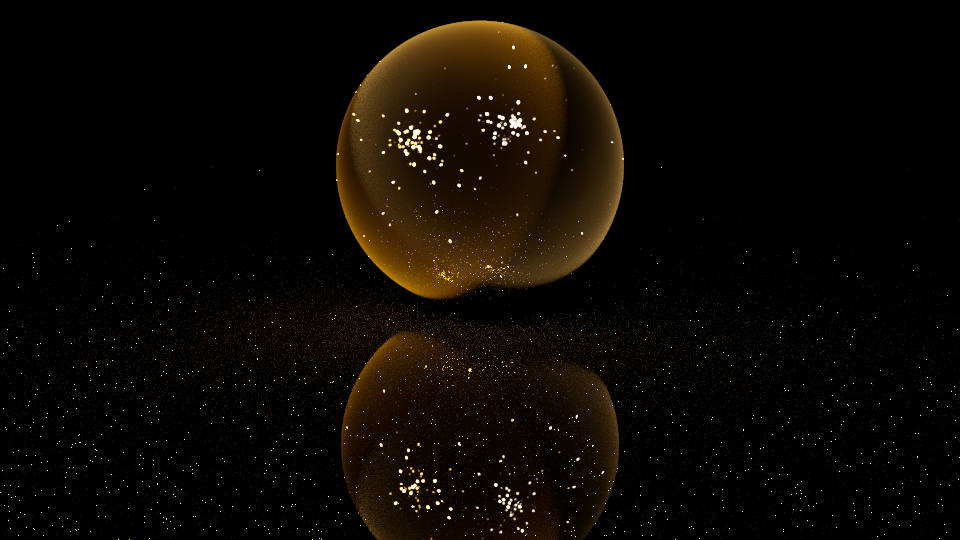
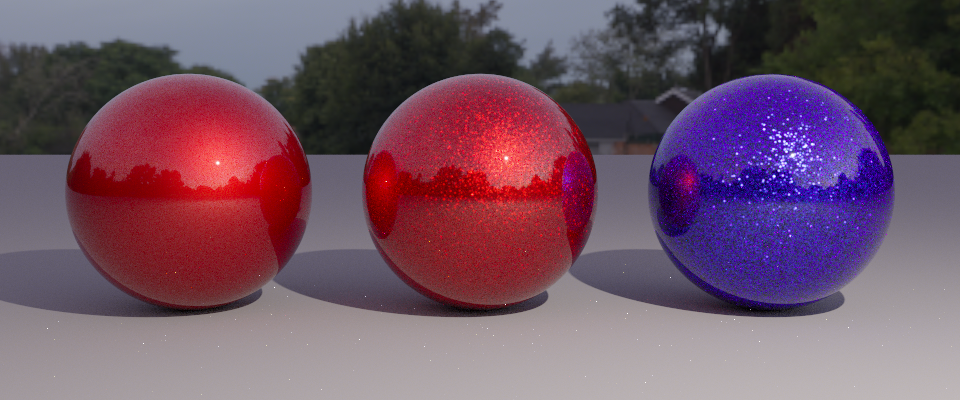
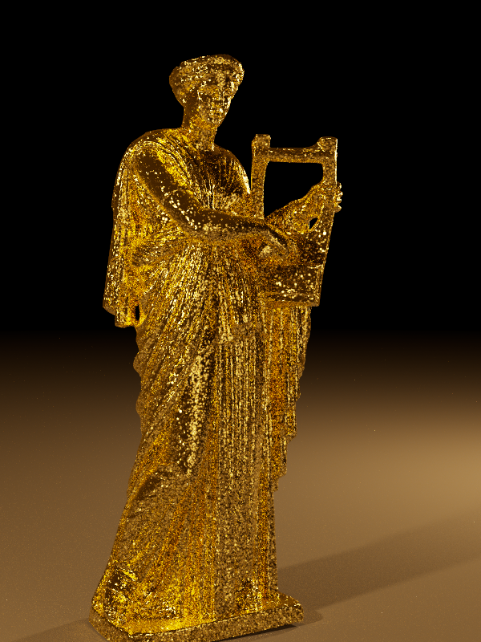

# Glints: a GGX distribution made of a finite number of facets

**Status:** the five planned stages are done. The distribution (`Microfacet/GlintNDF`) is an option of the rough metal (`"glints"` on a `conductor`,
section 3), with its own sampling where a pixel holds few facets, also in mirror images and behind glass; `--scene glints` checks
them. It also works as the base of a layered material: flakes under a clear coat.

(`scenes/glints_spheres.json`, spectral build, 256 spp, 88 s. The same gold and the same roughness 0.3 three times, under two small
lamps: the smooth distribution, 3 × 10⁵ facets per m² and 10⁷. The grain on the lower halves is the floor's light in single facets, and in good part still noise: at 64 spp the noise there
is 78 % of the mean on the middle sphere and 40 % on the right one, so about half of that at 256 spp.)

A smooth microfacet model says how much of the surface faces each direction, as if every pixel held infinitely many facets. Metallic
paint, lamé and pearl pigments hold few enough for single facets to flash. The glinty distribution keeps the smooth model's average
and puts a finite number of facets under it.

## 1. The model

After P. Kemppinen, L. Paulin, T. Thonat, J.-M. Thiery, J. Lehtinen and T. Boubekeur, "Evaluating and Sampling Glinty NDFs in Constant
Time", *ACM Transactions on Graphics* 44(6), 2025 (SIGGRAPH Asia). I read the authors' preprint in full and wrote the code from its
text; their shader was not used.

- **A facet is a point in four dimensions**: two for its place on the surface (texture space), two for its normal. The normals live in
  a disc U inscribed in the unit square, where the map T(ω) = L(Mω / |Mω|) puts a micro-normal: M = diag(1/α_x, 1/α_y, 1) turns the
  GGX distribution into the normals of a hemisphere, and L(x, y, z) = (x, y) / √(1 + z) is Lambert's equal-area projection.
- **One facet per cell of a 4D grid**, at a random place in the cell (and no facet where that place falls outside the disc). The
  cell's index seeds the random numbers, so nothing is stored or precomputed.
- **A facet answers** the half vector with a Gaussian lobe N_a in U and the pixel with the pixel's filter f (a Gaussian on the
  surface):

  D\*(x, ω) = D(ω) × Σ_i N_a(T(ω) − μ_i) f(x_i − x)

  in units where the grid holds one facet per unit of (area on the surface × area in U). Averaged over the surface the sum is 1, so
  D\* averages to the smooth D.
- **The grid follows the pixel.** Level l has spatial cells of side 2^l and 2^l × 2^l angular cells: the same number of facets at
  every level, traded between place and direction. The level is chosen so that a spatial cell is 2 to 4 standard deviations of the
  filter wide; a few spatial cells then cover the pixel.
- **Near facets one by one, far facets by their expectation.** Within those spatial cells, the facets of the 2 × 2 angular cells
  nearest to T(ω) are summed. The others are replaced by what they give on average: the lobe's mass over the unit square minus that
  block (error functions). The cost per evaluation is therefore bounded, whatever the size of the pixel.
- **Between two levels** each facet is kept or dropped by a roulette with the level's weight instead of being blended, so a glint keeps
  its brightness.

Parameters (`GlintParams`): the roughness α_x, α_y of the whole distribution, the micro-roughness (the width of one facet's lobe), the
density (facets per unit area of texture space), a seed for another arrangement.

## 2. Where the code differs from the paper

- **Normalization.** The printed formulas do not fix the constants unambiguously (the Gaussian is written with a 1D normalization,
  the result is scaled by 1/π). Here the constants follow from the requirement that D\* average to D (the paper's Eq. 2).
- **The lobe's width.** The paper widens a lobe by √D as a stand-in for the map's Jacobian. Here it is the true Jacobian of T,
  det M / (8 |Mω|³), so the micro-roughness is the lobe's standard deviation in radians of the half vector (their geometric mean
  along the two axes; the map stretches a lobe, as in the paper).
- **The spatial neighbourhood** covers 4 standard deviations of the filter (up to 5 × 5 cells) instead of a fixed small block: a
  renderer that is compared with references should not lose the filter's tails. This choice, and the level being 2 to 4 standard
  deviations per cell, are mine; the paper does not state its own.
- **The roulette is exact by default** (keep with probability w). The paper softens it (ε = 0.1) for smooth animation;
  `rouletteSoftness` restores that.
- **The error function** is the standard library's, not a rational approximation.
- **Importance sampling is a different procedure** (section 3): the paper's has no density that can be written down exactly, and
  an unbiased path tracer needs one.
- Not yet here: anisotropic facets, coloured facets.

## 3. In the renderer

- **Scene file.** A `conductor` takes `"glints": { "density", "microRoughness", "filter", "seed" }`: facets per square unit of the
  scene (metres), the width of one facet's lobe in radians (default 0.01), the pixel filter's standard deviation in pixels (default
  0.5), another arrangement. The roughness is the conductor's own. Only D changes: Fresnel, masking and the multiple-scattering
  compensation are those of the smooth metal. `"sampling": false` switches the facets' own sampling off (below).
- **The pixel's size** comes from the camera (`PathIntegrator::setPixelFootprints`, switched on by a scene with glints): once per
  pixel, the rays of the pixel's centre and of its two neighbours through the same point of the lens give the spacing of neighbouring
  rays at the lens and its growth with distance (any camera: pinhole, real lens, orthographic). A camera ray carries the two numbers,
  the hit turns them into a length (`SurfaceInteraction::pixelSpacing`), and the material makes the filter from it: a disc across the
  ray, projected along the ray onto the surface (an ellipse, long in the plane of incidence; the cosine is held above 0.02).
- **No texture coordinates.** The facets are laid out in world space on the three coordinate planes: three arrangements, each seen
  through the footprint projected onto its plane, mixed by a roulette with the weights |n_k| / Σ|n| (the paper's triplanar extension;
  a plane the surface is nearly perpendicular to is left out). Spheres, quads and meshes without UVs work alike. The density is per
  area of the coordinate plane, so a surface tilted against all three carries somewhat fewer facets per area than one that faces an
  axis (by |n_k| for each arrangement).
- **Beyond the first hit** (the paper leaves path tracing as future work; this part is the renderer's own). The footprint follows
  the path: every ray carries the pixel's spacing and, apart from it, the blur its earlier bounces add. A perfect mirror or smooth
  glass hands the footprint on unchanged, as a flat one would (the curvature of the surface and the bending at a refraction are
  ignored: the footprint comes out too small behind a curved mirror, which costs noise, not sharpness). Any other bounce spreads the
  path over its lobe, and the lobe's angular width, taken from the density of the sampled direction as 1 / √(2π pdf) (the standard
  deviation of a Gaussian lobe with that peak), widens the blur from there on. The material's filter is the pixel's filter and the
  blur added in quadrature. So a mirror image keeps its glints, a polished metal shows them blurred, and after a diffuse bounce the
  footprint holds so many facets that the answer is the smooth distribution (exactly, beyond level 12). A camera ray keeps its
  pixel through the boundary of a fog and through a see-through layer. Without a known footprint (the bidirectional integrator,
  light paths) the material answers with the smooth distribution, the facets' average.

  

  (`scenes/glints_reflection.json`, spectral build, 256 spp, 118 s. 10⁵ facets per m². The mirror image is seen from below the
  floor, so its glints are the same facets under slightly different angles.)
- **The pixel is filtered twice**: by the facets' filter and by the samples spread over the pixel. A glint is therefore a little
  wider than the filter says. A smaller `filter` gives sharper glints and needs more samples.
- **Sampling the facets.** Under a large light the smooth distribution's samples rarely land inside the narrow lobes, and the
  picture is noisy. Where a pixel holds few facets, half of the samples are therefore drawn from the lobes: (1) a level, with the
  blend's probabilities; (2) an angular cell, uniformly; (3) a facet of that cell under the pixel, in proportion to its weight (the
  pixel filter at the facet); (4) a point from the facet's lobe, cut to a square window of half width min(4 σ, half a cell). The
  window makes the density exact and as cheap as an evaluation: a point can only come from the 2 × 2 angular cells nearest to it.
  An empty cell or a point outside the disc gives no sample, which the density accounts for. The far facets' expectation is left
  to the smooth sampling, with which this one is mixed half and half.
- **Only below level 1.5** (about three facets per pixel). Measured on `glints_spheres.json` at 64 spp, the lower half of the middle
  sphere, lit by the floor (noise from two renders with different seeds, the brightest 0.5 % of the differences clipped):

  | Facets per m² (level) | Noise without / with | Time without / with |
  |---|---|---|
  | 3 × 10³ (about −1.2) | 357 % / 114 % of the mean | 12 s / 18 s |
  | 3 × 10⁴ (about 0.5; the right sphere) | 187 % / 92 % | the same renders |
  | 3 × 10⁵ (about 2.1) | 78 % / 62 % | 19 s / 44 s |

  With few facets the variance falls about tenfold for half as much time again. With many, the gain does not pay for the density
  (per time, the plain sampling wins), so the facets are sampled only below level 1.5. The weakness is step 2: the cell is chosen
  without knowing how much its facets weigh under the pixel. Under a small lamp the mixed sampling is a little noisier than the
  plain one (8 % against 4 % on the upper half at 3 × 10³), because the lamp is found by light sampling either way.
- **Under a clear coat** (`"glints"` in the metal `base` of a `layered` material: metallic paint). The coat's random walk evaluates
  the base in its own local frame, so it hands the base the hit's place, its footprint and that frame (`SurfaceInteraction::
  localFrame`); the facets stay laid out in the world. Two approximations. The footprint's ellipse is built with the direction
  inside the coat, so it is a little shorter at grazing views than the pixel's. And **only the walk's first meeting with the base
  has glints**; after a reflection inside the coat the base answers with its smooth distribution. Without that, every further
  meeting multiplies the walk's weight by another heavy-tailed factor: single evaluations a billion times the mean were measured
  (the average of 2 million evaluations was 737 ± 734 where it should be 0.42). With it the averages are 0.418 to 0.421 in all four
  cases tried (two pixel sizes, with and without the facets' sampling), and the later meetings carry only a few percent of the light.

  

  (`scenes/glints_paint.json`, spectral build, 256 spp, 191 s. Silver of roughness 0.35 under a tinted coat; the left sphere has the
  smooth distribution.)
- **A mesh without texture coordinates:**

  

  (`scenes/glints_erato.json`, spectral build, 256 spp, 190 s: rough gold as 3 × 10⁶ facets per m² on the Erato scan (Geoffrey Marchal,
  CC BY 4.0, `assets/Meshes/erato/CREDITS.md`; the mesh is not in the repository), under two small lamps and a large dim one.)
- **No denoiser.** It takes single bright pixels for noise.
- Pictures without glints are unchanged: three scene files rendered before and after with the same seed are identical byte for byte.

## 4. What the model does not do (the paper's own statements)

- **It does not conserve energy exactly.** Lobes of facets near the disc's rim reach outside it, and the expectation is taken over the
  square that holds the disc. The loss grows when the micro-roughness is not small against the roughness (section 5).
- **Roughness and micro-roughness are not independent.** A micro-roughness near the roughness itself blurs the highlight: physically
  sensible, but the two must be chosen together.
- **Path tracing is left as future work** in the paper (it would need the pixel's footprint carried along the path). That part will be
  this renderer's own.

## 5. Checks (`--scene glints`, both builds, about 8 minutes)

| Check | Result |
|---|---|
| a. The map T there and back; its Jacobian against finite differences; D against the engine's GGX (anisotropic α) | 4 × 10⁻¹⁵; 5 × 10⁻⁸; 9 × 10⁻¹⁶ |
| b. Levels 0 and 1, where every facet is summed, against a plain sum over all facets (which visits 6 standard deviations of the filter) | sum of differences / sum below 7 × 10⁻⁶ |
| c. The average over the surface is the smooth GGX: 8 cases, levels −2 to 9.2, footprints stretched up to 8 : 1, anisotropic roughness | within the standard error (0.002 to 0.3 %) in every case |
| d. Level 3: the far facets replaced by their expectation against the plain sum of all 64 angular cells | averages 1.006 and 1.000, each ± 0.002 |
| e. Energy against the smooth distribution (half vectors drawn from D cos θ, averaged over the surface): α 0.1 / 0.3 / 0.6, micro-roughness 0.01 / 0.05, levels 1.5 / 6.5 | within the error in 10 cases; −2.1 % and −0.8 % for α 0.1 with micro-roughness 0.05 (a lobe half as wide as the distribution) |
| f. Many facets per pixel: the spread of D\* / D over pixels | 0.15 % at level 11, 0.05 % at level 11.9; exactly 1 beyond level 12 |
| g. (information) the paper's softened roulette, level 2.5 | average off by −0.2 ± 0.3 % |
| h. The material: rough gold with glints on a plane tilted against all three coordinate planes, its BRDF averaged over the plane against the smooth gold's, for pixels of 0.004, 0.04 and 0.6 units; and with no pixel size | −0.9 ± 0.3 %, 0.0 ± 0.3 %, −0.06 ± 0.01 %; exactly the smooth BRDF |
| i. The pixel's size at the hit: a plane 5 m in front of a pinhole camera, and an orthographic view, against closed forms | 0.2 % and 0.0 % (RGB build); 0.4 % and 0.2 % (spectral build: its noise) |
| j. Sampling the facets: six moments (1, x, y, x², y², xy) of the drawn half vectors against the same moments of the density, at levels −1.5, 0.6, 2.4 (stretched footprint, weight 0.6) and 4.3 | within 4 standard errors + 0.002; the share of draws that give a sample (100, 100, 55.6, 75.6 %) equals the density's integral |
| k. The material's reflectance under uniform light at one place, estimated by `sample()` with and without the facets' sampling, three pixel sizes | equal within the errors (0.4 % or better) in both builds |
| l. The footprint beyond the first hit: through a 10 cm sheet of smooth glass the plane at 5 m sees the pixel's size of a 5 m ray (times the sheet's transmittance) and no blur; through rough glass (roughness 0.2) a blur | 1.1 % off (RGB build), 0.0 % (spectral); blur 0; blur 0.39 and 0.44 m |
| m. Flakes under a clear coat: the layered BRDF (coat of index 1.5 over rough gold) averaged over the tilted plane, with against without glints in the base, two pixel sizes | 0.2 ± 0.6 % and 0.07 ± 0.08 % (RGB build), 0.4 ± 0.6 % and 0.11 ± 0.06 % (spectral) |

The averages are unbiased estimates, so they are judged by their standard error (4 standard errors plus 0.3 %); the energy loss is an
intended approximation and is judged by a bound (2 %).
