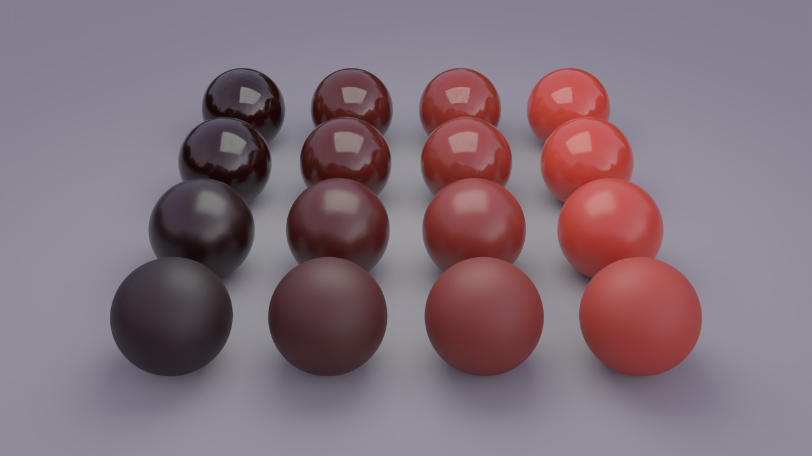
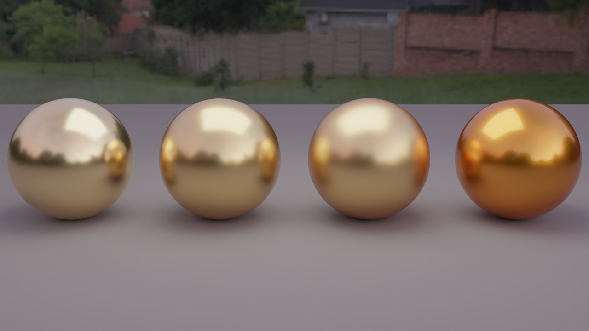
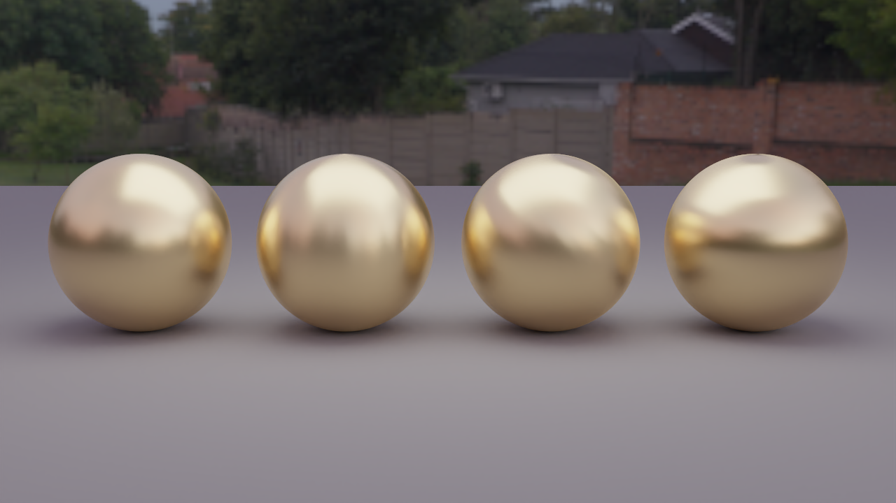
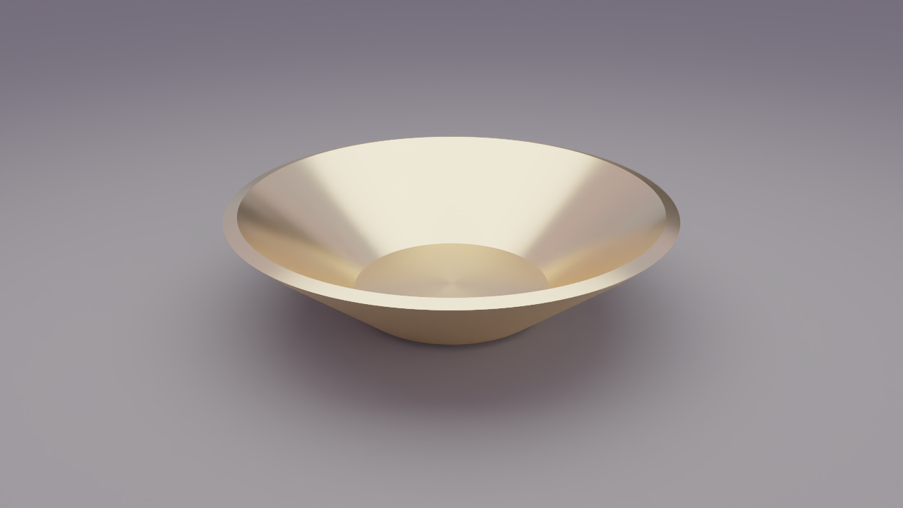

# Gloss: layered coats (lacquered gold, car paint)

A material with a transparent coat over a base is computed as **light bouncing back and forth between the layers**. Result: changing only the roughness of the coat and the brightness of the base moves the "sharpness" and the "contrast" of the gloss independently. A coat over gold also changes its color (amber lacquer).

## 1. What was added

| Item | Where |
|---|---|
| Layered material `LayeredCoat` (the coat is a rough dielectric, the base is diffuse or metal; a stochastic trace sums the bounces between the layers) | `include/Materials/LayeredCoat.hpp`, `src/Materials/LayeredCoat.cpp` |
| The base metal is evaluated with the index of refraction inside the coat (`mediumIor` of `RoughConductor`) | `include/Materials/RoughConductor.hpp` |
| `"type": "layered"` in the scene file | `docs/SCENE_FILE.md` |
| Self-check `--scene layered` | `src/Cli/Checks/LayeredChecks.cpp` |
| Example scenes | `scenes/layered_gloss.json` (grid of roughness x base brightness), `scenes/layered_lacquer.json` (lacquered gold) |

## 2. How it works

- **Bounces between the layers.** Part of the light is reflected at the surface of the coat and the rest enters. After scattering at the base it returns, and part of it is reflected again at the underside of the coat and goes back down. This continues indefinitely. A closed form exists only in special cases, such as a smooth coat over a diffuse base.
- **Stochastic trace.** The bounces between the layers are followed a few times with random numbers and averaged (Jakob et al. 2014; the same approach as `LayeredBxDF` in pbrt-v4). It handles any roughness and any base; the evaluated value carries some noise (no bias).
- **Surface of the coat.** A rough dielectric (GGX microfacets, with refraction after Walter et al. 2007). The roughness has a lower bound (0.02), so a perfectly mirror-like coat is not represented (it would need a delta distribution).
- **Base metal.** The inside of the coat is a medium of index n (default 1.5), so the Fresnel reflection of the metal is computed with the relative index (η + i k) / n.
- **Colored coat.** `tint` is the transmittance (RGB) of the coat for a path along the normal. Oblique paths are longer and therefore attenuated more (Beer-Lambert). It represents amber lacquer or colored varnish.
- **Direction sampling.** The direction in which the trace leaves the layers is used directly as the sample. Its weight is the throughput of the trace, which is exact. The probability density that the integrator uses is a deterministic approximation (a mixture of the coat's own reflection lobe and a cosine lobe); it is used only for the weighting against light sampling (an approximate density does not introduce bias).

## 3. What was verified (`--scene layered`, PASS in both RGB and spectral builds)

- **Agreement with the closed form.** For a nearly smooth coat (roughness 0.04) over a diffuse base (reflectance 0.8), the directional albedo is F + (1 − F) R (1 − Fᵢ) / (1 − R Fᵢ). At incidence 0°, 40° and 70° the difference is within 0.1%.
- **`eval()` and `sample()` give the same value.** The two are independent estimators (a trace with direct lighting, and a forward trace). They agree for 5 cases x 2 incidence angles: roughness 0.1 to 0.4, diffuse and gold bases, tinted coats (at roughness 0.4: 0.2030 and 0.2029).
- **Energy.** Even over a diffuse base of reflectance 1, the directional albedo does not exceed 1 (maximum 0.936; the loss of the microfacet model for a rough coat).
- **Reciprocity.** The means of f(a, b) and f(b, a) agree.

**An error found on the way:** in the weighting of direct light, the probability density of the other strategy was used with the direction taken the wrong way round (a slip when copying the pbrt formula). For a rough coat `eval()` came out 4 to 6% too high, which was found by comparing with `sample()`. After changing it to the density of the inward direction obtained when the coat is sampled from outside, the two agree.

## 4. Examples

**Gloss grid** (`scenes/layered_gloss.json`. Red diffuse base, coat index 1.5, 1280x720, 192 spp, denoised. About 3 minutes):

- Rows (back to front): coat roughness 0.03, 0.12, 0.3, 0.55. The rougher the coat, the more blurred the reflections and the wider the highlights, so the gloss loses "sharpness".
- Columns (left to right): base brightness 0.02, 0.12, 0.40, 0.80. The darker the base, the more a reflection of the same strength stands out, so the gloss gains "contrast".
- These two axes move independently. They correspond to the axes used when gloss is organized with two parameters in perception research (Pellacini et al. 2000).

**Lacquered gold** (`scenes/layered_lacquer.json`. Same settings. About 2.5 minutes):

- Adding a clear coat puts a sharp reflection on top of the rough reflection of the gold. With the satin coat (0.3) that reflection is blurred.
- The amber coat (`tint` [1.0, 0.72, 0.30]) dyes the gold with the color of a double pass through the coat (there and back). Blue is strongly reduced, giving a deep orange like copper.

The renders are the images after denoising (OIDN). Before denoising, the stochastic evaluation leaves grainy noise.

## 5. Anisotropy (hairline metal, lathe-turned metal)

When a metal is polished in one direction, fine grooves in that direction form on the surface. The slope along the grooves is small and the slope across them is large. The highlight therefore **stretches in a band perpendicular to the grooves**. Because the roughness differs with direction (separate α for x and y), it is called anisotropic.

**What was added**

- **Supplying the tangent.** The direction of the anisotropy x axis is decided by the shape: for a sphere, the direction of the lines of latitude; for a quad, the direction of the first edge; for a mesh, the direction in which the texture coordinate u increases (the first edge if there are no coordinates). For lathe-turned surfaces (`lathe`) a coordinate was added in which u runs around the axis.
- **Material frame.** `RoughConductor` builds a frame from the tangent and rotates it about the normal by `rotation` (degrees). The same tangent is passed to the base of a `LayeredCoat`.
- **Convention for the direction.** `anisotropy > 0` is rough along the tangent (the highlight stretches along the tangent). `anisotropy < 0` is smooth along the tangent, that is, **grooves along the tangent** (hairline finish).
- **Scene file.** `anisotropy` (−1 to 1) and `rotation` (degrees) for a metal (`conductor`) and for the `base` of `layered`.

**What was verified** (`--scene aniso`, PASS in both RGB and spectral builds)

- The tangent direction that the shapes produce (sphere, quad, mesh; with and without texture coordinates).
- The density of the visible normals of the anisotropic GGX integrates to 1 over the normals facing outward (error within 0.004%).
- The directional albedo of rough anisotropic gold agrees between `sample()` and `eval()`.
- Rotating the axes by ρ gives the same result as shifting the azimuth by −ρ without rotating (3 cases, within 0.1%).
- Lacquer over anisotropic gold also agrees between `sample()` and `eval()`.

In the first run, the integral of the visible-normal density exceeded 1; that was an error in the check, which also integrated normals facing away (the half vector of an actual reflection always faces outward).

**Examples**

**Spheres** (`scenes/aniso_spheres.json`. Gold, roughness 0.3, 1280x720, 192 spp, denoised. About 1 minute): from the left, isotropic, hairline along the tangent (`anisotropy` −0.9), grooves rotated by 45°, grooves rotated by 90°. The tangent of a sphere follows the lines of latitude, so the grooves run around the axis, and the highlight stretches vertically (second), diagonally (third) and horizontally (fourth).

**Lathe-turned gold bowl** (`scenes/aniso_bowl.json`. Same settings. About 3.5 minutes): the grooves become circles around the axis, and the highlight stretches perpendicular to them, radially (fan-shaped) toward the inside of the bowl.

## References

- Jakob, d'Eon, Jakob, Marschner, "A Comprehensive Framework for Rendering Layered Materials", ACM TOG 33(4), Article 118, 2014 (SIGGRAPH).
- Pharr, Jakob, Humphreys, *Physically Based Rendering*, 4th ed. (`LayeredBxDF`).
- Walter, Marschner, Li, Torrance, "Microfacet Models for Refraction through Rough Surfaces", EGSR 2007.
- Heitz, "Sampling the GGX Distribution of Visible Normals", JCGT 7(4), 2018.
