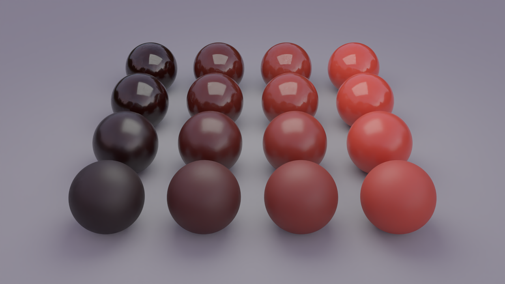
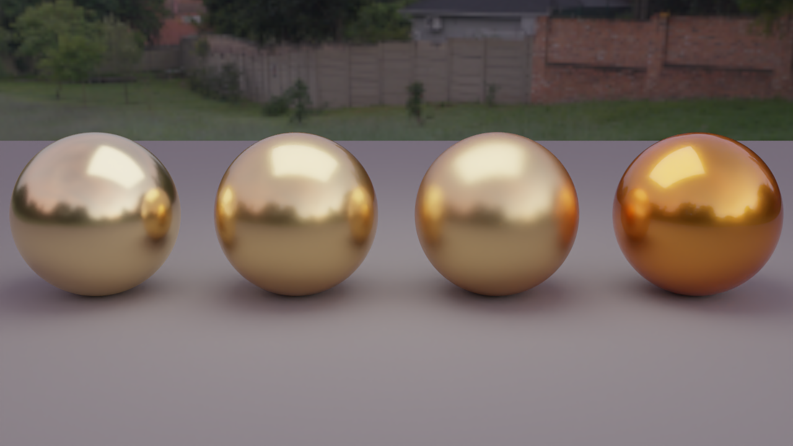
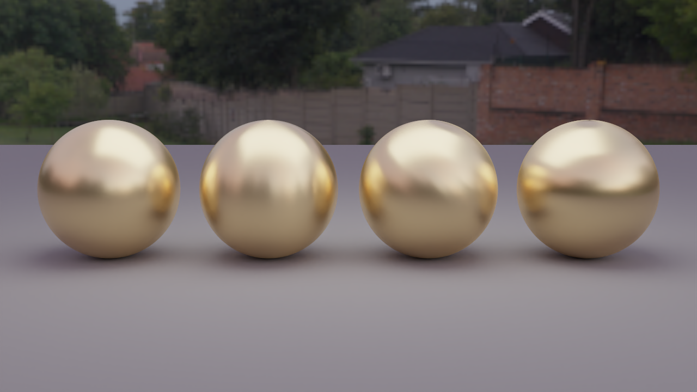
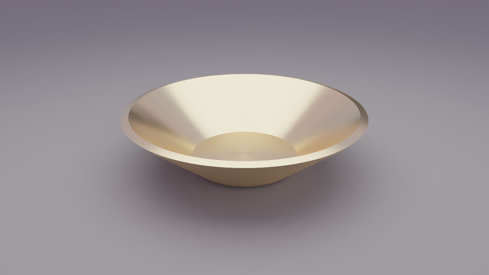

# 光沢: 層構造のコート（漆を塗った金、車の塗装）

下地の上に透明なコートがある材質を、**層の間を光が行き来する計算**で表した。結論: コートの粗さと下地の明るさを変えるだけで、光沢の「鮮明さ」と「コントラスト」が独立に動く。金の上のコートは、色も変える（琥珀色の漆）。

## 1. 何を足したか

| 物 | 場所 |
|---|---|
| 層構造の材質 `LayeredCoat`（コートは粗い誘電体、下地は拡散または金属。確率的な追跡で、層の往復を足し合わせる） | `include/Materials/LayeredCoat.hpp`、`src/Materials/LayeredCoat.cpp` |
| 下地の金属を、コートの中の屈折率で扱う（`RoughConductor` の `mediumIor`） | `include/Materials/RoughConductor.hpp` |
| シーンファイルの `"type": "layered"` | `docs/SCENE_FILE.md` |
| 自己チェック `--scene layered` | `src/Cli/Checks/LayeredChecks.cpp` |
| 作例 | `scenes/layered_gloss.json`（粗さ × 下地の明るさの格子）、`scenes/layered_lacquer.json`（漆を塗った金） |

## 2. 仕組み

- **層の往復。** 光は、コートの表面で一部が反射し、残りが中へ入る。下地で散乱して戻ると、コートの裏側でまた一部が反射して下へ戻る。これが無限に続く。閉じた式は、コートが滑らかで下地が拡散のような特別な場合にしかない。
- **確率的な追跡。** 層の間の往復を、乱数で何回か追って平均する（Jakob ら 2014、pbrt-v4 の `LayeredBxDF` と同じ方式）。任意の粗さと下地に対応し、評価値には少しノイズが乗る（偏りはない）。
- **コートの表面。** 粗い誘電体（GGX の微小面。Walter ら 2007 の屈折つき）。粗さには下限（0.02）があり、完全な鏡のコートは表さない（デルタ分布が要るため）。
- **下地の金属。** コートの中は屈折率 n（既定 1.5）の媒質なので、金属のフレネル反射は、相対屈折率 (η + i k) / n で計算する。
- **色つきのコート。** `tint` は、法線方向にコートを通ったときの透過率（RGB）。斜めの経路ほど長く通るので、より濃く効く（Beer-Lambert）。琥珀色の漆や色つきのニスを表す。
- **向きのサンプリング。** 追跡が層を抜けた向きが、そのまま標本になる。重みは追跡の通過率で、厳密。積分器が使う確率密度は、決定的な近似（コート自身の反射ローブと余弦ローブの混合）で、光源のサンプリングとの重みづけだけに使う（近似でも偏りは出ない）。

## 3. 確かめたこと（`--scene layered`、RGB・スペクトルとも PASS）

- **閉じた式との一致。** ほぼ滑らかなコート（粗さ 0.04）の下に、拡散の下地（反射率 0.8）がある場合の方向アルベド = F + (1 − F) R (1 − Fᵢ) / (1 − R Fᵢ)。入射 0°、40°、70° で、差は 0.1% 以内。
- **`eval()` と `sample()` が同じ値。** 2 つは独立な推定量（直接光つきの追跡と、順方向の追跡）。粗さ 0.1〜0.4、拡散と金の下地、色つきのコートの 5 通り × 入射 2 角度で一致（粗さ 0.4 で 0.2030 と 0.2029）。
- **エネルギー。** 反射率 1 の拡散の下地でも、方向アルベドは 1 を超えない（最大 0.936。粗いコートの微小面モデルの損失）。
- **相反性。** f(a, b) と f(b, a) の平均が一致。

**途中で見つけた誤り:** 直接光の重みづけで、相手の戦略の確率密度を、向きを取り違えて使っていた（pbrt の式を写したときの取り違え）。粗いコートで、`eval()` が 4〜6% 高く出て、`sample()` との比較で見つかった。コートを外側から標本抽出したときの、中への向きの密度に直して、一致した。

## 4. 作例

**光沢の格子**（`scenes/layered_gloss.json`。赤い拡散の下地、コートの屈折率 1.5、1280×720、192 spp、デノイズあり。約 3 分）:

- 行（奥から手前）: コートの粗さ 0.03、0.12、0.3、0.55。粗いほど、映り込みがぼやけ、ハイライトが広がって、光沢が「鮮明さ」を失う。
- 列（左から右）: 下地の明るさ 0.02、0.12、0.40、0.80。下地が暗いほど、同じ強さの反射が目立ち、光沢が「コントラスト」を増す。
- この 2 つの軸は、独立に動く。知覚の研究（Pellacini ら 2000）で、光沢を 2 つのパラメータで整理するときの軸に対応する。

**漆を塗った金**（`scenes/layered_lacquer.json`。同じ設定。約 2.5 分）:

- 透明なコートを足すと、金の粗い反射の上に、鮮明な映り込みが重なる。つや消しのコート（0.3）では、その映り込みがぼやける。
- 琥珀色のコート（`tint` [1.0, 0.72, 0.30]）は、金の色を、コートを 2 回通った色（往復）に染める。青が強く減るので、銅のような濃い橙になる。

なお、描画はデノイズ後の画像（OIDN）。デノイズ前は、確率的な評価のため、粒状のノイズが乗る。

## 5. 限界

- コートは、厚みのない面として扱う（層の中での散乱はない）。吸収だけ、`tint` で表す。
- 粗さの下限 0.02。滑らかな鏡のコートは未対応。
- 評価にノイズが乗る。粗いコートの下の金属では、サンプル数が要る。
- コートの異方性、下地の異方性は未対応。
- 実測の BRDF とは、まだ比べていない。

## 6. 次の候補

1. ハイライトのすその形（GGX と Beckmann など）と、光沢の知覚の図。
2. 向きのテクスチャ（接線の場を画像で与える）。
3. 実測の BRDF との比較（hpBRDF の Fake gold と Aluminum、研究室の PC で）。

## 6. 異方性（ヘアラインの金属、旋盤で削った金属）

金属を一方向に研磨すると、表面に同じ向きの細かい溝ができる。溝に沿った傾きは小さく、溝に垂直な傾きは大きい。このため、ハイライトは、**溝に垂直な向きに帯状に伸びる**。粗さが方向で違う（x と y で別の α）ので、異方性と呼ぶ。

**何を足したか**

- **接線の供給。** 異方性の x 軸の向きを、形から決める。球は緯線の向き、四角形は第 1 辺の向き、メッシュはテクスチャ座標 u が増える向き（座標がなければ第 1 辺）。旋盤で削った面（`lathe`）には、u が軸の周りに回る座標を足した。
- **材質の座標系。** `RoughConductor` が、接線から座標系を作り、法線の周りに `rotation`（度）だけ回す。`LayeredCoat` の下地にも、同じ接線が渡る。
- **向きの約束。** `anisotropy > 0` は、接線の向きに粗い（ハイライトが接線に沿って伸びる）。`anisotropy < 0` は、接線の向きに滑らか、つまり**接線に沿った溝**（ヘアライン仕上げ）。
- **シーンファイル。** 金属（`conductor`）と、`layered` の `base` に、`anisotropy`（−1〜1）と `rotation`（度）。

**確かめたこと**（`--scene aniso`、RGB・スペクトルとも PASS）

- 形が出す接線の向き（球、四角形、メッシュ。テクスチャ座標の有無）。
- 異方性 GGX の可視法線の密度が、表を向いた法線について 1 に積分される（誤差 0.004% 以内）。
- 粗い異方性の金の方向アルベドが、`sample()` と `eval()` で一致する。
- 軸を ρ だけ回した結果が、方位角を −ρ だけずらした回さない結果と一致する（3 通り、0.1% 以内）。
- 異方性の金の上に漆を塗った場合も、`sample()` と `eval()` が一致する。

最初の検査で、可視法線の密度の積分が 1 を超えたのは、裏向きの法線まで積分に入れていた検査の誤りだった（実際の反射の半ベクトルは、必ず表向き）。

**作例**

**球**（`scenes/aniso_spheres.json`。金、粗さ 0.3、1280×720、192 spp、デノイズあり。約 1 分）: 左から、等方、接線に沿ったヘアライン（`anisotropy` −0.9）、溝を 45° 回した物、90° 回した物。球の接線は緯線の向きなので、溝は軸の周りを回り、ハイライトは、縦に伸びる（2 つ目）、斜めに伸びる（3 つ目）、横に伸びる（4 つ目）。

**旋盤で削った金の鉢**（`scenes/aniso_bowl.json`。同じ設定。約 3.5 分）: 溝が軸の周りの円になり、ハイライトは、溝に垂直に、鉢の内側へ放射状（扇形）に伸びる。

**限界**

- 接線は、形から決まる向きだけ（法線マップや向きのテクスチャはない）。
- 多重散乱の補正は、異方性では幾何平均の粗さで近似している。
- コートの粗さは等方のまま。

## 参考文献

- Jakob, d'Eon, Jakob, Marschner, "A Comprehensive Framework for Rendering Layered Materials", ACM TOG 33(4), Article 118, 2014（SIGGRAPH）。
- Pharr, Jakob, Humphreys, *Physically Based Rendering*, 4th ed.（`LayeredBxDF`）。
- Walter, Marschner, Li, Torrance, "Microfacet Models for Refraction through Rough Surfaces", EGSR 2007。
- Heitz, "Sampling the GGX Distribution of Visible Normals", JCGT 7(4), 2018。
