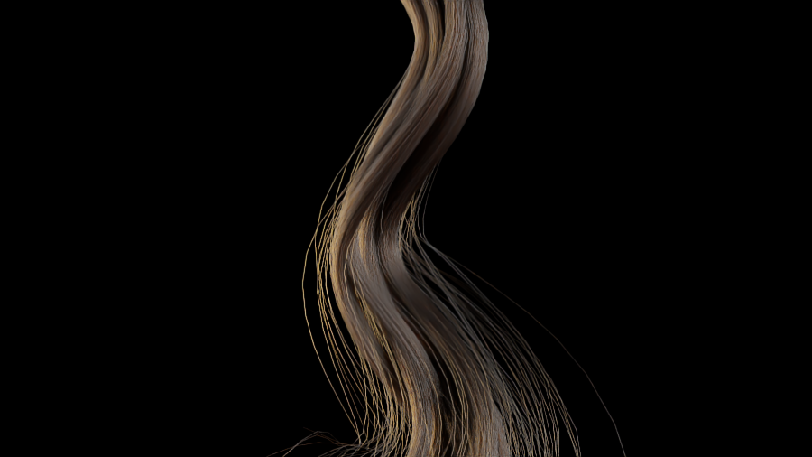
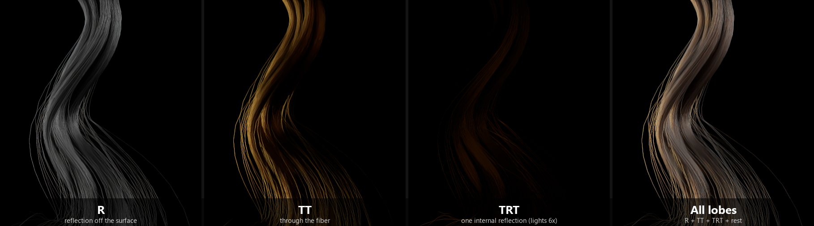
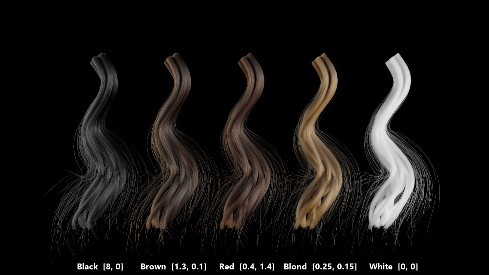
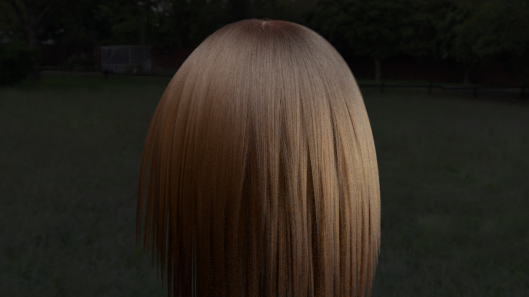

# Hair: scattering of a single fiber, locks and head hair

Hair is traced as **individual cylinders**, and the behavior of light inside a fiber is folded into a **scattering function (BSDF)**. Conclusion: the color of a hair is decided by **the amount of melanin alone**. Where the highlights get their color and how light passes through a fiber come out of the **three light paths** (reflection, transmission, internal reflection) without adding any material parameter.

## 1. What was added

| Item | Where |
|---|---|
| The scattering function `Hair` of a single hair (the three lobes of Marschner 2003, in the energy-conserving form of Chiang 2016; with importance sampling) | `include/Materials/Hair.hpp` |
| The shape `HairCurves`, which intersects a hair as a chain of cylinders (with its own BVH) | `include/Geometry/HairCurves.hpp` |
| Procedural generation of a lock (`MakeLock`) and of hair flowing over a head (`MakeHeadHair`) | `include/Geometry/HairGenerator.hpp` |
| The offset of a ray's origin is stored per hit (for thin hairs; the default is the same as before) | `include/Core/Interaction.hpp` (`rayOffset`) |
| `"type": "hair"` (material) and `"shape": "hair"` (shape) in the scene file | `src/Cli/SceneFileMaterials.cpp` (material), `src/Cli/SceneFile.cpp` (shape), `docs/SCENE_FILE.md` |
| Self-check `--scene hair` | `src/Cli/Checks/HairChecks.cpp` |
| Examples | `scenes/hair_lock.json` (lock), `hair_colors.json` (5 colors), `hair_head.json` (head hair) |

## 2. Theory

### 2.1 What a hair is

A hair is a **translucent cylinder of refractive index about 1.55** (diameter about 0.1 mm). Inside there is **melanin** (eumelanin, black to brown, and pheomelanin, red to yellow), which absorbs light. The surface is covered with scale-like cuticles, slightly tilted.

Light that hits a hair leaves by one of the following paths (Marschner et al. 2003).

| Symbol | Path | Appearance |
|---|---|---|
| **R** | Reflection at the surface | A sharp white highlight (it does not take the hair color) |
| **TT** | Goes in, passes through and comes out (two transmissions) | The hair glows in backlight. It takes the hair color |
| **TRT** | Goes in, is reflected once at the back and comes out | A colored second highlight (shifted from R by the tilt of the cuticle) |
| rest | Two or more internal reflections | Weak. Added as independent of the azimuth (diffuse) |

### 2.2 Coordinates and angles

Let x be the axis of the hair, and y, z the directions in the plane of the cross-section (z = surface normal). A direction w is given by two angles.

- **θ** (longitudinal angle): the inclination from the plane perpendicular to the axis. sin θ = w · x.
- **φ** (azimuthal angle): the angle in the cross-section, measured from the y axis.
- **h** ∈ [−1, 1]: the position of the hit across the width of the hair (measured perpendicular to the viewing direction). h = sin γₒ, where γₒ is the angle between the viewing direction and the normal in the cross-section.

For a hit on a cylinder, **h is determined by the outgoing direction** (h = −wₒ,y / cos θₒ), so it is not passed to the material.

### 2.3 Geometry of the paths

Inside the hair, in the plane of the cross-section, light travels in a circle of **refractive index η′ = √(η² − sin²θₒ) / cos θₒ** (Bravais index). The refraction angle is sin γₜ = h / η′. The azimuth at which a path p (the number of internal segments) leaves the hair is

　**Φ(p, h) = 2p γₜ − 2 γₒ + p π**

p = 0 (R) is the mirror image about the normal (φ = −2 γₒ). p = 1 (TT) is nearly forward (the deviation from π).

### 2.4 The scattering function

It is divided by path and multiplied together (Chiang et al. 2016, d'Eon et al. 2011).

　**f(wₒ, wᵢ) = Σₚ Mₚ(θᵢ, θₒ) · Aₚ(h) · Nₚ(φ) / |cos θᵢ|**

- **Mₚ** (longitudinal spread): Mₚ = I₀(cos θᵢ cos θₒ / vₚ) · exp(−sin θᵢ sin θₒ / vₚ) / (2 vₚ sinh(1/vₚ)). I₀ is the modified Bessel function of the first kind. vₚ is the variance, set by the longitudinal roughness βₘ: v₀ = (0.726 βₘ + 0.812 βₘ² + 3.7 βₘ²⁰)², v₁ = v₀ / 4 (TT is sharp), v₂ = 4 v₀ (TRT is wide).
- **Aₚ** (attenuation): R is the Fresnel reflection F at the surface. TT is (1 − F)² T. After that, every internal reflection multiplies by T F. T = exp(−σₐ · 2 cos γₜ / cos θₜ) is the transmittance of one pass through the hair (σₐ is the absorption, measured in lengths with the hair radius as the unit). p ≥ 3 is summed in one term, in closed form as a geometric series: A₃ = A₂ F T / (1 − F T).
- **Nₚ** (azimuthal spread): a logistic distribution centered on Φ(p, h) (cut at −π to π and normalized). The width s is set by the azimuthal roughness βₙ: s = √(π/8) (0.265 βₙ + 1.194 βₙ² + 5.372 βₙ²²). p ≥ 3 is uniform (1 / 2π).
- **Cuticle tilt α** (default 2°): shifts the longitudinal centers of R, TT and TRT by −2α, α and 4α. This tilt is why the highlights of R and TRT appear shifted along the axis of the hair.

**Energy conservation.** Without absorption (T = 1), Σₚ Aₚ = 1 (because of the closed form above). Mₚ and Nₚ are each normalized, so all the light that a hair receives leaves again.

**Handling of cos.** The |cos θᵢ| in the denominator (= cos with the normal of the hair) cancels the cos that the integrator multiplies. This is because the hair is defined using the fact that the **projected width** of the cross-section does not depend on the azimuth.

### 2.5 Color

The absorption σₐ (RGB) can be given in three ways.

1. **Melanin** (`"melanin": [eumelanin, pheomelanin]`): σₐ = eumelanin × (0.419, 0.697, 1.37) + pheomelanin × (0.187, 0.4, 1.05) (the values in the `HairMaterial` of pbrt-v4). Guide values: black [8, 0], brown [1.3, 0.1], red [0.4, 1.4], blond [0.25, 0.15], white (gray) hair [0, 0].
2. **Apparent color** (`"color": [r, g, b]`): the σₐ for which the apparent color after many internal reflections is that value (an approximation of d'Eon et al. 2011; it depends on the azimuthal roughness).
3. **Direct** (`"sigmaA": [r, g, b]`).

**Spectral mode.** The RGB values above are taken as the values at R = 610 nm, G = 545 nm and B = 465 nm and **interpolated in log-log** (extrapolated at the ends). The absorption spectrum of melanin is a smooth curve that becomes steeply stronger toward short wavelengths, so three points were used to approximate it.

### 2.6 Importance sampling

The direction wᵢ is drawn to match the shape of the scattering function.

1. The path p is chosen in proportion to the size of Aₚ (averaged over wavelength).
2. θᵢ is drawn by the inverse of the cumulative distribution of Mₚ.
3. φᵢ is drawn by the inverse of Nₚ (the cut logistic) (uniform for p ≥ 3).

The probability density is the sum of the contributions of all three paths (`pdf()`), consistent with `sample()` and `eval()`.

## 3. Implementation

### 3.1 One hit does everything inside one hair

The light inside a hair is **not followed**. When a ray hits the cylinder of a hair, the scattering function handles R, TT, TRT, … all at once at that point. It decides the outgoing direction and position (in practice the light is taken to leave from the same point) and the next ray is shot. The shift of position while passing through the hair (the exit of TT is on the opposite side of the entrance) is ignored, as an approximation. The diameter of the hair (about 0.16 mm) is smaller than one pixel of the render (about 0.4 mm in the examples), so it does not affect the appearance.

### 3.2 Shape and intersection

`HairCurves` treats **one segment of a hair (a polyline) = one finite cylinder** (the radius is the average of the two ends).

- The intersection solves the quadratic equation with the side of each cylinder, one at a time. There are no caps (the tip becomes thinner and vanishes).
- **Only hits from the outside are counted.** A ray leaving from the inside (one that passed through the hair with TT) does not hit the far wall of the same hair, because the scattering function has already handled the inside. In this case the origin of the ray is shifted to the inside of the hair by `rayOffset` (1/1000 of the radius).
- At the joints, a segment overlaps its neighbor a little (so that no pinhole-like gaps appear where the hair bends outward).
- The normal is made orthogonal to the tangent of the vertices interpolated within the segment (so that the polyline does not show its corners). The tangent `dpdu` and the normal `n` are passed to `Hair`.
- With 100,000 hairs × several tens of segments, the segments are not made one by one into a `Hittable`; there is a **dedicated BVH** (a segment is a 4-byte vertex index).

### 3.3 Generation of hair

- **One hair**: it bends toward gravity (`droop`) and undulates in a smooth wave. The phase of the wave is decided by the position of the root, so nearby hairs move in the same way.
- **Clump**: a hair is pulled toward the path of the nearest **guide**, more strongly toward the tip. Gaps open between clumps, and the hairs in a clump stay close together.
- **Lock** (`style: lock`): the clumps sway separately around a common center line and spread out toward the tip. The tips are uneven. Some hairs (`flyaway`) leave the lock.
- **Head hair** (`style: head`): the roots are placed on a sphere, the hairs leave the scalp and fall by gravity. A hair that would enter the head is pushed back onto the surface. Hair near the face is combed to the back and to the sides (`sweep`).

The radius of the hair is drawn thicker (0.08 mm) than the real one (about 0.05 mm). If it is made thinner, the line becomes thinner than a pixel and the noise increases.

## 4. What was checked (`--scene hair`, PASS in both RGB and spectral)

| Check | Result |
|---|---|
| Energy of a non-absorbing hair (∫ f \|cos\| dω = 1, with uniform direction sampling; βₘ = βₙ = 0.3, 0.6, three incident directions) | 0.997 to 1.003 (error 0.2 to 0.6%) |
| The integral of `pdf()` is 1. The sample mean of `sample()` agrees with the expected value from the pdf | 1.007, 0.994. Every component of the sample mean and the expected value differ by at most 0.007 |
| The mean of the weight f cos / pdf of `sample()` = 1 (no absorption), = ΣAₚ (with absorption) | 1, 0.1906, 0.2071 (the same as the expected values) |
| Direction of the lobes (a strongly absorbing hair keeps only R; is the highlight at the mirror image about the normal?) | About 5.6 × 10⁵ times the value in the direction 40° away in azimuth, at the mirror direction |
| Direction of the lobes (a transparent hair seen from the front; does TT go straight through?) | 1.1 × 10⁵ times the sideways value, in the straight-through direction |
| Intersection of a cylinder (from the side, starting outside, a miss) | t = 1.95 (the same as expected), no hit from the inside, a miss when 0.01 off |
| BVH against brute force (150 hairs × 8 segments, 4000 rays) | 4000 / 4000 agree, no mismatch in `occluded()` |
| **White furnace**: does one non-absorbing hair in a uniform white sky return the sky brightness 1 (4 directions) | 0.998 to 1.002 in both RGB and spectral (error 0.15 to 0.4%; it changes a little from run to run) |
| White furnace: a non-absorbing lock (150 hairs, 3 directions; includes multiple scattering between hairs) | RGB 0.997 to 0.999 (error 0.3 to 0.4%), spectral 1.000 to 1.009 |

**Found along the way**
- **The margin of the BVH bounds was too small** (the overlap at the joints stuck out of the box). In the comparison with brute force, 1 of 4000 rays did not agree. The margin was widened and they agreed.
- When the white-furnace lock was set with too many hairs (600 hairs in a width of 12 mm; a packing of 2.7 times), the mean became 0.88, which looked like a failure. The cause was neither the scattering function nor the intersection: **in a thick lock of reflectance 1, a path has hundreds of scatterings, and the distribution of the Russian-roulette weights has a heavy tail** (the mean is biased downward, and the error estimate is too small). With 100 to 300 hairs it is 0.993 to 1.000. The test setting was corrected to a realistic density.

## 5. Examples

The render times are measured on this PC (8 threads, Release). Thin hairs need many samples, so they take time.

**Lock** (`scenes/hair_lock.json`. 5000 hairs, 900 × 506, 192 spp, with denoising. 2.5 minutes; the options in the file itself are 1000 px and 256 spp): a white key light from the right and a backlight from the back left. Thin hairs leave the lock and glow gold in the backlight.

**The three lobes** (the same lock, drawn one lobe at a time with `"lobes"` of the material. 2 minutes each. The figure is made by `tools/figures/hair_figures.py lobes`):

- **R**: a white reflection that does not take the hair color. It becomes thin streaks along the flow of the hair.
- **TT**: light that passed through the hair. It takes the hair color (golden brown here). In backlight, the thin hairs at the edge of the lock glow.
- **TRT**: **very weak** for this brown hair (it becomes visible only with the light made 6 times stronger). The light passes through twice, so the more absorbing the hair, the weaker it is.
- Adding the three and then the remaining terms gives the lock on the far right.

**Colors that change with melanin alone** (`scenes/hair_colors.json`. Five locks of the same shape. Everything except the color is the same. 1400 × 788, 256 spp, with denoising. 23 minutes):

The numbers are `[eumelanin, pheomelanin]`. The more eumelanin, the blacker; pheomelanin gives a reddish tint. White hair (0, 0) has no absorption, and glows white through many internal reflections.

**Hair flowing over a head** (`scenes/hair_head.json`. 40000 hairs, about 500 clumps, 900 × 506, 512 spp, without denoising. 18 minutes; the options in the file itself have `denoise` on, and the picture was rendered without it):

The head is a sphere seen from behind. The area lights above and at the back left make a bright band that follows the roundness of the head. With the denoiser, the detail of each hair disappears and it becomes a smooth surface (it is not used for the example).

## 6. References

See [REFERENCES.md](REFERENCES.md), group "Hair".
