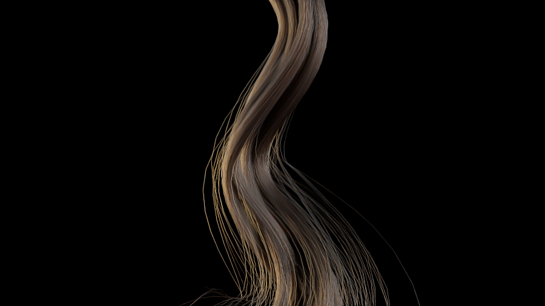
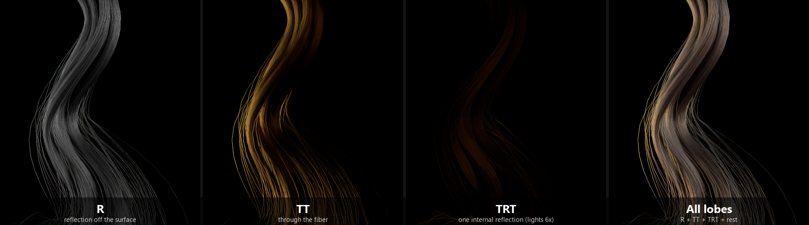
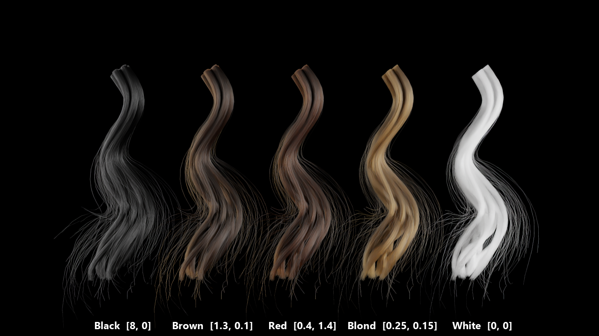
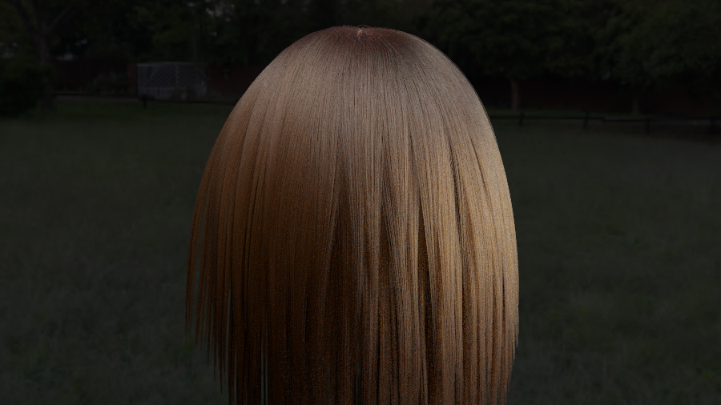

# 髪: 1 本の毛の散乱と、毛束・頭髪

髪の毛を、**1 本ずつの円柱**として追跡し、毛の中の光の振る舞いを、**散乱関数（BSDF）**に畳み込んだ。結論: 毛の色は、**メラニンの量だけ**で決まる。ハイライトの色づく位置や、光が毛を透かして出る様子は、材質のパラメータを足さなくても、**3 つの光の道筋**（反射、透過、内部反射）から自然に出る。

## 1. 何を足したか

| 物 | 場所 |
|---|---|
| 髪 1 本の散乱関数 `Hair`（Marschner 2003 の 3 ローブを、エネルギー保存の形に直した Chiang 2016 の式。重点サンプリングつき） | `include/Materials/Hair.hpp` |
| 毛を円柱の連なりとして交差判定する形状 `HairCurves`（専用の BVH つき） | `include/Geometry/HairCurves.hpp` |
| 毛束（`MakeLock`）と、頭を流れる髪（`MakeHeadHair`）の手続き的な生成 | `include/Geometry/HairGenerator.hpp` |
| 光線の出発点のずらし量をヒットごとに持たせた（細い毛のため。既定は従来と同じ） | `include/Core/Interaction.hpp`（`rayOffset`） |
| シーンファイルの `"type": "hair"`（材質）、`"shape": "hair"`（形状） | `src/Cli/SceneFile.cpp`、`docs/SCENE_FILE.md` |
| 自己チェック `--scene hair` | `src/Cli/Checks/HairChecks.cpp` |
| 作例 | `scenes/hair_lock.json`（毛束）、`hair_colors.json`（5 色）、`hair_head.json`（頭髪） |

## 2. 理論

### 2.1 髪の毛は何か

毛は、**屈折率 約 1.55 の半透明の円柱**（直径 約 0.1 mm）。内部に**メラニン**（黒〜茶の真性メラニン eumelanin、赤〜黄の亜性メラニン pheomelanin）があって、光を吸収する。表面は、うろこ状のキューティクルで覆われ、わずかに傾いている。

毛に当たった光は、次の道筋のどれかで出ていく（Marschner ら 2003）。

| 記号 | 道筋 | 見え方 |
|---|---|---|
| **R** | 表面で反射 | 白い（毛の色がつかない）鋭いハイライト |
| **TT** | 入って、通り抜けて出る（transmission を 2 回） | 逆光で毛が光る。毛の色がつく |
| **TRT** | 入って、裏側で 1 回反射して、出る | 色のついた、もう 1 本のハイライト（キューティクルの傾きで、R とずれる） |
| 残り | 内部反射を 2 回以上 | 弱い。方位には無関係（拡散）として足す |

### 2.2 座標と角度

毛の軸を x、毛の断面の面内を y、z とする（z = 表面の法線）。向き w は 2 つの角度で表す。

- **θ**（縦の角度）: 軸に垂直な面からの傾き。sin θ = w · x。
- **φ**（方位の角度）: 断面の中で、y 軸から測った角度。
- **h** ∈ [−1, 1]: 毛の幅を横切る、当たった位置（視線に垂直な方向に測る）。h = sin γₒ で、γₒ は、断面で、視線と法線がなす角。

円柱への当たりでは、**h は出射方向から決まる**（h = −wₒ,y / cos θₒ）ので、材質に渡さない。

### 2.3 道筋の幾何

毛の中で光は、断面の面内では**屈折率 η′ = √(η² − sin²θₒ) / cos θₒ**（Bravais の屈折率）の円の中を進む。屈折角は sin γₜ = h / η′。道筋 p（内部の線分の数）が毛から出るときの方位は、

　**Φ(p, h) = 2p γₜ − 2 γₒ + p π**

p = 0（R）は、法線について鏡像（φ = −2 γₒ）。p = 1（TT）は、ほぼ前方（π からのずれ）。

### 2.4 散乱関数

道筋ごとに分けて、掛け合わせる（Chiang ら 2016、d'Eon ら 2011）。

　**f(wₒ, wᵢ) = Σₚ Mₚ(θᵢ, θₒ) · Aₚ(h) · Nₚ(φ) / |cos θᵢ|**

- **Mₚ**（縦の広がり）: Mₚ = I₀(cos θᵢ cos θₒ / vₚ) · exp(−sin θᵢ sin θₒ / vₚ) / (2 vₚ sinh(1/vₚ))。I₀ は第 1 種変形ベッセル関数。vₚ は分散で、縦の粗さ βₘ から決まる: v₀ = (0.726 βₘ + 0.812 βₘ² + 3.7 βₘ²⁰)²、v₁ = v₀ / 4（TT は鋭い）、v₂ = 4 v₀（TRT は広い）。
- **Aₚ**（減衰）: R は表面のフレネル反射 F。TT は (1 − F)² T。それ以降は、1 回内部で反射するたびに T F を掛ける。T = exp(−σₐ · 2 cos γₜ / cos θₜ) は、毛の中を 1 回通る透過率（σₐ は吸収。毛の半径を単位にした長さで測る）。p ≥ 3 は等比級数で閉じた式にして、1 項で足す: A₃ = A₂ F T / (1 − F T)。
- **Nₚ**（方位の広がり）: Φ(p, h) を中心にしたロジスティック分布（−π〜π で切って、正規化）。幅 s は方位の粗さ βₙ から決まる: s = √(π/8) (0.265 βₙ + 1.194 βₙ² + 5.372 βₙ²²)。p ≥ 3 は一様（1 / 2π）。
- **キューティクルの傾き α**（既定 2°）: R、TT、TRT の縦の中心を、−2α、α、4α だけずらす。R と TRT のハイライトが、毛の軸の方向にずれて見えるのは、この傾きによる。

**エネルギー保存。** 吸収がない（T = 1）ときは、Σₚ Aₚ = 1 になる（上の閉じた式のため）。Mₚ と Nₚ はそれぞれ規格化されているので、毛 1 本が受けた光は、すべて出ていく。

**cos の扱い。** 分母の |cos θᵢ|（= 毛の法線との cos）は、積分器が掛ける cos を打ち消す。毛は、断面の**投影幅**が方位によらない、ということを使った定義のため。

### 2.5 色

吸収 σₐ（RGB）は、3 通りに指定できる。

1. **メラニン**（`"melanin": [真性, 亜性]`）: σₐ = 真性 × (0.419, 0.697, 1.37) + 亜性 × (0.187, 0.4, 1.05)（pbrt-v4 の `HairMaterial` にある値）。目安: 黒 [8, 0]、茶 [1.3, 0.1]、赤 [0.4, 1.4]、金髪 [0.25, 0.15]、白髪 [0, 0]。
2. **見た目の色**（`"color": [r, g, b]`）: 内部で何回も反射したあとの見かけの色が、その値になるような σₐ（d'Eon ら 2011 の近似。方位の粗さに依存）。
3. **直接**（`"sigmaA": [r, g, b]`）。

**スペクトルモード。** 上の RGB の値を、R = 610 nm、G = 545 nm、B = 465 nm での値とみなして、**対数 − 対数で補間**する（端は外挿）。メラニンの吸収スペクトルは、波長が短いほど急に強くなる、なだらかな曲線なので、3 点で近似した。**これは簡易版**で、実測のスペクトルは使っていない。

### 2.6 重点サンプリング

向き wᵢ を、散乱関数の形に合わせて引く。

1. 道筋 p を、Aₚ の（波長平均の）大きさに比例して選ぶ。
2. θᵢ を、Mₚ の累積分布の逆関数で引く。
3. φᵢ を、Nₚ（切ったロジスティック）の逆関数で引く（p ≥ 3 は一様）。

確率密度は、3 つの道筋すべての寄与の和（`pdf()`）で、`sample()` と `eval()` と矛盾しない。

## 3. 実装

### 3.1 1 回のヒットで、毛 1 本の中を全部済ませる

毛の中の光は**追わない**。光線が毛の円柱に当たったら、そこで、R、TT、TRT、…のすべてを、散乱関数が一度に扱う。出る向きと位置（実際には、同じ点から出るとみなす）を決めて、次の光線を飛ばす。毛の中を通る間の位置のずれ（TT の出口は、入口の反対側）は無視する近似。毛の直径（約 0.16 mm）が、描画の 1 画素（作例で約 0.4 mm）より小さいので、見た目には影響しない。

### 3.2 形状と交差

`HairCurves` は、毛（折れ線）の**線分 1 つ = 有限の円柱 1 つ**として扱う（半径は両端の平均）。

- 交差は、円柱の側面との 2 次方程式を 1 本ずつ解く。蓋はない（毛先は細くなって消える）。
- **外側からの当たりだけを数える**。内側から出る光線（TT で毛を通り抜けるもの）は、その毛自身の向こう側の壁には当たらない。散乱関数が、すでに毛の中を済ませたため。このとき、光線の出発点は、毛の内側へ `rayOffset`（半径の 1000 分の 1）だけずらす。
- 継ぎ目では、隣の線分と少し重ねる（外側に曲がるところで、針の穴のような隙間ができないように）。
- 法線は、頂点の接線を線分の中で補間したものに直交させる（折れ線のカクつきを、見た目に出さない）。接線 `dpdu` と法線 `n` が、`Hair` に渡る。
- 毛 10 万本 × 数十線分になるので、線分を 1 つずつ `Hittable` にせず、**専用の BVH**（線分は頂点の番号 4 バイト）を持つ。

### 3.3 毛の生成

本格的なグルーミングではなく、**毛らしく見える最低限**の構造だけ。

- **毛 1 本**: 重力に向かって曲がり（`droop`）、滑らかな波でうねる。波の位相は、根元の位置で決まるので、近い毛は同じように動く。
- **房**（clump）: 毛は、最も近い**ガイド**の経路に、先端ほど強く引き寄せられる。房の間に隙間ができ、房の中の毛は寄り添う。
- **毛束**（`style: lock`）: 房が、共通の中心線のまわりで、それぞれ別々に揺れ、先端へ向かって広がる。毛先は不揃い。一部の毛（`flyaway`）は、束から外れる。
- **頭髪**（`style: head`）: 球の上に根元を置き、頭皮から出て、重力で落ちる。頭に入る毛は、表面に押し戻す。顔の近くの毛は、後ろと左右へ流す（`sweep`）。

毛の半径は、実物（約 0.05 mm）より太く描く（0.08 mm）。細くすると、画素より細い線になり、ノイズが増える。

## 4. 確かめたこと（`--scene hair`、RGB・スペクトルとも PASS）

| 検査 | 結果 |
|---|---|
| 吸収のない毛のエネルギー（∫ f \|cos\| dω = 1。一様な方向抽出で。βₘ = βₙ = 0.3、0.6、入射 3 通り） | 0.997〜1.003（誤差 0.2〜0.6%） |
| `pdf()` の積分が 1。`sample()` の標本平均が、pdf から求めた期待値と一致 | 1.007、0.994。標本平均と期待値の各成分の差は 0.007 以内 |
| `sample()` の重み f cos / pdf の平均 = 1（吸収なし）、= ΣAₚ（吸収あり） | 1、0.1906、0.2071（期待値と同じ） |
| ローブの向き（吸収の強い毛は R だけ残る。ハイライトの位置が、法線についての鏡像か） | 鏡像の方向で、方位が 40° ずれた方向の 約 5.6 × 10⁵ 倍 |
| ローブの向き（透明な毛を正面から見て、TT が真っ直ぐ抜けるか） | 真っ直ぐ抜ける方向で、横の 1.1 × 10⁵ 倍 |
| 円柱の交差（側面から、外側から出発、外れ） | t = 1.95（期待値と同じ）、内側からは当たらない、0.01 外れると外れ |
| BVH と全探索の一致（150 本 × 8 線分、光線 4000 本） | 4000 / 4000 一致、`occluded()` の食い違いなし |
| **白色炉**: 吸収のない毛 1 本が、一様な白い空の中で、空の明るさ 1 を返すか（4 方向） | RGB・スペクトルとも 0.998〜1.002（誤差 0.15〜0.4%。実行ごとに少し変わる） |
| 白色炉: 吸収のない毛束（150 本、3 方向。毛同士の多重散乱を含む） | RGB 0.997〜0.999（誤差 0.3〜0.4%）、スペクトル 1.000〜1.009 |

**途中で見つけたこと**
- **BVH の包みの余白が足りなかった**（継ぎ目の重なり分が、箱の外に出ていた）。全探索との比較で、4000 本中 1 本が合わなかった。余白を広げて一致。
- 白色炉の毛束を、毛を詰めすぎた設定（幅 12 mm に 600 本。充填率 2.7 倍）にすると、平均が 0.88 になり、失敗に見えた。原因は、散乱関数でも交差でもなく、**反射率 1 の厚い束では経路が数百回の散乱になり、ロシアンルーレットの重みの分布が重い裾を持つ**ため（平均が下に偏り、誤差の見積もりも小さすぎる）。毛 100〜300 本では 0.993〜1.000。試験の設定のほうを、現実の密度に直した。

## 5. 作例

描画時間は、この PC（8 スレッド、Release）の実測。細い毛は、サンプル数が要るので、時間がかかる。

**毛束**（`scenes/hair_lock.json`。5000 本、900 × 506、192 spp、デノイズあり。2.5 分）: 右から白い主光源、左奥から逆光。細い毛が束から外れ、逆光で金色に光る。

**3 つのローブ**（同じ毛束を、材質の `"lobes"` で 1 つずつに分けて描いた。各 2 分。図は `tools/figures/hair_figures.py lobes`）:

- **R**: 毛の色がつかない、白い反射。毛の流れに沿った細い筋になる。
- **TT**: 毛を通り抜けた光。毛の色（ここでは金茶）がつく。逆光で、束の縁の細い毛が光る。
- **TRT**: この茶色の毛では**ごく弱い**（光源を 6 倍にして、やっと見える）。2 回通るので、吸収の強い毛ほど弱い。吸収の弱い毛ほど強くなるはずだが、比べていない。
- 3 つを足し、残りの項を加えると、右端の毛束になる。

**メラニンだけで変わる色**（`scenes/hair_colors.json`。同じ形の毛束 5 本。色以外は同じ。1400 × 788、256 spp、デノイズあり。23 分）:

数値は `[真性メラニン, 亜性メラニン]`。真性が多いほど黒く、亜性が多いと赤みが出る。白髪（0, 0）は、吸収がなく、内部を何度も反射して白く光る。赤は、期待したほど赤くない（茶に近い）。亜性メラニンの値と、画面の色の対応は、調整していない。

**頭を流れる髪**（`scenes/hair_head.json`。40000 本、約 500 の房、900 × 506、512 spp、デノイズなし。18 分）:

頭は球で、後ろから見ている。上と左後ろの面光源が、頭の丸みに沿った明るい帯を作る。デノイズをかけると、毛の 1 本ずつの細部が消えて滑らかな面になる（作例には使っていない）。

## 6. 限界

- **円形の断面**。実際の毛は楕円で、巻き毛は断面がさらに平たい。毛の内部（髄）の散乱もない（Zinke ら 2008 の拡散項、d'Eon ら 2011 の楕円断面は未対応）。
- **簡易な毛の生成**。グルーミング、毛同士の衝突、髪型の設計はない。頭は球（顔の形はない）。
- **毛同士の多重散乱は、経路追跡で扱う**（明るい髪では、経路が長くなる）。専用の近似（dual scattering）は使っていない。白髪や金髪では、深さを大きく取る必要がある（`--depth 64` など）。
- **毛を 1.6 倍に太く描いている**。毛の本数を減らして、ノイズを下げるため。
- **色の裏づけは弱い**。メラニンの σₐ は、pbrt-v4 の RGB の値で、**スペクトルは 3 点の補間**。実測の毛や、毛の分光反射率とは比べていない。
- **キューティクルの傾き α は一定**（2°）。
- **デノイザは細い毛を消す**（滑らかなかつらのように見える）。頭髪の作例はデノイズなしの 512 spp（わずかな粒状のノイズが残る）。毛束と 5 色は、デノイズあり。

## 7. 参考文献

**書誌は記憶から書いた。公開する前に、Web 検索で確認する。**

- Marschner, Jensen, Cammarano, Worley, Hanrahan. *Light Scattering from Human Hair Fibers.* ACM Transactions on Graphics (SIGGRAPH) 22(3), 2003.（R、TT、TRT の 3 ローブ）
- d'Eon, Francois, Hill, Letteri, Aubry. *An Energy-Conserving Hair Reflectance Model.* Computer Graphics Forum (EGSR) 30(4), 2011.（エネルギー保存、Mₚ の式、見た目の色から σₐ を決める近似）
- Chiang, Bitterli, Tappan, Burley. *A Practical and Controllable Hair and Fur Model for Production Path Tracing.* Computer Graphics Forum (Eurographics) 35(2), 2016.（Nₚ のロジスティック分布、粗さの式、重点サンプリング）
- Pharr, Jakob, Humphreys. *Physically Based Rendering: From Theory to Implementation*, 4th ed. 2023.（`HairBxDF` の実装。メラニンの σₐ の値）
- Zinke, Yuksel, Weber, Keyser. *Dual Scattering Approximation for Fast Multiple Scattering in Hair.* ACM Transactions on Graphics (SIGGRAPH) 27(3), 2008.（未対応。限界の節で言及）
