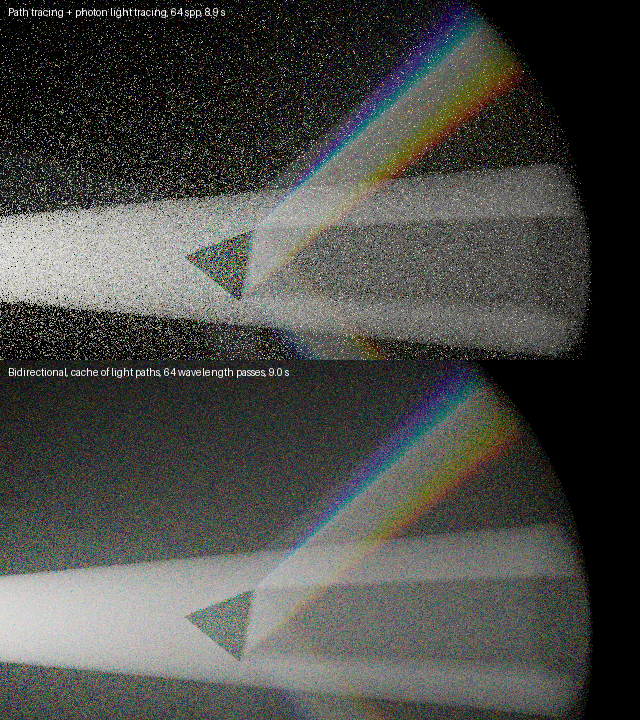

# LVC-BPT（光頂点キャッシュ付き双方向パストレーシング）の試作

霧、拡散面、ガラス（分散あり）の中で、光の筋とコースティクスを、パストレーシングより速く（同じ時間で、ノイズの分散が 10〜60 倍小さく）描く試作です（2026-11-08）。実装は `GoLD_rayt/include/Render/VolumeBPT.hpp`（ヘッダのみ）です。Ray Tracing Camp 10 の発表（[README の参考文献](../README.md#10-references) に載せています）で知った構成を、CPU のこのエンジンで作り直しました。

## 0. 要点

- **光の経路を先に N 本追跡して、頂点を貯めます**（Light Vertex Cache）。カメラの経路は、その頂点につなぎます。
- つなぎ方（戦略）は、**NEE、光頂点との接続、光線追跡**の 3 種類です。経路ごとに、すべての戦略の確率密度から**バランスヒューリスティックの MIS** で重みを付けます。
- **GPU を速くする技術ではありません。** 光源側とカメラ側の長所を組み合わせる、サンプリングの方法です。発表（GPU）では、状態の大きさと分岐を抑える形（光頂点を配列に貯める）として出てきます。CPU のここでも、光の経路を多数のカメラ経路で使い回せる利点は、そのまま効きます。
- ガラスは「接続できない頂点」として、サブパスに入れます。分散は、**波長を描画パスごとに 1 つに固定**して扱います。
- 検証は `--scene lvc`（PT、フォトンの光線追跡と一致）。



## 1. 何を解く手法か

- **パストレーシング（PT）** は、カメラから経路を伸ばして、運よく光源に当たれば寄与になります。点光源や細い光、ガラスを通った光（コースティクス）には、ほとんど当たりません。霧の中の細いビームは、散乱点がビームに入る確率が低く、点々のノイズになります。
- **光線追跡（LT）** は、光源から経路を伸ばして、各頂点をカメラにつなぎます。コースティクスと細いビームに強い一方、カメラ側の見え方（拡散面での複数回の反射など）に弱いです。
- **双方向パストレーシング（BPT）** は、両方を作って、頂点同士をつなぎます。同じ経路が複数の作り方で作れるので、MIS で重みを付けます。

## 2. 戦略と MIS

n 個の頂点 `x_1 … x_n`（光側から）を持つ経路は、`s` 個を光側のサブパス、`n − s` 個をカメラ側のサブパスから作る、`n + 1` 通りの作り方があります。

| s | 呼び名 | 内容 |
|---|---|---|
| 0 | NEE | カメラ側のサブパスを、光源に直接つなぐ |
| 0 < s < n | 接続 | 光側の頂点と、カメラ側の頂点を、影の光線でつなぐ |
| n | 光線追跡 | 光側のサブパスを、カメラにつなぐ（スプラット） |

各戦略の確率密度を `p_s(x)`、サンプル数を `n_s` とすると、どの戦略で作った経路も、寄与は `f(x) / D(x)`、`D = Σ_s n_s p_s(x)` です（バランスヒューリスティック）。`n_s` は、カメラ側から始まる戦略では、画素あたりのサンプル数 `spp`、光線追跡では、光経路の本数 `N` です。再帰的な MIS（頂点ごとの数値）は使わず、経路の頂点の位置から、毎回、全戦略の密度を計算します（正しさを確かめやすい形にした試作です）。

## 3. 光頂点のキャッシュ

1. 光経路を `N` 本追跡して、頂点（位置、法線、アルベド、手前の辺の透過率）を配列に貯めます。
2. カメラの 1 サンプルは、貯めた光経路を 1 本ランダムに選び、**自分の全頂点を、その経路の全頂点につなぎます**。
3. 光経路を多数のカメラサンプルで共有しても、不偏です（それぞれの対は、同じ分布からの独立な標本）。光の側の費用は、ほとんど要りません。
4. 光線追跡だけのときは、頂点を貯めません（光経路 5000 万本でメモリが尽きたため）。

注意: 光経路を共有するので、ノイズが画素間で相関します（帯やまだら）。

## 4. 密度と寄与（霧と拡散面）

頂点の測度は、霧では体積、面では面積です。点 `a` から、方向の密度 `p_dir`（立体角あたり）で、頂点 `x` に着く密度は次のとおりです。

| 頂点 | 密度 | 寄与の因子 |
|---|---|---|
| 霧 | `p_dir · σ_s · T(a,x) / d²` | `σ_s · 位相関数` |
| 拡散面 | `p_dir · ρ · T(a,x) · \|cos\| / d²` | `ρ/π` |

- `σ_s` は散乱係数（`albedo · σ_t`）。散乱か吸収かの選択（確率 `albedo`）を、密度に含めています。`ρ` は、面で吸収されない確率（アルベド）です。
- `p_dir` は、光では放射の密度（円錐の立体角の逆数。重点サンプリングの混合を含む）、霧では位相関数、面では `cos/π`、カメラでは `1/Ω_pixel`（画素の立体角の逆数）です。
- 辺ごとに、`T · |cos_a| · |cos_b| / d²` が掛かります（霧の頂点では cos = 1）。
- 辺の透過率は、サブパスを追跡する間に記録します（媒質の中を通った長さから）。**接続の辺だけ**、影の光線で測ります。面は影の光線を遮り、無効境界（霧の境界）は通ります。

## 5. ガラスと分散

**ガラス（滑らかな誘電体）は、鏡面頂点です。**
- 接続の端点にはなりません（向きが合わず、確率ゼロ）。端点が鏡面になる戦略は、`D` の和から外します。ガラスの連鎖は、長い 1 本の辺のように扱われます。
- 重みは、`Material::sample` が返す W（反射 1、屈折 1/η²）です。入って出る連鎖では、η² が打ち消し合います。
- 寄与では、その頂点を**サンプリングした側の cos** と W を組にします。密度では、鏡面頂点の方向の密度を 1 とし（デルタを省く）、幾何の換算は残します。
- **MIS の重みは、規格化されている**ので、デルタの扱いが多少不正確でも、偏りは出ません（分散が増えるだけ）。偏りは、サンプリングの重み（寄与）が間違っているときだけ出ます。

**分散**は、経路の形が波長で変わるので、つなぐ 2 本の経路の波長が一致していないといけません。そこで、**波長を描画パスごとに 1 つに固定**します（`--lvc-passes K`）。
- パス k では、層化した乱数から、波長を 1 つ決めて、光経路もカメラ経路も、その波長で追跡します。パスごとに、自分のキャッシュ（光経路 N/K 本、カメラ spp/K）を作り、K 枚の平均を取ります。
- 波長の密度は、全戦略に共通で、MIS の比で消えます。
- K は、帯（波長の隙間）を消す数です。測ると、K = 16 で頭打ちで、**色の粒は、K では減りません。光経路の数 N（1/√N）で減ります**。分散のないシーンは、K = 1（従来の 4 波長）です。

## 6. 放射の重点サンプリング

床や壁も照らす広い円錐の光で、コースティクスを効率よく拾うため、光経路の半分を、物体を囲む小さな円錐へ送ります（`PointLight::setEmissionTarget`）。光が出す量（強度）は変わらず、混合した密度を `emissionPdf` に入れるので、MIS の重みは整合しています。

## 7. 検証（`--scene lvc`）

| 構成 | 基準 | 見るもの |
|---|---|---|
| 霧の球 | PT（媒質内 NEE あり） | 戦略を単独（NEE、LT）、組み合わせ、全部。平均と、6×3 ブロックごと |
| 霧の球 + 拡散面の床 | PT | 同上 |
| 霧の中のガラス球 | フォトンマップの光線追跡（独立実装） | L S S M…（光の最初の頂点がガラス）の画像 |
| 同上、絵の全体 | PT + フォトンの光線追跡 | 接続 + LT、全戦略（球を映さないブロック） |
| 分散するガラス球（Abbe 10、K = 32） | 同上 | 同上（許容は広め。1 波長のパスは色の分散が大きい） |

RGB・スペクトルの両方で通ります。**戦略を 1 つずつ単独で PT と比べる**やり方で、次の不具合を見つけました。
- 霧の境界から空気中へ出るとき、レイの媒質を更新していない（霧の外の床で、空気中なのに散乱）。
- 保存されたフォトンが 0 のとき、マップが無効になり、二重に数える。
- ガラスの向こうの霧まで、カメラ側が経路を捨てて、2% 暗くなる。

分散のある構成のチェックは、画像が小さいので、比が ±5% 程度揺れます（符号の偏りはなく、実シーンの平均 RGB は、基準と 1% 以内で一致）。

## 8. 結果（同じ時間でのノイズの分散。PT / この試作）

| 構成（640 px、約 3〜9 秒） | ビーム | もや | コースティクス |
|---|---|---|---|
| 霧の中のスポット | 43 倍 | 280 倍 | |
| 霧と拡散面の床 | 10 倍 | 14 倍 | 床の光の円（PT が得意な直接光）1.8 倍 |
| 霧の中のガラス球 | 31 倍 | 58 倍 | 9 倍 |
| 霧の中の分散プリズム | 15 倍 | 61 倍 | 虹の扇 12 倍 |

同じ画像を独立に 2 回描いて、差からノイズを推定し、時間を掛けた値の比です。PT が苦手な領域（細いビーム、間接光）で効きます。PT が得意な直接光は、差が小さいです。

## 9. 使い方

```bash
# 霧の中のプリズム（約 9 分）
GoLD_rayt.exe --scene fogspot --spot-prism --abbe 6 --spot-deg 1.4 --width 1280 --lvc --lvc-passes 96 --spp 192 --lvc-paths 600000000 --fog-light 150

# ジェム（約 11 分）
GoLD_rayt.exe --scene caustics --gal-object gem --abbe 9 --width 1000 --lvc --lvc-passes 64 --lvc-depth 16 --spp 512 --lvc-paths 400000000 --gal-dist 0.8 --gal-scale 1.4 --gal-light 8 --gal-albedo 0.08 --gal-spread 8 --gal-look 0.02,0.02,-0.015 --gal-fov 9 --denoise

# 自己チェック
GoLD_rayt.exe --scene lvc
```

- `--lvc`: この方式で描く（なしは PT）。`--lvc-paths N`: 光経路の総数。`--lvc-depth D`: サブパスあたりの頂点数。`--lvc-passes K`: 波長のパス数（分散ガラスのとき 64〜128）。`--lvc-mask M`: 戦略（1 = NEE、2 = 接続、4 = 光線追跡）。
- 描画の時間は、ほぼ「光経路の数」で決まります（1 本あたり約 0.3〜1 マイクロ秒、8 スレッド）。

## 10. 制限と次の手

- **対象**: 灰色の均一な霧（無効境界の球の中）、点光源またはスポット、ピンホールのカメラ。霧の外にカメラと光源。面は、すべて同じアルベドの灰色の Lambertian。
- **出せないもの**: ガラスを通して見える、壁のコースティクス（カメラ側の拡散点の両隣が鏡面で、接続できない。頂点の統合（VCM 風）か、フォトンの収集が要る）。粗い誘電体。色つき・不均一な媒質。レンズ。
- **次の手**: 頂点の統合、再帰的 MIS（速くする）、色つきの面と `Material` の利用、虹の中の色ノイズを減らす工夫。
