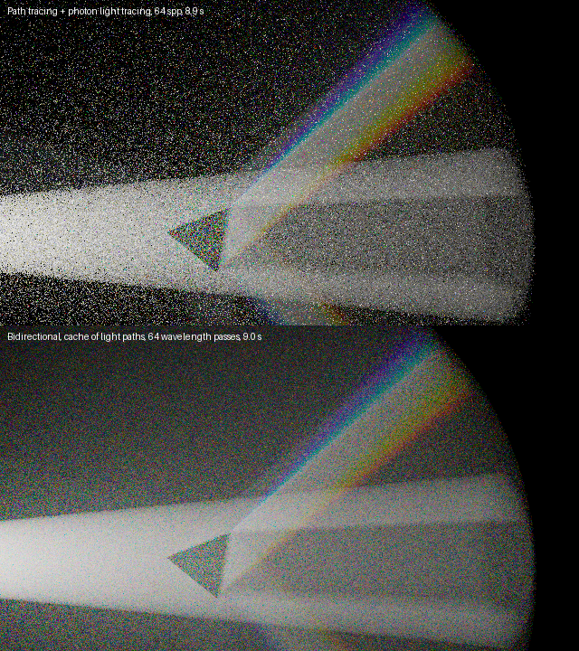

# LVC-BPT (bidirectional path tracing with a light vertex cache): a prototype

A prototype that renders light shafts and caustics in fog (kiri), on diffuse surfaces and in glass (with dispersion) faster than path tracing (in the same time, the variance of the noise is 10 to 60 times smaller) (2026-11-08). The implementation is `GoLD_rayt/include/Render/VolumeBPT.hpp` (header only). The design learned from the talk at Ray Tracing Camp 10 (listed in the [references](REFERENCES.md)) was rebuilt in this CPU engine.

## 0. Summary

- **N light paths are traced first and their vertices are stored** (Light Vertex Cache). The camera paths are connected to those vertices.
- There are three connection strategies: **NEE, connection to a light vertex, and light tracing**. Every path is weighted by the **balance heuristic MIS** from the probability densities of all strategies.
- **This is not a technique for making the GPU faster.** It is a sampling method that combines the strengths of the light side and the camera side. In the talk (GPU), it appears as a form that keeps the state small and reduces branching (the light vertices are stored in an array). On the CPU here, the advantage of reusing light paths for many camera paths works as it is.
- Glass is put into the sub-paths as a "vertex that cannot be connected". For dispersion, **the wavelength is fixed to one per render pass**.
- Verification is `--scene lvc` (agreement with PT and with the light tracing of photons).



## 1. What problem this method solves

- **Path tracing (PT)** extends a path from the camera, and it contributes only if it happens to hit a light. It almost never hits point lights, thin lights, or light that passed through glass (caustics). A thin beam in fog has a low probability that a scattering point enters the beam, which gives speckle noise.
- **Light tracing (LT)** extends a path from the light and connects each vertex to the camera. It is strong for caustics and thin beams, but weak for the camera-side appearance (such as multiple reflections on diffuse surfaces).
- **Bidirectional path tracing (BPT)** makes both and connects the vertices to each other. The same path can be made in several ways, so it is weighted by MIS.

## 2. Strategies and MIS

A path with n vertices `x_1 … x_n` (counted from the light side) can be made in `n + 1` ways, with `s` vertices from the light-side sub-path and `n − s` from the camera-side sub-path.

| s | Name | Content |
|---|---|---|
| 0 | NEE | Connect the camera-side sub-path directly to a light |
| 0 < s < n | Connection | Connect a light-side vertex and a camera-side vertex with a shadow ray |
| n | Light tracing | Connect the light-side sub-path to the camera (splatting) |

Let the probability density of each strategy be `p_s(x)` and its number of samples `n_s`. A path made by any strategy then contributes `f(x) / D(x)`, with `D = Σ_s n_s p_s(x)` (the balance heuristic). `n_s` is the number of samples per pixel `spp` for the strategies that start from the camera side, and the number of light paths `N` for light tracing. Recursive MIS (a number per vertex) is not used; the densities of all strategies are computed every time from the positions of the vertices of the path (a prototype in a form that is easy to check for correctness).

## 3. The cache of light vertices

1. `N` light paths are traced and their vertices (position, normal, albedo, transmittance of the edge before it) are stored in an array.
2. One camera sample picks one of the stored light paths at random and **connects all of its own vertices to all vertices of that path**.
3. Sharing the light paths among many camera samples is still unbiased (each pair is an independent sample from the same distribution). The cost on the light side is almost nothing.
4. In the light-tracing-only case, the vertices are not stored (memory ran out at 50 million light paths).

Note: because the light paths are shared, the noise is correlated between pixels (bands and mottling).

## 4. Densities and contributions (fog and diffuse surfaces)

The measure of a vertex is volume in fog and area on a surface. The density of arriving at a vertex `x` from a point `a` with a directional density `p_dir` (per solid angle) is as follows.

| Vertex | Density | Factor of the contribution |
|---|---|---|
| Fog | `p_dir · σ_s · T(a,x) / d²` | `σ_s · phase function` |
| Diffuse surface | `p_dir · ρ · T(a,x) · \|cos\| / d²` | `ρ/π` |

- `σ_s` is the scattering coefficient (`albedo · σ_t`). The choice between scattering and absorption (probability `albedo`) is included in the density. `ρ` is the probability of not being absorbed at a surface (the albedo).
- `p_dir` is the density of the emission for a light (the inverse of the solid angle of the cone; it includes the mixture of importance sampling), the phase function in fog, `cos/π` on a surface, and `1/Ω_pixel` (the inverse of the solid angle of a pixel) for the camera.
- For each edge, `T · |cos_a| · |cos_b| / d²` is multiplied (cos = 1 at a fog vertex).
- The transmittance of an edge is recorded while the sub-path is traced (from the length traveled through the medium). **Only the edge of a connection** is measured with a shadow ray. A surface blocks the shadow ray, and a null interface (the boundary of the fog) lets it through.

## 5. Glass and dispersion

**Glass (a smooth dielectric) is a specular vertex.**
- It cannot be the endpoint of a connection (the directions do not match; probability zero). A strategy whose endpoint would be specular is removed from the sum in `D`. A chain of glass is treated like one long edge.
- The weight is the W returned by `Material::sample` (1 for reflection, 1/η² for refraction). In a chain that goes in and comes out, the η² cancel.
- In the contribution, the **cos on the side that sampled** that vertex is paired with W. In the density, the directional density of a specular vertex is taken as 1 (the delta is omitted), and the geometric conversion is kept.
- **The MIS weights are normalized**, so even if the handling of the delta is somewhat inaccurate, no bias appears (only the variance increases). Bias appears only when the sampling weight (the contribution) is wrong.

For **dispersion**, the shape of a path changes with wavelength, so the wavelengths of the two paths to be connected must be the same. Therefore **the wavelength is fixed to one per render pass** (`--lvc-passes K`).
- In pass k, one wavelength is chosen from a stratified random number, and both the light paths and the camera paths are traced at that wavelength. Each pass builds its own cache (N/K light paths, camera spp/K), and the K images are averaged.
- The density of the wavelength is common to all strategies and cancels in the MIS ratio.
- K is the number that removes the bands (gaps between wavelengths). As measured, it saturates at K = 16, and **the color grain does not decrease with K. It decreases with the number of light paths N (1/√N)**. A scene without dispersion uses K = 1 (the usual 4 wavelengths).

## 6. Importance sampling of the emission

To pick up caustics efficiently from a light with a wide cone that also lights the floor and walls, half of the light paths are sent into a small cone that encloses the object (`PointLight::setEmissionTarget`). The emitted amount (intensity) does not change, and the mixed density is put into `emissionPdf`, so the MIS weights are consistent.

## 7. Verification (`--scene lvc`)

| Configuration | Reference | What is compared |
|---|---|---|
| A ball of fog | PT (with NEE in the medium) | Each strategy alone (NEE, LT), combinations, all. The mean, and every 6×3 block |
| A ball of fog + a diffuse floor | PT | Same |
| A glass ball in fog | Ray tracing of the photon map (an independent implementation) | The image of L S S M… (the first vertex of the light is the glass) |
| Same, the whole picture | PT + light tracing of photons | Connection + LT, all strategies (blocks that do not show the ball) |
| A dispersive glass ball (Abbe 10, K = 32) | Same | Same (wider tolerance. A path of one wavelength has a large color variance) |

It passes in both RGB and spectral. **Comparing each strategy alone with PT** found the following bugs.
- When leaving the boundary of the fog into the air, the medium of the ray was not updated (on the floor outside the fog, scattering happened although it was in air).
- When the number of stored photons was 0, the map was disabled and counted twice.
- For fog behind the glass, the camera side discarded the path, which made the image 2% darker.

The checks of the dispersive configuration use small images, so the ratio fluctuates by about ±5% (there is no sign bias, and the mean RGB of the real scene agrees with the reference within 1%).

## 8. Results (variance of the noise at the same time. PT / this prototype)

| Configuration (640 px, about 3 to 9 seconds) | Beam | Haze | Caustics |
|---|---|---|---|
| A spot in fog | 43 times | 280 times | |
| Fog and a diffuse floor | 10 times | 14 times | The circle of light on the floor (direct light, which PT is good at) 1.8 times |
| A glass ball in fog | 31 times | 58 times | 9 times |
| A dispersive prism in fog | 15 times | 61 times | The fan of the rainbow 12 times |

The same image was rendered twice independently, the noise was estimated from the difference, and the values are the ratio of the values multiplied by the time. It works in the regions where PT is weak (thin beams, indirect light). For direct light, which PT is good at, the difference is small.

## 9. Usage

```bash
# A prism in fog (about 9 minutes)
GoLD_rayt.exe --scene fogspot --spot-prism --abbe 6 --spot-deg 1.4 --width 1280 --lvc --lvc-passes 96 --spp 192 --lvc-paths 600000000 --fog-light 150

# A gem (about 11 minutes)
GoLD_rayt.exe --scene caustics --gal-object gem --abbe 9 --width 1000 --lvc --lvc-passes 64 --lvc-depth 16 --spp 512 --lvc-paths 400000000 --gal-dist 0.8 --gal-scale 1.4 --gal-light 8 --gal-albedo 0.08 --gal-spread 8 --gal-look 0.02,0.02,-0.015 --gal-fov 9 --denoise

# Self-check
GoLD_rayt.exe --scene lvc
```

- `--lvc`: render with this method (without it, PT). `--lvc-paths N`: total number of light paths. `--lvc-depth D`: number of vertices per sub-path. `--lvc-passes K`: number of wavelength passes (64 to 128 for dispersive glass). `--lvc-mask M`: strategies (1 = NEE, 2 = connection, 4 = light tracing).
- The render time is decided almost by "the number of light paths" (about 0.3 to 1 microsecond per path, 8 threads).
