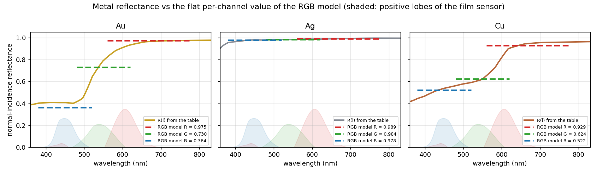
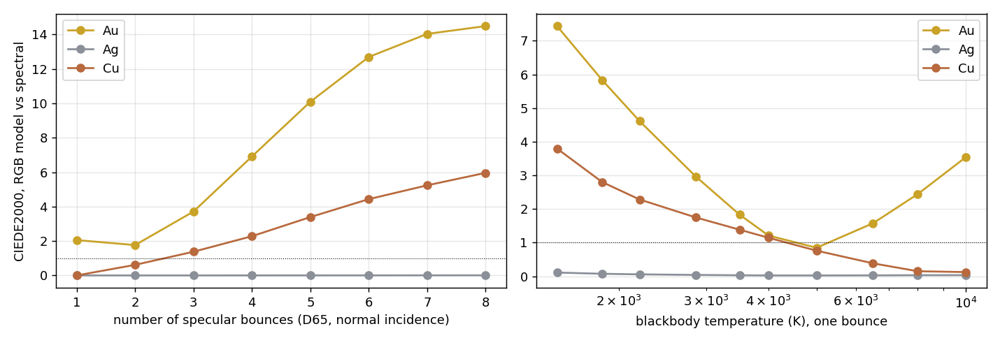
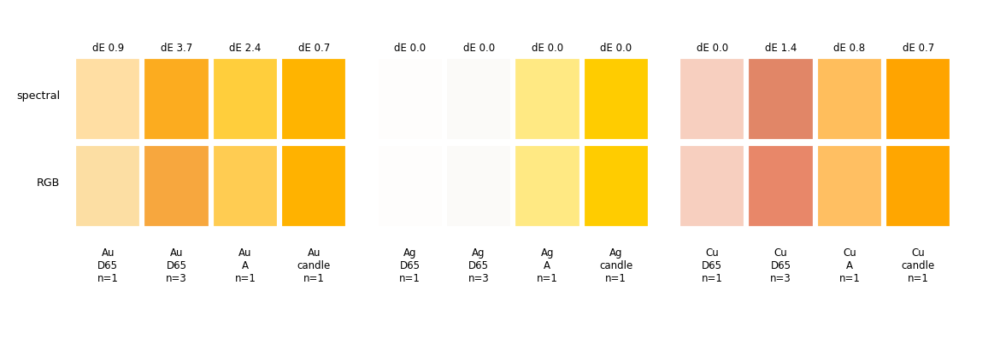

# 金属の色: スペクトル計算と RGB 近似の差（金・銅・銀）

「スペクトルレンダリングは RGB より正確か」を、数値で答えるための解析です（このプロジェクトの最初の検証項目）。
再現手順は[末尾](#8-再現手順)にあります。計算の全出力は [metal_accuracy_results.txt](data/metal_accuracy_results.txt)、スクリプトは `tools/studies/metal_accuracy.py` です。

- [1. 結論](#1-結論)
- [2. 何を比べたか](#2-何を比べたか)
- [3. 結果](#3-結果)
- [4. なぜ差が出るか](#4-なぜ差が出るか)
- [5. エンジンでの実測との照合](#5-エンジンでの実測との照合)
- [6. 粗い金属（多重散乱）](#6-粗い金属多重散乱)
- [7. 限界と、次にやること](#7-限界と次にやること)
- [8. 再現手順](#8-再現手順)

---

## 1. 結論

| 条件 | 金 (Au) | 銅 (Cu) | 銀 (Ag) |
|---|---|---|---|
| D65 の光、1 回反射、全角度 | ΔE00 0.2〜**2.1**（垂直入射で最大） | 0.0〜0.3 | 0.00 |
| D65 以外の光（タングステン A、ろうそく、LED）、1 回反射 | **2〜6** | 1.8〜2.8 | ≤ 0.07 |
| D65、金属同士の多重反射（3 回 / 4 回 / 6 回） | **3.7 / 6.9 / 12.7** | 1.4 / 2.3 / 4.4 | ≤ 0.01 |

（ΔE00 = CIEDE2000。1 前後が「並べて比べてやっと分かる」、2〜3 が「一目で違う」目安。白は D65、光の輝度は 1。）

1. **銀は、RGB 近似でもスペクトルとほぼ同じです。** 反射率が可視域でほぼ平らなので、RGB の 3 数に縮約しても何も失われません。
2. **銅は、D65 の光での 1 回反射なら RGB 近似で十分です**（ΔE00 0.3 以下）。差が出るのは、D65 以外の光（約 2）と、多重反射（4 回で約 2）です。
3. **金は、RGB 近似と最も差が出る金属です。** D65 の垂直入射でも、赤チャンネルが約 6% 低い（ΔE00 2.1）。表示用にクリップした後でも 0.9 です。光源が D65 から外れる、反射が重なる、のどちらでも差が広がります。
4. **角度（Fresnel の入射角依存）は、主因ではありません。** `(eta, k)` の RGB 縮約は、D65 の下では斜めの入射でも反射率をよく再現します（金の誤差は、垂直入射の誤差がそのまま斜めで縮むだけ）。事前に「差が出そうな条件」として挙げていたもののうち、角度は外れでした。
5. **以前の観察「金の球でスペクトルと RGB の差は約 2.5/255（スペクトルのほうが暖色）」は、項目 3 の赤チャンネルの頭打ちと整合します**（赤が約 6% 違えば、sRGB の 8bit で数/255 になる。下の 4.1）。その画像を同じ手法で分解したわけではないので、「同じ原因だと考えられる」という意味です。

**スペクトル側が「正確」と言える範囲:** スペクトルレンダラーは、`Fresnel(λ, θ)^n × 光源(λ) × フィルムのセンサー` の 1 nm 積分に収束します。エンジンで実測した値は、この積分と 0.5% 以内で一致しました（[5 章](#5-エンジンでの実測との照合)）。その積分自体の誤差は、フィルムの CMF の近似（Wyman 2013）が ΔE00 0.01〜0.18（表示される sRGB の 8bit 値は同一）、光学定数は Johnson の表のとおりです。

---

## 2. 何を比べたか

**参照解（スペクトル）**: 1 nm 刻みで 360〜830 nm を積分します。

```
RGB_ref(c) = Integral F(λ, θ)^n · L(λ) · s_c(λ) dλ          （c = R, G, B）
```

- `F`: Johnson の n, k から、エンジンと同じ非偏光の導体 Fresnel（`Core/Fresnel.hpp` の移植）。表は `ComplexIorTable` と同じく、n と k の波長の和集合上で線形補間します。
- `L`: 光源の SPD。輝度 Y = 1 に正規化（エンジンの `EmissionSpectrum::FromCurve` と同じ）。
- `s_c`: フィルムのセンサー感度（Wyman の CMF × sRGB 行列、D65 で (1,1,1) になるよう正規化）。**エンジンのフィルムと同じものを使う**ので、この解析で見えるのは「RGB 近似の誤差」だけで、CMF 近似の誤差は混ざりません（CMF の誤差は別に測りました。1 章）。

**RGB 近似**: エンジンの RGB ビルドそのものを移植しました。

1. 表を `integrateIorToRgb_CMF` で RGB の `(eta, k)` に縮約（F0 を D65 の下の色に合わせる。F0 が最大の分光反射率を超える場合は、そこで頭打ち）。
2. 光源は SPD を RGB に縮約（`L_c = ∫ L s_c`）。
3. `RGB_c = L_c × F_c(θ; eta_c, k_c)^n`。

**指標**: CIEDE2000（白 = D65）。sRGB の範囲外の値は、そのまま XYZ を経由して測った「生の ΔE00」と、両方を [0,1] にクリップしてから測った「表示 ΔE00」（`clip` 列）の両方を出します。光源に合わせたホワイトバランス（`--wb`）後の ΔE は、青チャンネルが 0 付近の光（ろうそく）で割り算が暴れて意味を持たないので、参考値にとどめます。

**条件**: 金属 Au・Ag・Cu、入射角 0〜85°、光源（D65、タングステン A 2856 K、ろうそく 1850 K、合成 LED、黒体 1500〜10000 K）、反射回数 1〜8。

---

## 3. 結果



*実線: 表の垂直入射の反射率。破線: RGB 近似が各チャンネルで使う反射率（波長によらない一定値）。薄い塗り: フィルムのセンサー感度の正の部分。*

### 3.1 RGB への縮約（垂直入射の F0、D65 の下）

| 金属 | スペクトルの F0（RGB） | RGB 近似の F0 | 備考 |
|---|---|---|---|
| Au | (1.036, 0.730, 0.364) | (0.975, 0.730, 0.364) | **赤が 1 を超え、頭打ちされる** |
| Cu | (0.929, 0.624, 0.522) | 同じ | 一致 |
| Ag | (0.989, 0.984, 0.978) | 同じ | 一致 |

参考として、`approxIorToRgb_3Wavelengths`（450 / 550 / 650 nm の 3 点だけを使う縮約）では、金の F0 が (0.957, 0.792, 0.408) になります。緑 +8.5%、青 +12%、赤 −7.6% で、CMF 積分の縮約よりずっと悪いです（銅 (0.935, 0.624, 0.538)、銀はほぼ同じ）。

### 3.2 D65 の光、1 回反射（角度依存）

| 入射角 | 金: スペクトル | 金: RGB | ΔE00（クリップ後） | 銅 ΔE00 | 銀 ΔE00 |
|---|---|---|---|---|---|
| 0° | (1.036, 0.730, 0.364) | (0.975, 0.730, 0.364) | 2.05 (0.86) | 0.00 | 0.00 |
| 30° | (1.035, 0.730, 0.366) | (0.975, 0.729, 0.366) | 2.02 (0.86) | 0.01 | 0.00 |
| 45° | (1.030, 0.730, 0.373) | (0.974, 0.730, 0.373) | 1.89 (0.86) | 0.05 | 0.00 |
| 60° | (1.018, 0.739, 0.401) | (0.973, 0.738, 0.402) | 1.52 (0.89) | 0.17 | 0.00 |
| 70° | (1.003, 0.764, 0.456) | (0.974, 0.763, 0.458) | 1.06 (0.95) | 0.30 | 0.00 |
| 80° | (0.990, 0.836, 0.601) | (0.980, 0.837, 0.602) | 0.49 (0.49) | 0.34 | 0.01 |

緑・青はどの角度でも 0.5% 以内で一致します。差は赤だけで、垂直入射の −5.8% から、斜めになるほど縮みます（Fresnel で反射率が 1 に近づくため）。

### 3.3 光源が D65 でないとき（1 回反射、θ = 0° / 60°）

| 金属 | 光源 | スペクトル（0°） | RGB（0°） | ΔE00 0° / 60° | クリップ後 0° |
|---|---|---|---|---|---|
| Au | タングステン A | (1.764, 0.615, 0.046) | (1.782, 0.607, 0.085) | 2.96 / 2.84 | 2.42 |
| Au | ろうそく | (2.502, 0.457, **−0.056**) | (2.586, 0.446, −0.004) | 5.83 / 5.38 | 0.72 |
| Au | LED | (1.043, 0.791, 0.089) | (1.027, 0.767, 0.125) | 1.95 / 1.87 | 2.07 |
| Cu | タングステン A | (1.623, 0.516, 0.107) | (1.699, 0.519, 0.121) | 1.75 / 1.81 | 0.83 |
| Cu | ろうそく | (2.334, 0.371, −0.028) | (2.465, 0.381, −0.006) | 2.80 / 2.75 | 0.70 |
| Cu | LED | (0.928, 0.665, 0.168) | (0.979, 0.655, 0.178) | 2.31 / 2.43 | 2.31 |
| Ag | 全部 | — | — | ≤ 0.07 | ≤ 0.02 |

- 黒体の温度を振ると（図の右）、金の誤差は **5000 K 付近で最小（0.85）**、そこから暖色側でも寒色側でも増えます（2856 K で 3.0、1500 K で 7.4、10000 K で 3.5）。D65（6500 K 付近）で縮約しているので、ずれるほど外れます。
- ろうそく（1850 K）の青は、金のスペクトルでは負（sRGB の範囲外）になります。表示用にクリップすると差は小さい（0.7）ですが、HDR のまま後処理に回すなら残ります。



### 3.4 多重反射（同じ金属で n 回、θ = 0°、D65）

| n | 金 スペクトル | 金 RGB | 金 ΔE00 | 銅 ΔE00 | 銀 ΔE00 |
|---|---|---|---|---|---|
| 1 | (1.036, 0.730, 0.364) | (0.975, 0.730, 0.364) | 2.05 | 0.00 | 0.00 |
| 2 | (1.018, 0.542, 0.112) | (0.951, 0.532, 0.133) | 1.77 | 0.62 | 0.00 |
| 3 | (0.975, 0.410, 0.014) | (0.928, 0.388, 0.048) | 3.71 | 1.38 | 0.00 |
| 4 | (0.920, 0.314, **−0.021**) | (0.905, 0.283, 0.018) | 6.91 | 2.28 | 0.00 |
| 6 | (0.802, 0.191, −0.033) | (0.860, 0.151, 0.002) | 12.69 | 4.43 | 0.01 |

金は 3 回反射で ΔE00 が 3.7、6 回で 12.7（RGB のほうが赤は 7% 明るく、緑は 21% 暗い）。金の指輪の内側、杯、向かい合う金の板のような、金属が金属を映す場面で差が出ます。スペクトルの青は 4 回以上で負（sRGB の範囲外）になり、RGB 近似はそれを表せません。



*上段: スペクトル、下段: RGB 近似（表示用にクリップして sRGB へ）。光源の輝度は 1 なので白っぽく見える。*

---

## 4. なぜ差が出るか

### 4.1 金の赤チャンネルは 1 を超える（物理的な上限との衝突）

金の反射率は 500〜600 nm で 0.45 から 0.9 へ急に立ち上がり（上の図）、赤（600 nm 付近）はほぼ 0.975 で平らです。ところが、sRGB の赤チャンネルのセンサー感度は、青緑（440〜520 nm）に**負の裾**を持っています。金は青緑の反射率が低い（0.4）ので、その負の寄与が白より小さくなり、結果として赤チャンネルの値が **1.036** と、1 を超えます。

RGB 近似は、反射率を Fresnel の式（`eta`, `k`）で表すので、`F ≤ 1` に縛られます。そこで `integrateIorToRgb_CMF` は、F0 を「可視域の最大の分光反射率」（金で 0.975）に頭打ちします（F0 > 1 では `k²` が負になって解けないための、意図した措置）。その結果、赤が約 6% 低くなります。

以前の観察「金の球でスペクトルと RGB の差が約 2.5/255」は、この赤の差と同じ向き（スペクトルのほうが赤い）・同じ大きさです（赤の 6% は、0.975 と 1.0 なら sRGB の 252 と 255、中間の明るさなら数/255）。

### 4.2 光源が D65 でないと、各チャンネルの実効反射率が変わる

RGB 近似は、反射率を「D65 の下で 1 回だけ」決めた一定値にします。しかし実際には、チャンネル c が見る反射率は `∫ F L s_c / ∫ L s_c` で、光源 L の重みが変わるたびに動きます。金は 480〜560 nm で反射率が急変するので、光源の傾きに敏感です。

例（金、垂直入射、θ = 0°）: 青チャンネルの実効反射率は、D65 で 0.364、タングステン A では **0.197** です（RGB 近似は 0.364 のまま）。青チャンネルは「440〜480 nm の正の山」と「500〜650 nm の負の裾」の差で、暖色の光は後者を強く照らします。負の裾の側の金の反射率（0.5〜0.95）は青の山の側（0.4）より高いので、負の寄与が増えて青が大きく下がります。銀と銅は、反射率が平らか、緩やかなので影響が小さいです。

### 4.3 多重反射は、スペクトルを尖らせる

n 回反射した反射率は `F(λ)^n` です。金の `F(λ)` は赤で 0.975、青で 0.4 なので、n が増えると赤と青の比が `(0.975/0.4)^n` に広がり、スペクトルは長波長側へ尖ります。スペクトル計算はこれを波長ごとに正しく計算しますが、RGB 近似は「各チャンネルの定数の n 乗」です。チャンネルの内側のスペクトルの形（例えば緑チャンネルの中の、500 nm の立ち上がり）が n 乗で変わる分を、表せません。

D65 の垂直入射で、スペクトルの「1 回あたりの実効反射率」`(RGB値)^(1/n)` は、金の赤で n = 1 → 6 に 1.036 → 0.964、緑で 0.730 → 0.759 と動きます（RGB 近似は 0.975 と 0.730 で固定。詳細は結果ファイルの E8）。RGB 近似の赤（0.975）が合うのは、n = 4〜5 前後です。

### 4.4 角度依存は、ほぼ問題ない

D65 の下では、縮約した `(eta, k)` で計算した `F(θ)` が、スペクトルの `F(θ)` と、緑・青で 0.5% 以内、銅の赤でも 1% 以内で一致します（3.2 章）。「斜めの入射で RGB が外れる」という予想は、今回のデータ（Johnson の Au・Ag・Cu）では当たっていませんでした。

---

## 5. エンジンでの実測との照合

Python の移植が、実際のエンジンと同じ値を出しているかを確かめるため、`--scene metalprobe` を追加しました（`main_cli.cpp`）。滑らかな金属の球（半径 1）を、光源の SPD を持つ大きな発光殻の中に置き、遠くから（ほぼ正射影で）撮ります。球面上のリング半径が `sin θ` なので、1 枚の画像で入射角 0〜85° が得られ、反射は 1 回だけです。入射角ごとの平均色を表示します。RGB ビルドとスペクトルビルド（別々）で実行し、Python の予測と比べます。

**結果（3 金属 × 4 光源 × 2 モード、480 px、512 spp、全角度の表は [metal_probe_compare.txt](data/metal_probe_compare.txt)）**

- **エンジンの RGB ビルドは、Python の RGB 近似と一致**: 入射角 80° 未満の全ビンで ΔE00 ≤ 0.07。
- **エンジンのスペクトルビルドは、Python の 1 nm 積分と一致**: 同じく ΔE00 ≤ 0.12（銀・D65 の 0° ビンだけ 0.45。そのビンは 32 画素しかなく、白に近い色の ΔE が色ノイズに敏感なため）。80° 以上のビンは、±1.5° の幅で急峻な `F(θ)` を平均するので、点の値との比較にならず除外しました。
- したがって、**エンジンの RGB 版とスペクトル版の差は、この解析の数値そのもの**です（実測 ΔE00、θ = 0° 付近 / 60°）:

| 金属 | D65 | タングステン A | ろうそく | LED |
|---|---|---|---|---|
| Au | 2.10 / 1.51 | 2.97 / 2.86 | 5.86 / 5.37 | 1.94 / 1.87 |
| Cu | 0.11 / 0.18 | 1.81 / 1.80 | 2.81 / 2.74 | 2.25 / 2.44 |
| Ag | ≤ 0.1 | ≤ 0.1 | ≤ 0.1 | ≤ 0.1 |

（3.2・3.3 章の Python の値は 2.05 / 1.52、2.96 / 2.84、5.83 / 5.38、1.95 / 1.87、銅 0.00 / 0.17、1.75 / 1.81、2.80 / 2.75、2.31 / 2.43。銅・D65 の 0° だけ 0.11 と 0.00 で食い違うのは、上の 32 画素のビンのノイズです。）

多重反射は、エンジンでは測っていません（1 回反射の一致から、n 回は `F^n` の積になるだけなので、3.4 章は Python の値のままです）。

---

## 6. 粗い金属（多重散乱）

粗い金属は、微小面どうしの反射（多重散乱）が増えます。エンジンは Kulla-Conty の補正項 `f_ms = F_ms (1−E(μo))(1−E(μi)) / (π(1−E_avg))`、`F_ms = F_avg² E_avg / (1 − F_avg(1−E_avg))` で、単一散乱 GGX が失うエネルギーを戻します。`F_ms` は反射率の 2 乗に近い量なので、3.4 章の「2 回反射」と同じ種類の差が出ると予想し、`metalprobe --roughness r`（RGB・スペクトル各 512 spp）で測りました。全角度の表は [metal_probe_rough_compare.txt](metal_probe_rough_compare.txt) です。

### 6.1 結果: 「拡大する」のは光源が D65 でないときと、銅

RGB 版とスペクトル版の ΔE00（入射角 0〜45° 付近の値）:

| 条件 | r = 0.01 | 0.3 | 0.5 | 0.7 | 1.0 |
|---|---|---|---|---|---|
| 金・D65 | 2.0 | 2.0 | 1.9 | 1.5 | 1.4〜1.6 |
| 金・タングステン A | 3.0 | 3.0 | 3.2 | 4.0 | **6.3** |
| 銅・D65 | 0.0 | — | 0.1 | — | **1.1** |

- **金・D65: ほぼ拡大しません**（微減）。ただし中身が入れ替わります。滑らかな金は「赤が 6% 低い」（頭打ち）が差の全部でしたが、粗い金（r = 1.0、45°）では RGB (0.939, 0.526, 0.193) とスペクトル (0.969, 0.537, 0.176) で、赤 −3%、緑 −2%、**青 +10%** になります。粗いほど赤の差が縮み（多重散乱側の実効反射率が下がり、頭打ちの影響が薄れる）、代わりに多重散乱項の青が RGB では明るすぎます。
- **金・タングステン: 拡大します**（3.0 → 6.3、約 2 倍）。粗さ 1.0 では RGB (1.716, 0.437, 0.045)、スペクトル (1.608, 0.456, −0.001)（45°）で、赤が RGB で 7% 明るく、青は RGB が正でスペクトルは 0 以下です。光源による実効反射率のずれ（4.2 章）が、多重散乱項で 2 乗になって効きます。
- **銅・D65: 拡大します**（0.1 → 1.1）。滑らかな銅は D65 で 1 回なら一致していましたが、粗さ 1.0 では多重散乱の寄与が大きくなり、3.4 章の 2〜3 回反射に近い差（0.6〜1.4）が出ます。
- 銀は測っていません（反射率が平らなので、3.4 章から差は出ないと見込みます）。

### 6.2 なぜか

多重散乱項 `F_ms` の色が RGB とスペクトルで違うためです。RGB 版は `F_avg`（半球平均の Fresnel）を縮約した `(eta, k)` から作り、頭打ちの影響も引き継ぎます。スペクトル版は波長ごとに `F_ms(λ)` を作って最後にセンサーで RGB にします（`F_ms` は `F_avg` の非線形関数なので、「平均してから関数」と「関数してから平均」は一致しません）。D65 の下で `F_ms` の色を比べると（Python の見積もり、`E_avg` はエネルギーの 95% / 60% / 40% を単一散乱が受け持つ場合）:

| 金属 | E_avg | RGB 版の F_ms | スペクトル→RGB の F_ms | 差（R, G, B） |
|---|---|---|---|---|
| Au | 0.95 | (0.949, 0.544, 0.156) | (1.002, 0.553, 0.137) | −5%, −2%, **+14%** |
| Au | 0.60 | (0.935, 0.471, 0.115) | (0.972, 0.485, 0.091) | −4%, −3%, **+27%** |
| Au | 0.40 | (0.916, 0.398, 0.085) | (0.929, 0.417, 0.058) | −1%, −5%, **+48%** |
| Cu | 0.60 | (0.824, 0.322, 0.223) | (0.782, 0.320, 0.219) | +5%, +1%, +2% |

粗いほど（E_avg が小さいほど）、多重散乱項の割合が増え、金の青の誤差が大きくなります。

### 6.3 解決策の提案

**案 A（試作で検証済み）: RGB 版の `F_ms` の色を、スペクトルから作る。**
`RoughConductor` の RGB ビルドで、`F_ms` を「縮約した `(eta, k)` の F_avg から作る」のをやめ、`F_ms(λ)` を表から波長ごとに作り、D65 のセンサーで RGB に投影した値（`color::spectrumToRGB_D65`）にします。事前計算だけで、描画時のコストは変わりません。試作して同じ測定をしたところ（試作は測定後に元へ戻しました）:

| 条件 | 現状 | 案 A |
|---|---|---|
| 銅・D65・r = 1.0 | 1.09 | **0.11** |
| 金・D65・r = 1.0 | 1.55 | **0.53** |
| 金・D65・r = 0.5 | 1.90 | 1.84（残りは単一散乱側の赤の頭打ち） |
| 金・タングステン・r = 1.0 | 6.30 | 5.65（光源のずれは直らない） |

D65 の下の誤差は大きく減りますが、**光源が D65 でないときの差は直りません**。RGB は光源を知らないためで、案 A でも原理的に直せません。`setRoughness()` でも `F_ms` を作り直すので、実装するときは表を保持して、そこも差し替える必要があります。

**案 B: 光源が D65 でない場面や、金属の見た目が主題の最終レンダリングは、スペクトルビルドを使う。**
Release では、スペクトル版は RGB 版とほぼ同じ速さです。この解析の差（光源違いの 2〜6、粗い金・タングステンの 6.3、多重反射の 3.7〜）は、スペクトル版では出ません。RGB 版は、プレビューと D65 の場面に使う、という使い分けです。最も確実で、追加の実装が要りません。

**案 C: 金の赤の頭打ちを外す（単一散乱側）。**
金の F0 の赤が 1 を超える分（1.036）が、滑らかな金・粗い金・D65 の誤差の残りです（案 A の後の金・D65・r = 0.5 の 1.84 など）。F0 に 1 を超える値を許す縮約は、1 回反射では一致しますが、多重反射で R^n が 1 を超えて増え、エネルギー保存を破るので、そのままは勧めません。多重反射の実効値を見て、F0 の赤を 0.975〜1.0 の間に置く（例えば 3 回反射まで誤差を均す）方法はありえますが、未検証です。

**案 D（より根本的）: 微小面の多重散乱を補正項でなく直接計算し、その上で比べる。**
Kulla-Conty は近似です。微小面の高さ相関ランダムウォーク（Heitz 2016）で波長ごとに真の色を出せば、RGB 版とスペクトル版の「どちらが真に近いか」まで言えます。6.1 章の差は、両版とも同じ近似を使った上での差なので、この比較は未実施です。

**推奨**: まず案 A（小さな変更で、銅と D65 の金の粗い面が直る）を実装し、光源違いの精度が要る場面は案 B（スペクトルビルド）で、と使い分けます。案 C・D は、案 A の後に残る誤差を見てから判断します。

---

## 7. 限界と、次にやること

**この解析が扱っていないこと**
- **多重散乱補正そのものの正しさ**（Kulla-Conty は近似）。6 章は「RGB 版とスペクトル版の差」を測ったもので、粗い金属の真の色（微小面のランダムウォークなど）との比較ではありません。
- **色ノイズと等時間の比較**（スペクトルは波長のサンプリングによる色ノイズがあり、収束が違う）。ここでの値は、すべて収束した期待値です。
- **偏光**（非偏光の平均だけ）、**薄膜・酸化膜**、**光学定数そのものの誤差**（Johnson の表を真とした）。
- **sRGB の範囲外の色**（金の多重反射の青、ろうそくの光の青）の扱い。表示時のクリップで見かけの差が縮む（ΔE00 が 5.8 → 0.7 など）が、HDR のまま後処理するなら残る。

**この結果から考えられる次の手**（どれも未着手）
1. **金の赤の頭打ちを外す**（RGB ビルドの精度向上）。F0 が 1 を超える値を許す（Schlick 型の F0 + 角度の形）と、D65 の 1 回反射は一致しますが、多重反射では R^n が 1 を超えて増え、エネルギー保存を破ります（3.4 章の n = 2 以降）。n によらず誤差を小さくする縮約には、複数回の反射での最小二乗が必要で、どこまで効くかは試していません。
2. **等時間の比較**で、色ノイズを含めたスペクトルの実効精度を測る（同じ画像を独立な乱数で 2 回描き、差からノイズを推定する）。
3. **キャラクターの金属パーツ**（方針 2）で、現在の `CoatedDiffuse` の Schlick と、`RoughConductor`（Au の表）の差を見る。小さな金属パーツで、多重反射の差が出るかどうか。
4. 粗い金属の対策は 6.3 章（RGB 版の多重散乱項の色を直す。試作で効果を確認済み）。

---

## 8. 再現手順

**解析（Python、数秒）** — 必要なもの: `numpy`、`colour-science`、`matplotlib`

```bash
python tools/studies/metal_accuracy.py --true-cmf --figs docs/img > docs/data/metal_accuracy_results.txt
```

**エンジン実測** — RGB ビルドとスペクトルビルドを別々に作り（`tools/build_cli.ps1` と、`-Spectral` を付けた同じスクリプト。スペクトル版は `CL=/DRAYT_SPECTRAL_MODE`）、プロジェクトのフォルダ（`GoLD_rayt/GoLD_rayt/`）で:

```bash
GoLD_rayt.exe --scene metalprobe --metal Au --light tungsten --width 480 --spp 512 > probe_Au_tungsten_rgb.log
python tools/studies/metal_accuracy.py --compare probe_Au_tungsten_rgb.log probe_Au_tungsten_spectral.log
```

`--metal` は Au | Ag | Cu、`--light` は d65 | tungsten | candle | led、`--roughness r` は粗さ（既定 0.01）。1 回 約 8 秒（Release、8 スレッド）。粗さ付きのログは、予測との比較を省いて RGB 版とスペクトル版の直接比較だけを出します。
