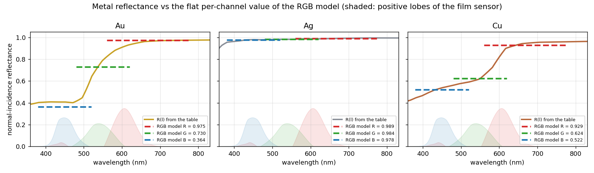
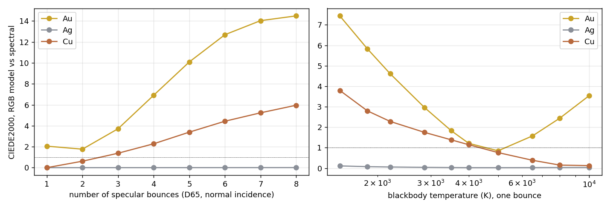
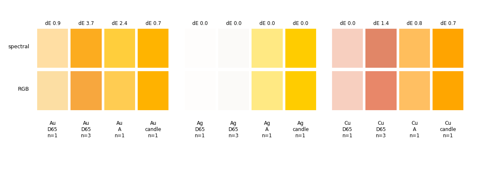

# Metal color: the difference between spectral calculation and the RGB approximation (gold, copper, silver)

This is an analysis that answers "is spectral rendering more accurate than RGB?" with numbers (the first thing this project set out to verify).
Reproduction steps are at the [end](#7-reproduction). The full output of the calculation is [metal_accuracy_results.txt](data/metal_accuracy_results.txt); the script is `tools/studies/metal_accuracy.py`.

- [1. Conclusions](#1-conclusions)
- [2. What was compared](#2-what-was-compared)
- [3. Results](#3-results)
- [4. Why the difference appears](#4-why-the-difference-appears)
- [5. Check against measurements in the engine](#5-check-against-measurements-in-the-engine)
- [6. Rough metals (multiple scattering)](#6-rough-metals-multiple-scattering)
- [7. Reproduction](#7-reproduction)

---

## 1. Conclusions

| Condition | Gold (Au) | Copper (Cu) | Silver (Ag) |
|---|---|---|---|
| D65 light, one reflection, all angles | ΔE00 0.2 to **2.1** (largest at normal incidence) | 0.0 to 0.3 | 0.00 |
| Light other than D65 (tungsten A, candle, LED), one reflection | **2 to 6** | 1.8 to 2.8 | ≤ 0.07 |
| D65, metal-to-metal inter-reflection (3 / 4 / 6 bounces) | **3.7 / 6.9 / 12.7** | 1.4 / 2.3 / 4.4 | ≤ 0.01 |

(ΔE00 = CIEDE2000. As a rule of thumb, about 1 is "only noticeable side by side" and 2 to 3 is "different at a glance". White is D65 and the light's luminance is 1.)

1. **For silver, the RGB approximation is almost the same as spectral.** The reflectance is nearly flat over the visible range, so reducing it to three RGB numbers loses nothing.
2. **For copper, the RGB approximation is sufficient for one reflection under D65 light** (ΔE00 0.3 or less). Differences appear for light other than D65 (about 2) and for inter-reflection (about 2 at 4 bounces).
3. **Gold is the metal where the RGB approximation differs most.** Even at normal incidence under D65, the red channel is about 6% low (ΔE00 2.1); after clipping for display it is 0.9. The difference grows when the light departs from D65 and when reflections stack up.
4. **Angle (the incidence-angle dependence of Fresnel) is not the main cause.** Under D65 the RGB reduction of `(eta, k)` reproduces the reflectance well even at oblique incidence (the error for gold is just the normal-incidence error shrinking toward grazing angles). Of the conditions that had been listed in advance as likely to show a difference, angle was a miss.
5. **The earlier observation "on a gold sphere, spectral and RGB differ by about 2.5/255 (spectral is warmer)" is consistent with the red-channel cap of item 3** (a red difference of about 6% becomes a few /255 in 8-bit sRGB; see 4.1 below). That image was not decomposed with the same method, so this only means "probably the same cause".

6. **The gamut you display in changes what difference is visible.** Candle-lit gold lies outside sRGB, and on an sRGB display the difference vanishes (ΔE00 about 0.9 for the bowl and the statue), but in Display P3 it is 4 to 5 (section 3.5). The difference is not a fine pattern in the folds but a shift in the color of the whole object, and it does not vanish through the eye's spatial filter (section 3.6). The sRGB display hides the difference only because the RGB renderer works in sRGB primaries: its error then sits in the blue channel that the display clips. With a wider working space both displays show about the same difference (section 3.7). Through real view transforms the hiding survives only where the view clips the Rec.709 channels (Blender's Standard and Filmic); Blender's current default, AgX, shows the difference on sRGB too (section 3.8).

**Where "spectral is accurate" holds:** the spectral renderer converges to the 1 nm integral of `Fresnel(λ, θ)^n × light(λ) × film sensor`. The values measured in the engine agree with this integral within 0.5% ([section 5](#5-check-against-measurements-in-the-engine)). The error of the integral itself is: the film's CMF approximation (Wyman 2013, the film's until 2026-11-17; it now uses the 1 nm CIE table) gave ΔE00 0.01 to 0.18 here (the displayed 8-bit sRGB values are identical); the optical constants are as in Johnson's table.

---

## 2. What was compared

**Reference solution (spectral)**: integrate 360 to 830 nm in 1 nm steps.

```
RGB_ref(c) = Integral F(λ, θ)^n · L(λ) · s_c(λ) dλ          (c = R, G, B)
```

- `F`: unpolarized conductor Fresnel from Johnson's n, k, the same as in the engine (a port of `Core/Fresnel.hpp`). As in `ComplexIorTable`, the table is interpolated linearly over the union of the wavelengths of n and k.
- `L`: the light's SPD, normalized to luminance Y = 1 (the same as the engine's `EmissionSpectrum::FromCurve`).
- `s_c`: the film's sensor sensitivity (Wyman's CMF times the sRGB matrix, normalized to give (1, 1, 1) for D65). **The same sensor as the engine's film is used** (the film's until 2026-11-17), so what this analysis shows is only the "error of the RGB approximation"; the error of the CMF approximation is not mixed in (the CMF error was measured separately; see section 1).

**RGB approximation**: the engine's RGB build itself was ported.

1. Reduce the table to RGB `(eta, k)` with `integrateIorToRgb_CMF` (F0 is matched to the color under D65; if F0 exceeds the largest spectral reflectance it is capped there).
2. Reduce the light's SPD to RGB (`L_c = ∫ L s_c`).
3. `RGB_c = L_c × F_c(θ; eta_c, k_c)^n`.

**Metric**: CIEDE2000 (white = D65). For values outside the sRGB range, both the "raw ΔE00", measured by passing the values straight through XYZ, and the "display ΔE00" (`clip` column), measured after clipping both to [0, 1], are given. ΔE after white balance for the light (`--wb`, `wb` column) is measured after a CAT16 chromatic adaptation (full adaptation, D = 1, luminance preserved) from the light's white to the D65 white. Previously each RGB channel was divided by the light's RGB, but that was meaningless for the candle, where blue is negative. Candle-lit gold (normal incidence, one reflection) stays large after adaptation, at ΔE00 24 (59 with the division). The chromatic adaptation raises the gain of blue (the S cones) by about 7 times, which magnifies the small difference in blue between the RGB and spectral versions.

**Conditions**: metals Au, Ag, Cu; incidence angles 0 to 85°; lights (D65, tungsten A 2856 K, candle 1850 K, synthetic LED, blackbody 1500 to 10000 K); 1 to 8 reflections.

---

## 3. Results



*Solid lines: the normal-incidence reflectance from the table. Dashed lines: the reflectance the RGB approximation uses for each channel (a constant independent of wavelength). Light fill: the positive part of the film's sensor sensitivity.*

### 3.1 Reduction to RGB (normal-incidence F0, under D65)

| Metal | Spectral F0 (RGB) | RGB-approximation F0 | Note |
|---|---|---|---|
| Au | (1.036, 0.730, 0.364) | (0.975, 0.730, 0.364) | **Red exceeds 1 and is capped** |
| Cu | (0.929, 0.624, 0.522) | same | match |
| Ag | (0.989, 0.984, 0.978) | same | match |

For reference, with `approxIorToRgb_3Wavelengths` (a reduction using only the three points 450 / 550 / 650 nm) the F0 of gold becomes (0.957, 0.792, 0.408): green +8.5%, blue +12%, red −7.6%, much worse than the CMF-integral reduction (copper (0.935, 0.624, 0.538); silver almost the same).

### 3.2 D65 light, one reflection (angle dependence)

| Incidence angle | Gold: spectral | Gold: RGB | ΔE00 (after clipping) | Copper ΔE00 | Silver ΔE00 |
|---|---|---|---|---|---|
| 0° | (1.036, 0.730, 0.364) | (0.975, 0.730, 0.364) | 2.05 (0.86) | 0.00 | 0.00 |
| 30° | (1.035, 0.730, 0.366) | (0.975, 0.729, 0.366) | 2.02 (0.86) | 0.01 | 0.00 |
| 45° | (1.030, 0.730, 0.373) | (0.974, 0.730, 0.373) | 1.89 (0.86) | 0.05 | 0.00 |
| 60° | (1.018, 0.739, 0.401) | (0.973, 0.738, 0.402) | 1.52 (0.89) | 0.17 | 0.00 |
| 70° | (1.003, 0.764, 0.456) | (0.974, 0.763, 0.458) | 1.06 (0.95) | 0.30 | 0.00 |
| 80° | (0.990, 0.836, 0.601) | (0.980, 0.837, 0.602) | 0.49 (0.49) | 0.34 | 0.01 |

Green and blue agree within 0.5% at every angle. The difference is only in red, from −5.8% at normal incidence, shrinking toward oblique angles (because Fresnel reflectance approaches 1).

### 3.3 When the light is not D65 (one reflection, θ = 0° / 60°)

| Metal | Light | Spectral (0°) | RGB (0°) | ΔE00 0° / 60° | After clipping, 0° |
|---|---|---|---|---|---|
| Au | Tungsten A | (1.764, 0.615, 0.046) | (1.782, 0.607, 0.085) | 2.96 / 2.84 | 2.42 |
| Au | Candle | (2.502, 0.457, **−0.056**) | (2.586, 0.446, −0.004) | 5.83 / 5.38 | 0.72 |
| Au | LED | (1.043, 0.791, 0.089) | (1.027, 0.767, 0.125) | 1.95 / 1.87 | 2.07 |
| Cu | Tungsten A | (1.623, 0.516, 0.107) | (1.699, 0.519, 0.121) | 1.75 / 1.81 | 0.83 |
| Cu | Candle | (2.334, 0.371, −0.028) | (2.465, 0.381, −0.006) | 2.80 / 2.75 | 0.70 |
| Cu | LED | (0.928, 0.665, 0.168) | (0.979, 0.655, 0.178) | 2.31 / 2.43 | 2.31 |
| Ag | all | — | — | ≤ 0.07 | ≤ 0.02 |

- Varying the blackbody temperature (right of the figure), the error for gold is **smallest near 5000 K (0.85)** and grows toward both warmer and cooler (3.0 at 2856 K, 7.4 at 1500 K, 3.5 at 10000 K). The reduction is done at D65 (near 6500 K), so the further away, the worse.
- The blue of the candle (1850 K) is negative (outside sRGB) in the spectral gold. After clipping for display the difference is small (0.7), but it remains if the result goes to post-processing as HDR.



### 3.4 Inter-reflection (n reflections off the same metal, θ = 0°, D65)

| n | Gold spectral | Gold RGB | Gold ΔE00 | Copper ΔE00 | Silver ΔE00 |
|---|---|---|---|---|---|
| 1 | (1.036, 0.730, 0.364) | (0.975, 0.730, 0.364) | 2.05 | 0.00 | 0.00 |
| 2 | (1.018, 0.542, 0.112) | (0.951, 0.532, 0.133) | 1.77 | 0.62 | 0.00 |
| 3 | (0.975, 0.410, 0.014) | (0.928, 0.388, 0.048) | 3.71 | 1.38 | 0.00 |
| 4 | (0.920, 0.314, **−0.021**) | (0.905, 0.283, 0.018) | 6.91 | 2.28 | 0.00 |
| 6 | (0.802, 0.191, −0.033) | (0.860, 0.151, 0.002) | 12.69 | 4.43 | 0.01 |

For gold, ΔE00 is 3.7 at 3 reflections and 12.7 at 6 (in the RGB version red is 7% brighter and green 21% darker). The difference shows in scenes where metal reflects metal: the inside of a gold ring, a cup, facing gold plates. The spectral blue becomes negative (outside sRGB) at 4 or more reflections, which the RGB approximation cannot represent.



*Top row: spectral. Bottom row: RGB approximation (clipped for display to sRGB). The light's luminance is 1, so the swatches look whitish.*

---

### 3.5 The gamut you display in changes the visible difference (bowl and statue, checked by rendering)

The bowl (`--scene goldbowl`) and the statue (`scenes/erato_gold.json`) were rendered with the RGB build and the spectral build, and the ΔE00 of the **displayed image** was measured for each display gamut (the same processing as the `--gamut` output: primaries conversion, negative values set to 0, Reinhard, sRGB curve, 8 bit). The table gives the mean ΔE00 and the fraction of pixels with ΔE00 > 1 (about 1 is a rough guide for a "just visible difference" in ΔE00; it varies with the comparison method and viewing conditions. It is a different value from the guide of 2.3 for ΔE\*ab).

| Light | Object | sRGB display | Display P3 display |
|---|---|---|---|
| D65 | bowl | 1.32 (65 %) | 1.32 (67 %) |
| Tungsten | bowl | 2.65 (80 %) | 2.88 (80 %), 95th percentile 4.9 → 6.6 |
| Candle | bowl | **0.92 (36 %)** | **5.16 (87 %)** |
| Candle | statue | **0.96 (36 %)** | **4.40 (65 %)** |

- Candle-lit gold lies outside sRGB (the spectral blue is negative). In sRGB the two images are cut to the same boundary color and the difference vanishes. In P3 nothing is cut and the difference is visible as it is. Rec.2020 shows the same tendency.
- D65 is the same regardless of gamut. For tungsten the mean changes little, but the pixels with large differences (95th percentile) were hidden in sRGB.
- The noise floor (the difference between two renders of the same version) is 0.4 to 0.75 for the bowl and 0.8 to 1.1 for the statue (about 0.7 times that when comparing averaged images). The candle (P3) and tungsten differences are well above this. The D65 difference (1.2 to 1.3) is a small difference that is hard to tell from noise, because the noise floor is close to 1.
- **The denoiser (OIDN) clips negative values to 0.** In the candle statue, blue in the raw render was −0.04 on average and 0 after denoising. In the denoised image no color outside sRGB remains, and no difference appears even in P3 (ΔE00 1.43). Gamut measurements are therefore made on renders without denoising.
- The display uses Reinhard (per channel) at exposure 0. A strong tone map reduces the difference, so the values depend on the display processing.

The full numbers are in `docs/data/gold_compare_gamut_results.txt` and `docs/data/erato_compare_gamut_results.txt`. The scripts are `tools/studies/gold_compare_gamut.py` and `erato_compare_gamut.py`.

### 3.6 S-CIELAB: does the difference remain through the eye's spatial filter? (statue)

The color-difference map of the statue looks large deep in the folds and small on flat areas, but overall the spectral version looks more vivid. Using a spatial filter for color (S-CIELAB: blur the color areas coarsely, as the eye does, then take the difference), it was examined whether the fine color of the folds mixes into its surroundings and the difference disappears (two-render average of raw renders; 20 / 40 / 80 pixels per degree of visual angle; 40 corresponds to 0.25 mm pixels viewed from 60 cm).

| Light, display | Per-pixel ΔE00 (mean) | S-CIELAB (40 px/deg) | S-CIELAB (80 px/deg) | Difference of the object's mean color |
|---|---|---|---|---|
| D65, sRGB | 1.24 | 1.14 | 0.83 (noise 0.5) | 0.66 |
| Tungsten, sRGB | 2.42 | 2.55 | 2.34 | **2.84** |
| Candle, P3 | 4.40 | 4.26 | 4.08 | **6.00** |

- **The tungsten and candle (P3) differences do not vanish through the filter.** They are nearly the same even when the viewing distance changes by a factor of 4. The difference is not a fine pattern in the folds but a shift in color over the whole object (low spatial frequency). The difference of the object's mean color is at least as large as the per-pixel mean.
- **The difference on flat areas is not small either.** For tungsten, 53 to 56 % of pixels have ΔE00 > 2.3 (more than twice the guide of about 1 for a just-visible difference). On a 0 to 10 color map, ΔE 2 to 3 looked dark and seemed small. The explanation "the color of the folds decides the overall impression" is not needed for this data.
- **The D65 difference is a difference in fine patterns** and mixes away when seen from a distance (0.83, close to the noise of 0.5).
- The filter widths were copied from the table in the paper. Since the conclusion does not change when the viewing distance changes by a factor of 4, the result is robust to an error in the table.
- Calculation: `tools/studies/erato_scielab.py`, `tools/lib/scielab.py`. The full output is in `docs/data/erato_scielab_results.txt`.

### 3.7 The sRGB display hides the difference only when the RGB renderer works in sRGB primaries (reference model)

Is the vanishing of the candle difference on an sRGB display (3.5) a property of RGB rendering, or of an RGB renderer that works in sRGB primaries, as this one does (and as Blender and Unreal do by default)? The reference model of this analysis (normal incidence, the same metal at every bounce) was run with the RGB renderer working in five bases: sRGB, Display P3, Rec.2020, the AP1 primaries of ACEScg (white scaled to D65) and the "Sharp" primaries of Ward and Eydelberg-Vileshin (2002). Each was compared with the spectral result over 9 lights (blackbodies from 1500 to 6500 K, and D65) × 1, 2, 3, 4 and 6 reflections, shown on an sRGB display (negative channels clipped) and on a Display P3 display (Reinhard per channel, exposure 0, as in 3.5).

| Working basis (gold) | Hidden on sRGB, visible on P3 | Share of the P3 difference the sRGB clip removes | Mean ΔE00, linear | On P3 | On sRGB |
|---|---|---|---|---|---|
| sRGB | **2** of 37 | **64 %** | 8.41 | 7.98 | 3.19 |
| Display P3 | 0 of 33 | 2 % | 5.33 | 4.25 | 4.34 |
| Rec.2020 | 0 of 32 | 6 % | 4.72 | 4.67 | 4.59 |
| ACEScg (AP1) | 0 of 28 | −15 % | 3.39 | 3.96 | 4.40 |
| Sharp | 0 of 23 | −5 % | 3.07 | 2.64 | 2.73 |

"Hidden" means ΔE00 below 1 on sRGB and at least 2 on P3 ("of 37": the conditions visible on P3). The share removed is the mean of 1 − ΔE(sRGB) / ΔE(P3) over the conditions whose spectral color is outside sRGB. Means are over the 45 conditions.

- **Only the sRGB working basis hides the difference.** With a wider basis, an sRGB and a P3 display show about the same difference. For copper, too, only the sRGB basis hides the difference (the same two conditions as for gold).
- **Fully hidden only in two conditions: one reflection under a light redder than about 1910 K**, where the light itself lies outside sRGB (1500 K: 0.58 on sRGB against 8.24 on P3; 1850 K, the candle: 0.64 against 5.82). Under the same lights with more reflections, the clip still removes 75 to 90 % of the difference, but what remains is above 1. This agrees with the renders of 3.5: the bowl, mostly single reflections, is hidden under the candle and not under tungsten.

**Why.** The error of the sRGB-basis renderer sits in the blue channel, which is the channel that gets clipped:

- The sRGB blue sensor (the CIE observer converted to linear sRGB) is negative from 516 to 780 nm. Gold reflects long wavelengths strongly and short ones weakly, so under a red light the spectral result keeps the negative part of the blue integral and loses most of the positive part. Its blue is negative (outside sRGB): −0.056 for the candle and one reflection.
- The RGB renderer's blue is the light's blue times gold's blue (0.36). A light redder than about 1910 K has a blue of zero or below, so the RGB blue sits at about 0, on the edge of sRGB (−0.004).
- For the candle and one reflection the linear error is 5.83, of which the blue channel alone accounts for 5.05 and red and green together for 1.03. Clipping sets both blues to 0 and removes the error together with the blue.
- Above about 1910 K the light's blue is positive, the RGB blue stays above 0 (2200 K: +0.023 against −0.025) and the clip no longer removes it (2.71). With more reflections the red and green error grows, and no clip removes that.
- In the wide bases the error is not in the sRGB blue (ACEScg, candle, one reflection: blue alone 0.14 of 1.17), so the clip removes little of it.

**A consequence for the choice of working space.** On an sRGB display with clipping, the sRGB-basis renderer looks on average closer to the spectral result than the Display P3, Rec.2020 and ACEScg bases do (3.19 against 4.3 to 4.6), because its error lies in the channel that the clip discards; only the Sharp basis does better (2.73). On a P3 display it is the other way round (7.98 against 4.0 to 4.7, Sharp 2.64), and so is an sRGB display with a gamut mapping that reduces chroma instead of clipping (OKLCH: 5.45 against 3.8 to 4.5, Sharp 2.40). A wider working space lowers the rendering error itself (Ward and Eydelberg-Vileshin 2002; [rgb_basis_study_results.txt](data/rgb_basis_study_results.txt)), but whether the displayed image gets closer to the spectral one depends on the display and on the gamut mapping.

Limits: a calculation with the reference model, not renders (the engine's RGB build works only in sRGB primaries). Normal incidence and the same metal at every bounce. The display values depend on the tone curve (Reinhard per channel at exposure 0). ACEScg here is the AP1 primaries with a D65 white; the ACES white (D60) and its adaptation are not modeled. The Sharp matrix was written from memory of the paper. The model uses Wyman's fit of the CIE observer.

Full output: [working_space_hiding_results.txt](data/working_space_hiding_results.txt) (script `tools/studies/working_space_hiding.py`). Related: light × reflections for the sRGB basis in [condition_map_results.txt](data/condition_map_results.txt) (`condition_map.py`), and the bowl renders under four gamut mappings in [gamut_mapping_results.txt](data/gamut_mapping_results.txt) (`gamut_mapping_study.py`).

### 3.8 Real view transforms: Blender's AgX shows the difference on sRGB too

The results above use the renderer's own PNG output (Reinhard per channel, negative channels clipped). A production image goes through a view transform instead. The bowl renders of 3.5 (the RGB build works in sRGB primaries) were shown through the view transforms of Blender 4.5 and through the ACES 1.3 SDR output transform, applied with OpenColorIO itself (Blender's own `config.ocio` and LUTs, and OCIO's built-in ACES 1.3 CG config), at exposure 0. The table gives the mean ΔE00 over the bowl under the candle, with the share of pixels above 1 in brackets.

| View transform (candle-lit bowl) | sRGB display | Display P3 display |
|---|---|---|
| Renderer's output (Reinhard, clip) | 0.91 (36 %) | 5.15 (87 %) |
| Blender Standard | 1.12 (43 %) | 5.22 (87 %) |
| Blender Filmic (Blender's default from 2.80 to 3.6) | 0.99 (40 %) | (sRGB only) |
| Khronos PBR Neutral | 1.18 (50 %) | (sRGB only) |
| **Blender AgX (Blender's default since 4.0)** | **2.14 (80 %)** | 4.19 (80 %) |
| ACES 1.3 SDR | 1.47 (48 %) | 2.31 (79 %) |

The noise floor (the same build rendered twice) is 0.4 to 0.8.

- **The hiding survives in the views that clip the Rec.709 channels:** Blender Standard and Filmic (Filmic takes the logarithm of the Rec.709 channels, so a negative channel ends at the bottom of its range, like a clip), and nearly Khronos PBR Neutral. The candle bowl stays at about 1 on sRGB against 5 on P3.
- **AgX does not hide it.** On sRGB the difference is 2.14 with 80 % of the pixels above 1, half of the P3 value. AgX converts the image to a very wide gamut (FilmLight E-Gamut) before its logarithmic curve and maps it to the display with a 3D LUT. The negative blue of the spectral image is therefore not cut away: it changes the displayed color. For candle-lit gold with one reflection, the displayed blue is 0.426 for the spectral color and 0.479 for the RGB one (on a scale of 0 to 1), where the clipping views give 0 for both.
- **ACES lies in between and depends on the exposure.** For candle-lit gold with one reflection (reference model), the sRGB difference is 1.15 at −1 stop, 2.71 at 0 and 4.17 at +1. In the displayed values, the ACES tone scale lifts the RGB color's blue above 0 (0.183) but not the spectral one's (0), so the final clip no longer treats the two alike.
- **AgX depends on the exposure as well.** For the same color, the sRGB and P3 differences are equal at 0 and +1 stop, but at −2 stops sRGB shows a third of the P3 difference (1.72 against 5.65). Half of the lit bowl pixels are 1.3 to 2.2 stops darker than that color, so the bowl falls in between.
- **All tone-mapped views also shrink the P3 difference** (AgX 4.19, ACES 2.31, against 5.2 for the views that only clip), because they compress the chroma of bright colors.
- Under tungsten no view hides the difference (1.8 to 2.8 on sRGB, 2.0 to 3.1 on P3). With an RGB renderer in ACEScg primaries, no view hides it either (reference model: the sRGB version removes at most 10 % of the P3 difference at any exposure), and AgX and Khronos PBR Neutral give the smallest differences.

So whether an sRGB display hides the RGB renderer's error is decided by three things together: the renderer works in sRGB primaries, the light lies outside sRGB, and the view clips the Rec.709 channels. Blender's Standard and Filmic views do; its current default, AgX, does not.

Limits: Blender 4.5's views without looks (no "Punchy" or contrast looks); ACES 2.0 was not tested (OCIO 2.4 has no built-in ACES 2.0 config); the Display P3 version of ACES is the dim-surround transform. Displays are taken as ideal (sRGB piecewise curve, D65 white), and ΔE00 uses the display's white. One scene (the bowl) at exposure 0; the reference model adds the exposure sweep and the 45 conditions.

Full output: [view_transform_hiding_results.txt](data/view_transform_hiding_results.txt) (scripts `tools/studies/view_transform_hiding.py` and `ocio_apply.py`).

## 4. Why the difference appears

### 4.1 The red channel of gold exceeds 1 (a collision with the physical upper limit)

The reflectance of gold rises steeply from 0.45 to 0.9 between 500 and 600 nm (figure above), and red (near 600 nm) is nearly flat at 0.975. However, the sensor sensitivity of the sRGB red channel has a **negative lobe** in the blue-green (440 to 520 nm). Gold has low reflectance there (0.4), so the negative contribution is smaller than for white, and as a result the value of the red channel is **1.036**, above 1.

The RGB approximation expresses reflectance with the Fresnel formula (`eta`, `k`), so it is bound by `F ≤ 1`. `integrateIorToRgb_CMF` therefore caps F0 at "the largest spectral reflectance in the visible range" (0.975 for gold); this is intended, because with F0 > 1, `k²` would be negative and unsolvable. As a result red is about 6% low.

The earlier observation of about 2.5/255 on a gold sphere (item 5 of section 1) is in the same direction as this red difference (spectral is redder) and of the same size (6% in red is 252 against 255 in sRGB for 0.975 against 1.0, and a few /255 at middle brightness).

### 4.2 When the light is not D65, the effective reflectance of each channel changes

The RGB approximation fixes the reflectance at a constant determined "once, under D65". In reality, the reflectance that channel c sees is `∫ F L s_c / ∫ L s_c`, which moves whenever the weighting by the light L changes. Gold's reflectance changes sharply between 480 and 560 nm, so it is sensitive to the slope of the light.

Example (gold, normal incidence, θ = 0°): the effective reflectance of the blue channel is 0.364 under D65 and **0.197** under tungsten A (the RGB approximation stays at 0.364). The blue channel is the difference between "a positive peak at 440 to 480 nm" and "a negative tail at 500 to 650 nm", and warm light illuminates the latter strongly. Gold's reflectance on the negative-tail side (0.5 to 0.95) is higher than on the side of the blue peak (0.4), so the negative contribution grows and blue drops considerably. Silver and copper are affected little, because their reflectance is flat or gentle.

### 4.3 Multiple reflections sharpen the spectrum

The reflectance after n reflections is `F(λ)^n`. Gold's `F(λ)` is 0.975 in red and 0.4 in blue, so as n grows the ratio of red to blue widens as `(0.975/0.4)^n` and the spectrum sharpens toward long wavelengths. The spectral calculation does this correctly per wavelength, but the RGB approximation is "the n-th power of a constant per channel". It cannot represent the change, under the n-th power, of the shape of the spectrum inside a channel (for example the rise at 500 nm inside the green channel).

For normal incidence under D65, the spectral "effective reflectance per reflection" `(RGB value)^(1/n)` moves for gold from 1.036 to 0.964 in red and from 0.730 to 0.759 in green as n goes from 1 to 6 (the RGB approximation is fixed at 0.975 and 0.730; details are E8 in the results file). The red of the RGB approximation (0.975) matches at about n = 4 to 5.

### 4.4 Angle dependence is almost not a problem

Under D65, `F(θ)` calculated with the reduced `(eta, k)` agrees with the spectral `F(θ)` within 0.5% in green and blue, and within 1% even in the red of copper (section 3.2). The expectation that "RGB goes wrong at oblique incidence" was not borne out by this data (Johnson's Au, Ag, Cu).

---

## 5. Check against measurements in the engine

To check that the Python port gives the same values as the real engine, `--scene metalprobe` is provided (`src/Cli/Scenes/MetalScenes.cpp`). A smooth metal sphere (radius 1) is placed inside a large emissive shell that has the light's SPD, and photographed from far away (nearly orthographic). The ring radius on the sphere is `sin θ`, so one image gives incidence angles 0 to 85°, and there is only one reflection. The mean color per incidence angle is printed. Run it with the RGB build and the spectral build (built separately) and compare with the Python prediction.

**Results (3 metals × 4 lights × 2 modes, 480 px, 512 spp; the table for all angles is [metal_probe_compare.txt](data/metal_probe_compare.txt))**

- **The engine's RGB build agrees with the Python RGB approximation**: ΔE00 ≤ 0.07 in every bin below 80° incidence.
- **The engine's spectral build agrees with the Python 1 nm integral**: likewise ΔE00 ≤ 0.12 (only the 0° bin for silver under D65 gives 0.45; that bin has only 32 pixels, and the ΔE of a near-white color is sensitive to color noise). Bins at 80° and above were excluded, because they average the steep `F(θ)` over a ±1.5° width and are not comparable with a point value.
- Therefore **the difference between the engine's RGB and spectral versions is the number of this analysis itself** (measured ΔE00, near θ = 0° / 60°):

| Metal | D65 | Tungsten A | Candle | LED |
|---|---|---|---|---|
| Au | 2.10 / 1.51 | 2.97 / 2.86 | 5.86 / 5.37 | 1.94 / 1.87 |
| Cu | 0.11 / 0.18 | 1.81 / 1.80 | 2.81 / 2.74 | 2.25 / 2.44 |
| Ag | ≤ 0.1 | ≤ 0.1 | ≤ 0.1 | ≤ 0.1 |

(The Python values of sections 3.2 and 3.3 are 2.05 / 1.52, 2.96 / 2.84, 5.83 / 5.38, 1.95 / 1.87, and for copper 0.00 / 0.17, 1.75 / 1.81, 2.80 / 2.75, 2.31 / 2.43. Only the 0° value for copper under D65 disagrees, 0.11 against 0.00; this is the noise of the 32-pixel bin above.)

For inter-reflection (section 3.4), the Python values are used: from the agreement for one reflection, n reflections are just the product of `F^n`.

---

## 6. Rough metals (multiple scattering)

Rough metals have more reflection between microfacets (multiple scattering). The engine returns the energy that single-scattering GGX loses using the Kulla-Conty correction term `f_ms = F_ms (1−E(μo))(1−E(μi)) / (π(1−E_avg))`, `F_ms = F_avg² E_avg / (1 − F_avg(1−E_avg))`. `F_ms` is a quantity close to the square of the reflectance, so a difference of the same kind as the "two reflections" of section 3.4 was expected, and it was measured with `metalprobe --roughness r` (RGB and spectral, 512 spp each). The table for all angles is [metal_probe_rough_compare.txt](data/metal_probe_rough_compare.txt).

### 6.1 Result: the difference "grows" when the light is not D65, and for copper

ΔE00 between the RGB and spectral versions (values near 0 to 45° incidence):

| Condition | r = 0.01 | 0.3 | 0.5 | 0.7 | 1.0 |
|---|---|---|---|---|---|
| Gold, D65 | 2.0 | 2.0 | 1.9 | 1.5 | 1.4 to 1.6 |
| Gold, tungsten A | 3.0 | 3.0 | 3.2 | 4.0 | **6.3** |
| Copper, D65 | 0.0 | — | 0.1 | — | **1.1** |

- **Gold, D65: it hardly grows** (a slight decrease). But the content is swapped. For smooth gold, "red is 6% low" (the cap) was the whole difference, but for rough gold (r = 1.0, 45°) the RGB (0.939, 0.526, 0.193) against the spectral (0.969, 0.537, 0.176) gives red −3%, green −2% and **blue +10%**. The rougher it is, the smaller the red difference becomes (the effective reflectance on the multiple-scattering side drops and the effect of the cap thins out), and instead the blue of the multiple-scattering term is too bright in RGB.
- **Gold, tungsten: it grows** (3.0 → 6.3, about 2 times). At roughness 1.0 the RGB (1.716, 0.437, 0.045) against the spectral (1.608, 0.456, −0.001) (45°) gives red 7% brighter in RGB, and blue positive in RGB but 0 or below in spectral. The shift of the effective reflectance caused by the light (section 4.2) acts squared in the multiple-scattering term.
- **Copper, D65: it grows** (0.1 → 1.1). Smooth copper agreed for one reflection under D65, but at roughness 1.0 the contribution of multiple scattering is large, and a difference close to the 2 to 3 reflections of section 3.4 (0.6 to 1.4) appears.

### 6.2 Why

The color of the multiple-scattering term `F_ms` differs between RGB and spectral. The RGB version builds it from `F_avg` (the hemispherical average of Fresnel) computed from the reduced `(eta, k)`, and inherits the effect of the cap. The spectral version builds `F_ms(λ)` per wavelength and converts to RGB with the sensor at the end (`F_ms` is a nonlinear function of `F_avg`, so "average then function" and "function then average" do not agree). Comparing the color of `F_ms` under D65 (Python estimate, with `E_avg` for the cases where single scattering carries 95% / 60% / 40% of the energy):

| Metal | E_avg | RGB version F_ms | Spectral → RGB F_ms | Difference (R, G, B) |
|---|---|---|---|---|
| Au | 0.95 | (0.949, 0.544, 0.156) | (1.002, 0.553, 0.137) | −5%, −2%, **+14%** |
| Au | 0.60 | (0.935, 0.471, 0.115) | (0.972, 0.485, 0.091) | −4%, −3%, **+27%** |
| Au | 0.40 | (0.916, 0.398, 0.085) | (0.929, 0.417, 0.058) | −1%, −5%, **+48%** |
| Cu | 0.60 | (0.824, 0.322, 0.223) | (0.782, 0.320, 0.219) | +5%, +1%, +2% |

The rougher the metal (the smaller E_avg), the larger the share of the multiple-scattering term, and the larger the blue error for gold.

### 6.3 Proposed solutions

**Option A (verified with a prototype): make the color of the RGB version's `F_ms` from the spectrum.**
In the RGB build of `RoughConductor`, stop making `F_ms` from the F_avg of the reduced `(eta, k)`; instead make `F_ms(λ)` per wavelength from the table and project it to RGB with the D65 sensor (`color::spectrumToRGB_D65`). It needs only precomputation, and the cost at render time does not change. Making a prototype and repeating the same measurement gave the following (the prototype was reverted after the measurement):

| Condition | Current | Option A |
|---|---|---|
| Copper, D65, r = 1.0 | 1.09 | **0.11** |
| Gold, D65, r = 1.0 | 1.55 | **0.53** |
| Gold, D65, r = 0.5 | 1.90 | 1.84 (the rest is the red cap on the single-scattering side) |
| Gold, tungsten, r = 1.0 | 6.30 | 5.65 (the shift from the light is not fixed) |

The error under D65 drops considerably, but **the difference when the light is not D65 is not fixed**. This is because RGB does not know the light, and even Option A cannot fix it in principle. `setRoughness()` also rebuilds `F_ms`, so an implementation must keep the table and replace that as well.

**Option B: for scenes whose light is not D65, and for final renders where the look of the metal is the subject, use the spectral build.**
In Release, the spectral version is almost as fast as the RGB version. The differences of this analysis (2 to 6 for other lights, 6.3 for rough gold under tungsten, 3.7 and up for inter-reflection) do not appear in the spectral version. The split is: the RGB version for previews and D65 scenes. It is the most reliable and needs no additional implementation.

**Option C: remove the cap on the red of gold (single-scattering side).**
The part where the red of gold's F0 exceeds 1 (1.036) is the remainder of the error for smooth gold, rough gold and D65 (for example 1.84 for gold, D65, r = 0.5 after Option A). A reduction that allows F0 above 1 agrees for one reflection, but with multiple reflections R^n grows above 1 and breaks energy conservation, so it is not recommended as it is.

**Option D (more fundamental): compute the multiple scattering of microfacets directly instead of with a correction term, and compare on that basis.**
Kulla-Conty is an approximation. If the true color per wavelength is obtained with a height-correlated random walk over microfacets (Heitz 2016), one can say even "which of the RGB and spectral versions is closer to the truth".

**Recommendation**: implement Option A first (a small change that fixes copper and the rough surfaces of gold under D65), and use Option B (the spectral build) for scenes that need accuracy for other lights.

---

## 7. Reproduction

**Analysis (Python, a few seconds)** — requires `numpy`, `colour-science`, `matplotlib`

```bash
python tools/studies/metal_accuracy.py --true-cmf --figs docs/img > docs/data/metal_accuracy_results.txt
```

**Engine measurement** — build the RGB build and the spectral build separately (`tools/build_cli.ps1`, and the same script with `-Spectral`; the spectral version uses `CL=/DRAYT_SPECTRAL_MODE`), and in the project folder (`GoLD_rayt/GoLD_rayt/`):

```bash
GoLD_rayt.exe --scene metalprobe --metal Au --light tungsten --width 480 --spp 512 > probe_Au_tungsten_rgb.log
python tools/studies/metal_accuracy.py --compare probe_Au_tungsten_rgb.log probe_Au_tungsten_spectral.log
```

`--metal` is Au | Ag | Cu, `--light` is d65 | tungsten | candle | led, and `--roughness r` is the roughness (default 0.01). One run takes about 8 seconds (Release, 8 threads). A log with roughness omits the comparison with the prediction and gives only the direct RGB-against-spectral comparison.

**Gamut and visible differences (sections 3.5 and 3.6)** — render the same settings twice (`a`, `b`) with the RGB build and with the spectral build, and save with `--out x.pfm` (`.pfm` keeps negative values; use the raw data without denoising).

```powershell
# Bowl: 4 images per light (rgb / spectral x a / b). 800x450, 256 spp, about 1.5 minutes each
GoLD_rayt.exe --scene goldbowl --light candle --width 800 --spp 256 --out goldbowl_candle_rgb_a.pfm
python tools/studies/gold_compare_gamut.py <folder of renders> docs/data/gold_compare_gamut_results.txt d65 tungsten candle

# Statue: a version of scenes/erato_gold.json with its "spectrum" (3 places) replaced by d65 / tungsten / candle, again 4 images (the raw .pfm is saved even with --denoise)
python tools/studies/erato_compare_gamut.py <folder> docs/data/erato_compare_gamut_results.txt d65 tungsten candle
python tools/studies/erato_scielab.py <folder> docs/data/erato_scielab_results.txt d65 tungsten candle --fig <folder for figures>

# Check of the gamut output (matrices, cICP, 16-bit PNG, .pfm)
python tools/test/gamut_check.py matrices

# Bowl under four gamut mappings (clip, gray, white, OKLCH), from the same renders
python tools/studies/gamut_mapping_study.py <folder of renders> docs/data/gamut_mapping_results.txt
```

**Working space (section 3.7; reference model, seconds to a minute)**

```bash
python tools/studies/working_space_hiding.py --out docs/data/working_space_hiding_results.txt
python tools/studies/rgb_basis_study.py --out docs/data/rgb_basis_study_results.txt
python tools/studies/condition_map.py <out folder>        # results.txt (= docs/data/condition_map_results.txt) and a figure
```

**View transforms (section 3.8; a minute)** — needs a Python with PyOpenColorIO; the one bundled with Blender 4.5 has it, and the script takes Blender's `config.ocio` from next to it

```bash
python tools/studies/view_transform_hiding.py --ocio-python <blender>/4.5/python/bin/python.exe --renders <folder of bowl renders> --out docs/data/view_transform_hiding_results.txt
```

File names are `goldbowl_<light>_<rgb|spectral>_<a|b>.pfm` and `erato_<light>_<rgb|spectral>_<a|b>.pfm`. What is measured is not the look of a photograph but the difference between two renders.
