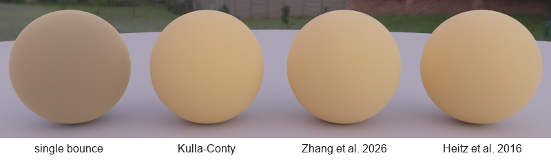
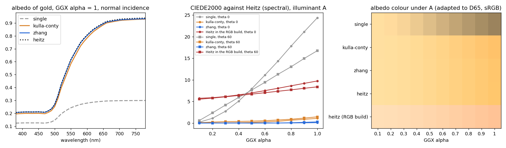

# Light that bounces between the facets of a rough metal

On a rough metal, much of the light that hits a microfacet is reflected into a neighbouring one before it leaves. The ordinary
microfacet BRDF (GGX with Smith's shadowing) counts only the first bounce. On a very rough surface (GGX alpha = 1), it loses 70 % of
the light at normal incidence. The lost light has bounced off gold two or more times, so it is darker and more saturated than the
first bounce. This is the colour effect that the RGB-vs-spectral study of this renderer is about ([METAL_ACCURACY.md](METAL_ACCURACY.md)),
at the scale of the microsurface.

A conductor's `"multipleScattering"` chooses how that light is counted:

| value | what it does | cost |
|---|---|---|
| `"off"` (`false`) | single bounce only | - |
| `"kulla-conty"` (`true`, the default) | a deterministic lobe that returns the lost energy, coloured by the cosine-averaged Fresnel term (Kulla and Conty 2017) | free |
| `"heitz"` | a random walk on the microsurface that keeps the height of every hit (Heitz et al. 2016); unbiased, the reference | a walk per evaluation |
| `"zhang"` | the position-free path formulation with successive height preintegration (Zhang et al. 2026): no heights are traced, a tiny bias | a 10-bounce path per evaluation |

```json
"gold": { "type": "conductor", "metal": "Au", "roughness": 1.0, "multipleScattering": "zhang" }
```



<sub>`scenes/multibounce_gold.json`, spectral build, 512 spp, OIDN.</sub>

## How it works

Code: `Microfacet/MultiBounce.hpp` (`heitzRho`, `zhangRho`), used by `RoughConductor` (eval, sample, pdf, Mueller matrix).

- Both models estimate rho(wi, wo) = f cos(theta_o) by drawing one path on the microsurface per evaluation. The single bounce is
  added analytically (GGX with the height-correlated G2, the same in both models), so only the multiple bounces are noisy.
- The inner directions of a path come from the **visible normals of either hemisphere**: light that travels upward between the
  facets meets the facets that face down-going light. These are drawn with spherical caps (Dupuy and Benyoub 2023), which also work
  for directions below the horizon. The projected area is (1 + Lambda) cos from above and Lambda |cos| from below.
- **Heitz**: the heights enter only through C1(h), the fraction of the surface below h. At each hit the light that leaves towards wo
  is added with the probability C1(h)^Lambda(wo) that nothing blocks it. The walk ends when the light leaves.
- **Zhang**: the vertex term F D / (4 |cos|) of each bounce is multiplied by one segment term for the whole path. The segment term
  depends only on Lambda of each direction and on where the path first turns upward (their supplement, Eq. 5). The type-3 recursion
  needs the sub-paths without the first and without the last bounce, so the terms form a table over (first, last) direction, which
  grows by two columns per bounce. Their path type-aware evaluation (PTABE), an empirical resampling with its own bias, is not
  implemented.
- **Sampling** in the renderer is the same for all models: GGX visible normals, plus a cosine lobe with probability 1 − E(mu_o).
  The weight is f cos / pdf with the stochastic f. The pdf is exact for this mixture, so MIS with light sampling stays unbiased.
- The multiple bounces are unpolarized in the Mueller matrix (as the Kulla-Conty lobe was).

## Checks (`--scene multibounce`, both builds, ~20 s)

| | check | result |
|---|---|---|
| a | the projected area from above and below = the integral of max(0, w.m) D(m); five moments of the sampled normals against the integrals (6 directions, 2 M samples) | 5e-6; ≤ 2.7 standard errors |
| b | Zhang's single bounce = D G2 / (4 cos_i); Heitz's first hit averages to it | 1e-9; ≤ 0.014 % |
| c | Zhang's segment term of a path = that of the reversed path (the paper's reciprocity proof); four five-bounce paths = an independent implementation (Python) | 7e-16; 1e-12 |
| d | white furnace (F = 1), alpha 0.3 / 0.6 / 1, theta_i 0 / 45 / 75: Heitz's albedo; Zhang against Heitz, both to 10 bounces | 0.999–1.002; Zhang loses ≤ 1.2 % at alpha 1 and grazing light, as in the paper's Fig. 8 |
| e | the multiple-bounce lobe in the plane of incidence, alpha 1, theta_i 0 and 60 (the paper's Fig. 5): Zhang − Heitz | ≤ 0.0033 on rho ≈ 0.09–0.29 |
| f | RoughConductor (gold, roughness 0.9): the albedo through `sample()` = through `eval()` | within 0.1 % |

Building the checks turned up an old inaccuracy in `GGXDistribution::lambda`. It computed tan² through `math::safe_recip`, which
clamps at 1e-6, so Lambda stopped growing near ~500 within 0.06° of the horizon. A single bounce never notices. The walks do reach
such directions, and there the projected area Lambda |cos| came out thousands of times too small: rare samples of 10³–10⁶ put
Heitz's furnace 0.5–5 % above 1. Lambda is now 0.5 (sqrt(cos² + alpha² sin²) / |cos| − 1), and `furnace`, `metals`, `glints` and
`polarization` still pass.

## Results

### The colour of rough gold

`--scene multibounce-gold` writes the directional albedo of gold for each model, roughness and angle of incidence (1 M paths each,
RGB build and spectral build, 380–810 nm). `tools/studies/multibounce_gold.py` turns the albedo into CIELAB under D65 and under
illuminant A (the illuminant is the white). The reference is Heitz's model in the spectral build.



CIEDE2000 against Heitz (spectral), normal incidence:

| GGX alpha | single bounce (D65) | Kulla-Conty (D65) | Zhang (D65) | Heitz, RGB build (D65) | Heitz, RGB build (A) |
|---|---|---|---|---|---|
| 0.2 | 1.1 | 0.06 | 0.02 | 2.0 | 5.9 |
| 0.5 | 7.7 | 0.21 | 0.01 | 1.6 | 7.0 |
| 1.0 | 23.5 | 1.31 | 0.11 | 1.4 | 9.8 |

- **Zhang is indistinguishable from Heitz** in colour (ΔE00 ≤ 0.3 at every roughness, both angles and both lights).
- **Kulla-Conty is close but not exact**: up to ΔE00 1.3 (normal incidence) and 1.7 (60°) at alpha 1, mostly lightness (L* 84.5
  against 85.8 under A: the lobe is a little too dark), the chroma within 0.5. The error is about the size of a visible difference
  side by side, and only on very rough metal.
- **The multiple bounces raise the RGB error under a warm light.** With the bounces counted correctly, the RGB build's gold under
  illuminant A differs from the spectral build by ΔE00 5.8 at alpha 0.1 and 9.8 at alpha 1. Under D65 the difference is 1.3–2.1 and
  does not grow. The microsurface repeats the macroscopic finding (gold in gold, more bounces, larger RGB error under warm light).

### Noise and time in a rendering

`tools/studies/multibounce_noise.py`: the four-sphere scene with every sphere on one model, 400 px, 64 spp, two seeds. The noise is
half the mean squared difference of the two renders on the gold.

| | noise variance | time | variance × time (Heitz = 1) |
|---|---|---|---|
| spectral: Kulla-Conty | 2.3e-3 | 2.7 s | 0.37 |
| spectral: Zhang | 3.2e-3 | 4.7 s | 0.93 |
| spectral: Heitz | 5.0e-3 | 3.2 s | 1.00 |
| RGB: Zhang | 3.0e-3 | 2.9 s | 0.83 |
| RGB: Heitz | 4.9e-3 | 2.1 s | 1.00 |

- Zhang's estimate has 36–38 % less variance than Heitz's (the paper's claim of lower variance holds). But it always follows 10
  bounces, while Heitz's walk usually leaves after two or three hits, so per unit time the two are about equal.
- The paper's Russian roulette (survival probability = the segment term) cut the time by a quarter and raised the variance
  sevenfold (variance × time 4.96). A roulette on weight × segment term still doubled it (1.58). The default is no roulette.

## Limits and open points

- Reflection only (conductors, and the metal base of `layered`). Zhang et al. also leave transmission open. Rough glass and
  rough dielectric coats keep the single bounce.
- Glints use the smooth GGX distribution for the multiple bounces.
- Not implemented: PTABE, and the other position-free models (Wang et al. 2022, Bitterli and d'Eon 2022, Cui et al. 2023).
- Heitz's furnace at alpha 0.3 is 1.002 (others 0.999–1.002). It is within the check's limit but slightly above the 1.000 ± 0.0007
  of an independent Python implementation.
- A cheaper estimator for the renderer would be the natural next step: a table of the multiple-bounce albedo per wavelength
  (like Kulla-Conty, but fitted to Zhang / Heitz) would remove both the noise and the 1.3 ΔE00 lightness error.

## References

- E. Heitz, J. Hanika, E. d'Eon, C. Dachsbacher, "Multiple-Scattering Microfacet BSDFs with the Smith Model", *ACM TOG* 35(4), 2016.
- S. Zhang, T. Funatomi, Y. Fujimura, Y. Mukaigawa, H. Kubo, "Successive Height Preintegration for a Height-Interdependent Path
  Formulation of Multiple Bounces in Smith Microfacet BRDFs", SIGGRAPH 2026 Conference Papers, doi:10.1145/3799902.3811194 (and its
  supplement).
- B. Wang, W. Jin, J. Fan, J. Yang, N. Holzschuch, L.-Q. Yan, "Position-Free Multiple-Bounce Computations for Smith Microfacet BSDFs",
  *ACM TOG* 41(4), 2022.
- Y. Cui, G. Pan, J. Yang, L. Zhang, L.-Q. Yan, B. Wang, "Multiple-bounce Smith Microfacet BRDFs using the Invariance Principle",
  SIGGRAPH Asia 2023.
- J. Dupuy, A. Benyoub, "Sampling Visible GGX Normals with Spherical Caps", *Computer Graphics Forum* 42(8), 2023 (HPG).
- C. Kulla, A. Conty, "Revisiting Physically Based Shading at Imageworks", SIGGRAPH 2017 course.
