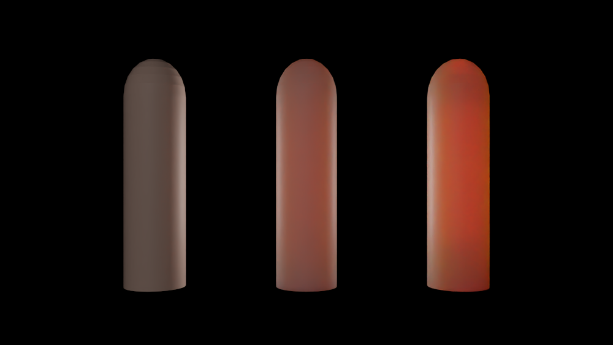
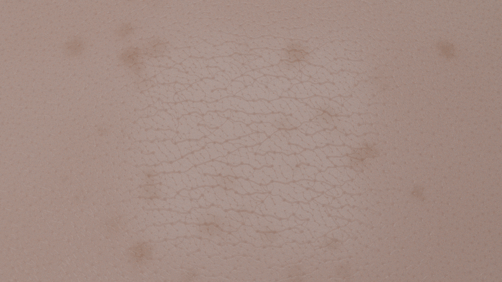
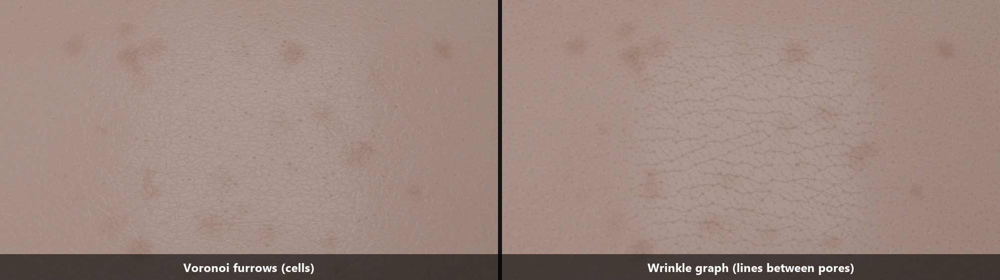

# 肌: 毛穴と皮溝の凹凸、色素の揺らぎ、逆光の指（薄い所の透過）

肌の質感の 3 つの要素を足した。**微細な凹凸**（皮溝と毛穴。法線だけを曲げる）、**色素の揺らぎ**（そばかす、シミ、赤み、毛穴の暗さ）、**薄い所の透過**（指に光を当てたときの赤い透け）の 3 通りの計算の比較。結論: 逆光の指では、**BSSRDF は、同じ光学定数の体積のランダムウォークの 0.44 倍**しか赤い光を通さなかった（`docs/SSS.md` 9.2 の「薄い所の透過」の誤差を、絵と数値で見せた）。凹凸のほうは、まだ「皮膚らしい」とまでは言えない。

## 1. 何を足したか

| 物 | 場所 |
|---|---|
| 皮膚の微細な凹凸 `SkinRelief`（3 次元の Worley ノイズで、皮溝のネットワークと毛穴の高さを作り、法線を曲げる） | `include/Materials/SkinRelief.hpp` |
| 皮膚の色の揺らぎ `SkinPigment`（そばかす、うっすらしたシミ、赤み）。毛穴の暗さ（`SkinRelief::poreMask`） | `include/Materials/SkinPigment.hpp` |
| 皮溝と毛穴のグラフ合成 `WrinkleField`（Weiss ら 2023 の手法の CPU 版。毛穴を節点、皮溝を辺とする） | `include/Materials/WrinkleField.hpp` |
| 材質のフック `Material::perturbShading`（ヒットの直後に、材質が陰影の法線を差し替える）。`CoatedDiffuse::setRelief`、`setPigment`。出射点の係数のフック `Material::subsurfaceExitTint` | `include/Materials/Material.hpp`、`CoatedDiffuse.hpp`、`src/Render/Integrator.cpp` |
| シーンファイルの `"type": "skin"`（表面下散乱と凹凸を JSON で）、`lathe` の `translate` | `src/Cli/SceneFile.cpp`、`docs/SCENE_FILE.md` |
| 自己チェック `--scene relief` | `src/Cli/Checks/ReliefChecks.cpp` |
| 作例 | `scenes/skin_fingers.json`（逆光の指 3 本）、`scenes/skin_macro.json`（皮膚の接写） |

## 2. 微細な凹凸

**何を作るか。** 皮膚には、細かい溝（皮溝）が網目状に走り、皮膚を約 0.5 mm の多角形に区切っている。その中に毛穴がある。

**作り方。** 世界座標の 3 次元 Worley ノイズ（セル状のノイズ。セルごとに、ずらした特徴点を 1 つ持つ）を使う。位置だけで決まるので、UV は要らず、同じ材質の物体は同じ模様になる。

- 最も近い特徴点までの距離 F1 と、2 番目に近い F2。F2 − F1 が小さいところ（セルの境目）が、**皮溝**: 深さ × exp(−((F2 − F1) / 幅)²)。
- 深さは、隣り合う 2 つのセルの乱数の平均で、溝ごとに変わる（どちら側から見ても同じ値なので、溝は連続）。
- **2 つの尺度**: 細かい網目と、3 倍大きい網目（深さ 0.9 倍）を足す。実際の皮膚も、数本の深い主線と、多数の浅い副線でできている。`stretch` で、セルを x 方向に伸ばす（皮溝は、向きに偏りがある）。
- 一部のセル（`poreFraction`）の特徴点に、丸いくぼみ（**毛穴**）: 深さ × exp(−(F1 / 半径)²)。
- 高さ h(p)（m、負 = くぼみ）の勾配を、2 つの接線方向の中心差分で取り、**n′ = normalize(n − ∇h)** とする（バンプマップと同じ）。形は動かさない。

典型値: セル 0.5〜0.6 mm、溝の深さ 35〜40 µm、毛穴の深さ 80〜100 µm、半径 60〜70 µm。

**積分器との接続。** ヒットの直後に `perturbShading` が呼ばれ、材質が `rec.n`（陰影の法線）を差し替える。幾何法線 `gn` は変わらない。視線に背を向けた法線にならないよう、`dot(n′, wo) ≥ 0.05` に直す。デノイザの法線の特徴量にも、曲げた法線が入る。

## 2.4 皮溝と毛穴のグラフ合成（Weiss ら 2023）

**動機。** 2 節の Worley ノイズの皮溝は、規則的な網目で、「ひび割れた革」に見えた。実際の皮膚の微細な皮溝（micro relief）は、**毛穴どうしをつなぎ、毛穴で始まり、毛穴で終わる**。皮膚の張力の向き（顔の流れ）に沿った深い主線と、それと交差する浅い斜めの副線でできていて、密度と深さは部位で変わる。論文（Weiss, Moulin, Chandran, Zoss, Gotardo, Bradley, *Graph-Based Synthesis for Skin Micro Wrinkles*, 2023）と補足資料を読んで、実装した。

**手順**（層ごと。粗い層から細かい層へ、3 層が既定）:
1. **グラフ**: 毛穴を節点として、Poisson ディスクでサンプリングする（平均距離 `spacing`。細かい層は、粗い層の節点を残して、間に足す）。各節点を、近い 5 つの節点と辺で結ぶ。辺が、皮溝の候補。
2. **シミュレーション**（歩行者がけもの道を作る様子を模す）: 節点を 1 つ選び、その辺の 1 本を、確率 P(h) ∝ (1 − a_dist (d/d_min − 1) + p_cont + p_pref − a_cross p_cross) で選んで、掘る（W ← W + Δt a_deposit (1 − W)）。毎回、全体を減衰させる（W ← W (1 − Δt a_decay)）。p_pref は主方向を好む項、p_cont は「反対側の強い辺の続き」を報い、並走する辺を罰する項、p_cross は強い辺との交差を罰する項。何度も選ばれる辺が、深い皮溝になる。
3. **描画**: 辺を、重みに比例した幅の溝にする（中心線を、ノイズでゆらす。両端は毛穴で動かない）。溝の断面は、谷と、その脇の小さなふくらみ（論文の形状関数）。節点は毛穴（皮溝が集まるほど深い）。重なりは、滑らかな最大値（論文の MellowMax）で混ぜる。

**このエンジンへの載せ方。**
- 結果は、**1 枚のタイル（24 mm、2048²）の高さマップ**。トーラス（端がつながる）として作るので、繰り返しても継ぎ目が出ない。
- 物体には、**3 方向の投影の混合（triplanar）**で当てる。UV が要らず、球でも円柱でも使える。法線は、高さの勾配から（これまでの `SkinRelief` と同じ）。毛穴の暗さ（色素）にも、同じ場の毛穴を使う。
- 作成は、約 9 秒（3 層、毛穴 8000 個、辺 2 万本）。JSON は `"relief": { "wrinkles": { ... } }`。`RAYT_WRINKLE_DUMP=ファイル.png` で高さマップ、`RAYT_WRINKLE_DUMP_PORES=ファイル.png` で毛穴のマスクを書き出せる。

**論文との違い**（正直に）:
- UV マップも CUDA も使わない（平らなタイルを CPU で）。
- 選択確率の式は、テキスト抽出で一部の記号が欠けていたので、上の形（距離の項は、節点の最短の辺に対する相対値）で実装した。
- 主方向の好み（`preference` = 2）と、選択の鋭さ（`selectivity` = 2.5）の 2 つの係数を足した。足さないと、ほとんどの辺が同じ強さに掘れて、網目が一様になった。
- 重みは、層の最大値で正規化してから描く。主方向の推定（Gabor）、パッチからの最適化、画像のスタイル損失は実装していない。
- 層の値（間隔 1.2 / 0.6 / 0.3 mm、深さ 40 / 18 / 7 µm、主方向 0° と副方向 50°）は、論文の範囲（主線 20〜100 µm、副線 5〜40 µm）を参考に、**目で決めた**。

**結果。** 高さマップ（暗い = 谷）で、Worley の網目と比べて、主線が x 方向にそろい、途中で途切れ、副線が斜めに交差する、皮膚らしい線になった。

## 2.5 色素の揺らぎ（そばかす、シミ、赤み、毛穴の暗さ）

**動機。** 皮膚が不自然に見える最大の原因は、**色が一様なこと**（そばかす、シミ、赤み、毛穴がない）と考えた。ゲームや映画では、実在の人物のスキャンから作ったテクスチャに、手描きと手続き的な合成を足すことが多いようだが（Web 検索の要約に基づく。論文は全文を読んでいない。参考文献の節を参照）、ここでは、**世界座標の手続き的な場**で作る。UV もスキャンも要らない。

**色の係数 F(p)**（RGB、(0, 1]）を、皮膚の反射率に掛ける。

- **そばかす**: 3 次元の格子（2.5 mm）の、ずらした点に、斑点を置く。斑点は、大きさ（半径の 0.5〜1.5 倍）も、濃さ（最大の 0.4〜1 倍）も、1 つずつ違う。縁は、位置を小さなノイズでゆがめて（**ドメインワープ**）、不規則にする。斑点の出やすさは、低周波のノイズで変わる（**群れる**。日に当たる所に多い）。重なりは 1 − Π(1 − s g)。形は g = exp(−(d / r)³)（柔らかいが、縁がある）。濃い斑点で、周りの皮膚の 0.58 / 0.48 / 0.42 倍（R/G/B。日焼けした斑点の見た目から、目で決めた値）。
- **うっすらしたシミ**: 大きく柔らかい斑（フラクタルノイズ）。最大で 15% 暗く、青ほど強く効く。
- **赤み**: 非常に低周波の、顔の紅潮のようなむら。緑と青だけを下げる（血液は、そこで吸収する）。
- **毛穴の暗さ**: 毛穴（`poreMask`）の位置が、皮膚より暗く、少し赤い（影になった点）。係数は (0.30, 0.42, 0.45) × `poreDarkness`。
- **毛穴のばらつき**: 毛穴の半径と深さは、1 つずつ ±50% 違う。毛穴の密度は、低周波のノイズで、平均の 0.4〜1.6 倍に変わる（毛穴の多い所と少ない所）。

**表面下散乱との組み合わせ。** 色素は、散乱する層（真皮）の上の**表皮**にあるので、光は、**入るときと出るときの 2 回**、色素を通る。入射点のアルベドだけに掛けると、色素の模様が散乱距離（赤で 3.7 mm）にぼやける。そこで、**入射点で √F、出射点で √F**を掛ける（`subsurfaceExitTint`）。一様な色素なら、合わせて F になる。これは**自分で選んだ扱い**で、実測や文献では確かめていない。

**費用。** 色素と毛穴の暗さで、描画時間が約 2 倍（600 × 338、48 spp、表面下散乱あり: 凹凸のみ 12 秒、毛穴の暗さを足して 19 秒、色素を足して 26 秒）。

## 3. 逆光の指

**条件**（`scenes/skin_fingers.json`）: 同じ形の指 3 本（幅 1.6 cm、高さ 6 cm、先端は半楕円。`lathe`）。それぞれの真後ろに、小さな光（8 mm × 4 cm）がある。前からは弱い補助光だけ。

| 指 | 材質 |
|---|---|
| 左 | 表面下散乱なし（拡散 + 皮脂のコート） |
| 中 | **BSSRDF**（Burley のプロファイル。散乱距離 3.67 / 1.37 / 0.68 mm（R/G/B）、アルベド 0.80 / 0.52 / 0.42） |
| 右 | 指の内側を**散乱媒質**で満たして、光を体積のランダムウォークで追う。σₜ = 1 / 散乱距離 = 272 / 730 / 1470 /m、等方。単一散乱アルベド 0.9906 / 0.921 / 0.8652（拡散反射率 0.80 / 0.52 / 0.42 から、Christensen–Burley のアルベド逆変換で求めた） |

（1000 × 563、768 spp、デノイズあり。4.7 分。）

**数値**（800 × 450、1024 spp、デノイズなしの線形値。指の中央 1.2% × 16% の平均。補助光の反射も含む）:

| 指 | R | G | B | R / G |
|---|---|---|---|---|
| 表面下散乱なし | 0.117 | 0.076 | 0.062 | 1.5 |
| BSSRDF | 0.365 | 0.082 | 0.059 | 4.4 |
| 体積のランダムウォーク | **0.835** | 0.066 | 0.032 | 12.6 |

- 指は、赤い光（散乱距離 3.7 mm）ほど透ける。幅 16 mm は、赤の散乱距離の約 4.4 倍。緑・青はほとんど透けず、体積のほうが、むしろ暗い（吸収が強いため）。
- **BSSRDF の赤は、体積の 0.44 倍**（0.365 / 0.835。補助光の反射 0.117 を引くと 0.35 倍）。`docs/SSS.md` 9.2 の測定（厚さ 4ℓ 以上で、BSSRDF の透過は 0.2〜0.4 倍）と同じ向きで、近い大きさ。**この誤差は、研究の刺激（半透明の物体）に近い条件で、効く。**
- 表面下散乱なしの指は、暗い灰褐色の影になる（透けない）。

**注意**: 2 つの指の「同じ光学定数」は、アルベド逆変換による対応で、厳密な一致ではない（表面の境界の扱いも違う）。数値の比（0.44）は、目安。

## 4. 皮膚の接写（凹凸と色素）

（`scenes/skin_macro.json`。1000 × 563、384 spp、デノイズなし。6.8 分。凹凸はグラフ合成（2.4 節）、色は色素（2.5 節）。）

**Worley の網目（2 節）との比較**（同じ構図、同じ色素、同じ光。左が Worley、右がグラフ合成）:

**これで分かったこと**
- 凹凸は、**光沢のハイライトの中に**現れる（表面の皮脂のコート）。拡散の部分は、表面下散乱で光が数 mm にぼやけるので、細かい凹凸は消える。色素と毛穴の暗さは、拡散の部分でも見える。
- **一様に大きな光源では、凹凸が見えない**。法線が曲がっても、一様な光を反射するだけだから。小さな光源にして、ハイライトを画面の中央に置いた。
- Worley の皮溝（左）は、**規則的な網目で、ひび割れた革に見えた**。グラフ合成（右）は、**主線が x 方向にそろい、途中で途切れ、斜めの副線と細かい網目が重なる**。毛穴は、黒い点として、皮溝の端と節に並ぶ。**皮膚の接写の写真に近い見え方**になった。
- そばかす、赤み、毛穴の暗さ（色素）が、一様な色を崩す。

**出来の評価（正直に）**: 前よりかなり皮膚らしい。残る不自然さは、(1) 毛穴が、規則正しく並んでいる（Poisson ディスクの性質。密度のむらは、ゆるく足しただけ）、(2) そばかすの縁が柔らかく、形がぼんやりしている、(3) タイル（24 mm）が繰り返す（接写の 2 倍の幅なので、画面の中では目立たないが、広い範囲では見えるはず）、(4) 色が単調（メラニンとヘモグロビンの分布がない）、(5) 光沢が一様（皮脂の多い所と少ない所がない）。

## 5. 確かめたこと（`--scene relief`、RGB・スペクトルとも PASS）

| 検査 | 結果 |
|---|---|
| 高さ場: 0 以下、最深が溝 + 毛穴の和以内、平均は負、同じ点で同じ値 | 最小 −100 µm、最大 0、平均 −14.6 µm |
| 曲げた法線: 単位長、平面での平均が元の法線（勾配の平均は 0） | 平均 (−3 × 10⁻⁵, 3.5 × 10⁻⁴, 0.974)、標準誤差 7 × 10⁻⁴。平均の傾き 9.5°、最大 72.6° |
| 中心差分の刻みを半分にしても、勾配が一致 | 2000 点中 1971 点（残りは、F1 の折れ目の近く） |
| **白色炉**: 凹凸のある皮膚の球が、なめらかな球と同じエネルギーを返す | 滑らか (0.802, 0.527, 0.429)、凹凸 (0.793, 0.521, 0.424)。**凹凸のほうが約 1.1% 暗い**（バンプマップの通常の損失。許容は 3%） |
| 色素の場: 係数が (0, 1]、同じ点で同じ値、斑が皮膚の一部を覆う、赤が最も吸収されない | 係数の平均 (0.972, 0.919, 0.930)、最小 0.50。青で 0.9 未満の点が約 11% |
| **白色炉（色素）**: 色素つきの皮膚の球は、一様な皮膚より暗く、明るくならない（表面下散乱の入射・出射の係数も通る） | 表面下散乱なし: (0.803, 0.527, 0.429) → (0.782, 0.480, 0.398)。あり: (0.796, 0.530, 0.435) → (0.782, 0.478, 0.396) |
| 毛穴の場: 0〜1、最大が毛穴の中心付近、密度が領域でばらつく | 最大 0.99、2 cm の区画ごとの毛穴の被覆が 3 から 22（6400 点中） |
| **グラフ合成**（1 層、12 mm のタイル）: 同じ種で同じ結果、種が違えば違う結果。周期的（1 タイル離れた点が同じ高さ）。高さ ≤ 最大の深さ。毛穴のマスクが 0〜1。主線が主方向に走る（勾配のエネルギーが、線を横切る向きに 4.3 倍） | 高さ −24.7 .. 1.8 µm、平均 −1.1 µm、勾配のエネルギー比 4.3 |
| グラフ合成から曲げた法線: 単位長、平均が元の法線 | 平均 (−1 × 10⁻⁴, 1 × 10⁻⁴)、標準誤差 2〜4 × 10⁻⁴。平均の傾き 2.7° |

既存の検査（lights、volume、layered、sss、aniso、ocean、hair）は、変更後も PASS。毛穴の検査は、乱数の標本が小さいので、まれに揺らぐ（基準を緩めてある）。

## 6. 限界と次

- **法線だけを曲げる**。形は動かない（輪郭はなめらか）。くぼみの中の影や相互反射は計算しない。斜めから見るとバンプマップに特有の破綻が出る。
- グラフ合成の層の値（間隔、深さ、主方向）は、目で決めた。論文のパッチからの最適化（粒子群最適化、スタイル損失）、主方向の推定（Gabor）、顔の流れの場（部位で向きが変わる）は実装していない。主方向は、タイル全体で 1 つ。
- 凹凸は、`CoatedDiffuse`（皮膚の材質）だけ。MMD の肌（PMX）には付けていない。積分器の `perturbShading` は、経路追跡の積分器だけ（LVC-BPT、フォトンマップは通らない）。
- **光学係数は、記憶による典型値**（散乱距離 3.67 / 1.37 / 0.68 mm、アルベド）。**文献値や実測の分光反射率との照合は、まだしていない**（次の作業）。
- 指は、回転体（爪、関節、骨はない）。体積の指は、BSSRDF の指と、光学定数の対応が厳密でない（3 節）。
- 皮膚の接写は、球の一部。血管、産毛、年齢による変化は表現していない。色素の色（斑の色、赤み）と強さは、**目で決めた値**で、実測や文献とは照合していない。色素の「入るとき半分、出るとき半分」の扱いも、自分で選んだもので、検証していない。
- 色素と毛穴の暗さで、描画が約 2 倍遅くなる（係数を、ヒットごとに 1 回だけ計算して使い回している）。
- 次の候補: 部位ごとに向きと密度が変わる場（顔の流れ）、毛穴の密度のむら、そばかすの縁と形の改善、光沢の揺らぎ（皮脂）、産毛、文献値との照合、耳のような薄く曲がった形、スキャンされた指・手のメッシュの読み込み、BSSRDF の薄い所の補正（体積への切り替え、有限の厚さのプロファイル。`docs/SSS.md` 第 13 節）。

## 7. 参考文献

**書誌は記憶から書いた。公開する前に、Web 検索で確認する。**

- S. Worley. *A Cellular Texture Basis Function.* SIGGRAPH 1996.（Worley ノイズ）
- A. Haro, B. Guenter, I. Essa. *Real-time, Photo-realistic, Physically Based Rendering of Fine Scale Human Skin Structure.* Eurographics Workshop on Rendering, 2001.（型取りから作った法線マップをテクスチャ合成で広げる）
- P. Graham, B. Tunwattanapong, J. Busch, X. Yu, A. Jones, P. Debevec, A. Ghosh. *Measurement-Based Synthesis of Facial Microgeometry.* Computer Graphics Forum (Eurographics) 32(2), 2013.（測定した接写パッチの合成）
- S. Weiss, J. Moulin, P. Chandran, G. Zoss, P. Gotardo, D. Bradley. *Graph-Based Synthesis for Skin Micro Wrinkles.* Eurographics Symposium on Geometry Processing, 2023.（毛穴を点にしたグラフで皮溝を作る。2.4 節で実装）
- R. S. Barros, M. Walter. *Synthesis of Human Skin Pigmentation Disorders.* Computer Graphics Forum 36(1), 2017.（反応拡散による色素の斑。ここでは使っていない）
- P. Christensen, B. Burley. *Approximate Reflectance Profiles for Efficient Subsurface Scattering.* Pixar Technical Memo 15-04, 2015.（プロファイル、アルベド逆変換）
