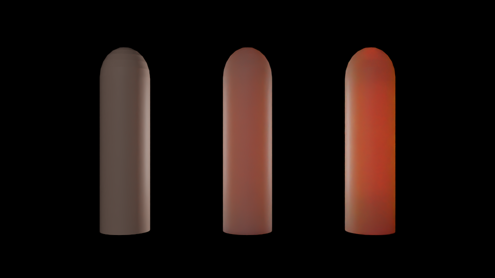
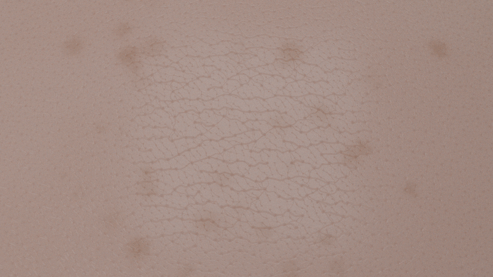
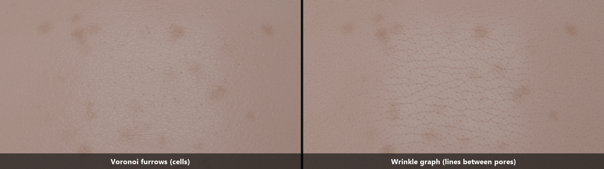

# Skin: micro-relief of pores and furrows, pigment variation, backlit fingers (transmission through thin parts)

Three elements of skin appearance (material appearance, shitsukan) were added: the **micro-relief** (skin furrows and pores; only the normal is bent), the **pigment variation** (freckles, blotches, redness, dark pores), and the **transmission through thin parts** (the red see-through look of a finger with light behind it), compared with three calculations. Conclusion: on a backlit finger, the **BSSRDF let through only 0.44 times as much red light as a volume random walk with the same optical constants** (the error of "transmission through thin parts" in `docs/SSS.md` 9.2, shown here as a picture and as numbers).

## 1. What was added

| Item | Where |
|---|---|
| Micro-relief of the skin `SkinRelief` (3D Worley noise makes the network of furrows and the heights of the pores, and bends the normal) | `include/Materials/SkinRelief.hpp` |
| Variation of the skin colour `SkinPigment` (freckles, faint blotches, redness). Darkness of the pores (`SkinRelief::poreMask`) | `include/Materials/SkinPigment.hpp` |
| Graph synthesis of furrows and pores `WrinkleField` (a CPU version of the method of Weiss et al. 2023: pores are the nodes, furrows the edges) | `include/Materials/WrinkleField.hpp` |
| Variation of the gloss (oily and dry places) `CoatedDiffuse::setGlossVariation` (the strength and roughness of the coat change per hit through `SurfaceInteraction::glossScale` / `roughScale`) | `include/Materials/CoatedDiffuse.hpp` |
| Material hook `Material::perturbShading` (right after a hit, the material replaces the shading normal). `CoatedDiffuse::setRelief`, `setPigment`. Hook for the factor at the exit point `Material::subsurfaceExitTint` | `include/Materials/Material.hpp`, `CoatedDiffuse.hpp`, `src/Render/Integrator.cpp` |
| `"type": "skin"` in the scene file (subsurface scattering and relief in JSON), `translate` of `lathe` | `src/Cli/SceneFile.cpp`, `docs/SCENE_FILE.md` |
| Self-check `--scene relief` | `src/Cli/Checks/ReliefChecks.cpp` |
| Examples | `scenes/skin_fingers.json` (three backlit fingers), `scenes/skin_macro.json` (close-up of skin), `scenes/skin_lamp_dry.json` and `skin_lamp_wet.json` (before and after wetting; `docs/SKIN_MOISTURE.md` 5.7) |

## 2. Micro-relief

**What is made.** Skin has fine grooves (skin furrows) running in a network that divides the skin into polygons of about 0.5 mm. Pores lie inside them.

**How.** 3D Worley noise in world coordinates (cellular noise; each cell has one jittered feature point). It depends on position only, so no UV is needed and objects with the same material get the same pattern.

- The distance F1 to the nearest feature point and F2 to the second nearest. Where F2 − F1 is small (the borders of cells) is a **furrow**: depth × exp(−((F2 − F1) / width)²).
- The depth is the mean of the random numbers of the two neighbouring cells, so it changes from furrow to furrow (the value is the same seen from either side, so a furrow is continuous).
- **Two scales**: a fine network and a network 3 times larger (depth 0.9 times) are added. Real skin also has a few deep primary lines and many shallow secondary lines. `stretch` stretches the cells in the x direction (furrows have a preferred direction).
- A round dent (**pore**) at the feature point of some of the cells (`poreFraction`): depth × exp(−(F1 / radius)²).
- The gradient of the height h(p) (m, negative = dent) is taken with central differences in two tangent directions, and **n′ = normalize(n − ∇h)** (as in bump mapping). The shape is not moved.

Typical values: cell 0.5 to 0.6 mm, furrow depth 35 to 40 µm, pore depth 80 to 100 µm, radius 60 to 70 µm.

**Connection to the integrator.** Right after a hit, `perturbShading` is called and the material replaces `rec.n` (the shading normal). The geometric normal `gn` does not change. So that the normal does not face away from the viewer, it is corrected to `dot(n′, wo) ≥ 0.05`. The bent normal also goes into the normal feature of the denoiser.

## 2.4 Graph synthesis of furrows and pores (Weiss et al. 2023)

**Motivation.** The furrows of the Worley noise of section 2 form a regular network and looked like "cracked leather". The fine furrows of real skin (micro relief) **connect pores, begin at a pore and end at a pore**. They consist of deep primary lines along the direction of skin tension (the flow of the face) and shallow diagonal secondary lines crossing them, and their density and depth change with the body part. This was implemented after reading the paper (Weiss, Moulin, Chandran, Zoss, Gotardo, Bradley, *Graph-Based Synthesis for Skin Micro Wrinkles*, 2023) and its supplementary material.

**Procedure** (per level, from coarse to fine levels; 3 levels by default):
1. **Graph**: pores are the nodes, sampled with Poisson-disk sampling (average distance `spacing`; a finer level keeps the nodes of the coarser level and adds nodes between them). Each node is joined by edges to its 5 nearest nodes. The edges are candidates for furrows.
2. **Simulation** (imitating pedestrians making a desire path): choose a node, choose one of its edges with probability P(h) ∝ (1 − a_dist (d/d_min − 1) + p_cont + p_pref − a_cross p_cross), and dig it (W ← W + Δt a_deposit (1 − W)). Every time, decay everything (W ← W (1 − Δt a_decay)). p_pref is a term that prefers the primary direction, p_cont rewards the continuation of a strong edge on the opposite side and penalises parallel edges, and p_cross penalises crossing a strong edge. Edges chosen many times become deep furrows.
3. **Drawing**: each edge becomes a groove whose width is proportional to its weight (the centre line is made to wobble with noise; the two ends are fixed at the pores). The cross-section of a groove is a valley with a small bulge beside it (the paper's shape function). A node is a pore (deeper where more furrows meet). Overlaps are blended with a smooth maximum (the paper's MellowMax).

**How it is used in this engine.**
- The result is **the height map of one tile (24 mm, 2048²)**. It is made as a torus (the edges are connected), so repeating it shows no seam.
- It is applied to objects by **a mixture of three projections (triplanar)**. No UV is needed, and it works on spheres and cylinders. The normal comes from the gradient of the height (as in the earlier `SkinRelief`). The darkness of the pores (pigment) also uses the pores of the same field.
- Default values of the levels (for a body part such as the cheek, where the primary direction is weak): spacing 1.0 / 0.55 / 0.3 mm, depth 40 / 28 / 24 µm, primary direction 0° / 60° / 120°, strength of the primary direction `base` 0.35 / 0.5 / 1.0 (the last is isotropic). The first setting was one for a strongly directional part such as the forehead (0.1 to 0.8, depth 40 / 18 / 7 µm), but the fine level was shallow and thin and was lost in the pixels (0.04 mm).
- Building takes about 9 seconds (3 levels, 8000 pores, 20 000 edges). In JSON: `"relief": { "wrinkles": { ... } }`. `RAYT_WRINKLE_DUMP=file.png` writes the height map, and `RAYT_WRINKLE_DUMP_PORES=file.png` writes the pore mask.

**Differences from the paper**:
- No UV map and no CUDA (a flat tile on the CPU).
- Some symbols of the selection-probability formula were missing in the text extraction, so it was implemented in the form above (the distance term is relative to the shortest edge of the node).
- Two coefficients were added: the preference for the primary direction (`preference` = 2) and the sharpness of the selection (`selectivity` = 2.5). Without them, most edges were dug equally deep and the network became uniform.
- The weights are normalised by the maximum of the level before drawing.
- The values of the first version of the levels (spacing 1.2 / 0.6 / 0.3 mm, depth 40 / 18 / 7 µm, primary direction 0° and secondary direction 50°) were chosen with the paper's ranges (primary lines 20 to 100 µm, secondary lines 5 to 40 µm) as a reference; the current defaults are the ones above.

**Result.** In the height map (dark = valley), compared with the Worley network, the primary lines line up in the x direction and break off midway, and the secondary lines cross diagonally: lines like those of skin.

## 2.45 Variation of the gloss (sebum)

The shine of skin is not uniform. Places rich in sebum (nose, forehead) have strong, sharp highlights, and dry places have dull ones. One reason skin looked "not shiny" in the close-up was that the strength and roughness of the coat were **the same everywhere**.

`gloss: { "variation": 0.65, "frequency": 70 }`: with low-frequency noise g ∈ [−1, 1] (patches of the order of 1 cm; `frequency` is the number per metre), the strength of the coat is multiplied by (1 + variation · g) and the roughness by (1 − 0.6 variation · g). Places with much sebum (g > 0) are stronger and less rough. It is computed once per hit and stored in `SurfaceInteraction` (the evaluation, sampling and probability density of `CoatedDiffuse` use the same value). The weight of the coat in the exit lobe of subsurface scattering stays fixed (the range of the variation is small, so the energy mismatch is small).

## 2.5 Pigment variation (freckles, blotches, redness, dark pores)

**Motivation.** I took the largest cause of skin looking unnatural to be **its uniform colour** (no freckles, blotches, redness or pores). Games and films seem to add hand painting and procedural synthesis to textures made from scans of real people (based on summaries of a web search; the papers were not read in full; see section 7), but here it is made with a **procedural field in world coordinates**. No UV and no scan are needed.

**The colour factor F(p)** (RGB, (0, 1]) is multiplied onto the reflectance of the skin.

- **Freckles**: spots are placed at jittered points of a 3D grid (2.5 mm). Each spot differs in size (0.5 to 1.5 times the radius) and in strength (0.4 to 1 times the maximum). The edge is made irregular by distorting the position with small noise (**domain warping**). How likely spots are changes with low-frequency noise (they **cluster**; more where the sun reaches). Overlaps combine as 1 − Π(1 − s g). The shape is g = exp(−(d / r)³) (soft, but with an edge). A strong spot is 0.58 / 0.48 / 0.42 times (R/G/B) the surrounding skin.
- **Faint blotches**: large soft patches (fractal noise). At most 15% darker, stronger towards blue.
- **Redness**: a very low-frequency unevenness like a flush of the face. It lowers only green and blue (blood absorbs there).
- **Dark pores**: the position of a pore (`poreMask`) is darker than the skin and a little red (a point in shadow). The factor is (0.30, 0.42, 0.45) × `poreDarkness`.
- **Pore variation**: the radius and depth of each pore differ by ±50%. The density of the pores changes with low-frequency noise between 0.4 and 1.6 times the mean (places with many and few pores).

**Combination with subsurface scattering.** The pigment lies in the **epidermis**, above the scattering layer (the dermis), so light passes through the pigment **twice, on the way in and on the way out**. If it is multiplied onto the albedo at the entry point only, the pigment pattern is blurred over the scattering distance (3.7 mm for red). So **√F is multiplied at the entry point and √F at the exit point** (`subsurfaceExitTint`). For a uniform pigment the two together give F.

**Cost.** Pigment and dark pores make rendering about 2 times slower (600 × 338, 48 spp, with subsurface scattering: 12 seconds with relief only, 19 seconds with dark pores added, 26 seconds with pigment added).

## 3. Backlit fingers

**Conditions** (`scenes/skin_fingers.json`): three fingers of the same shape (width 1.6 cm, height 6 cm, a half-ellipse tip; `lathe`). Right behind each one is a small light (8 mm × 4 cm). Only a weak fill light from the front.

| Finger | Material |
|---|---|
| Left | no subsurface scattering (diffuse + coat of sebum) |
| Middle | **BSSRDF** (Burley's profile. Scattering distance 3.67 / 1.37 / 0.68 mm (R/G/B), albedo 0.80 / 0.52 / 0.42) |
| Right | the inside of the finger is filled with a **scattering medium** and the light is followed by a volume random walk. σₜ = 1 / scattering distance = 272 / 730 / 1470 /m, isotropic. Single-scattering albedo 0.9906 / 0.921 / 0.8652 (from the diffuse reflectance 0.80 / 0.52 / 0.42 by the albedo inversion of Christensen and Burley) |

(1000 × 563, 768 spp, denoised. 4.7 minutes.)

**Numbers** (800 × 450, 1024 spp, linear values without denoising. Mean over 1.2% × 16% at the centre of the finger. Includes the reflection of the fill light):

| Finger | R | G | B | R / G |
|---|---|---|---|---|
| No subsurface scattering | 0.117 | 0.076 | 0.062 | 1.5 |
| BSSRDF | 0.365 | 0.082 | 0.059 | 4.4 |
| Volume random walk | **0.835** | 0.066 | 0.032 | 12.6 |

- The finger is more transparent to red light (scattering distance 3.7 mm). The width of 16 mm is about 4.4 times the scattering distance of red. Green and blue hardly pass, and the volume is even darker (strong absorption).
- **The red of the BSSRDF is 0.44 times that of the volume** (0.365 / 0.835; 0.35 times after subtracting the reflection of the fill light, 0.117). This is in the same direction and of similar size as the measurement of `docs/SSS.md` 9.2 (for thicknesses of 4ℓ and more, the transmission of the BSSRDF is 0.2 to 0.4 times). **This error matters under conditions close to the stimuli of the research (translucent objects).**
- The finger without subsurface scattering is a dark grey-brown shadow (nothing passes through).

## 4. Close-up of skin (relief, pigment, gloss)

(`scenes/skin_macro.json`. 1000 × 563, 384 spp, no denoising. 6.6 minutes. The relief is the graph synthesis (section 2.4), the gloss variation is section 2.45, and the colour is the pigment (section 2.5).)

**Comparison with the Worley network (section 2)** (same composition, same pigment, same light and gloss. Left: Worley; right: graph synthesis. Both took 6 to 7 minutes):

**Course of the adjustment and what was learned**
- The first graph synthesis (a strongly directional setting, a small light source) felt like "the network is only in the centre of the picture" and "not shiny". Measuring the bend of the normal with 9 of `--scene relief` showed that **the mean slope is almost the same as Worley's (6.4° and 6.6°), but the median is half (1.9° and 4.2°)**. That is, most of the graph synthesis was flat and only the thin lines and pores were steeply inclined. Shine is seen as a **spread of glints**, where small inclined facets catch the highlight, so a surface with many flat parts looks flat and dull. The fine level (width 0.04 mm, depth 7 µm) was thinner than a pixel (0.043 mm) and was averaged away in the picture.
- The fix: (1) the fine level was made deeper and thicker (depth 7 → 24 µm, width 0.14 → 0.3). (2) The primary direction was weakened (a part with uniform tension, such as the cheek, has an isotropic network, as in the paper). (3) The pores were made deeper and larger. As a result, the median of the slope of the normal rose from 1.9° to 13.6° and the fraction above 10° from 24% to 58% (Worley: 4.2°, 25%).
- **A larger light source** was used. The relief is visible only inside the highlight. With a small light source the highlight is only in the centre. With a large light source (0.3 × 0.3 m) the shine (highlight) spreads over the whole picture and the network is visible everywhere. The earlier conclusion that relief is invisible under a uniformly large light source relaxes if the relief is **steep enough** (when the normal slope is large, the reflection reaches beyond the edge of the light source).
- **Gloss variation** (places with much and little sebum) was added. The strength of the coat is 0.75, the roughness 0.15, and they change by ±65% in patches.
- On the right (graph synthesis), the network is visible everywhere, with a soft shine, freckles and redness on top. On the left (Worley), the black dots of the pores are clear, but the network is visible only in the cracks at the corner (bottom right).

**Assessment**: the right image is close to a close-up of skin.

## 5. What was checked (`--scene relief`, PASS in both RGB and spectral)

| Check | Result |
|---|---|
| Height field: at most 0, deepest within the sum of furrow + pore, mean negative, same value at the same point | min −100 µm, max 0, mean −14.6 µm |
| Bent normal: unit length, mean on a plane equal to the original normal (the mean of the gradient is 0) | mean (−3 × 10⁻⁵, 3.5 × 10⁻⁴, 0.974), standard error 7 × 10⁻⁴. Mean slope 9.5°, maximum 72.6° |
| The gradient agrees when the step of the central difference is halved | 1971 of 2000 points (the rest are near the creases of F1) |
| **White furnace**: a skin sphere with relief returns the same energy as a smooth sphere | smooth (0.802, 0.527, 0.429), relief (0.793, 0.521, 0.424). **The relief is about 1.1% darker** (the usual loss of bump mapping; the tolerance is 3%) |
| Pigment field: factor in (0, 1], same value at the same point, spots cover part of the skin, red is absorbed least | mean factor (0.972, 0.919, 0.930), minimum 0.50. About 11% of the points are below 0.9 in blue |
| **White furnace (pigment)**: a skin sphere with pigment is darker than uniform skin and never brighter (also passes through the entry and exit factors of subsurface scattering) | without subsurface scattering: (0.803, 0.527, 0.429) → (0.782, 0.480, 0.398). With: (0.796, 0.530, 0.435) → (0.782, 0.478, 0.396) |
| Pore field: 0 to 1, maximum near the centre of a pore, density varies between regions | maximum 0.99, pore coverage per 2 cm block from 3 to 22 (of 6400 points) |
| **Graph synthesis** (1 level, 12 mm tile): same result for the same seed, different for a different seed. Periodic (points one tile apart have the same height). Height ≤ maximum depth. Pore mask 0 to 1. Primary lines run along the primary direction (the energy of the gradient across the lines is 4.3 times) | height −24.7 .. 1.8 µm, mean −1.1 µm, gradient energy ratio 4.3 |
| Normal bent from the graph synthesis: unit length, mean equal to the original normal | mean (−1 × 10⁻⁴, 1 × 10⁻⁴), standard error 2 to 4 × 10⁻⁴. Mean slope 2.7° |

**Information** (9 of `--scene relief`; not used for pass/fail): the bend of the normal with the close-up settings (on a flat surface, 2 cm square, 50 000 random points).

| Relief | Mean | Median | 90th percentile | Above 10° |
|---|---|---|---|---|
| Worley furrows and pores | 6.6° | 4.2° | 16.6° | 24.7% |
| Graph synthesis (default levels, `depthScale` 1.6) | 14.5° | 13.6° | 30.8° | 58.0% |

The existing checks (lights, volume, layered, sss, aniso, ocean, hair) still PASS after the change.

## 6. Energy of the bent normal

**The lobes around the bent normal (specular, diffuse, flakes) discard samples that point below the geometric surface and do not renormalise, so they lose about 1.2% of the energy with the default relief** (the white furnace of section 5; an approximation common to bump mapping). **The exit lobe of subsurface scattering uses the smooth normal, so it does not lose.** Because of this asymmetry, a white layer that moves light from the exit lobe to another lobe (flakes, emulsion) looks darker by the moved fraction × 1.2% (`out/studies/flakes_sss`, 2026-11-13). For red, the gain of the white layer is small, +0.7%, and it cancels to near 0 because the entry and exit fall on different patches.

## 7. References

**The bibliographic data were checked by web search on 2026-11-09** (authors, title, journal, volume and issue, year, pages). Haro et al., Graham et al., Weiss et al., and Barros and Walter were checked from search summaries (of the papers, only Weiss et al. was read in full).

- S. Worley. *A Cellular Texture Basis Function.* SIGGRAPH 1996, 291-294. (Worley noise)
- A. Haro, B. Guenter, I. Essa. *Real-time, Photo-realistic, Physically Based Rendering of Fine Scale Human Skin Structure.* Eurographics Workshop on Rendering, 53-62, 2001. (Normal maps made from a mould, extended by texture synthesis)
- P. Graham, B. Tunwattanapong, J. Busch, X. Yu, A. Jones, P. Debevec, A. Ghosh. *Measurement-Based Synthesis of Facial Microgeometry.* Computer Graphics Forum (Eurographics) 32(2), 335-344, 2013. (Synthesis of measured close-up patches)
- S. Weiss, J. Moulin, P. Chandran, G. Zoss, P. Gotardo, D. Bradley. *Graph-Based Synthesis for Skin Micro Wrinkles.* Computer Graphics Forum 42(5) (Eurographics Symposium on Geometry Processing), 2023. (Furrows from a graph with pores as points. Implemented in section 2.4)
- R. S. Barros, M. Walter. *Synthesis of Human Skin Pigmentation Disorders.* Computer Graphics Forum 36(1), 330-344, 2017. (Pigment patches by reaction-diffusion. Not used here)
- P. Christensen, B. Burley. *Approximate Reflectance Profiles for Efficient Subsurface Scattering.* Pixar Technical Memo 15-04, 2015. (Profile, albedo inversion)
