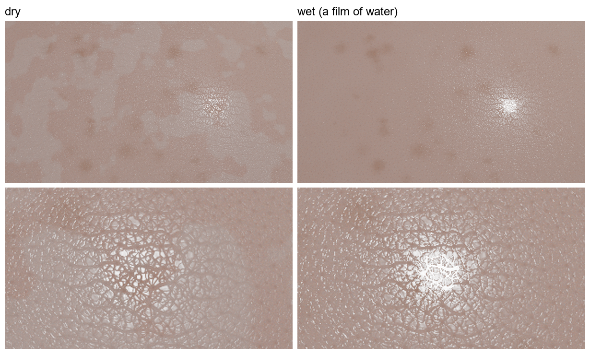

# Skin moisturizing (lotion and emulsion): design (2026-11-09)

**Status:** Stage A (film shape and separation of the specular normal, section 5.1), stage B (surface scattering layer, section 5.2), stage C (time axis, section 5.3), stage D (contribution to light passing through thin parts, section 5.4), stage E (emulsion, section 5.5) and stage F (an emulsion applied after a lotion, section 5.6) are done. Close-ups before and after wetting with water (small, strong light source) are in section 5.7. Image statistics of wetness (also for non-skin objects) are in `docs/WETNESS.md`. Literature values are in `docs/SKIN_MOISTURE_REFS.md` (with confidence marks). **Inferences inside the formulas are marked as such.**

**A note on words (2026-11-10):** In this document "glow" is light that actually **passes through** a thin part (the see-through look: light seen through a thin part). It is a different thing from the toumeikan of skin (a clear, fresh look of skin seen from the front; a kansei quality, not physical transparency). The back-lit cone (sections 5.4 to 5.6) is a **computational diagnostic** for separating the contributions of the mechanisms. It cannot be measured on human skin, and it is not a condition used in experiments on the material appearance (shitsukan) of skin. An earlier version called it "perceived translucency" and "the core of the research". The method of section 5.4 that multiplies two renderings can now be replaced by a single rendering with the `randomWalk` of the skin material (`docs/SSS.md` section 12).

## 1. Why rebuild (what the first prototype showed)

When "dry / just applied / dried afterwards" were rendered with the existing knobs alone (roughness, `specular`, relief depth, albedo), **the network of skin furrows became sharper right after application**. A real water film fills the furrows and smooths the surface, so this is the wrong direction.

Cause: `CoatedDiffuse` uses **the same normal `rec.n` (the one bent by the relief)** for the specular lobe (GGX), the diffuse lobe and the exit of subsurface scattering. The smoother the coat, the more the normals of the furrows show up directly in the specular reflection. A real film is **a separate interface that stays smooth above the furrows**: the specular reflection is determined by the normal of the top of the film, and the shape of the skin furrows (below the film) should affect only the darkness of the diffuse light.

## 2. Physical model

On the skin, from the top: (a) the film (water, humectant, oil), (b) the surface of the stratum corneum (skin furrows, scales (flakes of the stratum corneum)), (c) thin scattering in the stratum corneum, (d) the epidermis and dermis (the existing subsurface scattering).

### 2.1 Film shape: the puddle model (liquid collects in the furrows)
Let h_s(p) be the height of the skin surface (the existing `SkinRelief::heightAt`; negative = a dent) and z_f(p) the top of the film.

    z_f(p) = smoothmax( h_s(p), L )        (L is the "filling height"; smoothmax is a smooth maximum that rounds the kink)
    t(p)   = z_f(p) − h_s(p) ≥ 0            (film thickness: thick at the bottom of a furrow, 0 on a ridge)

- **L is determined by the amount applied.** The mean thickness h̄ = ⟨t⟩ = amount / density. L is found by bisection from the distribution of h_s over a tile (the height map of the graph synthesis, or Worley samples). With a small amount, only the deepest pores and furrows are filled (the liquid collects there).
- The normal of the top of the film uses the same formula as bump mapping: n_f = normalize(n − ∇z_f). Over a filled furrow it is almost flat (≈ the geometric normal). On a ridge it equals the skin normal.

### 2.2 Specular reflection: the top of the film
- The specular lobe (GGX) is evaluated **in the frame of n_f**. The roughness is that of the film where there is a film (water is very smooth) and that of the skin on a ridge (t ≈ 0). Roughness and weight are blended with the coverage c(p) = 1 − exp(−t/t₀) (t₀ is about 1 µm; an approximation of the mixing inside a pixel).
- Fresnel: reflection air → film R₁(θ, n_f), and film → stratum corneum R₂ (n_s = 1.55). The thickness is much larger than the wavelength, so **interference is ignored and the two are added incoherently**: R ≈ R₁ + (1 − R₁)² R₂.
  - Water film (1.33): R₁(0°) = 0.020, R₂ = 0.0058. The total is about 0.026, **lower** than about 0.04 of the existing coat on dry stratum corneum (1.5). So skin looks "shiny" when wet not because the amount of reflection increases but because **the highlight becomes sharply concentrated** (the effect of the roughness difference in the existing GGX).
  - Humectant film (glycerin 1.47): R₁(0°) = 0.036, R₂ ≈ 0.

### 2.3 Surface scattering layer (scales, and thin scattering in the stratum corneum)
Dry skin looks whitish because the **air gaps** in the peeling layer diffusely reflect white light (literature: image analysis of the scales of dry skin; from a search summary). A third lobe is added as the **local diffuse reflection** of the skin:

    ρ_s(p) = ρ₀ · σ(p) · f_match · f_hyd

- ρ₀: reflectance of the surface scattering of dry skin (varied as a free parameter). σ(p) ∈ [0, 1]: distribution of the scales (low-frequency patches, made with noise).
- **f_match (index matching)**: when the air gaps are filled with a liquid of index n_f, the reflection at the interfaces decreases. It is estimated by **the ratio of the Fresnel reflections per interface**: f_match = [ ((n_s − n_f)/(n_s + n_f)) / ((n_s − 1)/(n_s + 1)) ]². Water → **0.125**, glycerin → **0.015**, dry (n_f = 1) → 1.
- **f_hyd (hydration of the stratum corneum)**: the variation of the refractive index inside the stratum corneum decreases with hydration (in vivo, the scattering coefficient tends to decrease; H ∈ [0, 1], f_hyd = 1 − κ_H H; κ_H is varied).
- What the local diffuse reflection takes is subtracted from the light entering subsurface scattering (energy conservation): the entering light is multiplied by (1 − ρ_s).

**Quantities used over time:**

    h_w(t) = h_w0 · exp(−t/τ_w)       (water part: evaporates; τ_w should be a few minutes)
    h_g    = h_w0 · (φ_g / (1 − φ_g)) × density ratio   (humectant part: stays)
    n_f(t) = volume-weighted mean (water 1.33, glycerin 1.47)
    H(t)   = H∞ + (H₀ − H∞) exp(−t/τ_H)

h̄(t) = h_w(t) + h_g. For the time axis, three points are looked at first: "dry (no film)", "just applied (t = 0)" and "dried afterwards (t ≫ τ_w)".

### 2.4 What is not changed (on purpose)
- Subsurface scattering (scattering distance, albedo) is left as it is. The stratum corneum is thin (10 to 20 µm), 1 to 2 orders of magnitude thinner than the scattering length (hundreds of µm to mm), so **the effect of hydration of the stratum corneum is expressed as a thin surface scattering (2.3), not as scattering that includes the dermis** (`SKIN_MOISTURE_REFS.md` section 6).
- Pigment (freckles etc.) and gloss variation (patches of sebum) are layered on as before.

## 3. Engine changes

| Place | Change |
|---|---|
| `Core/Interaction.hpp` | Add to `SurfaceInteraction` the normal of the top of the film `ns` (0 = the same as `n`), the coverage `filmCover`, and the reflectance of the surface scattering `surfScatter` (same convention as the existing `glossScale`: once per hit). The film's refractive index is a parameter of the film (`SkinFilm`), not a field of the hit. |
| `Materials/SkinFilm.hpp` (new) | State (h̄, n_f, ...), computation of the filling height L, and {t, ns, c} at a point p. Uses the height of `SkinRelief`. |
| `Materials/CoatedDiffuse.hpp/.cpp` | `setFilm()`. `perturbShading` fills in the values above. **The specular lobe (eval / sample / pdf) works in the frame of `ns`**; the diffuse lobe and subsurface scattering use `n`. The third lobe (local diffuse) is added to `lobeProbability`, `sample`, `pdf` and `eval`. Film Fresnel is in 2.2. |
| `src/Cli/SceneFileMaterials.cpp` | The skin keys `"film"`: `{ "thicknessUm", "ior", "roughness", "softnessUm" }`, `"scatter"`: `{ "rho0", "frequency", "threshold", "softness", "hydration", "kappaH", "gapUm", "seed" }` and `"lotion"` (section 5.3 and later). |
| `src/Cli/Checks/ReliefChecks.cpp` | The checks of section 4 (results in sections 5.1 to 5.6). |

**Not changed:** `Integrator` (the call of `perturbShading` stays as it is), LVC-BPT and the photon map (like the relief, they do not go through it). `aovAlbedo` and the denoiser normal stay `n`.

## 4. What to check (added to `--scene relief`)

1. **Regression**: with no film (amount 0, ρ₀ = 0), the same rendering and numbers as before (white furnace, the existing items of `--scene relief`).
2. **Film thickness**: the mean thickness matches the amount given (bisection for L). Amount 0 → thickness 0; a large enough amount → the whole surface is flat (z_f = constant).
3. **Normal**: over a filled furrow the film normal is almost equal to the geometric normal. On a ridge it equals the skin normal.
4. **Energy**: in the white furnace, with the film and surface scattering, it is no brighter than without.
5. **Lobe consistency**: `eval`, `sample` and `pdf` agree for the three lobes (same convention as the existing checks). Reciprocity.
6. **Index matching**: f_match is 1 at n_f = 1, 0 at n_f = n_s, and 0.125 for water.
7. **Behavior** (informational): increasing the film amount **reduces** the contrast of the skin furrows inside the highlight (the opposite of the present error).

## 5. Implementation order

| Stage | Content | What it shows |
|---|---|---|
| A | Film shape (puddle) + separation of the specular normal + film Fresnel | The furrows fill up and the gloss becomes smooth "just after application" (is the present error fixed?) |
| B | Surface scattering layer (scales, f_match, f_hyd) | Whiteness of dry skin, and its decrease with water and humectant |
| C | Time axis (evaporation, humectant remaining) and JSON, scenes of 3 states | Close-ups of dry / just applied / dried afterwards. A sweep of the film amount |
| D | Measurement of light passing through a thin shape (back-lit transmission) | A computational diagnostic: which mechanism changes the transmission, and by how much |
| E | Emulsion: oil film (n about 1.45, does not evaporate) + scattering by oil droplets (the film itself is a local scattering layer) | A bridge to make-up (foundation) |
| F | Layering: a layer and an application time per product, occlusion by the oil film | What an emulsion after a lotion adds |

A alone can be rendered. Check the direction with the result of A, then go to B.

## 5.1 Result of stage A (implemented, 2026-11-09)

**Implementation:** `Materials/SkinFilm.hpp` (bisection for the filling height L, film thickness / coverage / top normal, film Fresnel), separation of the specular normal in `CoatedDiffuse` (`SurfaceInteraction::ns`, `filmCover`), the JSON `film`, and `SkinRelief::surface`. Differences from the design: (1) the integrator weights by `|cos(rec.n, wi)|`, so the specular lobe around the film normal is multiplied by cos(ns, wi) / cos(n, wi) inside `eval` to cancel the integrator's weight (when there is no `ns` this code is not entered and the result is the same as before). (2) The film coverage is used only to blend the specular roughness and reflectance (the Fresnel of the diffuse and subsurface-scattering exit stays as without a film; stage B and later).

**Checks** (10 of `--scene relief`; PASS in both RGB and spectral. The existing `sss` and `lights` also PASS):
- 10a The mean thickness matches the amount asked for (1 / 5 / 20 µm give 0.998 / 4.97 / 19.96 µm). **Because the film collects only at rare points (pores), with few samples for determining L it was off by 4 to 7% at 1 µm and 5 µm** (solved by going from 20 thousand to 300 thousand samples).
- 10b Tilt of the film's top normal: skin 9.8°, film of 0.5 µm 8.6°, 5 µm 4.0°, 40 µm 0.003°. **The thicker the film, the flatter.**
- 10c Film Fresnel reflection: water 0.0257 (as the design predicted), index 1.55 0.0467.
- 10d `eval` and `sample` return the same albedo (with diffuse, with subsurface scattering).
- 10e White furnace (film 10 µm): within 1 to 2% of no film, and does not exceed 1.

**Rendering** (only a water film (index 1.33, roughness 0.02) added to `skin_macro.json`; 600 px, 160 spp, no denoising): with film amounts of 0 / 3 / 10 / 40 µm, the network of skin furrows becomes harder to see. Index of the line structure of the furrows (correlation of neighboring pixels of the high-pass component; noise is near 0, lines are positive): 0.098 → 0.036 → 0.029 → 0.029. So **the earlier error (furrows become more prominent when applied) was fixed in the opposite direction**. At 3 µm most of it disappears, and at 10 µm it saturates (the furrows are completely filled).
- The mean luminance is +1.7% (0 → 3 µm). The film lowers the specular reflectance (0.04 → 0.026), so more light enters.

## 5.2 Result of stage B (implemented, 2026-11-09)

**Implementation:** `Materials/SkinScatter.hpp` (field of scales σ(p), index matching `match()`, hydration `f_hyd`), the third lobe in `CoatedDiffuse` (white Lambertian reflection under the coat. It takes ρ_s of the entering light and sends the remaining (1 − ρ_s) to the diffuse lobe and subsurface scattering. The subsurface-scattering branch has probability (1 − pS)(1 − ρ_s) and weight (1 − F)(1 − ρ_s), so the ratio stays (1 − F)/(1 − pS)), `SurfaceInteraction::surfScatter`, and the JSON `"scatter": { rho0, frequency, threshold, softness, hydration, kappaH, gapUm, seed }`. When there is a film, the fraction of the gaps between scales filled by the liquid is W = 1 − exp(−mean thickness / gap) (gap = 1 µm), and f_match = 1 − W (1 − match).

**Checks** (11 of `--scene relief`; PASS in both RGB and spectral. `sss` and `lights` also PASS):
- 11a Index matching: air 1, index 1.55 0, water **0.1254**, glycerin **0.0151** (the design values).
- 11b Field of scales: from 0 to ρ₀, patchy (45% above 0.5 ρ₀). Hydration 1 gives 0.6 times (κ_H = 0.4), a 10 µm water film 0.1255 times, glycerin 0.0151 times.
- 10d `eval` and `sample` agree also with scales (with diffuse, with subsurface scattering).
- 11c White furnace (**rebuilt on 2026-11-13**; with a fixed ratio, red dropped because of the fluctuation): split into three tests, each judged by the difference of paired estimates (the same rays are shot in both scenes) at 4 standard errors. (1) **Bookkeeping**: on a smooth sphere with a white base (A = 1), adding scales changes nothing (with subsurface scattering, the fraction ρ of the light no longer takes the subsurface path, so a loss of that path × ρ is allowed). (2) **Local model**: on a skin base, gain = K × mean[ρ(1 − A)² / (1 − ρA)] (K is the coat's factor measured from a white base with the same relief). Without subsurface scattering it matches exactly (measured 0.0074 / 0.0371 / 0.0523, predicted 0.0070 / 0.0368 / 0.0521). (3) With subsurface scattering, the entrance and the exit fall on different patches, so the gain is at most the local model, and the lower bound is −ρ × the horizon loss (about 1.2% that the lobe of the bent normal throws below the geometric surface; measured in the same run from a white sphere, smooth / with relief). It returns with a water film, and does not exceed 1. **(2026-11-11) The diffuse lobe without subsurface scattering was also aligned with the layer formula (ρ + (1 − ρ)² R / (1 − ρ R)). Before, it was ρ + (1 − ρ) R, and the added brightness came out 2 to 4 times too large.** The phenomenon earlier described as "with skin that has subsurface scattering, red is about 1 to 2% darker under a white layer, cause unidentified" turned out to be `docs/SKIN.md` section 6 (fluctuation of the check + the small gain of red + the asymmetry of the normal loss).
- 11d **Direction when wet** (CIELAB of the white furnace. ρ₀ = 0.3, water film 10 µm): **L\* 84.0 → 80.8 (darker), C\* 13.8 → 17.1 (more vivid)** (with subsurface scattering: 84.1 → 81.2, 13.9 → 17.4. The spectral version goes the same way). It settles almost where skin without scales ends up under the same film (L\* 80.4, C\* 17.7). So **the darkening and the rise of chroma come from the disappearance of the white scattering**. Sawayama et al. (2017) showed, with photo statistics and psychophysics, that wet surfaces look darker and more vivid (the full text was read; the content of the paper and the result of measuring renderings with its statistics are in `docs/WETNESS.md`). This agrees with that direction.

**Rendering** (scales added to `skin_macro.json`. 600 px, 160 spp, no denoising. Dry: ρ₀ = 0.12, no film / just applied: water 8 µm, hydration 0.3 / dried afterwards: glycerin 0.6 µm, hydration 1.0): in the dry state whitish patches (scales) are visible; just applied and dried afterwards, the patches vanish and the skin becomes uniform and leans pink. Means over the whole image (displayed sRGB → CIELAB):

| State | L\* | C\* | HSV S |
|---|---|---|---|
| Dry | 64.77 | 9.45 | 0.1626 |
| Just applied | 64.69 (−0.08) | 9.93 (+0.48) | 0.1702 (+0.0076) |
| Dried afterwards | 64.53 (−0.25) | 9.84 (+0.38) | 0.1690 (+0.0064) |

- **Chroma rose in the expected direction (C\* +5%). Darkening hardly happened** (L\* −0.1 to −0.25). It is smaller than the −3 of the white furnace (11d) because (1) ρ₀ = 0.12 is small (the furnace used 0.3) and the coverage is half, and (2) the film lowers the specular reflectance (0.04 → 0.026) and so brightens the diffuse side.
- **The size of the darkening is set by ρ₀.** From the furnace proportions, the estimate is that L\* drops by about 1 for every 0.1 increase of ρ₀.
- The paper's "gets darker" is **not reproduced in close-ups of skin** (only the chroma increase). Skin has few hues, so it may be a target on which the paper's effect is weak (the paper's claim is that the effect is larger for images with a variety of hues).

## 5.3 Result of stage C (implemented, 2026-11-09)

**Implementation:** `Materials/SkinLotion.hpp` (the state `t` seconds after application: evaporation of the water part, humectant remaining, film index and roughness (volume mean), hydration of the stratum corneum (a form of difference between absorption and loss: 0 at t = 0, one maximum `hydrationPeak`)). The JSON skin key `"lotion": { doseUm, glycerin, timeS, waterTauS, hydrationPeak, hydrationRiseS, hydrationDecayS, waterIor, humectantIor, waterRoughness, residueRoughness }`. **It is written instead of `film`** (it overrides the film thickness, index and roughness, and the hydration of `scatter`, with the state at that time). When run, the selected state is printed as a `[Lotion] ...` line. A time sweep renders scenes in which only `timeS` is changed (generated by a script, outside `out/`).

    d(t) = dose (1 − φ) e^(−t/τw)  (water)  +  dose φ  (humectant; remains)
    H(t) = peak (e^(−t/τd) − e^(−t/τr)) / max

**Defaults:** dose 10 µm, φ = 5%, τw = 120 s; hydration: rise 60 s, peak 0.8 (at about 211 s), decay 1800 s.

**Checks** (12 of `--scene relief`; PASS in both RGB and spectral): at 0 s the thickness = dose, the index 1.337, hydration 0. After one time constant the water is at 1/e. After 10 hours only the humectant is left (0.5 µm, index 1.47, roughness 0.08). The thickness decreases monotonically and the index increases monotonically. Hydration has its peak of 0.8 at the time given by the formula (211 s).

**Time-course rendering** (`skin_macro.json` + `scatter` (κ_H = 0.3) + `lotion` (defaults), 450 px, 96 spp, no denoising, about 35 s each). Difference from dry in CIELAB of the whole image (displayed sRGB):

| Time | ρ₀ = 0.12: ΔL\* / ΔC\* | ρ₀ = 0.30: ΔL\* / ΔC\* |
|---|---|---|
| Dry (reference) | 64.73 / 9.53 | 65.57 / 8.61 |
| 0 s | −0.11 / +0.51 | −0.84 / +1.28 |
| 30 s | −0.10 / +0.49 | −0.83 / +1.28 |
| 120 s | −0.15 / +0.51 | −0.90 / +1.31 |
| 300 s | −0.29 / +0.49 | −0.89 / +1.14 |
| 900 s | −0.22 / +0.30 | −0.61 / +0.68 |
| 1800 s | −0.19 / +0.28 | −0.52 / +0.60 |
| 3600 s | −0.17 / +0.24 | −0.47 / +0.55 |

- **Right after application, and for a few minutes, the image is darker (−) and more vivid (+), and it starts to return from 300 to 900 s as the water evaporates.** Because the humectant film (0.5 µm) remains, **even after 1 hour it is still a little darker and more vivid than dry** (ΔC\* +0.55 at ρ₀ = 0.30).
- In the images, the whitish patches of scales seen when dry vanish right after application and partly come back at 900 s and 3600 s (montage. The humectant film fills the gaps less than water does: W = 1 − exp(−thickness / gapUm) is small for a thin film).
- **The darkening is small** (−0.1 to −0.3 at ρ₀ = 0.12, −0.5 to −0.9 at 0.30). The change in chroma is relatively larger. The same conclusion as stage B (the size of the darkening is proportional to ρ₀).
- The line structure of the furrows (correlation of neighboring pixels) vanishes while there is a film (0.034 → about 0.00) and did not come back even with a humectant-only film (0.5 µm).

## 5.4 Result of stage D: which mechanism affects light passing through a thin part, and by how much (2026-11-09)

**Question:** the contribution of the three mechanisms of a lotion (M1 white veil of scales, M2 optics of the film, M3 decrease of internal scattering by hydration) to the transmission of a thin part. The object is a **skin cone** whose thickness varies continuously (diameter 20 mm → 3 mm). A thin light behind (glow) and an area light in front (veil) were rendered separately. Reproduction: `tools/studies/skin_moisture_cone.py` (scene generation and aggregation; rendering takes about 40 s per image).

### What the verification showed: the BSSRDF cannot be used for thickness-dependent transmission
At first it was thought that taking ratios between states in BSSRDF renderings would cancel the errors in thin parts. **When checked, they did not cancel.** The comparison is with a volumetric random walk with the same optical constants (central axis of the cone, transmission with light from behind, ratio of RGB):

| Diameter | Random walk / BSSRDF (red / green / blue) | Increase when the scattering distance is multiplied by 1.3: BSSRDF (red / green / blue) | Same: random walk |
|---|---|---|---|
| 4 mm | 23 / 12 / 6.3 | 0.97 / 1.2 / 1.8 | 1.3 / 1.9 / 3.1 |
| 8 mm | 13 / 5.5 / 3.6 | 1.1 / 1.6 / 3.9 | 1.6 / 2.2 / 4.5 |
| 12 mm | 6.9 / 3.6 / 0.8 | 1.1 / 2.2 / 8.1 | 1.8 / 2.6 / 32 |

The red transmission of the BSSRDF is almost constant (0.11 to 0.20) for thicknesses of 4 to 16 mm, so it **cannot express the dependence on thickness** (the profile sees only the distance between two points on the surface). Its sensitivity to a change in scattering distance is also less than half that of the random walk. Therefore **the sensitivity of M3 (internal scattering) cannot be measured with the BSSRDF**. The earlier "0.44 times on a finger" (`docs/SKIN.md` section 3) was, under this condition, a larger deviation (5 to 20 times in the thin part of the cone).

### Method (after the change)
- **Internal scattering** is rendered with the random walk (`walk_*`; scattering distances 1.0 / 1.038 / 1.24 / 1.3 times).
- **Surface layers** (M1, M2) are factors applied at the entrance and the exit, so the ratio of BSSRDF renderings (with layer / without layer; same scattering distance) can be used as it is.
- Glow = random walk (scattering distance) × surface factor. Veil = BSSRDF reflection when lit from the front (valid in thick parts).
- Implementation: the layer of scales was made to act also on the light that passes through (`subsurfaceExitTint` gets (1 − ρ) / (1 − ρ A), where A is the albedo; this includes the round trips between layers). `lotion` gets `bulk` (at hydration H, the scattering distance is multiplied by 1 + bulk · H).

### Result (glow and veil, per state, ratio to dry. ρ₀ = 0.2, water film 8 µm, κ_H = 0.3, bulk = 0.3)

| State | Glow (4 to 16 mm) | Veil (from the front) | Combined ΔE\*ab (8 mm) |
|---|---|---|---|
| M1 scales removed | ×1.2 to 1.3 | ×0.85 to 0.94 | 6.6 |
| M2 optics of the film | ×1.0 | ×1.14 to 1.17 | 3.6 |
| M3 scattering distance 1.3 times | **×1.8 to 2.5** | ×0.94 to 0.97 | **26.5** |
| 200 s after application (all; scattering distance 1.24 times) | ×1.6 to 2.2 | ×0.86 to 0.97 | 23.0 |
| 1 hour after application (all; scattering distance 1.038 times) | ×1.1 to 1.2 | ×0.94 to 0.99 | 8.3 |

- **M3 (decrease of internal scattering) is the largest contribution.** A scattering distance of 1.3 times gives about 2 times the glow. **The glow is proportional to a power of the scattering distance (about the 2.6th to 3.4th power)**, so a 10% decrease in scattering raises the glow by 30 to 40%.
- **M1 (scales) raises the glow by 20 to 30% and lowers the veil by 6 to 15%.** Its sign and order of magnitude are visible, and it is proportional to ρ₀.
- **M2 (optics of the film) hardly affects the glow** (±3%). The veil is +14% (the film lowers the specular reflectance, so more light enters). The film affects not the transmission but the visible gloss and the surface reflection.
- **Color of the glow**: with hydration, the redness log(R/G) of the thin part decreases (1.63 → 1.29 at 4 mm). Green increases and the redness fades (M3). However, the combined chroma C\* rises (because the glow increases).
- Over time: 200 s (the hydration peak) is the largest; after 1 hour the hydration has receded and only the effect of the scales (M1) remains a little.

**The combined ΔE\*ab depends on the weights of glow and veil (equal brightness at 8 mm) and on the choice of white**, so use it only as a guide to the ranking.

## 5.5 Result of stage E: emulsion (a liquid containing oil droplets) (2026-11-09)

**How to see an emulsion.** A liquid with oil droplets (diameter about 1 µm) dispersed in water. (1) Right after application the oil droplets scatter white light and form a **milky white layer**. (2) When the water evaporates, the surroundings of the droplets become humectant (index 1.47), so the index **matches** that of the oil (1.45) and **the scattering disappears**. The droplets also merge. (3) Finally a **transparent film** of non-evaporating oil and humectant remains.

**Implementation:**
- `SkinLotion` gets the oil amount `oil`, `oilIor` (1.45), the droplet diameter `dropletUm` (1), the merging time constant `coalesceTauS` (600 s) and the asymmetry `dropletG` (0.9). The state's `emulsionTau` = the **transport optical depth** (1 − g) τ of the whole film, with τ = 1.5 Q h_oil / d × exp(−t / merging time constant). Q is the extinction efficiency of one droplet (**anomalous diffraction approximation**, van de Hulst: Q = 2 − (4/ρ) sin ρ + (4/ρ²)(1 − cos ρ), ρ = 2x(m − 1), m = index of oil / index of the surrounding liquid, x = π d n / λ, λ = 550 nm). **The surrounding liquid is a mix of water and humectant**, so as the water decreases m → 1 and Q falls (index matching).
- `CoatedDiffuse::setEmulsion`: the emulsion layer is added as **a white layer on top of the scales** (two-flux R = 0.75 τ' / (1 + 0.75 τ'); τ' is proportional to the local film thickness, so **it is whiter where it has collected in furrows**). The upper layer R_e and the lower layer (scales) R_f are combined as two non-absorbing layers (R = R_e + (1 − R_e)² R_f / (1 − R_e R_f)). It acts on both the entrance and the exit.
- JSON: `lotion` gets `oil`, `oilIor`, `dropletUm`, `coalesceTauS`, `dropletG` (`docs/SCENE_FILE.md`).
- **Checks** (13 of `--scene relief`; PASS in both RGB and spectral): 13a extinction efficiency (0 at m = 1, maximum 3.17 at ρ = 4.085), 13b time course (transport optical depth 0.090 at 0 s, 8 × 10⁻⁵ at 600 s, 0 after 10 hours. The film after 10 hours is oil + humectant of 1.3 µm, index 1.458. It does not exceed the initial value), 13c white furnace (**rebuilt on 2026-11-13**: the same three tests as 11c: bookkeeping uses a white sphere under a relief because the film needs a relief (without subsurface scattering all lobes lose the same fraction, so no change); the local model computes the emulsion's ρ = 0.75τ / (1 + 0.75τ) point by point from the local film thickness (exact match without subsurface scattering: 0.0112 / 0.0551 / 0.0766 versus 0.0113 / 0.0559 / 0.0777); blue is brighter by 4σ or more without subsurface scattering and does not darken with it). The emulsion layer was added to 10d (`eval` and `sample` agree).

**Close-up time course** (`skin_macro` + scales (ρ₀ = 0.2, κ_H = 0.3) + liquid. 450 px, 96 spp, no denoising). ΔL\* / ΔC\* of the whole image relative to dry:

| Liquid | 0 s | 60 s | 120 s | 300 s | 1800 s |
|---|---|---|---|---|---|
| Water lotion (10 µm) | −0.05 / +0.66 | −0.02 / +0.64 | −0.09 / +0.66 | −0.23 / +0.62 | −0.16 / +0.37 |
| Light emulsion (10 µm, oil 8%) | +0.43 / −0.14 | +0.36 / 0.00 | +0.22 / +0.16 | −0.12 / +0.52 | −0.18 / **+0.56** |
| Rich emulsion (20 µm, oil 15%) | **+1.59 / −1.85** | +1.30 / −1.46 | +1.02 / −1.02 | +0.37 / +0.08 | +0.03 / **+0.58** |

- An emulsion is **brighter and less chromatic right after application** (the milky layer hides the patches of scales and whitens everything). A water lotion is the opposite (darker, more vivid). Within a few minutes the milkiness disappears, and **at 1800 s the emulsion is still a little more vivid than the water lotion** (+0.56 to +0.58 versus +0.37). This is because the remaining oil film keeps the index difference from the scales small (oil 1.45 is closer to the stratum corneum 1.55 than water 1.33 is).
- The strength of the whiteness is proportional to the liquid amount and the oil amount (the rich emulsion is about 4 times the light emulsion).

**Effect on light passing through thin parts** (the cone of stage D. The rich emulsion, right after application (0 s) and after 1 hour. Glow is the ratio of random-walk scattering distance × surface factor. Veil is the reflection from the front. Ratios to dry):

| State | Glow (4 to 16 mm) | Veil | Combined ΔE\*ab (8 mm) |
|---|---|---|---|
| Right after application (0 s) | **×0.85 to 0.95** | **×1.14 to 1.23** | 9.3 (C\* 55.8 → 46.7, L\* 76.1 → 77.2) |
| 1 hour later | ×1.23 to 1.37 | ×0.95 to 1.05 | 8.1 (C\* 55.8 → 62.8) |

- **Right after application, the light seen through decreases by 5 to 15% and the surface reflection increases by 14 to 23%.** That is, **the milky layer hides the red light seen through** (chroma C\* decreases). This is the opposite direction of the water lotion (at 0 s the scales vanish and the glow is about 1.2 times).
- **After 1 hour the glow is 1.2 to 1.4 times**, larger than the water lotion (1.1 to 1.2 times), because the remaining oil film keeps the scales index-matched.
- **The numbers of this section are from before occlusion (section 5.6) was added** (the hydration of the emulsion was taken to be the same as that of a water lotion). In a re-measurement with an occlusion of 0.3, the glow after 1 hour is 1.34 to 1.45 times and the combined ΔE\*ab is 11.1 (C\* 55.8 → 65.2). Right after application it is unchanged (×0.86 to 0.97, veil ×1.14 to 1.22).

## 5.6 Result of stage F: an emulsion applied after a lotion (2026-11-09)

**Question:** in the usual order (lotion → emulsion), what does the emulsion add? Does the interval between applications (before the lotion dries, or after) matter?

**Literature:** no time-course measurement comparing layering with a lotion alone was found. What could be used was the order of magnitude of occlusion by an oil film (20 to 30% for mineral oil and silicone; 0 to 30% for an o/w emulsion depending on the formulation; it acts after the water has evaporated), and the value that applied water evaporates within 30 minutes (`SKIN_MOISTURE_REFS.md` 3.1).

### Model (includes inference)
- **The films mix into one.** Both a lotion and an o/w emulsion have water as the continuous phase, so when layered they were taken to become one liquid (inference). Water, humectant and oil are added layer by layer. The whiteness of the droplets is determined by the refractive index of the mixed liquid.
- **Hydration.** The formula of section 5.3 has the same form as the solution of a two-stage linear model: "the puddle of water S on the surface soaks into the stratum corneum, and the hydration H of the stratum corneum is lost". With layering, each application adds to S (an amount that, for that product alone, reaches `hydrationPeak`). H does not exceed 1.

      dS/dt = −S / τr
      dH/dt = k S − H (1 − occ) / τd
      occ(t) = occlusion × (1 − exp(−thickness of merged oil / occlusionOil))

- **Occlusion.** An oil film slows the loss of water from the stratum corneum. Only **oil that has merged into a film** is counted (oil droplets in water are not a barrier; chosen to agree with the literature's "acts after the water has evaporated"). It does not slow the evaporation of the water in the film. The knobs are `occlusion` (default 0.3) and `occlusionOil` (1 µm).

### Implementation
`SkinLotion::Layer` (one product and its application time), `SkinLotion::at(shared values, list of layers, time)`, and `hydrationAt` (integration in steps of 0.5 s). The JSON is `layers`, `occlusion` and `occlusionOilUm` of `lotion` (`docs/SCENE_FILE.md`). The rendering side (`CoatedDiffuse` etc.) is unchanged: it receives only the state at that time. **With one layer and no oil, the values are the same as before** (without occlusion the model is linear and the sum over layers is exact). **For an emulsion applied alone, the hydration changed to the longer-lasting side because of occlusion** (the note of section 5.5).

**Checks** (14 of `--scene relief`; PASS in both RGB and spectral): 14a with one layer and no occlusion, the integral matches the formula of section 5.3 (difference 2 × 10⁻⁷). 14b emulsion 180 s after the lotion: just before, a film of the lotion alone (2.6 µm); just after, 12.6 µm; after 10 hours, 1.8 µm of humectant and oil (the volume is conserved). 14c the hydration 1 hour after an emulsion (light: 10 µm, oil 8%) is 0.157 / 0.207 / 0.275 for an occlusion of 0 / 0.3 / 0.6 (without oil, it does not depend on the occlusion value). Hydration does not exceed 1. 14d is a table of the time course of hydration (informational).

### Measurement
The cone of stage D (glow = light from behind, veil = light from the front; ratios to dry). The liquids are a water lotion (10 µm, humectant 5%) and a rich emulsion (20 µm, oil 15%). **Time is measured from the last application.** Reproduction: `tools/studies/skin_moisture_layers.py` (50 scenes, about 30 s per image with the development build, about 27 minutes in total).

Glow (over diameters 4 to 16 mm) and hydration H of the stratum corneum:

| Care | Right after | After 200 s | After 30 min | After 1 hour |
|---|---|---|---|---|
| Lotion only | ×1.14 to 1.23 (H 0) | ×1.58 to 2.15 (0.80) | ×1.21 to 1.52 (0.34) | ×1.08 to 1.21 (0.13) |
| Emulsion only | **×0.86 to 0.97** (0) | ×1.46 to 1.94 (0.81) | ×1.40 to 1.74 (0.44) | ×1.34 to 1.45 (0.21) |
| Lotion, emulsion after 60 s | ×1.12 to 1.41 (0.56) | ×1.57 to 2.17 (1.00) | ×1.50 to 1.90 (0.54) | **×1.34 to 1.51** (0.26) |
| Lotion, emulsion after 600 s | ×1.21 to 1.52 (0.67) | ×1.59 to 2.17 (1.00) | ×1.48 to 1.83 (0.54) | ×1.33 to 1.50 (0.26) |

Veil (reflection from the front):

| Care | Right after | After 200 s | After 30 min | After 1 hour |
|---|---|---|---|---|
| Lotion only | ×1.02 to 1.12 | ×0.85 to 0.97 | ×0.92 to 0.98 | ×0.94 to 0.98 |
| Emulsion only | ×1.14 to 1.22 | ×1.02 to 1.12 | ×0.92 to 1.04 | ×0.94 to 1.06 |
| Lotion, emulsion after 60 s | ×1.14 to 1.21 | ×1.05 to 1.14 | ×0.92 to 1.05 | ×0.94 to 1.06 |
| Lotion, emulsion after 600 s | ×1.12 to 1.21 | ×1.01 to 1.12 | ×0.93 to 1.05 | ×0.94 to 1.07 |

Strength of occlusion (lotion, emulsion after 60 s. 1 hour after the emulsion):

| `occlusion` | Hydration H | Glow (4 to 16 mm) | Combined ΔE\*ab (8 mm) |
|---|---|---|---|
| 0 | 0.16 | ×1.25 to 1.38 | 9.4 |
| 0.3 (default) | 0.26 | ×1.34 to 1.51 | 13.0 |
| 0.6 | 0.44 | ×1.43 to 1.74 | 14.5 |

- **Layering an emulsion raises the glow after 1 hour from 1.1 to 1.2 times (lotion alone) to 1.3 to 1.5 times.** The oil film keeps the scales index-matched (×1.25 to 1.38 even at occlusion 0) and slows the loss of water (occlusion 0.3 adds about +0.1 more).
- **However, it is almost the same as the emulsion alone (×1.34 to 1.45).** The contribution of the lotion underneath is of a size buried in the method's error ("Accuracy" below). The emulsion itself carries water (8 tenths of the liquid is water), and the hydration of the stratum corneum reaches its upper limit.
- **The interval between applications (60 s and 600 s) made no difference** (H after 1 hour is 0.264 and 0.262), for the same reason.
- **If there is a lotion first, the dip of the glow right after the emulsion is applied disappears.** With the emulsion alone, the milky layer hides the light seen through, giving ×0.86 to 0.97. After a lotion, the stratum corneum is already hydrated, so it is ×1.1 to 1.5. The whiteness of the surface (veil ×1.14 to 1.21) is the same in both.
- **The strength of occlusion determines the state after 1 hour** (from 0 to 0.6, H goes from 0.16 to 0.44, and the glow at 8 mm from 1.29 to 1.52 times). Even within the literature's order of magnitude (0 to 30%), this value changes the size of the conclusion.

**Close-up time course** (the same conditions as section 5.5: `skin_macro` + scales (ρ₀ = 0.2, κ_H = 0.3), 450 px, 96 spp, no denoising). ΔL\* / ΔC\* of the whole image relative to dry. Time is measured from the application of the lotion:

| Care | 0 s | 60 s | 120 s | 360 s | 960 s | 1860 s | 3660 s |
|---|---|---|---|---|---|---|---|
| Lotion only | −0.05 / +0.66 | — | −0.08 / +0.65 | −0.23 / +0.55 | −0.17 / +0.40 | −0.14 / +0.35 | −0.13 / +0.32 |
| Emulsion after 60 s | (same) | **+1.62 / −1.86** | +1.34 / −1.46 | +0.40 / +0.07 | +0.10 / +0.52 | +0.10 / +0.53 | +0.10 / **+0.53** |

- The moment the emulsion is layered, the image becomes white and less chromatic (the same size as for the emulsion alone (+1.59 / −1.85)). By 6 minutes it has almost vanished.
- **After 16 minutes it stays more vivid than the lotion alone** (ΔC\* +0.53 versus +0.32 to 0.40) and does not return even after 1 hour. With the lotion alone, the patches of scales come back as it dries.
- The lotion-only row reproduced the table of section 5.5 (−0.05 / +0.66 at 0 s).

**Accuracy (the range checked):** for the glow, (1) the random walk was interpolated by a power law between the rendered scattering distances (1.0 / 1.038 / 1.12 / 1.24 / 1.3 times). The value for 1.12 times interpolated from its two neighbors was 0.93 to 1.01 times the rendered one. (2) The factor of the surface layers was taken from a rendering with the change in internal scattering cut off (without `bulk`). The ratio to the method of section 5.4 (with `bulk`, a reference at the same scattering distance) was 0.96 to 1.01. Together, **about ±5%**.

## 5.7 Before and after wetting with water: close-ups under a small, strong light source (2026-11-09)

**Question:** the close-ups of sections 5.1 to 5.6 used an area light (softbox), and the differences were small (ΔL\* of the whole image below 1). With lighting that shows gloss differences, can before and after wetting be told apart? Plain water, not a lotion. There is no new code (only `film` and `scatter`).

**Conditions:** the main light of `scenes/skin_macro.json` was replaced by a sphere of diameter 16 mm (distance 25 cm, slightly beside the specular direction of the camera). Dry skin has scales (ρ₀ = 0.2) and no film (`scenes/skin_lamp_dry.json`). Just wet: a water film (index 1.33, roughness 0.02) of mean thickness 5 µm (`scenes/skin_lamp_wet.json`) and 20 µm. Hydration is 0 (just wet). 1000 × 563, 384 spp, no denoising, 5 to 7 minutes per image with the development build.

(Left: dry skin. Right: water film of 5 µm. The bottom row is an enlargement of 320 × 180 pixels around the highlight.)

| State | L\* | C\* | Blown-out (white) pixels |
|---|---|---|---|
| Dry skin | 62.97 | 9.59 | 0% |
| Water film 5 µm | 62.38 (−0.6) | 10.60 (+1.0) | 0.03% |
| Water film 20 µm | 61.80 (−1.2) | 10.94 (+1.4) | 0.14% |

- **The difference is clearly visible.** Dry skin has whitish patches, and the highlight is wide, dark and broken up finely by the network of furrows. When wet, the patches vanish and the highlight gets a bright, sharp core. The cue for telling them apart is not the color (a little darker and more vivid; the direction is the same as in section 5.2) but **the shape of the highlight and the presence of patches**.
- **The picture changes with the film thickness.** At 5 µm the network of furrows remains around the core. At 20 µm the film fills the furrows and becomes flat, and the light source is reflected as a round, undistorted shape (it looks as if covered with glass).
- How visible the patches are is proportional to ρ₀.

## 6. Handling of parameters

| Parameter | Handling |
|---|---|
| `occlusion` (fraction of water loss that the oil film stops), `occlusionOil` | Sweep (0 to 0.6). Determines the hydration and the glow after 1 hour |
| ρ₀ (surface scattering of dry skin) | Sweep (about 0 to 0.1). **This sets the size of the conclusion** |
| κ_H (decrease of scattering with hydration) | Sweep (0 to 0.5) |
| Lotion amount (mg/cm²), τ_w, glycerin fraction | Sweep |
| Wetting spread of the film t₀ (about 1 µm) | Fixed. Check the sensitivity |
