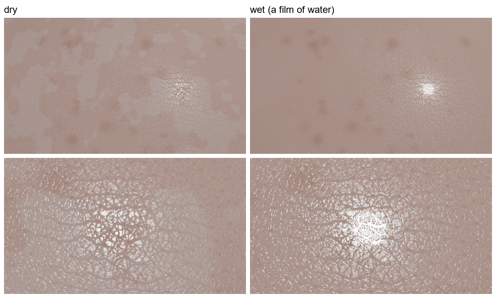

# 肌の保湿（化粧水・乳液）: 設計（2026-11-09）

**状態:** 段階 A（膜の形と鏡面の法線の分離、5.1 節）、段階 B（表面の散乱層、5.2 節）、段階 C（時間軸、5.3 節）、段階 D（薄い所を抜ける光への寄与、5.4 節）、段階 E（乳液、5.5 節）、段階 F（化粧水の後に乳液を重ねる、5.6 節）を実施済み。水で濡れる前と後の接写（小さく強い光源）は 5.7 節。濡れの画像統計（肌以外も）は `docs/WETNESS.md`。化粧（ファンデ）は未着手。文献値は `docs/SKIN_MOISTURE_REFS.md`（確度の記号つき）。式の中の**推論は、そう書いた**。

**言葉の注意（2026-11-10）:** この文書の「グロー」は、薄い所を**実際に抜ける光**（透け感）です。肌の「透明感」（正面から見た肌の、感性的な質。肌が実際に透明なわけではない）とは、別のものです。逆光の円錐（5.4〜5.6 節）は、仕組みの寄与を分けるための**計算上の診断**で、人の肌では測れず、肌の質感の実験で使われる条件でもありません。以前の版は、これを「半透明感」「研究の本題」と書いていました。なお、5.4 節の「2 つの描画を掛け合わせる」方法は、肌の材質の `randomWalk`（`docs/SSS.md` 14 節）で 1 回の描画に置き換えられますが、測り直してはいません。

## 1. なぜ作り直すか（最初の試作で分かったこと）

既存のつまみ（粗さ、`specular`、凹凸の深さ、アルベド）だけで「乾燥 / 塗った直後 / 乾いたあと」を描いたところ（`scenes/skin_moist_*.json`）、**塗った直後に皮溝の網目がくっきり出た**。現実の水膜は皮溝を埋めて表面を滑らかにするので、逆の向き。

原因: `CoatedDiffuse` は、鏡面（GGX）も、拡散も、表面下散乱の出射も、**同じ法線 `rec.n`（凹凸で曲げたもの）**を使う。滑らかなコートほど、皮溝の法線がそのまま鏡面反射に映る。実際の膜は、**溝の上でも滑らかな別の界面**で、鏡面反射は膜の上面の法線で決まり、皮溝の形（膜の下）は拡散の暗さにだけ効くはず。

## 2. 物理モデル

肌の上に、上から、(a) 膜（水、保湿成分、油）、(b) 角層の表面（皮溝、鱗屑）、(c) 角層の薄い散乱、(d) 表皮・真皮（既存の表面下散乱）。

### 2.1 膜の形: 溝にたまる（puddle）モデル
皮膚表面の高さを h_s(p)（既存の `SkinRelief::heightAt`。負 = くぼみ）、膜の上面を z_f(p) とする。

    z_f(p) = smoothmax( h_s(p), L )        （L は「満たす高さ」。smoothmax は、折れ目を丸める滑らかな最大値）
    t(p)   = z_f(p) − h_s(p) ≥ 0            （膜の厚さ。溝の底で厚く、山で 0）

- **L は、塗った量から決める。** 平均の厚さ h̄ = ⟨t⟩ = 量 / 密度。h_s のタイル（グラフ合成の高さマップ、または Worley のサンプル）の分布から、二分法で L を求める。少ない量では、最も深い毛穴と溝だけが満たされる（たまる）。
- 膜の上面の法線は、バンプと同じ式 n_f = normalize(n − ∇z_f)。満たされた溝の上では、ほぼ平ら（≈ 幾何法線）。山では、皮膚の法線に等しい。
- 毛細管力、表面張力の厳密な形は扱わない（推論: 谷にたまる形になる）。

### 2.2 鏡面反射: 膜の上面
- 鏡面（GGX）は、**n_f の座標系**で評価する。粗さは、膜のある所では膜の粗さ（水は非常に滑らか）、山（t ≈ 0）では皮膚の粗さ。被覆率 c(p) = 1 − exp(−t/t₀) で、粗さと係数を混ぜる（t₀ は、約 1 µm。画素内の混合の近似）。
- フレネル: 空気 → 膜の反射 R₁(θ, n_f)、膜 → 角層の反射 R₂（n_s = 1.55）。厚さが波長より十分大きいので**干渉は無視して、非干渉の和**: R ≈ R₁ + (1 − R₁)² R₂。
  - 水膜（1.33）: R₁(0°) = 0.020、R₂ = 0.0058。合計 約 0.026。乾いた角層（1.5 の既存のコート）の 約 0.04 より**低い**。つまり、濡れて「ぎらつく」のは、反射の量が増えるのではなく、**ハイライトが鋭く集中する**ため（既存の GGX の粗さの違いが出る）。
  - 保湿成分の膜（グリセリン 1.47）: R₁(0°) = 0.036、R₂ ≈ 0。
- 皮脂の膜が 0.5 µm 程度の所は、薄膜干渉が出うるが、扱わない（`docs/THIN_FILM.md` の機構を使えば、後で足せる）。

### 2.3 表面の散乱層（鱗屑と、角層の薄い散乱）
乾燥した肌が白っぽく見えるのは、はがれかけた層の**空気の隙間**が白色光を拡散反射するため（文献: 乾燥肌の鱗屑の画像解析。検索の要約）。肌の**局所の拡散反射**として、第 3 のローブを足す:

    ρ_s(p) = ρ₀ · σ(p) · f_match · f_hyd

- ρ₀: 乾いた肌の表面散乱の反射率（**未知。自由なパラメータとして変化させる**）。σ(p) ∈ [0, 1]: 鱗屑の分布（低周波の斑。ノイズで作る）。
- **f_match（屈折率の整合）**: 空気の隙間が、屈折率 n_f の液体で満たされると、界面の反射が減る。**界面ごとのフレネル反射の比**で見積もる: f_match = [ ((n_s − n_f)/(n_s + n_f)) / ((n_s − 1)/(n_s + 1)) ]²。水 → **0.125**、グリセリン → **0.015**、乾燥（n_f = 1）→ 1。（**単一の界面の見積もり**。隙間の満たされ方は、部分的なはず。推論。）
- **f_hyd（角層の水和）**: 角層の内部の屈折率のばらつきが、水和で減る（in vivo で散乱係数は減る方向。**量は未知**。H ∈ [0, 1]、f_hyd = 1 − κ_H H。κ_H を変化させる）。
- 局所の拡散反射が取る分は、表面下散乱に入る光から引く（エネルギー保存）: 入る光は (1 − ρ_s) 倍。

**時間に対して下の量を使う。**

    h_w(t) = h_w0 · exp(−t/τ_w)       （水の分。蒸発。τ_w は数分のはず。**未測定**）
    h_g    = h_w0 · (φ_g / (1 − φ_g)) × 密度比   （保湿成分の分。残る）
    n_f(t) = 体積で重みづけた平均（水 1.33、グリセリン 1.47）
    H(t)   = H∞ + (H₀ − H∞) exp(−t/τ_H)

h̄(t) = h_w(t) + h_g。時間は、「乾燥（膜なし）」「塗った直後（t = 0）」「乾いたあと（t ≫ τ_w）」の 3 点を、まず見る。

### 2.4 変えないもの（意図的）
- 表面下散乱（散乱距離、アルベド）は、そのまま。角層は 10〜20 µm と薄く、散乱の長さ（数百 µm〜mm）より 1〜2 桁薄いので、**角層の水和の効果は、真皮までを含む散乱ではなく、表面の薄い散乱（2.3）として表す**（`SKIN_MOISTURE_REFS.md` 6 節）。
- 色素（そばかすなど）、光沢の揺らぎ（皮脂の斑）は、そのまま重ねる。

## 3. エンジンの変更

| 場所 | 変更 |
|---|---|
| `Core/Interaction.hpp` | `SurfaceInteraction` に、膜の上面の法線 `ns`（0 なら `n` と同じ）、被覆率 `filmCover`、膜の屈折率 `filmIor`、表面散乱の反射率 `surfScatter` を足す（既存の `glossScale` と同じ作法で、ヒットごとに 1 回だけ） |
| `Materials/SkinFilm.hpp`（新） | 状態（h̄、n_f、H、ρ₀ など）、満たす高さ L の計算、点 p での {t, ns, c, ρ_s}。`SkinRelief` の高さを使う |
| `Materials/CoatedDiffuse.hpp/.cpp` | `setFilm()`。`perturbShading` で上の値を詰める。**鏡面（eval / sample / pdf）は `ns` の座標系**、拡散と表面下散乱は `n`。第 3 のローブ（局所の拡散）を、`lobeProbability`、`sample`、`pdf`、`eval` に足す。膜のフレネルは 2.2 |
| `src/Cli/SceneFile.cpp` | skin の `"film"`: `{ "doseMgCm2", "glycerin", "waterTauS", "scatter": { "rho0", "hydration", "kappaH" }, "timeS" }` ほか |
| `src/Cli/Checks/ReliefChecks.cpp` | 4 節の検査 |

**変えない:** `Integrator`（`perturbShading` の呼び出しは、そのまま）、LVC-BPT とフォトンマップ（凹凸と同じく、通らない）。`aovAlbedo` と、デノイザの法線は `n` のまま。

## 4. 確かめること（`--scene relief` に足す）

1. **回帰**: 膜なし（量 0、ρ₀ = 0）で、これまでの描画・数値と同じ（白色炉、`--scene relief` の既存の項目）。
2. **膜の厚さ**: 平均の厚さが、与えた量に一致（L の二分法）。量 0 → 厚さ 0、十分大きい量 → 全面が平ら（z_f = 一定）。
3. **法線**: 満たされた溝の上で、膜の法線が幾何法線にほぼ等しい。山の上で、皮膚の法線に等しい。
4. **エネルギー**: 白色炉で、膜・表面散乱ありでも、なしより明るくならない。
5. **ローブの整合**: `eval`、`sample`、`pdf` が、3 つのローブで一致（既存の検査と同じ作法）。相反性。
6. **屈折率の整合**: f_match が、n_f = 1 で 1、n_f = n_s で 0、水で 0.125。
7. **挙動**（情報）: 膜の量を増やすと、ハイライト内の皮溝のコントラストが**減る**（今回の誤りの逆）。

## 5. 実装の順序

| 段階 | 内容 | 見えること |
|---|---|---|
| A | 膜の形（puddle）+ 鏡面の法線の分離 + 膜のフレネル | 「塗った直後」に皮溝が埋まって、艶が滑らかになる（今回の誤りが直るか） |
| B | 表面の散乱層（鱗屑、f_match、f_hyd） | 乾燥肌の白さ、水・保湿成分での減少 |
| C | 時間軸（蒸発、保湿成分の残り）と JSON、3 状態のシーン | 乾燥 / 直後 / 乾燥後の接写。膜の量の掃引 |
| D | 薄い形を抜ける光の測定（逆光の透過） | 計算上の診断: どの機構が、透過をどれだけ変えるか |
| E | 乳液: 油膜（n 約 1.45、蒸発しない）+ 油滴の散乱（膜自体が局所の散乱層） | 化粧（ファンデ）への橋 |
| F | 重ね塗り: 製品ごとの層と塗った時刻、油膜の閉塞 | 化粧水の後の乳液が、何を足すか |

A だけで、描画できる。A の結果で、方向を確認してから B へ。

## 5.1 段階 A の結果（実装済み。2026-11-09）

**実装:** `Materials/SkinFilm.hpp`（満たす高さ L の二分法、膜の厚さ・被覆・上面の法線、膜のフレネル）、`CoatedDiffuse` の鏡面の法線の分離（`SurfaceInteraction::ns`、`filmCover`）、JSON の `film`、`SkinRelief::surface`。設計との違い: (1) 積分器は `|cos(rec.n, wi)|` で重みづけるので、膜の法線まわりの鏡面ローブは、`eval` の中で cos(ns, wi) / cos(n, wi) を掛けて、積分器の重みと打ち消した（`ns` がないときは、このコードは通らず、以前と同じ）。(2) 膜の被覆は、鏡面の粗さと反射率の混合にだけ使った（拡散・表面下散乱の出射のフレネルは、膜なしのまま。段階 B 以降）。

**検査**（`--scene relief` の 10。RGB・スペクトルとも PASS。既存の `sss`、`lights` も PASS）:
- 10a 平均の厚さが、頼んだ量に一致（1 / 5 / 20 µm で 0.998 / 4.97 / 19.96 µm）。**稀な点（毛穴）だけに膜がたまるので、L を決める標本が少ないと、1 µm と 5 µm で 4〜7% ずれた**（標本を 2 万点から 30 万点にして解決）。
- 10b 膜の上面の法線の傾き: 皮膚 9.8°、膜 0.5 µm で 8.6°、5 µm で 4.0°、40 µm で 0.003°。**膜が厚いほど平ら**になる。
- 10c 膜のフレネル反射: 水 0.0257（設計の予想どおり）、屈折率 1.55 で 0.0467。
- 10d `eval` と `sample` が同じアルベドを返す（拡散あり・表面下散乱あり）。
- 10e 白色炉（膜 10 µm）: 膜なしと 1〜2% 以内、1 を超えない。

**描画**（`skin_macro.json` に水の膜（屈折率 1.33、粗さ 0.02）だけを足した。600 px、160 spp、デノイズなし）: 膜の量 0 / 3 / 10 / 40 µm で、皮溝の網目が見えにくくなる。皮溝の線構造の指標（高域成分の隣接画素の相関。ノイズは 0 に近く、線は正）: 0.098 → 0.036 → 0.029 → 0.029。つまり、**前回の誤り（塗ると皮溝が目立つ）が逆向きに直った**。3 µm で大半が消え、10 µm で飽和する（皮溝が埋まりきる）。
- 平均の輝度は +1.7%（0 → 3 µm）。膜が、鏡面の反射率（0.04 → 0.026）を下げて、中に入る光が増えるため。**現実の「濡れると暗くなる」は、まだ出ていない**（段階 B の表面散乱層の仕事）。
- 小さい画像で、ノイズが多い。ハイライトの形の変化（鋭くなる）は、この構図ではほぼ見えない（光が一様に近い）。強い小さな光源での確認は、まだ。

## 5.2 段階 B の結果（実装済み。2026-11-09）

**実装:** `Materials/SkinScatter.hpp`（鱗屑の場 σ(p)、屈折率の整合 `match()`、水和 `f_hyd`）、`CoatedDiffuse` の第 3 のローブ（コートの下の白い Lambertian 反射。入る光の ρ_s を取り、残り (1 − ρ_s) を拡散ローブ・表面下散乱に回す。表面下散乱の枝は、確率 (1 − pS)(1 − ρ_s)・重み (1 − F)(1 − ρ_s) なので、比は変わらず (1 − F)/(1 − pS)）、`SurfaceInteraction::surfScatter`、JSON `"scatter": { rho0, frequency, threshold, softness, hydration, kappaH, gapUm, seed }`。膜があるとき、鱗屑の隙間が液体で満たされる割合は W = 1 − exp(−平均の厚さ / gap)（gap = 1 µm。これも目で決めた値）で、f_match = 1 − W (1 − match)。

**検査**（`--scene relief` の 11。RGB・スペクトルとも PASS。`sss`、`lights` も PASS）:
- 11a 屈折率の整合: 空気 1、屈折率 1.55 で 0、水 **0.1254**、グリセリン **0.0151**（設計の値）。
- 11b 鱗屑の場: 0 から ρ₀、斑状（0.5 ρ₀ 超が 45%）。水和 1 で 0.6 倍（κ_H = 0.4）、水膜 10 µm で 0.1255 倍、グリセリンで 0.0151 倍。
- 10d `eval` と `sample` が、鱗屑ありでも一致（拡散あり・表面下散乱あり）。
- 11c 白色炉（**2026-11-13 に作り直した**。固定の比率では、赤が揺れで落ちていた）: 3 本に分け、どれも対にした推定（同じ光線を両方の場面に撃つ）の差を 4 標準誤差で判定する。(1) **帳簿**: 滑らかな球・白い下地（A = 1）で鱗屑を載せても変わらない（表面下散乱ありは、鱗屑の割合 ρ の光が表面下の経路を通らなくなるので、その経路の損失 × ρ を許す）。(2) **局所モデル**: 肌の下地で、利得 = K × 平均[ρ(1 − A)² / (1 − ρA)]（K は同じ凹凸の白い下地から測るコートの係数）。表面下散乱なしでは厳密に一致する（実測 0.0074 / 0.0371 / 0.0523、予測 0.0070 / 0.0368 / 0.0521）。(3) 表面下散乱ありでは、入口と出口が別の斑に落ちるので、利得は局所モデル以下、下限は −ρ × 地平線の損失（曲げた法線のローブが幾何的な表面の下に捨てる約 1.2%。同じ実行で白い球の滑らか / 凹凸から測る）。水膜で戻り、1 を超えない。**（2026-11-11）表面下散乱なしの拡散ローブも、層の式（ρ + (1 − ρ)² R / (1 − ρ R)）にそろえた。以前は ρ + (1 − ρ) R で、足す明るさが 2〜4 倍に出ていた。** 以前「表面下散乱のある肌では、白い層で赤が約 1〜2% 暗くなる原因が未特定」と書いた現象の正体は `docs/SKIN.md` 6 節（検査の揺れ + 赤の利得の小ささ + 法線の損失の非対称）。
- 11d **濡れたときの向き**（白色炉の CIELAB。ρ₀ = 0.3、水膜 10 µm）: **L\* 84.0 → 80.8（暗く）、C\* 13.8 → 17.1（鮮やかに）**（表面下散乱あり: 84.1 → 81.2、13.9 → 17.4。スペクトル版も同じ向き）。鱗屑のない肌を同じ膜の下に置いたとき（L\* 80.4、C\* 17.7）とほぼ同じ所へ落ち着く。つまり、**暗く、彩度が上がるのは、白い散乱が消えたため**。Sawayama ら（2017）は、写真の統計と心理物理で、濡れた面が暗く、鮮やかに見える向きを示している（全文を読んだ。論文の内容と、その統計で描画を測った結果は `docs/WETNESS.md`）。この向きと一致する（モデルの帰結を確かめただけで、論文の数値との照合ではない）。

**描画**（`skin_macro.json` に鱗屑を足した。600 px、160 spp、デノイズなし。乾燥: ρ₀ = 0.12、膜なし / 塗った直後: 水 8 µm、水和 0.3 / 乾いたあと: グリセリン 0.6 µm、水和 1.0）: 乾燥では、白っぽい斑（鱗屑）が見え、塗った直後、乾いたあとでは斑が消えて、均一で桃色に寄る。画像全体（表示の sRGB → CIELAB）の平均:

| 状態 | L\* | C\* | HSV の S |
|---|---|---|---|
| 乾燥 | 64.77 | 9.45 | 0.1626 |
| 塗った直後 | 64.69（−0.08） | 9.93（+0.48） | 0.1702（+0.0076） |
| 乾いたあと | 64.53（−0.25） | 9.84（+0.38） | 0.1690（+0.0064） |

- **彩度は、期待の向きに上がった（C\* +5%）。暗くはほとんどならなかった**（L\* −0.1〜−0.25）。白色炉（11d）の −3 に比べて小さいのは、(1) ρ₀ = 0.12 と小さく（炉は 0.3）、被覆は半分、(2) 膜が鏡面の反射率を下げて（0.04 → 0.026）、拡散側を明るくするため。
- **暗さの大きさは ρ₀（未知）で決まる**。炉の比例から、ρ₀ が 0.1 増えるごとに L\* が約 1 下がる見積もり。ρ₀ は実測まで決められないので、掃引の結果として示す。
- 論文の「暗くなる」を、**肌の接写では再現できていない**（彩度の上昇だけ）。肌は色相が少ないので、論文の効果が弱い対象かもしれない（論文の主張は、色相の多様な画像ほど効果が大きい）。

## 5.3 段階 C の結果（実装済み。2026-11-09）

**実装:** `Materials/SkinLotion.hpp`（塗ってから t 秒後の状態: 水の分の蒸発、保湿成分の残り、膜の屈折率と粗さ（体積平均）、角層の水和（吸収と損失の差の形。t = 0 で 0、最大値 `hydrationPeak` が 1 回））。JSON の skin の `"lotion": { doseUm, glycerin, timeS, waterTauS, hydrationPeak, hydrationRiseS, hydrationDecayS, waterIor, humectantIor, waterRoughness, residueRoughness }`。**`film` の代わりに書く**（膜の厚さ・屈折率・粗さと、`scatter` の水和を、時刻の状態で上書きする）。実行すると、選ばれた状態が `[Lotion] ...` の行で出る。時間の掃引は、`timeS` だけを変えたシーンを描く（`out/` の外から、スクリプトで生成）。

    d(t) = dose (1 − φ) e^(−t/τw)  （水）  +  dose φ  （保湿成分。残る）
    H(t) = peak (e^(−t/τd) − e^(−t/τr)) / max

**既定値（どれも未測定。目安）:** dose 10 µm、φ = 5%、τw = 120 s、水和は、立ち上がり 60 s、ピーク 0.8（約 211 s）、減衰 1800 s。**化粧水の量は、重さを量れば決まり、蒸発の速さは、重さの時間変化で決まる**（実測の候補）。

**検査**（`--scene relief` の 12。RGB・スペクトルとも PASS）: 0 s で厚さ = dose、指数 1.337、水和 0。1 時定数で水が 1/e。10 時間で保湿成分だけ（0.5 µm、屈折率 1.47、粗さ 0.08）。厚さは単調に減り、屈折率は単調に増える。水和は、ピーク 0.8 が公式の時刻（211 s）にある。

**時間経過の描画**（`skin_macro.json` + `scatter`（κ_H = 0.3）+ `lotion`（既定）、450 px、96 spp、デノイズなし、各 約 35 秒）。乾燥に対する、画像全体の CIELAB（表示の sRGB）の差:

| 時間 | ρ₀ = 0.12: ΔL\* / ΔC\* | ρ₀ = 0.30: ΔL\* / ΔC\* |
|---|---|---|
| 乾燥（基準） | 64.73 / 9.53 | 65.57 / 8.61 |
| 0 s | −0.11 / +0.51 | −0.84 / +1.28 |
| 30 s | −0.10 / +0.49 | −0.83 / +1.28 |
| 120 s | −0.15 / +0.51 | −0.90 / +1.31 |
| 300 s | −0.29 / +0.49 | −0.89 / +1.14 |
| 900 s | −0.22 / +0.30 | −0.61 / +0.68 |
| 1800 s | −0.19 / +0.28 | −0.52 / +0.60 |
| 3600 s | −0.17 / +0.24 | −0.47 / +0.55 |

- **塗った直後から数分は、暗く（−）、鮮やか（+）で、水が蒸発する 300〜900 s にかけて戻り始める。** 保湿成分の膜（0.5 µm）が残るので、**1 時間後も、乾燥より少し暗く、鮮やかなまま**（ρ₀ = 0.30 で ΔC\* +0.55）。
- 画像では、乾燥時の白っぽい鱗屑の斑が、塗った直後に消え、900 s、3600 s で部分的に戻る（モンタージュ。保湿成分の膜が、隙間を水ほど満たさない: W = 1 − exp(−厚さ / gapUm) が薄い膜で小さいため。**gapUm は目で決めた値**）。
- **暗さは小さい**（ρ₀ = 0.12 で −0.1〜−0.3、0.30 で −0.5〜−0.9）。彩度の変化のほうが、相対的に大きい。段階 B と同じ結論（暗さの大きさは ρ₀ に比例）。
- 皮溝の線構造（隣接画素の相関）は、膜がある間は消え（0.034 → 0.00 前後）、保湿成分だけの膜（0.5 µm）でも戻らなかった。**0.5 µm の膜が毛穴だけにたまって、鏡面は平らだが、皮溝の網目まで埋めるとは限らない**ので、画像のノイズ（96 spp）を含めて、断定しない。

## 5.4 段階 D の結果: 薄い所を抜ける光に、どの機構が、どれだけ効くか（2026-11-09）

**問い:** 化粧水の 3 つの機構（M1 鱗屑の白いベール、M2 膜の光学、M3 水和による内部散乱の減少）の、薄い所の透過への寄与。物体は、厚さが連続して変わる**肌の円錐**（直径 20 mm → 3 mm）。後ろの細い光（グロー）と、前の面光源（ベール）を、別々に描いた。再現: `tools/studies/skin_moisture_cone.py`（シーンの生成と集計。描画は 1 枚 約 40 秒）。

### 検証で分かったこと: BSSRDF は、厚さ依存の透過に使えない
当初は、BSSRDF の描画で、状態どうしの比を取れば、薄い所の誤差は打ち消し合うと考えた。**確かめたら、打ち消し合わなかった。** 同じ光学定数の、体積のランダムウォークと比べた（円錐の中心軸、後ろから光を当てた透過、RGB の比）:

| 直径 | ランダムウォーク / BSSRDF（赤 / 緑 / 青） | 散乱距離を 1.3 倍にしたときの増え方: BSSRDF（赤 / 緑 / 青） | 同: ランダムウォーク |
|---|---|---|---|
| 4 mm | 23 / 12 / 6.3 | 0.97 / 1.2 / 1.8 | 1.3 / 1.9 / 3.1 |
| 8 mm | 13 / 5.5 / 3.6 | 1.1 / 1.6 / 3.9 | 1.6 / 2.2 / 4.5 |
| 12 mm | 6.9 / 3.6 / 0.8 | 1.1 / 2.2 / 8.1 | 1.8 / 2.6 / 32 |

BSSRDF の赤の透過は、厚さ 4〜16 mm でほぼ一定（0.11〜0.20）で、**厚さ依存を表せない**（プロファイルは、表面の 2 点間の距離だけを見る）。また、散乱距離の変化への感度が、ランダムウォークの 1/2 以下。したがって、**M3（内部散乱）の感度は、BSSRDF では測れない**。以前の「指で 0.44 倍」（`docs/SSS.md`）は、この条件では、もっと大きなずれ（円錐の薄い所で 5〜20 倍）だった。

### 方法（変更後）
- **内部散乱**は、ランダムウォークで描く（`walk_*`。散乱距離 1.0 / 1.038 / 1.24 / 1.3 倍）。
- **表面の層**（M1、M2）は、入口と出口にかかる係数なので、BSSRDF の描画の比（層あり / 層なし。散乱距離は同じ）をそのまま使える。
- グロー = ランダムウォーク(散乱距離) × 表面の係数。ベール = 前から照らしたときの BSSRDF の反射（厚い所で妥当。薄い所の BSSRDF の誤差は、未評価）。
- 実装: 鱗屑の層を、透けて出る光にも効かせた（`subsurfaceExitTint` に (1 − ρ) / (1 − ρ A)。A はアルベド。層の間の往復を含む）。`lotion` に `bulk`（水和 H のとき、散乱距離を 1 + bulk · H 倍）。

### 結果（グロー・ベールとも、状態ごと、乾燥に対する比。ρ₀ = 0.2、水の膜 8 µm、κ_H = 0.3、bulk = 0.3）

| 状態 | グロー（4〜16 mm） | ベール（前から） | 合成の ΔE\*ab（8 mm） |
|---|---|---|---|
| M1 鱗屑を消す | ×1.2〜1.3 | ×0.85〜0.94 | 6.6 |
| M2 膜の光学 | ×1.0 | ×1.14〜1.17 | 3.6 |
| M3 散乱距離 1.3 倍 | **×1.8〜2.5** | ×0.94〜0.97 | **26.5** |
| 塗って 200 秒後（すべて、散乱距離 1.24 倍） | ×1.6〜2.2 | ×0.86〜0.97 | 23.0 |
| 塗って 1 時間後（すべて、散乱距離 1.038 倍） | ×1.1〜1.2 | ×0.94〜0.99 | 8.3 |

- **M3（内部散乱の減少）が、最大の寄与**。散乱距離が 1.3 倍で、グローが約 2 倍。**グローは、散乱距離のべき乗（約 2.6〜3.4 乗）に比例する**ので、散乱が 10% 減ると、グローが 30〜40% 増える。**ただし、M3 の大きさ（水和でどれだけ散乱が減るか）は未測定**で、この表は「もし 1.3 倍なら」。
- **M1（鱗屑）は、グローを 20〜30% 増やし、ベールを 6〜15% 減らす**。実測がなくても、符号と桁が出る寄与だが、ρ₀（未測定）に比例する。
- **M2（膜の光学）は、グローにほぼ効かない**（±3%）。ベールは +14%（膜が鏡面の反射率を下げて、内部に入る光が増える）。膜は、透過ではなく、見た目の艶と、表面の反射に効く。
- **グローの色**: 水和すると、薄い所の赤み log(R/G) が下がる（4 mm で 1.63 → 1.29）。緑が増えて、赤みが薄れる（M3）。ただし、合成の彩度 C\* は上がる（グローが増えるため）。
- 時間経過: 200 秒後（水和のピーク）が最大で、1 時間後は、水和が引いて、鱗屑の効果（M1）だけが少し残る。

**合成の ΔE\*ab は、グローとベールの重み（8 mm で等しい明るさ）と白の取り方に依存する**ので、順位の目安にだけ使う。

### 限界
- **ベール**（前からの反射）は、BSSRDF（薄い所の誤差は未評価）。グローの表面の係数は、ランダムウォークでなく BSSRDF の比（層が入口・出口の係数であることに依拠）。
- ランダムウォーク側には、肌の表面の層（凹凸、膜、鱗屑）がなく、境界は粗い誘電体（屈折率 1.4）。膜による出口の内部反射の変化は、入っていない（M2 のグローへの寄与が小さいのは、そのため。入れると少し変わりうる）。
- **ρ₀、κ_H、bulk は未測定**。表は、条件つきの感度。
- 円錐は中立の刺激で、肌の透過の実測との照合は、していない。

## 5.5 段階 E の結果: 乳液（油滴を含む液）（2026-11-09）

**乳液の見方。** 水の中に油の滴（直径 約 1 µm）が散らばった液。(1) 塗った直後は、油滴が白い光を散乱して、**乳白色の層**になる。(2) 水が蒸発すると、油滴の周りが保湿成分（屈折率 1.47）になり、油（1.45）との屈折率が**整合して、散乱が消える**。油滴は合体もする。(3) 最後に、蒸発しない油と保湿成分の**透明な膜**が残る。

**実装:**
- `SkinLotion` に、油の量 `oil`、`oilIor`（1.45）、油滴の直径 `dropletUm`（1）、合体の時定数 `coalesceTauS`（600 s）、非対称性 `dropletG`（0.9）。状態の `emulsionTau` = 膜全体の**輸送光学厚** (1 − g) τ、τ = 1.5 Q h_oil / d × exp(−t / 合体の時定数)。Q は油滴 1 個の消光効率（**異常回折近似**、van de Hulst: Q = 2 − (4/ρ) sin ρ + (4/ρ²)(1 − cos ρ)、ρ = 2x(m − 1)、m = 油 / 周りの液体の屈折率、x = π d n / λ、λ = 550 nm）。**周りの液体は、水と保湿成分の混合**なので、水が減ると m → 1 となり、Q が下がる（屈折率の整合）。
- `CoatedDiffuse::setEmulsion`: 乳液の層を、**鱗屑の上の白い層**として足す（二流束 R = 0.75 τ' / (1 + 0.75 τ')。τ' は膜の局所の厚さに比例するので、**皮溝にたまった所ほど白い**）。上の層 R_e と下の層（鱗屑）R_f は、非吸収の 2 層として合成（R = R_e + (1 − R_e)² R_f / (1 − R_e R_f)）。入口と出口の両方にかかる。
- JSON: `lotion` に `oil`、`oilIor`、`dropletUm`、`coalesceTauS`、`dropletG`（`docs/SCENE_FILE.md`）。
- **検査**（`--scene relief` の 13。RGB・スペクトルとも PASS）: 13a 消光効率（m = 1 で 0、最大 3.17 が ρ = 4.085）、13b 時間経過（0 秒の輸送光学厚 0.090、600 秒で 8 × 10⁻⁵、10 時間後は 0。10 時間後の膜は、油 + 保湿成分の 1.3 µm、屈折率 1.458。初めの値を超えない）、13c 白色炉（**2026-11-13 に作り直した**: 11c と同じ 3 本。帳簿は膜が凹凸を要るので凹凸の下の白い球で（表面下散乱なしでは全ローブが同じ割合を失うので変化なし）、局所モデルは乳液の ρ = 0.75τ / (1 + 0.75τ) を膜の局所の厚さから点ごとに計算（表面下散乱なしで厳密に一致: 0.0112 / 0.0551 / 0.0766 対 0.0113 / 0.0559 / 0.0777）、青は表面下散乱なしで 4σ 以上明るく、ありでは暗くならない）。10d に乳液の層を加えた（`eval` と `sample` が一致）。

**接写の時間経過**（`skin_macro` + 鱗屑（ρ₀ = 0.2、κ_H = 0.3）+ 液。450 px、96 spp、デノイズなし）。乾燥に対する画像全体の ΔL\* / ΔC\*:

| 液 | 0 s | 60 s | 120 s | 300 s | 1800 s |
|---|---|---|---|---|---|
| 水の化粧水（10 µm） | −0.05 / +0.66 | −0.02 / +0.64 | −0.09 / +0.66 | −0.23 / +0.62 | −0.16 / +0.37 |
| 軽い乳液（10 µm、油 8%） | +0.43 / −0.14 | +0.36 / 0.00 | +0.22 / +0.16 | −0.12 / +0.52 | −0.18 / **+0.56** |
| こってりした乳液（20 µm、油 15%） | **+1.59 / −1.85** | +1.30 / −1.46 | +1.02 / −1.02 | +0.37 / +0.08 | +0.03 / **+0.58** |

- 乳液は、**塗った直後は明るく、彩度が下がる**（乳白色の層が、鱗屑の斑を隠し、全体を白くする）。水の化粧水は、逆（暗く、鮮やか）。数分で、乳白色は消え、**1800 秒後は、乳液のほうが、水の化粧水より、少し鮮やかなまま**（+0.56 〜 +0.58 対 +0.37）。残った油膜が、鱗屑との屈折率の差を小さいまま保つため（油 1.45 は、水 1.33 より、角層 1.55 に近い）。
- 白さの強さは、液の量と油の量に比例（こってりした乳液で、軽い乳液の約 4 倍）。

**薄い所を抜ける光への影響**（段階 D の円錐。こってりした乳液を、塗った直後（0 秒）と 1 時間後。グローは、ランダムウォークの散乱距離 × 表面の係数の比。ベールは前からの反射。乾燥に対する比）:

| 状態 | グロー（4〜16 mm） | ベール | 合成の ΔE\*ab（8 mm） |
|---|---|---|---|
| 塗った直後（0 秒） | **×0.85〜0.95** | **×1.14〜1.23** | 9.3（C\* 55.8 → 46.7、L\* 76.1 → 77.2） |
| 1 時間後 | ×1.23〜1.37 | ×0.95〜1.05 | 8.1（C\* 55.8 → 62.8） |

- **塗った直後は、透けた光が 5〜15% 減り、表面の反射が 14〜23% 増える**。つまり、**乳白色の層が、透けた赤い光を隠す**（彩度 C\* が下がる）。水の化粧水（0 秒で、鱗屑が消えて、グローが約 1.2 倍）と、逆の向き。
- **1 時間後は、グローが 1.2〜1.4 倍**で、水の化粧水（1.1〜1.2 倍）より大きい。残った油膜が、鱗屑を整合した状態に保つため。
- **この節の数値は、閉塞（5.6 節）を入れる前のもの**（乳液の水和は、水の化粧水と同じとしていた）。閉塞 0.3 を入れた測り直しでは、1 時間後のグローは 1.34〜1.45 倍、合成の ΔE\*ab は 11.1（C\* 55.8 → 65.2）。塗った直後は変わらない（×0.86〜0.97、ベール ×1.14〜1.22）。接写の表は測り直していない（接写は水和が鱗屑に少し効くだけなので、変化は小さいはず。未確認）。

**限界:** 異常回折近似は、m が 1 に近く、油滴が波長より大きい範囲の近似。油滴の大きさは単一の値（実際は分布）。合体の時定数、非対称性 g、油の屈折率は、目で決めた値。白さは波長によらない（550 nm）。**肌への吸収**（塗り込むと薄くなる）は、入っていない。乳液の光学定数の実測と照合していない。

## 5.6 段階 F の結果: 化粧水の後に乳液を重ねる（2026-11-09）

**問い:** 普通の順序（化粧水 → 乳液）で、乳液は何を足すか。塗る間隔（化粧水が乾く前か、乾いた後か）は効くか。

**文献:** 重ね塗りを、化粧水だけと比べた経時測定は、見つからなかった。使えたのは、油膜の閉塞の桁（鉱油・シリコーンで 2〜3 割、o/w 乳液は処方しだいで 0〜3 割、効くのは水が蒸発した後）と、塗った水が 30 分以内に蒸発する、という値（`SKIN_MOISTURE_REFS.md` 3.1。検索の要約のみ）。

### モデル（推論を含む）
- **膜は 1 つに混ざる。** 化粧水も o/w 乳液も、水が連続相なので、重ねたら 1 つの液になるとした（推論）。水、保湿成分、油を、層ごとに足す。油滴の白さは、混ざった液の屈折率で決まる。
- **水和。** 5.3 節の式は、「表面の水のたまり S が角層にしみ込み、角層の水和 H が失われる」2 段の線形モデルの解と同じ形。重ね塗りでは、塗るたびに S に足す（その製品だけなら `hydrationPeak` に達する量）。H は 1 を超えない。

      dS/dt = −S / τr
      dH/dt = k S − H (1 − occ) / τd
      occ(t) = occlusion × (1 − exp(−合体した油の厚さ / occlusionOil))

- **閉塞。** 油膜は、角層の水の損失を遅くする。数えるのは、**合体して膜になった油だけ**（水の中の油滴は、障壁にならない。文献の「水が蒸発した後に効く」に合わせた）。膜の水の蒸発は、遅くしない。`occlusion`（既定 0.3）、`occlusionOil`（1 µm）は、未測定。
- **入れていないもの:** 保湿成分が水を抱える効果（保湿成分入りの液は、2 時間後も蒸散の測定値が高い、という報告がある）、肌への吸収（塗り込み）、損失の 2 成分（数分と数時間）、先に塗った化粧水が、乳液のしみ込みを変える効果。

### 実装
`SkinLotion::Layer`（製品 1 つと、塗った時刻）、`SkinLotion::at(共通の値, 層のリスト, 時刻)`、`hydrationAt`（0.5 秒刻みの積分）。JSON は `lotion` の `layers`、`occlusion`、`occlusionOilUm`（`docs/SCENE_FILE.md`）。描画側（`CoatedDiffuse` など）は変えていない: 受け取るのは、その時刻の状態だけ。**1 層で油がなければ、これまでと同じ値**（閉塞がないとき、モデルは線形で、層の和が厳密）。**乳液 1 回だけの場合は、閉塞の分、水和が長持ちする側へ変わった**（5.5 節の注）。

**検査**（`--scene relief` の 14。RGB・スペクトルとも PASS）: 14a 1 層・閉塞なしで、積分が 5.3 節の式に一致（差 2 × 10⁻⁷）。14b 化粧水の 180 秒後に乳液: 直前は化粧水だけの膜（2.6 µm）、直後は 12.6 µm、10 時間後は保湿成分と油の 1.8 µm（体積が保存する）。14c 乳液（軽いもの: 10 µm、油 8%）の 1 時間後の水和は、閉塞 0 / 0.3 / 0.6 で 0.157 / 0.207 / 0.275（油がなければ、閉塞の値によらない）。水和は 1 を超えない。14d は水和の時間経過の表（情報）。

### 測定
段階 D の円錐（グロー = 後ろからの光、ベール = 前からの光。乾燥に対する比）。液は、水の化粧水（10 µm、保湿成分 5%）と、こってりした乳液（20 µm、油 15%）。**時間は、最後に塗ってから**。再現: `tools/studies/skin_moisture_layers.py`（シーン 50 個、開発用ビルドで 1 枚 約 30 秒、全部で約 27 分）。

グロー（直径 4〜16 mm の範囲）と、角層の水和 H:

| 手入れ | 直後 | 200 秒後 | 30 分後 | 1 時間後 |
|---|---|---|---|---|
| 化粧水だけ | ×1.14〜1.23（H 0） | ×1.58〜2.15（0.80） | ×1.21〜1.52（0.34） | ×1.08〜1.21（0.13） |
| 乳液だけ | **×0.86〜0.97**（0） | ×1.46〜1.94（0.81） | ×1.40〜1.74（0.44） | ×1.34〜1.45（0.21） |
| 化粧水、60 秒後に乳液 | ×1.12〜1.41（0.56） | ×1.57〜2.17（1.00） | ×1.50〜1.90（0.54） | **×1.34〜1.51**（0.26） |
| 化粧水、600 秒後に乳液 | ×1.21〜1.52（0.67） | ×1.59〜2.17（1.00） | ×1.48〜1.83（0.54） | ×1.33〜1.50（0.26） |

ベール（前からの反射）:

| 手入れ | 直後 | 200 秒後 | 30 分後 | 1 時間後 |
|---|---|---|---|---|
| 化粧水だけ | ×1.02〜1.12 | ×0.85〜0.97 | ×0.92〜0.98 | ×0.94〜0.98 |
| 乳液だけ | ×1.14〜1.22 | ×1.02〜1.12 | ×0.92〜1.04 | ×0.94〜1.06 |
| 化粧水、60 秒後に乳液 | ×1.14〜1.21 | ×1.05〜1.14 | ×0.92〜1.05 | ×0.94〜1.06 |
| 化粧水、600 秒後に乳液 | ×1.12〜1.21 | ×1.01〜1.12 | ×0.93〜1.05 | ×0.94〜1.07 |

閉塞の強さ（化粧水、60 秒後に乳液。乳液の 1 時間後）:

| `occlusion` | 水和 H | グロー（4〜16 mm） | 合成の ΔE\*ab（8 mm） |
|---|---|---|---|
| 0 | 0.16 | ×1.25〜1.38 | 9.4 |
| 0.3（既定） | 0.26 | ×1.34〜1.51 | 13.0 |
| 0.6 | 0.44 | ×1.43〜1.74 | 14.5 |

- **乳液を重ねると、1 時間後のグローは、化粧水だけの 1.1〜1.2 倍から、1.3〜1.5 倍になる。** 油膜が、鱗屑を屈折率の整合した状態に保ち（閉塞 0 でも ×1.25〜1.38）、水の損失を遅くする（閉塞 0.3 で、さらに +0.1 前後）。
- **ただし、乳液だけ（×1.34〜1.45）と、ほぼ同じ。** 下の化粧水の寄与は、方法の誤差（下の「精度」）に埋もれる大きさ。乳液自身が水を運び（液の 8 割が水）、角層の水和が上限に達するため。
- **塗る間隔（60 秒と 600 秒）は、効かなかった**（1 時間後の H は 0.264 と 0.262）。理由は同じ。
- **先に化粧水があると、乳液を塗った直後のグローの落ち込みがなくなる。** 乳液だけでは、乳白色の層が透けた光を隠して ×0.86〜0.97。化粧水の後なら、角層がすでに水和しているので ×1.1〜1.5。表面の白さ（ベール ×1.14〜1.21）は、どちらも同じ。
- **閉塞の強さが、1 時間後を決める**（0 → 0.6 で、H が 0.16 → 0.44、グローが 8 mm で 1.29 → 1.52 倍）。この値は未測定で、文献の桁（0〜3 割）の中でも、結論の大きさが変わる。

**結論 2・3 は、仮定の帰結。** 「どの製品も、単独のときと同じだけ水を角層に運ぶ」「水和は 1 で頭打ち」と置いたので、後から塗った乳液が、それまでの履歴を上書きする。化粧水が乾く前に重ねるべきか、という問いに、このモデルは「差がない」と答えるが、**確かめたのは仮定の帰結で、現実ではない**。角層水分計で、化粧水だけ / 乳液だけ / 重ね塗り（間隔 2 通り）を 1 時間追えば、判定できる。

**接写の時間経過**（5.5 節と同じ条件: `skin_macro` + 鱗屑（ρ₀ = 0.2、κ_H = 0.3）、450 px、96 spp、デノイズなし）。乾燥に対する画像全体の ΔL\* / ΔC\*。時間は、化粧水を塗ってから:

| 手入れ | 0 s | 60 s | 120 s | 360 s | 960 s | 1860 s | 3660 s |
|---|---|---|---|---|---|---|---|
| 化粧水だけ | −0.05 / +0.66 | — | −0.08 / +0.65 | −0.23 / +0.55 | −0.17 / +0.40 | −0.14 / +0.35 | −0.13 / +0.32 |
| 60 秒後に乳液 | （同じ） | **+1.62 / −1.86** | +1.34 / −1.46 | +0.40 / +0.07 | +0.10 / +0.52 | +0.10 / +0.53 | +0.10 / **+0.53** |

- 乳液を重ねた瞬間に、白く、彩度が下がる（乳液だけのとき（+1.59 / −1.85）と同じ大きさ）。6 分で、ほぼ消える。
- **16 分より後は、化粧水だけより鮮やかなまま**（ΔC\* +0.53 対 +0.32〜0.40）で、1 時間たっても戻らない。化粧水だけでは、乾くにつれて鱗屑の斑が戻る。
- 明るさの差（+0.10 対 −0.13）は小さく、ノイズの大きさを測っていないので、向きは断定しない。
- 化粧水だけの行は、5.5 節の表（0 s で −0.05 / +0.66）を再現した。

**精度（確かめた範囲）:** グローは、(1) ランダムウォークを、描画した散乱距離（1.0 / 1.038 / 1.12 / 1.24 / 1.3 倍）の間で、べき乗で補間した。1.12 倍を、両隣から補間した値は、描画の 0.93〜1.01 倍。(2) 表面の層の係数を、内部散乱の変化を切った描画（`bulk` なし）から取った。5.4 節の方法（`bulk` あり、同じ散乱距離の参照）との比は 0.96〜1.01。合わせて、**±5% 程度**。

**限界:** 上の仮定のほか、乳液は 1 種（こってり）。塗り込み（こすって広げる、肌への吸収）なし。閉塞、合体の時定数、水和の時定数は未測定。円錐は中立の刺激で、肌の実測との照合はしていない。

## 5.7 水で濡れる前と後: 小さく強い光源での接写（2026-11-09）

**問い:** 5.1〜5.6 節の接写は、面光源（ソフトボックス）で、差が小さかった（画像全体の ΔL\* は 1 未満）。艶の違いが出る照明なら、濡れる前と後は見分けられるか。化粧水ではなく、ただの水。新しいコードはない（`film` と `scatter` だけ）。

**条件:** `scenes/skin_macro.json` の主光源を、直径 16 mm の球（距離 25 cm、カメラの鏡面方向の少し横）に替えた。乾いた肌は、鱗屑あり（ρ₀ = 0.2）、膜なし（`scenes/skin_lamp_dry.json`）。濡れた直後は、水の膜（屈折率 1.33、粗さ 0.02）を平均 5 µm（`scenes/skin_lamp_wet.json`）と 20 µm。水和は 0（濡れた直後）。1000 × 563、384 spp、デノイズなし、開発用ビルドで 1 枚 5〜7 分。

（左: 乾いた肌。右: 水の膜 5 µm。下段は、ハイライトの周り 320 × 180 画素の拡大。）

| 状態 | L\* | C\* | 白く飛んだ画素 |
|---|---|---|---|
| 乾いた肌 | 62.97 | 9.59 | 0% |
| 水の膜 5 µm | 62.38（−0.6） | 10.60（+1.0） | 0.03% |
| 水の膜 20 µm | 61.80（−1.2） | 10.94（+1.4） | 0.14% |

- **差は、はっきり見える。** 乾いた肌は、白っぽい斑があり、ハイライトは広く、暗く、皮溝の網目で細かく割れる。濡れると、斑が消え、ハイライトに明るく鋭い芯ができる。見分けの手がかりは、色（少し暗く、鮮やか。向きは 5.2 節と同じ）より、**ハイライトの形と、斑の有無**。
- **膜の厚さで、絵が変わる。** 5 µm では、芯の周りに皮溝の網目が残る。20 µm では、膜が皮溝を埋めて平らになり、光源が丸くそのまま映る（ガラスを被せたように見える）。現実の濡れた肌は、水が玉になり、厚さがむらになるはずで、20 µm の絵は整いすぎている。
- **肌に残る水の量は、未測定**（5 µm、20 µm は仮の値）。斑の見え方は ρ₀（未測定）に比例する。

**限界:** 水滴（肌は水をはじいて玉になる）、流れた跡、厚い水の層の中の多重反射による暗さは、モデルにない。画像全体の平均（L\*、C\*）は 1 枚ずつの値で、ノイズの大きさは測っていない。

## 6. 未知のパラメータと扱い

| パラメータ | 扱い |
|---|---|
| `occlusion`（油膜が水の損失を止める割合）、`occlusionOil` | 掃引（0〜0.6）。1 時間後の水和とグローを決める。実測できる（角層水分計、蒸散計） |
| ρ₀（乾いた肌の表面散乱） | 掃引（0〜0.1 程度）。**ここが、結論の大きさを決める** |
| κ_H（水和による散乱の減少） | 掃引（0〜0.5） |
| 化粧水の量（mg/cm²）、τ_w、グリセリンの割合 | 掃引。実測できる（重さを量る） |
| 膜の濡れ広がり t₀（約 1 µm） | 固定。感度を確かめる |

結論は、「X なら Y になる」の形で書き、実測と一致したとは書かない。

## 7. 限界（先に書いておく）
- 膜の上面は、凹凸の高さからの近似（毛細管力、流れ、吸収はない）。膜の厚さ ≳ 数 µm のみ（薄膜干渉なし）。
- 凹凸は法線だけ（影、相互反射なし）。膜の下の皮溝の見え方は、拡散の暗さ（毛穴の暗さ）に頼る。
- 表面の散乱層は、局所の拡散反射 1 つ（鱗屑の 3 次元の形はない）。
- 光は、経路追跡の積分器だけ（LVC-BPT、フォトンマップは通らない）。
