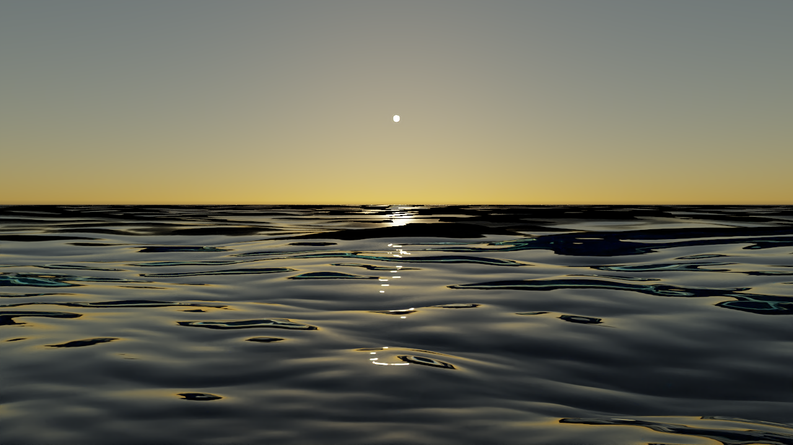

# 水: 海面の波と太陽のきらめき

低い太陽の海を描くために、**風から決まる波のスペクトル**で海面を作り、遠くで見えなくなる小さな波の傾きを**粗さとして返す**ようにした。結論: 太陽のきらめきの帯は、波の傾きの分布で決まり、その分布は、風速と、解像できない小さな波の両方から来る。

## 1. 何を足したか

| 物 | 場所 |
|---|---|
| 波のスペクトルから海面を作る（`MakeOceanWaves`、`MakeOceanMesh`） | `include/Geometry/ProceduralMesh.hpp`、`src/Geometry/ProceduralMesh.cpp` |
| シーンファイルの `"shape": "ocean"` | `docs/SCENE_FILE.md` |
| 遠くほど粗くなる水の材質（`Dielectric::setDistanceRoughness`、JSON の `distanceRoughness`） | `include/Materials/Dielectric.hpp` |
| 自己チェック `--scene ocean` | `src/Cli/Checks/OceanChecks.cpp` |
| 作例 `scenes/ocean_sunset.json` と、低い太陽の空 `assets/env/sky_el8.hdr`（`tools/data/make_sky.py --sun-el 8 --sun-dir 0 -1`） | |

## 2. 仕組み

- **波のスペクトル。** 風速 U（10 m の高さ、m/s）から、Pierson–Moskowitz のスペクトル S(ω) = α g² ω⁻⁵ exp(−β (g / (U ω))⁴) を作る（α = 8.1e-3、β = 0.74）。波の山を鋭くする JONSWAP の係数（γ）も指定できる。向きは、風に対して cos^(2s)(θ/2) に広がる。
- **波の足し合わせ。** 深い水の分散関係 ω² = g k で、スペクトルを波数ごとの密度 S(k) にし、(log k, 向き) の箱ごとに平面波を 1 つ選ぶ（波数、向き、位相を、箱の中でランダムにずらす）。各波の振幅は、その箱のエネルギー a = √(2 S(k) Δk D(θ) Δθ)。1344 個の波の和が、海面の高さになる。格子の繰り返し（タイリング）はない。Tessendorf（2001）の FFT による海面は、同じ和を、規則正しい格子の上で、FFT で速く評価する方法。水平線へ視線が向く構図では、繰り返しが見えるので、円形のメッシュで直接足している。
- **とがった波頭。** 横方向の変位（Gerstner 波）を `chop` で足し、波頭をとがらせる。
- **円形のメッシュ。** 原点の周りに、リングの間隔が等比で広がる格子（近くは細かく、遠くは荒い）。その場所の格子で解像できない短い波は、少しずつ弱めて消す。
- **遠くの粗さ。** メッシュで解像できない小さな波の傾きは、水の材質の粗さとして戻す（`distanceRoughness`: 近くは滑らか、遠くは粗さ 0.52、つまり GGX の α ≈ 0.27）。値は、Cox–Munk（1954）の傾きの分散（風速 10 m/s で 0.054）から決めた。こうしないと、遠くのきらめきの帯が細くなりすぎる。
- **水の中。** 水は、開いた 1 枚の面で、その下に、吸収（純水、Pope & Fry 1997）と少しの散乱（粒子、前方にとがった位相関数）を持つ媒質がある。光が水に入ると、媒質の中を進み、戻ってきた光が、水の色になる。

## 3. 確かめたこと（`--scene ocean`、PASS）

- 波の集合の高さの分散と傾きの分散が、元のスペクトルの積分と、4% 以内で一致（風速 6、10 m/s、γ = 1 と 3.3）。
- Pierson–Moskowitz で、スペクトル全体の分散が 0.0027 U⁴/g² に一致し、使っている波が、その 99.99% を持つ（有義波高 2.13 m、0.21 U²/g = 2.14 m）。
- ランダムな 4 万点の高さの平均が 0、分散が波の集合の値に一致（0.1166 と 0.1162）。
- 分散関係 ω² = g k、波が位相速度 √(g/k) で動く（相対誤差 1e-13）。
- 向きの分布が cos^(2s)(θ/2) に従う。
- 傾きの分散を Cox–Munk と比べると、風速 6 m/s では近く、風が強いほど、波のスペクトルのほうが小さい（14 m/s で 2.4 倍）。Pierson–Moskowitz は、傾きが風速でほとんど増えない（飽和する）が、本物の海は、短い波が風とともに増える。そこで、遠くの粗さは、Cox–Munk から決めた。

## 4. 作例

**低い太陽の海**（`scenes/ocean_sunset.json`。風速 10 m/s、波は手前へ向かって来る、太陽は水平線の上 8°、1280×720、192 spp、デノイズあり。約 2.5 分）:

- 太陽の下に、細かく砕けたきらめきの帯ができる。帯の幅と形は、波の傾きの分布で決まる。
- 手前の波の谷には、水の色（青緑）が見える。光が水の中へ入り、散乱して戻ってきた分。
- 空の色が、波の面に、フレネル反射で映る（視線が浅いほど強い）。

## 5. 限界

- 白波（泡）はない。
- 水の中の太陽（水中の光の筋、海底のコースティクス）は、水の中から太陽へ影の光線を飛ばさない（媒質内の光源サンプリングを使っていない）ので、出ない。水の色は、空から来る光が作る。
- 水の散乱の係数は、目で決めた（測定値ではない）。
- 波のスペクトルは、短い波が弱い（Pierson–Moskowitz）。表面張力の波（毛細管波）はない。
- 海底がない（深い海）。浅い海と海底は、`--scene sea`。
- 静止画（`time` で、波の動きを 1 コマずつ作ることはできる）。

## 6. 次の候補

1. 白波と泡（波頭の、横方向の変位が折り返す所）。
2. 水の中の光（媒質内の光源サンプリングを、屈折する水面に対応させる）。
3. 浅い海と海底のコースティクス。

## 参考文献

- Tessendorf, "Simulating Ocean Water", SIGGRAPH course notes, 2001。
- Pierson & Moskowitz, "A proposed spectral form for fully developed wind seas based on the similarity theory of S. A. Kitaigorodskii", J. Geophys. Res. 69, 1964。
- Hasselmann et al., "Measurements of wind-wave growth and swell decay during the Joint North Sea Wave Project (JONSWAP)", 1973。
- Cox & Munk, "Measurement of the roughness of the sea surface from photographs of the sun's glitter", J. Opt. Soc. Am. 44, 1954。
- Pope & Fry, "Absorption spectrum (380-700 nm) of pure water. II. Integrating cavity measurements", Applied Optics 36, 1997。

（書誌は記憶から書いた。公開前に照合する。）
