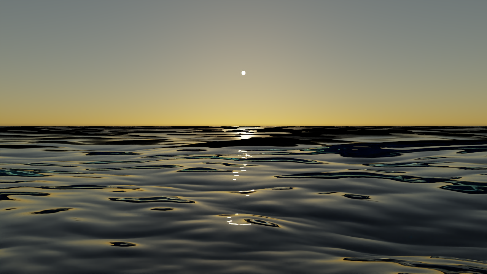

# Water: ocean waves and the glitter of the sun

To draw an ocean under a low sun, the ocean surface is built from a **wave spectrum determined by the wind**, and the slopes of the small waves that disappear in the distance are **returned as roughness**. Result: the band of sun glitter is determined by the distribution of wave slopes, and that distribution comes both from the wind speed and from the small waves that cannot be resolved.

## 1. What was added

| Item | Where |
|---|---|
| Building the ocean surface from a wave spectrum (`MakeOceanWaves`, `MakeOceanMesh`) | `include/Geometry/ProceduralMesh.hpp`, `src/Geometry/ProceduralMesh.cpp` |
| `"shape": "ocean"` in the scene file | `docs/SCENE_FILE.md` |
| A water material that gets rougher with distance (`Dielectric::setDistanceRoughness`, `distanceRoughness` in JSON) | `include/Materials/Dielectric.hpp` |
| Self-check `--scene ocean` | `src/Cli/Checks/OceanChecks.cpp` |
| Example `scenes/ocean_sunset.json`, and the low-sun sky `assets/env/sky_el8.hdr` (`tools/data/make_sky.py --sun-el 8 --sun-dir 0 -1`) | |

## 2. How it works

- **Wave spectrum.** From the wind speed U (at 10 m height, m/s), the Pierson-Moskowitz spectrum S(ω) = α g² ω⁻⁵ exp(−β (g / (U ω))⁴) is built (α = 8.1e-3, β = 0.74). The JONSWAP coefficient (γ), which sharpens the wave peak, can also be given. The directions spread around the wind as cos^(2s)(θ/2).
- **Summing the waves.** With the deep-water dispersion relation ω² = g k, the spectrum becomes a density S(k) per wavenumber, and one plane wave is chosen for each (log k, direction) bin (wavenumber, direction and phase are randomly jittered within the bin). The amplitude of each wave is the energy of its bin, a = √(2 S(k) Δk D(θ) Δθ). The sum of 1344 waves is the height of the ocean surface. There is no repetition of a grid (tiling). The FFT ocean of Tessendorf (2001) evaluates the same sum quickly with an FFT on a regular grid. In a composition where the view goes toward the horizon the repetition would be visible, so the sum is taken directly on a circular mesh.
- **Sharp crests.** A horizontal displacement (Gerstner wave) scaled by `chop` is added to sharpen the crests.
- **Circular mesh.** Around the origin, a grid whose ring spacing grows geometrically (fine near, coarse far). Short waves that the local grid cannot resolve are gradually weakened until they vanish.
- **Roughness in the distance.** The slopes of the small waves that the mesh cannot resolve are returned as the roughness of the water material (`distanceRoughness`: smooth near, roughness 0.45 far away, that is GGX α ≈ 0.20). The value was chosen from the slope variance of Cox-Munk (1954) (0.054 at a wind speed of 10 m/s). Without it, the glitter band in the distance becomes too thin.
- **Inside the water.** The water is a single open surface with, below it, a medium with absorption (pure water, Pope & Fry 1997) and a little scattering (particles, a forward-peaked phase function). Light that enters the water travels through the medium, and the light that returns gives the color of the water.

## 3. What was checked (`--scene ocean`, PASS)

- The height variance and slope variance of the wave set agree with the integrals of the original spectrum within 4% (wind speeds 6 and 10 m/s, γ = 1 and 3.3).
- For Pierson-Moskowitz, the variance of the whole spectrum agrees with 0.0027 U⁴/g², and the waves used hold 99.99% of it (significant wave height 2.13 m, 0.21 U²/g = 2.14 m).
- The mean of the heights at 40,000 random points is 0, and the variance agrees with the value of the wave set (0.1166 and 0.1162).
- The dispersion relation ω² = g k, and the waves move at the phase speed √(g/k) (relative error 1e-13).
- The directional distribution follows cos^(2s)(θ/2).
- Comparing the slope variance with Cox-Munk: close at a wind speed of 6 m/s; the stronger the wind, the smaller the wave spectrum's value (2.4 times at 14 m/s). In Pierson-Moskowitz the slope hardly increases with wind speed (it saturates), whereas on a real ocean the short waves grow with the wind. So the roughness in the distance was set from Cox-Munk.

## 4. Example

**Ocean under a low sun** (`scenes/ocean_sunset.json`. Wind speed 10 m/s, the waves come toward the viewer, the sun is 8° above the horizon, 1280×720, 128 spp, denoised. About 2.5 minutes, recorded earlier and not re-measured):

- Under the sun a band of finely broken glitter appears. The width and shape of the band are determined by the distribution of wave slopes.
- In the troughs of the nearby waves the color of the water (blue-green) is visible: the light that went into the water, scattered and came back.
- The color of the sky is reflected on the wave surfaces by Fresnel reflection (stronger at grazing view angles).

## References

- Tessendorf, "Simulating Ocean Water", SIGGRAPH course notes, 2001 (depending on the edition of the notes the year differs, 2001 / 2002; the copyright notice is 1999-2001).
- Pierson & Moskowitz, "A proposed spectral form for fully developed wind seas based on the similarity theory of S. A. Kitaigorodskii", J. Geophys. Res. 69(24), 5181-5190, 1964.
- Hasselmann et al., "Measurements of wind-wave growth and swell decay during the Joint North Sea Wave Project (JONSWAP)", Deutsche Hydrographische Zeitschrift, Reihe A (8°), Nr. 12, 1973 (16 authors, Hasselmann is the first).
- Cox & Munk, "Measurement of the roughness of the sea surface from photographs of the sun's glitter", J. Opt. Soc. Am. 44(11), 838-850, 1954.
- Pope & Fry, "Absorption spectrum (380-700 nm) of pure water. II. Integrating cavity measurements", Applied Optics 36(33), 8710-8723, 1997.

(The bibliographic details were checked by web search on 2026-11-09.)
